

# 🔷 Arcalyse

### *Your Capella model, inside and out.* · *Votre modèle Capella, sous toutes ses coutures.*

**Explore, check and understand a Capella / ARCADIA model — in a single HTML file.**

No installation · no server · works offline

**[English](#english)** · **[Français](#français)**

📘 **[User guide / Guide d'utilisation](docs/GUIDE-UTILISATION.md)** — menu by menu, with screenshots · menu par menu, avec captures d'écran

🛠 **Arcature**, the editing tool for Capella and SysML v2 files, is being finalized · **Arcature**, l'outil de modification des fichiers Capella et SysML v2, est en cours de finalisation.

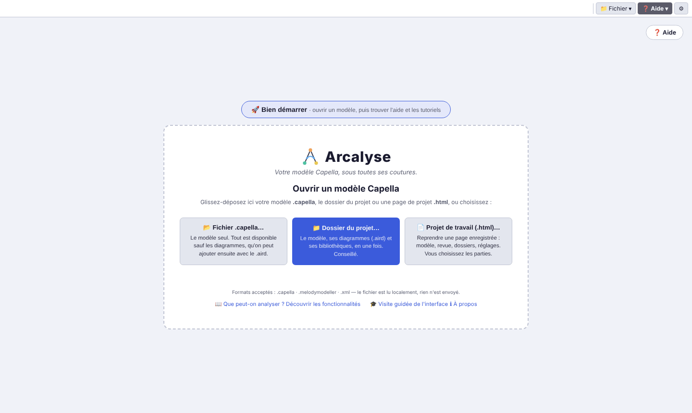

---

# English

## Why Arcalyse?

A Capella model grows fast: hundreds of functions, exchanges, components and ports, spread over five layers. In the workbench, each diagram only shows a piece of it. **Arcalyse reads the `.capella` file directly** and gives you, in a few seconds, an overview, Capella-style views and consistency checks — without opening Capella, without installing anything.

- 📂 **Drag and drop** your `.capella` file: the model is analysed in the browser, on your computer.
- 🔌 **Offline**: a single standalone HTML file (D3 library embedded), usable without a connection.
- 🧭 **All ARCADIA layers**: OA, SA, LA, PA, EPBS — functions, components, exchanges, chains, scenarios, requirements, properties.
- 🔲 **Capella diagrams**: with the project's `.aird`, the diagrams are drawn as in Capella, browsable and exportable as sheets (PDF, ZIP, HTML).
- 💬 **Review**: comments and notes on the elements and the diagrams, severity, assignees, due dates, check after each new version of the model, report.
- 🩺 **Ready-to-use checks**: unallocated elements, unconnected ports, incomplete traceability, names to review…
- 📤 **Exports everywhere**: CSV, PNG, SVG, PDF, standalone HTML reports, dashboards printable in A4.
- 🔄 **File watch**: Arcalyse detects new versions of the `.capella` file and shows what changed.
- 🏠 **Project home**: project information, checklists, review plans and whiteboards, saved with the model.
- 📄 **Your work follows the new versions of Arcalyse**: open a project page saved with an earlier version (2.1 or later) in the new one, everything is carried over.

## What you can do

### 🏠 Start from the project home
When a model or a project is opened, the **🏠 Home** view shows the project at a glance, on cards you can rearrange (drag, width, hide): Capella project, file and **Capella version**, loaded diagrams per layer, last model update, editable **project sheet** (purpose, milestone, version, owner, team, notes), model content per layer, review status, and shortcuts to the views.
- **☑ Checklists and 📋 review plans**: empty or from ARCADIA templates (model quality, OA, SA, LA, PA reviews); diagrams and elements are **dragged onto the items** and stay clickable. The **review plan** gathers purpose, milestone, date, participants and roles, decision, **scope** (diagrams and elements), entry criteria, checkpoints, exit criteria and actions; printable HTML, reusable `.json`.
- **🧾 Whiteboards**: notes, free text, rectangles, ellipses, lines and arrows (filled or not), diagrams and elements as **clickable icons**.
- **⧉ Separate windows**: a checklist, a plan or a whiteboard opens in its own window (another screen); diagrams of the **🔲 Capella Diagrams** list and elements of the **🧭 Explorer** or **⚡ Chains** can then be dragged into it.

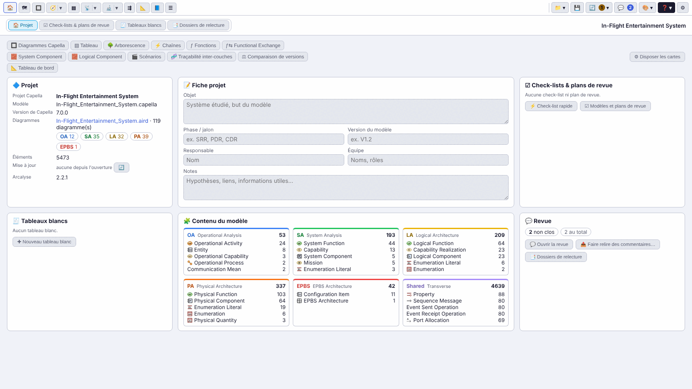

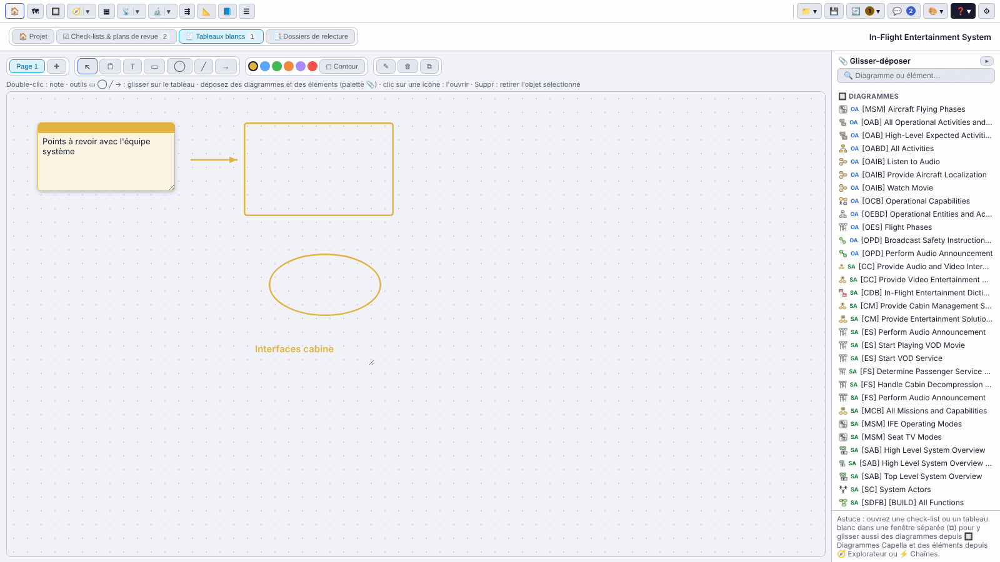

### 🔲 Open the Capella diagrams
Load the project's **`.aird`** file (or open the **📁 project folder**: the `.capella` and its diagrams are loaded together) and the **Capella diagrams** are drawn as in Capella — architecture, breakdown, data flow, class, mode & state, scenario diagrams… — read-only, without Capella installed:
- an **explorer** grouped by layer (OA, SA, LA, PA, EPBS) and, if you wish, by diagram type (OA › OAB…), with collapsible groups, filter and adjustable width;
- a **steady toolbar** on two rows (the diagram name, search, theme and export; then review notes, chains, filters, zoom, minimap), which no longer moves from one diagram to the next;
- zoom, search in the diagram, **minimap** below the explorer (or inside the diagram), highlighting of a functional chain or physical path (only those **drawn in the diagram** are offered), filters (ports, labels, exchange categories);
- **click an element** to open its details; conversely, the details panel lists the diagrams where the element appears and opens them centred on it;
- **export of several diagrams at once** as framed **sheets**: header (layer, acronym, name, type), Capella description and represented element, title block (project, layer, content, sources, date, sheet number), appendix of the represented elements — as **PDF** (contents, bookmarks; warning if the file may be heavy), **PNG / SVG ZIP** (one folder per layer, one appendix CSV per diagram) or standalone **HTML report**, with a live preview;
- **new version of the model**: after a 🔄 update, the `.aird` is re-read from disk (project folder) or the up-to-date one is requested; the diagrams of a previous model are removed when another model is opened; the `.aird` is saved in the 💾 HTML page;
- **⚖ diagram comparison** with a previous `.aird` (kept automatically at each update): new, deleted, renamed diagrams, elements added to or removed from a diagram, layout-only changes, diagrams showing elements missing from the model or affected by the model changes.

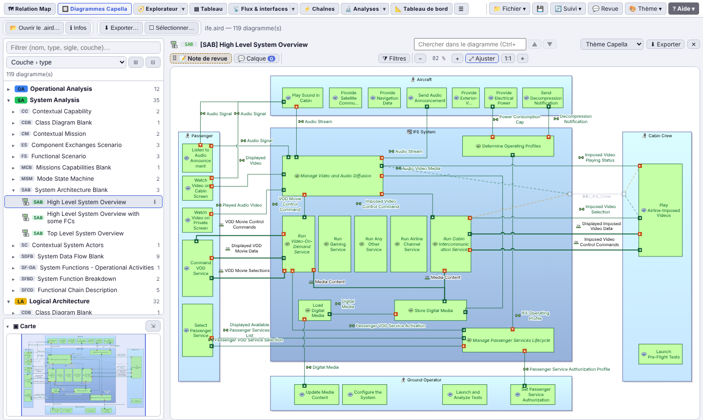

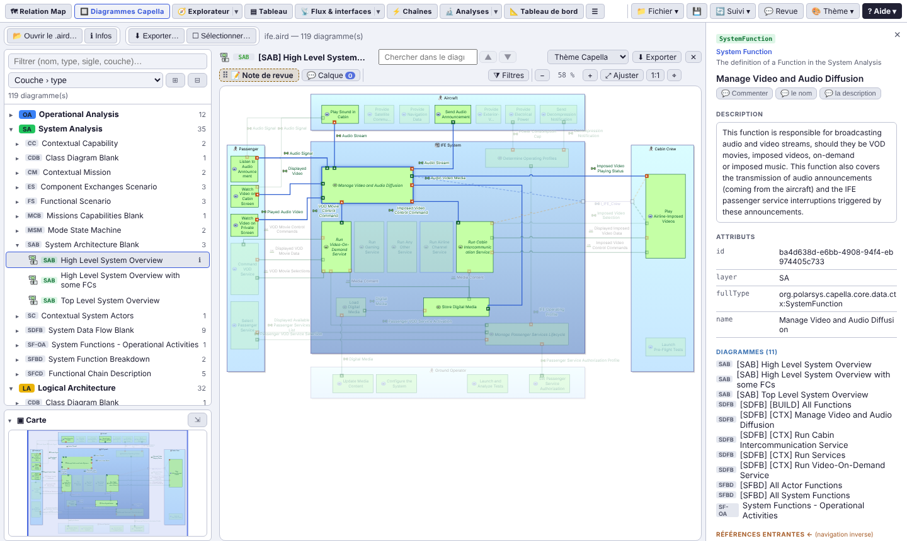

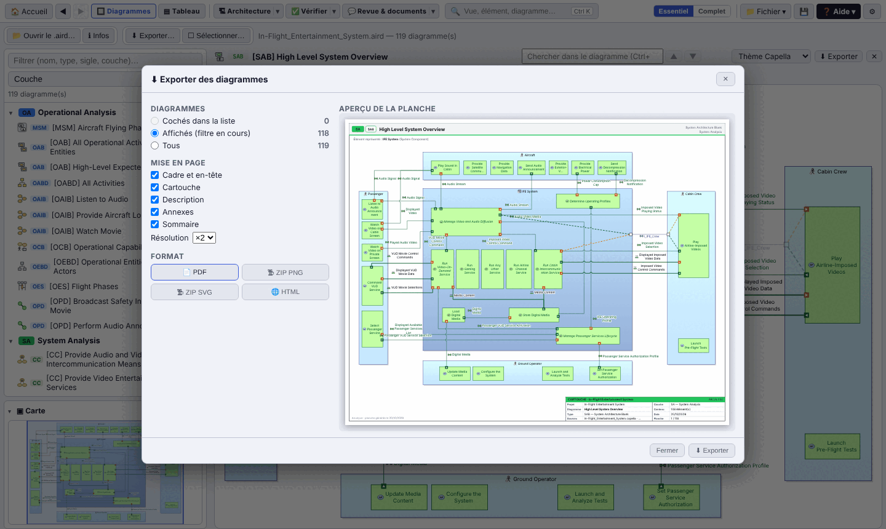

### 🗺 Navigate the model relations
The **Relation Map** graph centres the view on an element and expands its neighbours down to the chosen depth: breakdowns, allocations, exchanges, cross-layer realizations. Horizontal, vertical or radial layouts; zoom, filters by relation and type; image export.

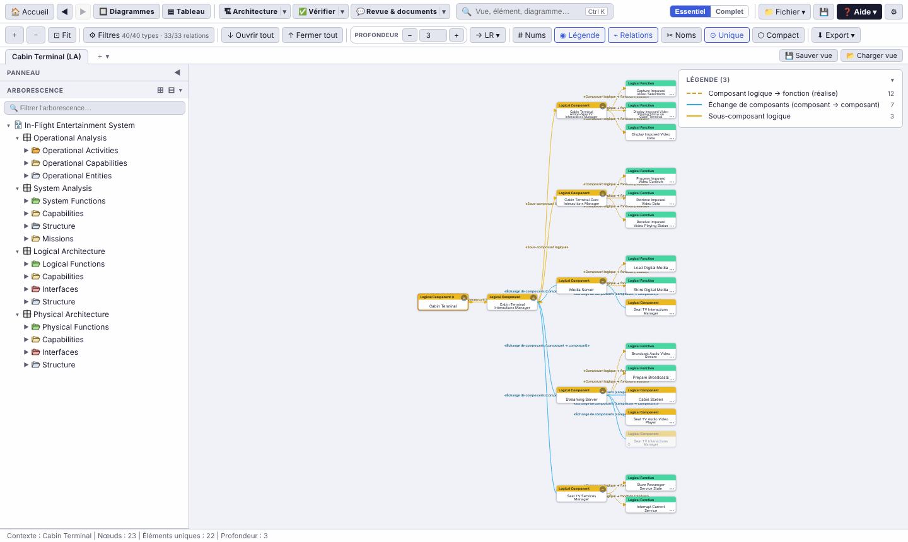

### ✨ Compute columns along relation paths
In the **▤ Table**, a **path column** follows, for each row, a sequence of model relations and shows what it finds at the end: the functions realized by each component, the components connected through their ports and physical links, the package owning a requirement… You choose the start type then, step by step, the relation to follow (allocation, realization, owner, contained element, reference, going through an intermediate element) and finally the value to display. A **live preview** shows, on a sample element, the path followed and the cell content, as well as the number of rows that will be filled. Columns can be sorted, filtered, copied to Excel and exported to CSV; they are saved with the view.

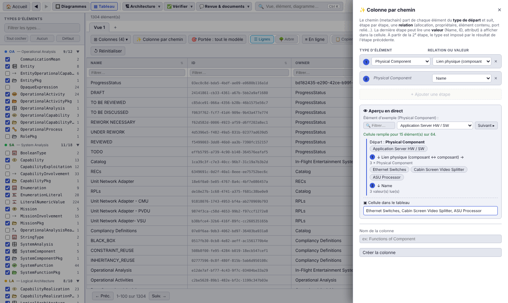

### 💬 Review the model
A **💬 Review** button opens a review panel: comments on the model, on its elements and on the diagrams, followed up from one version of the model to the next.
- **Comment anywhere**: from the details panel (the element, its name, its description or any attribute), by **right-click** on an element in the views (blocks, tables, lists), or on a diagram: drag the **📝 Review note** onto it, or right-click an element or an empty area. Notes form a **layer independent of the `.aird`**: they follow the zoom, can be moved and resized, and are linked to diagram elements by **drawing a line** from the note to them.
- **Optional fields**: only the text is required; severity (Information → Blocking), category, status (Open, In progress, Fixed to be checked, Validated, Rejected), author, creation date, due date, assignees, tags, replies.
- **🔁 Check after an update**: the commented value is recorded; when a new version of the model is loaded, the comments whose element has changed (before / now) or disappeared are listed, to **validate** them or keep them open.
- **📄 Report**: status × severity summary, standalone printable HTML report, CSV.
- **Saved in the page** (💾) and **exportable to `.json`**, to share a review or **merge** those of several reviewers; on import, Arcalyse checks that the review concerns the loaded Capella project. The panel can also be opened in a **separate window** (another screen), and has its own **🎓 guided tour**.
- **📤 Targeted review**: choose comments (or the scope of a review plan) and produce a **standalone HTML page** for reviewers — they answer each comment (agree, disagree, question, proposal…), add their own and send the page back (or pass it on); it is **imported back** into the review, answers and new comments included. The commented diagrams travel with their notes.

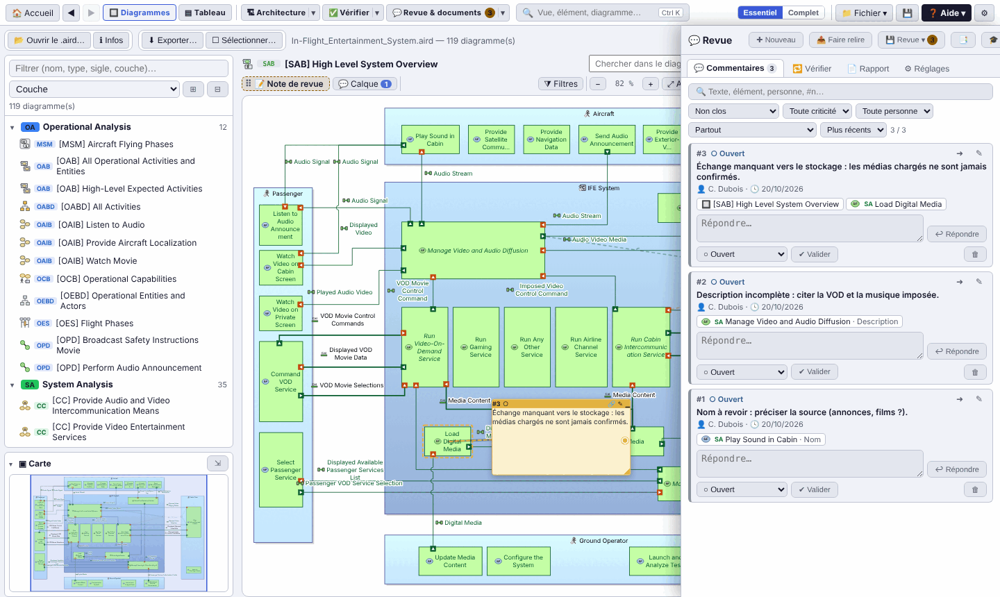

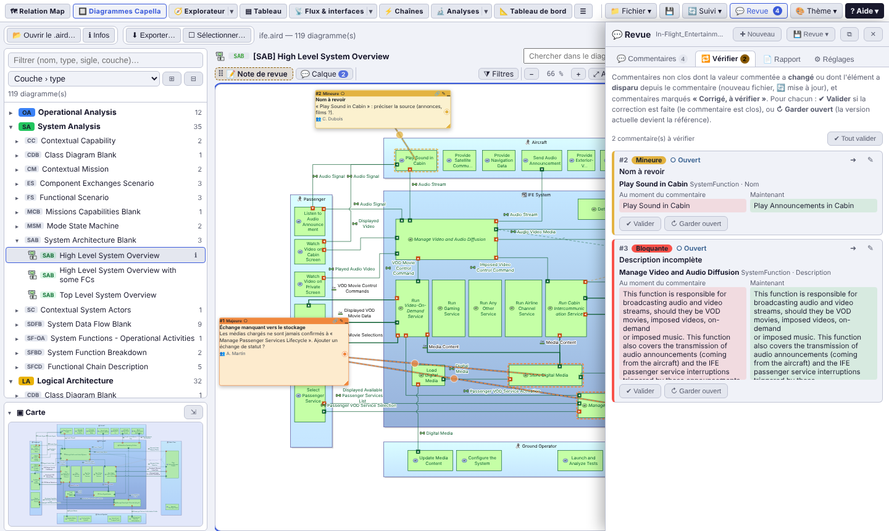

### ⚡ Read functional chains
Each functional chain, operational process or physical path is redrawn, with its inputs / outputs, the involved functions, their allocation and the exchanges. Filters by type, layer and content; **ℹ Info** of the displayed chain (owners, capabilities involving it, description) in the details panel; PDF, PNG, SVG, ZIP or HTML export of all chains at once.

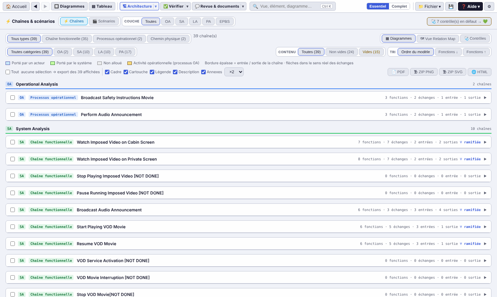

### ƒ⇆ See the exchanges as in Capella
The **Blocks views** follow the Capella rendering: green (system) or blue (actor) functions, input and output pins, exchanges and remote function. A click on the remote function takes you there. Same principle for **Operational Analysis**, **System / Logical Components**, **Behavior Exchange** and **Physical Links**, each with a row view, an N² matrix and checks.

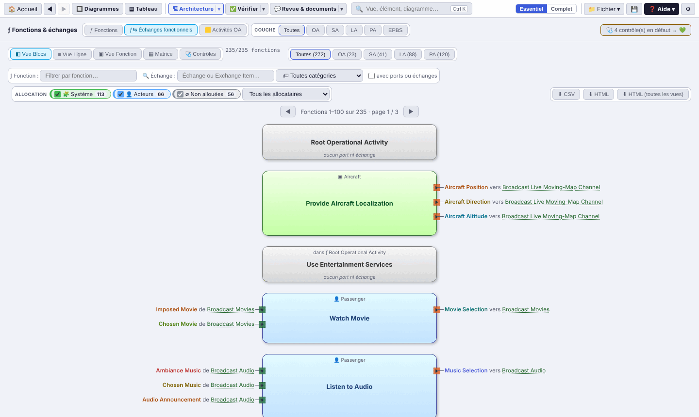

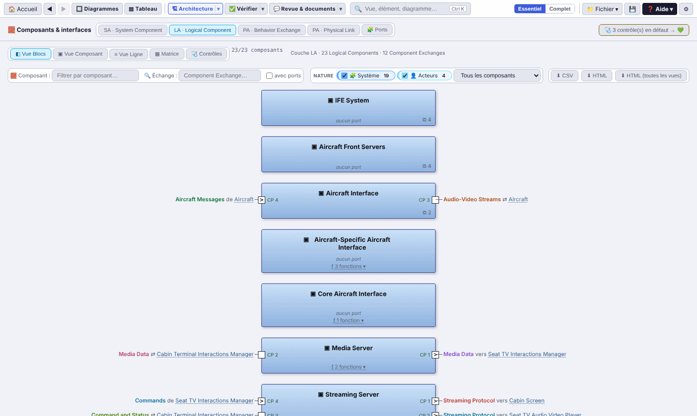

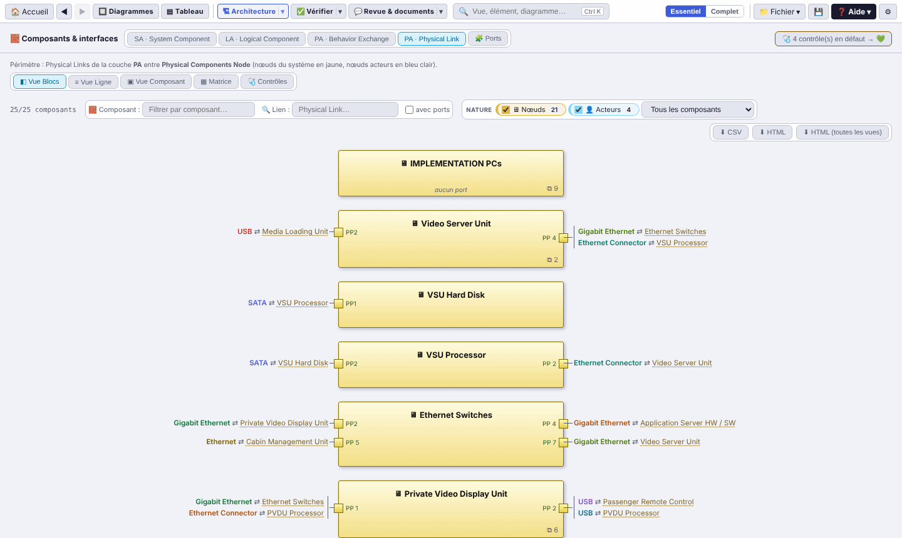

### 🎬 Review scenarios
Sequence diagrams (ES, FS, OES, OAS, IS) are redrawn: lifelines, messages, executions, states and modes, combined fragments (ALT, LOOP…), references. Checks and PNG / SVG export.

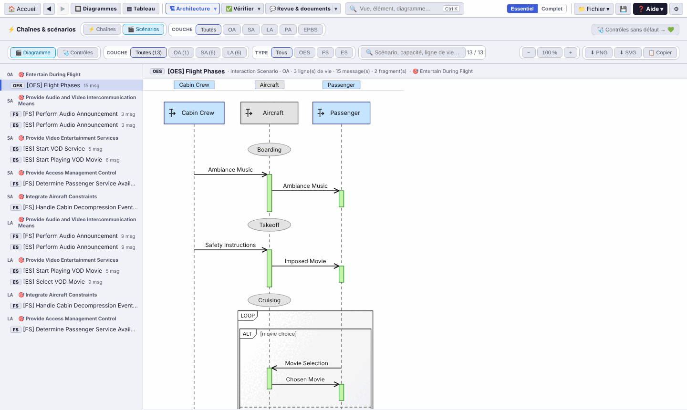

### 🔬 Analyse and check
- **ƒ Functions**: hierarchy with descriptions, Excel-style table (value filters, copy), allocation to the system or to actors, cross-layer traceability, metrics, **name quality** (action verbs in French and English, customisable rules) and printable **functional file**.
- **🧬 Cross-layer traceability**: OA → SA → LA → PA → EPBS realization rates by category, at a glance, and the list of untraced elements.
- **🎯 Capabilities & missions**, **🔁 Modes & states**, **📑 Requirements**, **🏷 Properties**, **🗃 Data & interfaces**, **⛓ Constraints**.
- **⚖ Version comparison**: elements added, deleted, modified or moved between two versions of the model, with an exportable report — and the **🔲 Diagrams** tab for the `.aird`.

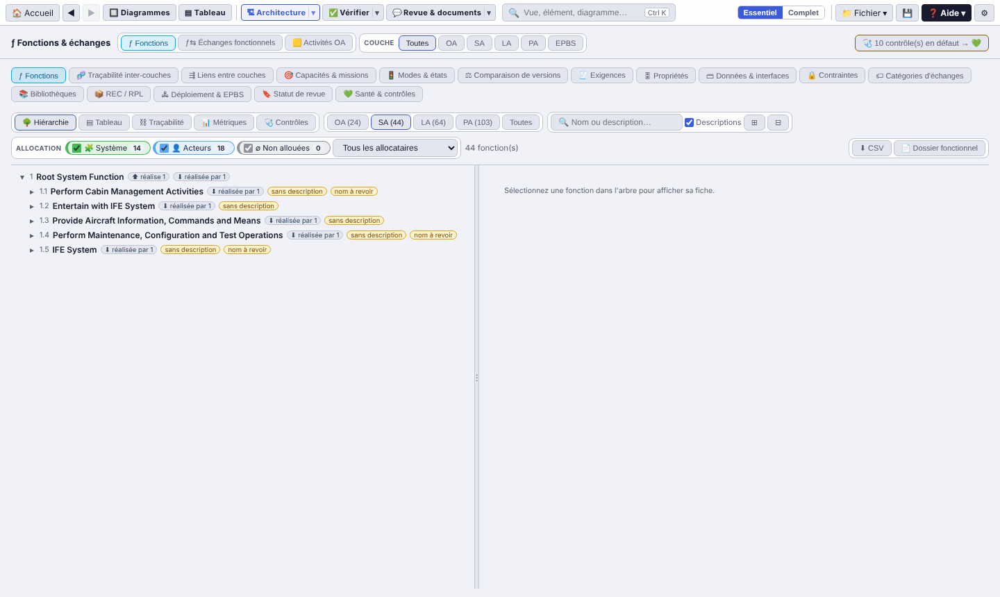

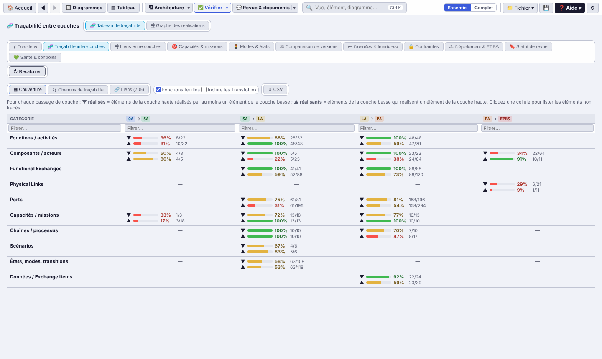

### 📐 Build your dashboards
Choose among dozens of indicators (number of elements, function allocation, description rate, empty chains, traceability…), arrange them on A4 pages, print or export to HTML.

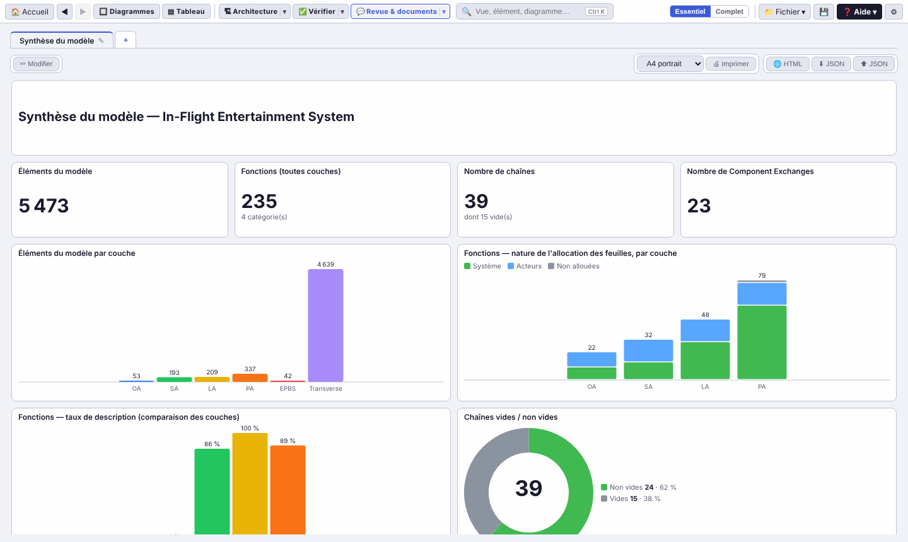

### And also
- 🧭 **Explorer**: tree, cards by layer, ARCADIA type index.
- 🔍 **Details panel**: attributes, references in both directions, diagrams of the element, and its Capella **description formatted as in Capella** (links to other elements clickable, original HTML code on demand).
- 🔗 **Links**: all the model relations, filterable and exportable.
- ▤ **Table**: all elements in a table, with view tabs, relation columns and computed path columns (live preview), sort, filters and CSV export.
- 🎨 **Themes**: Dark, Light, Office 2007, high contrast, and your own custom theme.
- 🎓 **Guided tour** and built-in help, for each view.
- 💾 **HTML page**: save the application with your model and its diagrams, your project home, your dashboards, your review comments and your settings, in a single file to share. Before another model replaces the displayed one, Arcalyse warns that unsaved work would be lost and offers to save first.
- 📄 **Work project**: with a new version of Arcalyse, **📄 Work project (.html)…** (welcome screen, 📁 File) opens the page saved with the previous one (2.1 or later) without running it, and carries over the parts you choose.

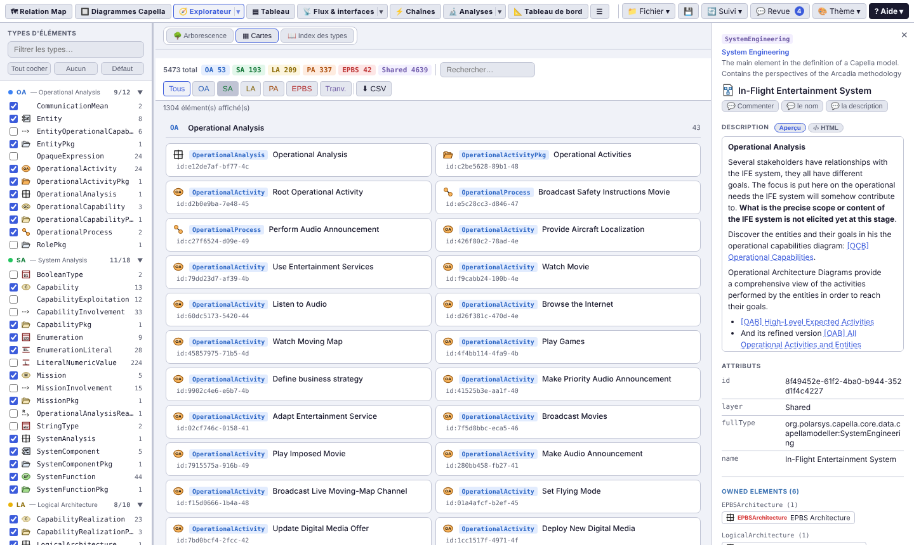

## Getting started

1. **Get the HTML file**:
   - delivered, ready to use, in **[`livraison/`](livraison/)** (“Download raw file” button on GitHub): **`arcalyse-en.html`** (English), **`arcalyse-fr.html`** (French) or **`arcalyse-multi.html`** (both languages, 🌐 switch; browser language by default);
   - or built from the sources: `node build.js --lang en` → `dist/arcalyse-en.html`, `node build.js` → `dist/arcalyse-fr.html`, `node build.js --lang multi` → `dist/arcalyse-multi.html`.
2. **Open it** in a recent browser (tested with Google Chrome version 155), even without a network.
3. **Drag and drop** your `.capella` file (or click 📂 .capella file…), or open the 📁 project folder to load the diagrams (`.aird`) as well — or reopen a saved 📄 work project. That's it.

> 📘 **Complete user guide**, menu by menu, with screenshots (in French): [`docs/GUIDE-UTILISATION.md`](docs/GUIDE-UTILISATION.md).

> 🛠 **Arcature**, the tool for editing Capella and SysML v2 files, is being finalized.

> To try it without a model of your own: the public samples [In-Flight Entertainment System](https://github.com/dbinfrago/Capella-IFE-sample) and [AIDA](https://sahara.irt-saintexupery.com/AIDA/AIDAArchitecture) are in `tests/models/` (under their own licences, EPL 2.0 and CC BY-SA 4.0: see [`tests/models/LISEZMOI.md`](tests/models/LISEZMOI.md)).

## Licence

Arcalyse is free software, distributed under the **Apache License 2.0** — see [`LICENSE`](LICENSE) and [`NOTICE.md`](NOTICE.md).
Copyright © 2026 Romain Lescole. Provided without any warranty.

Capella and ARCADIA are trademarks of their respective owners (Eclipse Foundation, Thales). Arcalyse is an independent tool, compatible with Capella models: neither official nor affiliated.

D3.js v7.9.0 is embedded under the ISC licence (© 2010-2023 Mike Bostock).

---

# Français

## Pourquoi Arcalyse ?

Un modèle Capella grossit vite : des centaines de fonctions, d'échanges, de composants, de ports, réparties sur cinq couches. Dans l'atelier, chaque diagramme n'en montre qu'un morceau. **Arcalyse lit directement le fichier `.capella`** et vous donne, en quelques secondes, une vue d'ensemble, des vues façon Capella et des contrôles de cohérence — sans ouvrir Capella, sans rien installer.

- 📂 **Glissez-déposez** votre `.capella` : le modèle est analysé dans le navigateur, sur votre poste.
- 🔌 **Hors ligne** : un seul fichier HTML autonome (bibliothèque D3 embarquée), utilisable sans connexion.
- 🧭 **Toutes les couches ARCADIA** : OA, SA, LA, PA, EPBS — fonctions, composants, échanges, chaînes, scénarios, exigences, propriétés.
- 🔲 **Diagrammes Capella** : avec le `.aird` du projet, les diagrammes sont dessinés comme dans Capella, consultables et exportables en planches (PDF, ZIP, HTML).
- 💬 **Revue** : commentaires et notes sur les éléments et les diagrammes, criticité, responsables, échéances, vérification à chaque nouvelle version du modèle, rapport.
- 🩺 **Des contrôles prêts à l'emploi** : éléments non alloués, ports non connectés, traçabilité incomplète, noms à revoir…
- 📤 **Exports partout** : CSV, PNG, SVG, PDF, rapports HTML autonomes, tableaux de bord imprimables en A4.
- 🔄 **Suivi du fichier** : Arcalyse détecte les nouvelles versions du `.capella` et montre ce qui a changé.
- 🏠 **Accueil du projet** : informations, check-lists, plans de revue et tableaux blancs, enregistrés avec le modèle.
- 📄 **Votre travail suit les nouvelles versions d'Arcalyse** : ouvrez dans la nouvelle version la page de projet enregistrée avec une version précédente (à partir de la 2.1), tout est repris.

## Ce que vous pouvez faire

### 🏠 Partir de l'accueil du projet
À l'ouverture d'un modèle ou d'un projet, la vue **🏠 Accueil** montre le projet d'un coup d'œil, sur des cartes réorganisables (glisser, largeur, masquer) : projet Capella, fichier et **version de Capella**, diagrammes chargés par couche, dernière mise à jour du modèle, **fiche projet** modifiable (objet, jalon, version, responsable, équipe, notes), contenu du modèle par couche, état de la revue, et accès rapide aux vues.
- **☑ Check-lists et 📋 plans de revue** : vides ou à partir de modèles ARCADIA (qualité du modèle, revues OA, SA, LA, PA) ; diagrammes et éléments se **glissent sur les points** et restent cliquables. Le **plan de revue** réunit objet, jalon, date, participants et rôles, décision, **périmètre** (diagrammes et éléments), critères d'entrée, points de contrôle, critères de sortie et actions ; HTML imprimable, `.json` réutilisable.
- **🧾 Tableaux blancs** : notes, texte libre, rectangles, ellipses, traits et flèches (remplis ou non), diagrammes et éléments en **icônes cliquables**.
- **⧉ Fenêtres séparées** : une check-list, un plan ou un tableau blanc s'ouvre dans sa propre fenêtre (autre écran) ; on peut alors y glisser les diagrammes de la liste de **🔲 Diagrammes Capella** et les éléments de **🧭 Explorateur** ou de **⚡ Chaînes**.

### 🔲 Ouvrir les diagrammes Capella
Chargez le fichier **`.aird`** du projet (ou ouvrez le **📁 dossier du projet** : le `.capella` et ses diagrammes sont chargés ensemble) et les **diagrammes Capella** sont dessinés comme dans Capella — architecture, décomposition, flux de données, classes, modes et états, scénarios… — en lecture seule, sans Capella installé :
- un **explorateur** classé par couche (OA, SA, LA, PA, EPBS) et, au choix, par type de diagramme (OA › OAB…), avec groupes repliables, filtre et largeur réglable ;
- une **barre stable** sur deux lignes (nom du diagramme, recherche, thème et export ; puis notes de revue, chaînes, filtres, zoom, mini-carte), qui ne bouge plus d'un diagramme à l'autre ;
- zoom, recherche dans le diagramme, **mini-carte** sous l'explorateur (ou dans le diagramme), mise en évidence d'une chaîne fonctionnelle ou d'un chemin physique (seuls ceux **dessinés dans le diagramme** sont proposés), filtres (ports, étiquettes, catégories d'échanges) ;
- **clic sur un élément** : son panneau de détail ; à l'inverse, le panneau de détail liste les diagrammes où l'élément figure et les ouvre centrés sur lui ;
- **export de plusieurs diagrammes à la fois** en **planches** encadrées : en-tête (couche, sigle, nom, type), description Capella et élément représenté, cartouche (projet, couche, contenu, sources, date, numéro de planche), annexe des éléments représentés — en **PDF** (sommaire, signets ; alerte si le fichier risque d'être lourd), **ZIP PNG / SVG** (un dossier par couche, un CSV d'annexe par diagramme) ou **rapport HTML** autonome, avec aperçu en direct ;
- **nouvelle version du modèle** : après une 🔄 mise à jour, le `.aird` est relu sur le disque (dossier du projet) ou le `.aird` à jour est demandé ; les diagrammes d'un ancien modèle sont retirés quand un autre modèle est ouvert ; le `.aird` est enregistré dans la 💾 page HTML ;
- **⚖ comparaison des diagrammes** avec un `.aird` précédent (gardé automatiquement à chaque mise à jour) : diagrammes nouveaux, supprimés, renommés, éléments ajoutés ou retirés d'un diagramme, changements de mise en page seuls, diagrammes qui montrent des éléments absents du modèle ou touchés par les changements du modèle.

### 🗺 Naviguer dans les relations du modèle
Le graphe **Relation Map** centre la vue sur un élément et déplie ses voisins jusqu'à la profondeur voulue : décompositions, allocations, échanges, réalisations entre couches. Dispositions horizontale, verticale, radiale ; zoom, filtres par relation et par type ; export image.

### ✨ Calculer des colonnes par chemin de relations
Dans le **▤ Tableau**, une **colonne par chemin** suit, pour chaque ligne, une suite de relations du modèle et affiche ce qu'elle trouve au bout : les fonctions réalisées par chaque composant, les composants reliés par leurs ports et liens physiques, le paquetage propriétaire d'une exigence… On choisit le type de départ puis, étape par étape, la relation à suivre (allocation, réalisation, propriétaire, élément contenu, référence, passage par un élément intermédiaire) et enfin la valeur à afficher. Un **aperçu en direct** montre, sur un élément d'exemple, le chemin parcouru et le contenu de la cellule, ainsi que le nombre de lignes qui seront remplies. Les colonnes se trient, se filtrent, se copient vers Excel et s'exportent en CSV ; elles sont enregistrées avec la vue.

### 💬 Relire le modèle
Un bouton **💬 Revue** ouvre un panneau de revue : des commentaires sur le modèle, ses éléments et les diagrammes, suivis d'une version du modèle à l'autre.
- **Commenter partout** : depuis le panneau de détail (l'élément, son nom, sa description ou un attribut), par **clic droit** sur un élément dans les vues (blocs, tableaux, listes), ou sur un diagramme : glissez la **📝 Note de revue**, ou clic droit sur un élément ou dans un espace vide. Les notes forment un **calque indépendant du `.aird`** : elles suivent le zoom, se déplacent, se redimensionnent et se lient aux éléments du diagramme en **traçant un trait** de la note vers eux.
- **Champs facultatifs** : seul le texte est demandé ; criticité (Information → Bloquante), catégorie, statut (Ouvert, En cours, Corrigé à vérifier, Validé, Rejeté), auteur, date de création, échéance, responsables, étiquettes, réponses.
- **🔁 Vérifier après une mise à jour** : la valeur commentée est mémorisée ; au chargement d'une nouvelle version du modèle, les commentaires dont l'élément a changé (avant / maintenant) ou disparu sont listés, pour les **valider** ou les garder ouverts.
- **📄 Rapport** : synthèse statut × criticité, rapport HTML autonome et imprimable, CSV.
- **Enregistrés dans la page** (💾) et **exportables en `.json`**, pour transmettre une revue ou **fusionner** celles de plusieurs relecteurs ; à l'import, Arcalyse vérifie qu'elle porte sur le projet Capella chargé. Le panneau s'ouvre aussi dans une **fenêtre séparée** (autre écran) et a sa **🎓 visite guidée**.
- **📤 Revue ciblée** : choisissez des commentaires (ou le périmètre d'un plan de revue) et produisez une **page HTML autonome** pour les relecteurs — ils répondent à chaque commentaire (d'accord, pas d'accord, question, proposition…), en ajoutent et renvoient la page (ou la transmettent) ; elle se **réimporte** dans la revue, réponses et nouveaux commentaires compris. Les diagrammes commentés voyagent avec leurs notes.

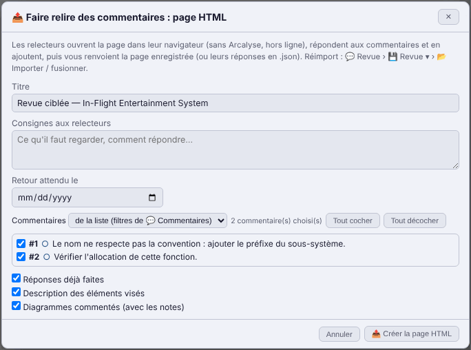

### ⚡ Lire les chaînes fonctionnelles
Chaque chaîne fonctionnelle, processus opérationnel ou chemin physique est redessiné, avec ses entrées / sorties, les fonctions impliquées, leur allocation et les échanges. Filtres par type, couche et contenu ; **ℹ Infos** de la chaîne affichée (porteurs, capacités qui l'impliquent, description) dans le panneau de détail ; export PDF, PNG, SVG, ZIP ou HTML de toutes les chaînes d'un coup.

### ƒ⇆ Voir les échanges comme dans Capella
Les **Vues Blocs** reprennent le rendu de Capella : fonctions vertes (système) ou bleues (acteurs), pins d'entrée et de sortie, échanges et fonction distante. Un clic sur la fonction distante vous y emmène. Même principe pour l'**Operational Analysis**, les **System / Logical Components**, le **Behavior Exchange** et les **Physical Links**, avec à chaque fois vue en lignes, matrice N² et contrôles.

### 🎬 Relire les scénarios
Les diagrammes de séquence (ES, FS, OES, OAS, IS) sont redessinés : lignes de vie, messages, exécutions, états et modes, fragments combinés (ALT, LOOP…), références. Contrôles et export PNG / SVG.

### 🔬 Analyser et contrôler
- **ƒ Fonctions** : hiérarchie avec descriptions, tableau façon Excel (filtres par valeur, copie), allocation au système ou aux acteurs, traçabilité entre couches, métriques, **qualité des noms** (verbes d'action en français et en anglais, règles personnalisables) et **dossier fonctionnel** imprimable.
- **🧬 Traçabilité inter-couches** : taux de réalisation OA → SA → LA → PA → EPBS par catégorie, en un coup d'œil, et la liste des éléments non tracés.
- **🎯 Capacités & missions**, **🔁 Modes & états**, **📑 Exigences**, **🏷 Propriétés**, **🗃 Données & interfaces**, **⛓ Contraintes**.
- **⚖ Comparaison de versions** : éléments ajoutés, supprimés, modifiés ou déplacés entre deux versions du modèle, avec rapport exportable — et l'onglet **🔲 Diagrammes** pour les `.aird`.

### 📐 Composer vos tableaux de bord
Choisissez parmi des dizaines d'indicateurs (nombre d'éléments, allocation des fonctions, taux de description, chaînes vides, traçabilité…), disposez-les sur des pages A4, imprimez ou exportez en HTML.

### Et aussi
- 🧭 **Explorateur** : arborescence, cartes par couche, index des types ARCADIA.
- 🔍 **Panneau de détail** : attributs, références dans les deux sens, diagrammes de l'élément, et sa **description Capella mise en forme comme dans Capella** (liens vers d'autres éléments cliquables, code HTML d'origine à la demande).
- 🔗 **Liens** : toutes les relations du modèle, filtrables et exportables.
- ▤ **Tableau** : tous les éléments en tableau, avec onglets de vues, colonnes de relations et colonnes calculées par chemin (aperçu en direct), tri, filtres et export CSV.
- 🎨 **Thèmes** : Sombre, Clair, Office 2007, contraste élevé, et votre thème personnalisé.
- 🎓 **Visite guidée** et aide intégrée, pour chaque vue.
- 💾 **Page HTML** : enregistrez l'application avec votre modèle et ses diagrammes, l'accueil du projet, vos tableaux de bord, vos commentaires de revue et vos réglages, en un seul fichier à transmettre. Avant qu'un autre modèle remplace celui affiché, Arcalyse prévient que le travail non enregistré serait perdu et propose d'enregistrer d'abord.
- 📄 **Projet de travail** : avec une nouvelle version d'Arcalyse, **📄 Projet de travail (.html)…** (écran d'accueil, 📁 Fichier) ouvre la page enregistrée avec la précédente (à partir de la 2.1) sans l'exécuter, et reprend les parties choisies.

## Démarrer

1. **Récupérez le fichier HTML** :
   - version livrée, prête à l'emploi, dans **[`livraison/`](livraison/)** (bouton « Download raw file » sur GitHub) : **`arcalyse-fr.html`** (français), **`arcalyse-en.html`** (anglais) ou **`arcalyse-multi.html`** (les deux langues, bascule 🌐 ; langue du navigateur par défaut) ;
   - ou version de développement, construite à partir des sources : `node build.js` → `dist/arcalyse-fr.html`, `node build.js --lang en` → `dist/arcalyse-en.html`, `node build.js --lang multi` → `dist/arcalyse-multi.html`.
2. **Ouvrez-le** dans un navigateur récent (testé sous Google Chrome version 155), même sans réseau.
3. **Glissez-déposez** votre fichier `.capella` (ou cliquez sur 📂 Fichier .capella…), ou ouvrez le 📁 dossier du projet pour charger aussi les diagrammes (`.aird`) — ou rouvrez un 📄 projet de travail enregistré. C'est tout.

> 📘 **Guide d'utilisation complet**, menu par menu, avec captures d'écran : [`docs/GUIDE-UTILISATION.md`](docs/GUIDE-UTILISATION.md).

> 🛠 **Arcature**, l'outil de modification des fichiers Capella et SysML v2, est en cours de finalisation.

> Pour essayer sans modèle à vous : les exemples publics [In-Flight Entertainment System](https://github.com/dbinfrago/Capella-IFE-sample) et [AIDA](https://sahara.irt-saintexupery.com/AIDA/AIDAArchitecture) sont dans `tests/models/` (sous leurs propres licences, EPL 2.0 et CC BY-SA 4.0 : voir [`tests/models/LISEZMOI.md`](tests/models/LISEZMOI.md)).

## Licence

Arcalyse est un logiciel libre, distribué sous **Apache License 2.0** — voir [`LICENSE`](LICENSE) et [`NOTICE.md`](NOTICE.md).
Copyright © 2026 Romain Lescole. Fourni sans aucune garantie.

Capella et ARCADIA sont des marques de leurs détenteurs respectifs (Eclipse Foundation, Thales). Arcalyse est un outil indépendant, compatible avec les modèles Capella : ni officiel, ni affilié.

D3.js v7.9.0 est embarqué sous licence ISC (© 2010-2023 Mike Bostock).
