# Guide d'utilisation d'Arcalyse

> **Arcalyse** — votre modèle Capella, sous toutes ses coutures.
> Ce guide passe en revue **tous les menus, sous-menus, vues et fenêtres** de l'application, explique ce que fait chaque commande et **comment s'en servir** (clics, glisser-déposer, raccourcis), avec des captures d'écran.

Les captures ont été faites avec le modèle d'exemple public *In-Flight Entertainment System* (IFE) livré avec Capella et ses diagrammes (`.aird`), dans le thème **Clair** ; les vues 📋 Exigences et 🏷 Propriétés utilisent le modèle *AIDA*. Elles sont régénérées par `node tools/guide-captures.js` (voir [Annexe C](#annexe-c--régénérer-les-captures-du-guide)). Sur les captures annotées, les **pastilles rouges numérotées** renvoient aux tableaux qui les suivent.

---

## Sommaire

1. [Présentation et prérequis](#1-présentation-et-prérequis)
2. [Démarrer : écran d'accueil et ouverture d'un modèle](#2-démarrer--écran-daccueil-et-ouverture-dun-modèle)
3. [L'interface : barre principale et menus](#3-linterface--barre-principale-et-menus)
4. [🏠 Accueil du projet](#4--accueil-du-projet)
5. [🗺 Relation Map](#5--relation-map)
6. [▤ Tableau](#6--tableau)
7. [🧭 Explorateur : Arborescence, Cartes, Index des types](#7--explorateur--arborescence-cartes-index-des-types)
8. [⚡ Chaînes](#8--chaînes)
9. [📡 Flux & interfaces](#9--flux--interfaces)
10. [🔲 Diagrammes Capella](#10--diagrammes-capella)
11. [ƒ Fonctions](#11-ƒ-fonctions)
12. [🔬 Analyses](#12--analyses)
13. [📐 Tableau de bord](#13--tableau-de-bord)
14. [🔎 Panneau de détail](#14--panneau-de-détail)
15. [💬 Revue](#15--revue)
16. [🔄 Suivi du fichier et mises à jour du modèle](#16--suivi-du-fichier-et-mises-à-jour-du-modèle)
17. [💾 Enregistrer, partager, réutiliser](#17--enregistrer-partager-réutiliser)
18. [🎨 Thèmes et personnalisation](#18--thèmes-et-personnalisation)
19. [❓ Aide, visites guidées, À propos](#19--aide-visites-guidées-à-propos)
20. [Raccourcis clavier et gestes de souris](#20-raccourcis-clavier-et-gestes-de-souris)
21. [Pas à pas : scénarios d'utilisation](#21-pas-à-pas--scénarios-dutilisation)
22. [Questions fréquentes et dépannage](#22-questions-fréquentes-et-dépannage)

---

## 1. Présentation et prérequis

Arcalyse est une application **autonome** : un **seul fichier HTML** (`arcalyse-fr.html`, `arcalyse-en.html` ou `arcalyse-multi.html`) qui s'ouvre dans un navigateur et **fonctionne hors ligne**. Elle lit un modèle Capella / ARCADIA (`.capella`) **localement** — rien n'est envoyé sur un réseau — pour l'explorer, l'analyser, le contrôler, le commenter et l'exporter, sans ouvrir Capella.

| Point | Détail |
|---|---|
| Navigateur conseillé | **Microsoft Edge** ou **Google Chrome** récents : ils permettent l'enregistrement direct (Ctrl+S réécrit le même fichier) et la relecture automatique du `.capella` modifié. Les autres navigateurs fonctionnent, avec téléchargement à la place de l'enregistrement direct. |
| Fichiers lus | `.capella` (modèle sémantique), `.melodymodeller`, `.xml` ; `.aird` (diagrammes) en complément, dans 🔲 Diagrammes Capella. Un `.aird` ou `.afm` seul ne suffit pas : il ne contient pas les éléments du modèle. |
| Fichiers produits | Page HTML autonome (avec le modèle), CSV, PDF, ZIP (PNG / SVG), HTML de rapports, JSON (vues, réglages, revue). Tout est produit dans le navigateur. |
| Lecture seule | Arcalyse **ne modifie jamais** le modèle Capella : c'est un outil de lecture, d'analyse et de revue. |
| Langues | Version française, anglaise, ou multilingue (bouton 🌐 EN / FR dans `arcalyse-multi.html`, ou adresse `?lang=fr` / `?lang=en`). |

**Couleurs des couches ARCADIA**, utilisées partout : **OA** Analyse opérationnelle · **SA** Analyse système · **LA** Architecture logique · **PA** Architecture physique · **EPBS** Éléments de configuration · *Transverse* (types partagés).

---

## 2. Démarrer : écran d'accueil et ouverture d'un modèle

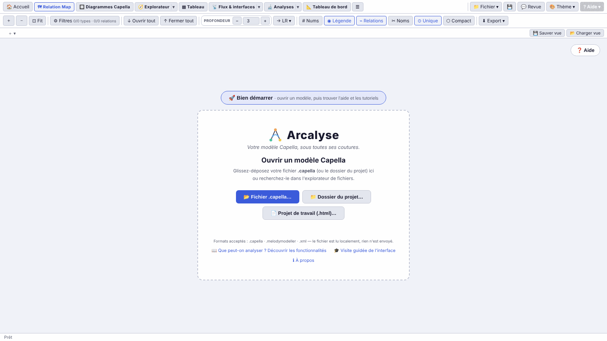

À l'ouverture du fichier HTML, l'écran d'accueil invite à charger un modèle. Les boutons de la barre du haut sont déjà visibles : sans modèle, ils proposent d'en charger un.

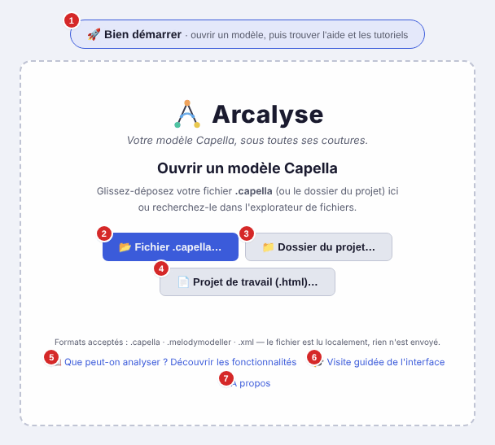

| N° | Commande | Ce qu'elle fait |
|---|---|---|
| 1 | **🚀 Bien démarrer** | Courte visite : montre où ouvrir votre fichier ; elle reprend automatiquement une fois le modèle chargé pour montrer où trouver l'aide et les tutoriels. |
| 2 | **📂 Fichier .capella…** | Ouvre le sélecteur de fichiers pour choisir un `.capella`. |
| 3 | **📁 Dossier du projet…** | (Edge / Chrome) Choisit le **dossier** du projet Capella : le `.capella` **et** ses diagrammes `.aird` sont chargés ensemble. S'il y a plusieurs modèles dans le dossier, une liste vous laisse choisir. |
| 4 | **📄 Projet de travail (.html)…** | Reprend une page Arcalyse enregistrée avec une version précédente (à partir de la 2.1) : modèle, diagrammes, revue, accueil, tableaux de bord, ▤ Tableau, vues, barre, thème, règles de nommage — au choix. La page n'est pas exécutée, seules ses données sont lues. |
| 5 | **📖 Que peut-on analyser ?** | Ouvre l'aide complète (onglet Démarrage). |
| 6 | **🎓 Visite guidée de l'interface** | Présente chaque zone de l'interface pas à pas (plus complète avec un modèle chargé). |
| 7 | **ℹ À propos** | Version, auteur, licence, composants tiers, informations techniques. |

### Les quatre façons d'ouvrir un modèle

1. **Glisser-déposer** : faites glisser le fichier `.capella` depuis l'explorateur de fichiers **n'importe où dans la fenêtre**. Vous pouvez aussi déposer **le `.capella` et le `.aird` ensemble**, ou **le dossier du projet** (Edge / Chrome), ou une **page de projet de travail** `.html`.
2. **Bouton 📂 Fichier .capella…** de l'écran d'accueil.
3. **Menu 📁 Fichier › 🔷 Ouvrir un modèle Capella…** (voir [§ 3.3](#33--fichier)). Si un modèle est déjà ouvert, un avertissement rappelle que le travail non enregistré sera perdu et propose d'abord 💾 Enregistrer la page.
4. **📁 Dossier du projet…** (bouton d'accueil ou 📁 Fichier › 📁 Ouvrir le dossier du projet…).

Le modèle est analysé (quelques secondes pour un gros modèle), puis la vue **🏠 Accueil du projet** s'ouvre automatiquement.

> ⚠ Quand un modèle est chargé, le navigateur demande une confirmation avant de quitter la page (← Précédent, fermeture de l'onglet) : pensez à **💾 Enregistrer** pour garder votre travail (commentaires, vues, tableaux de bord…).

---

## 3. L'interface : barre principale et menus

### 3.1 La barre principale

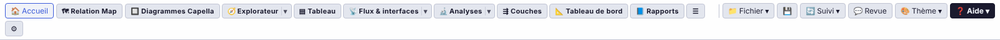


| N° | Bouton | Rôle |
|---|---|---|
| ◀ ▶ | **Historique** | Précédent / Suivant (Alt+← / Alt+→) : vues, éléments du détail et diagrammes ouverts ([§ 3.7](#37--historique-de-navigation)). |
| 1 | **🏠 Accueil** | Accueil du projet : fiche, contenu du modèle, check-lists et plans de revue, tableaux blancs ([§ 4](#4--accueil-du-projet)). |
| 2 | **🗺 Relation Map** | Graphe interactif centré sur un élément et ses voisins ([§ 5](#5--relation-map)). Fait apparaître la 2ᵉ barre de commandes. |
| 3 | **🔲 Diagrammes Capella** | Diagrammes du projet (`.aird`) dessinés comme dans Capella ([§ 10](#10--diagrammes-capella)). *Épinglé par défaut.* |
| 4 | **🧭 Explorateur ▾** | Menu : 🌳 Arborescence, ▦ Cartes, 📖 Index des types ([§ 7](#7--explorateur--arborescence-cartes-index-des-types)). |
| 5 | **▤ Tableau** | Tous les éléments en tableau configurable ([§ 6](#6--tableau)). *Épinglé par défaut.* |
| 6 | **📡 Flux & interfaces ▾** | Menu : ⚡ chaînes ([§ 8](#8--chaînes)), échanges, composants, liens physiques, diagrammes, scénarios, ports, liens ([§ 9](#9--flux--interfaces)). |
| 7 | **🔬 Analyses ▾** | Menu : ƒ Fonctions, traçabilité, capacités, modes & états, comparaison, exigences, propriétés, données, contraintes ([§ 11](#11-ƒ-fonctions) et [§ 12](#12--analyses)). |
| 8 | **⇶ Couches** · **📐 Tableau de bord** · **📘 Rapports** | ⇶ Liens entre couches ([§ 12.9](#129--liens-entre-couches)), tableaux de bord d'indicateurs ([§ 13](#13--tableau-de-bord)), rapports automatiques ([§ 4.5](#45--dossiers-de-relecture-et--rapports)). *Épinglés par défaut.* |
| 9 | **☰** (Ctrl+K) | Toutes les vues : recherche, menus affichés, épingles ([§ 3.2](#32-menus-des-vues-épingles-et-ctrlk)). |
| 10 | **📁 Fichier ▾** | Ouvrir, mettre à jour, enregistrer, exporter les réglages ([§ 3.3](#33--fichier)). |
| 11 | **💾** | Enregistrement direct de la page (Ctrl+S ; Maj+clic : enregistrer sous). |
| 12 | **🔄 Suivi ▾** | Détection des nouvelles versions du `.capella` ([§ 16](#16--suivi-du-fichier-et-mises-à-jour-du-modèle)). Un badge compte les enregistrements en attente. |
| 13 | **💬 Revue** | Panneau des commentaires de revue ([§ 15](#15--revue)). Badge : commentaires non clos ; ⚠ n : à vérifier après une mise à jour. |
| 14 | **🎨 Thème ▾** | Thèmes de couleurs et thème personnalisé ([§ 18](#18--thèmes-et-personnalisation)). |
| 15 | **❓ Aide ▾** | Aide complète, visites guidées, À propos ([§ 19](#19--aide-visites-guidées-à-propos)). |
| 16 | **⚙** | Préférences : affichage des menus (Expert, Simplifié, Personnalisé), barre en icônes seules, enregistrement automatique, thème ([§ 3.4](#34--préférences)). Hors mode Expert, le mode est rappelé à côté de ⚙. |

Un clic sur un **nom de menu** (ex. « 🔬 Analyses ») rouvre la **dernière vue** utilisée dans ce menu ; la **flèche ▾** déroule la liste.

### 3.2 Menus des vues, épingles et Ctrl+K

| 🧭 Explorateur ▾ | 📡 Flux & interfaces ▾ | 🔬 Analyses ▾ |
|---|---|---|
| 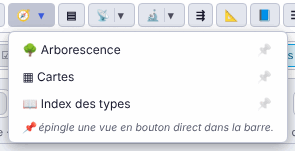 | 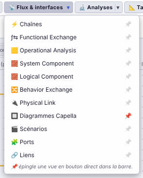 | 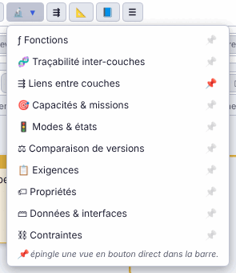 |

Dans chaque menu, l'icône **📌** à droite d'une vue l'**épingle** : elle devient un bouton direct de la barre (un second clic la retire). Par défaut sont épinglés 🏠 Accueil, 🔲 Diagrammes Capella, ▤ Tableau et 📐 Tableau de bord. ⚡ Chaînes n'est plus épinglé par défaut : il est dans le menu 📡 Flux & interfaces (📌 dans ☰ pour l'épingler de nouveau).

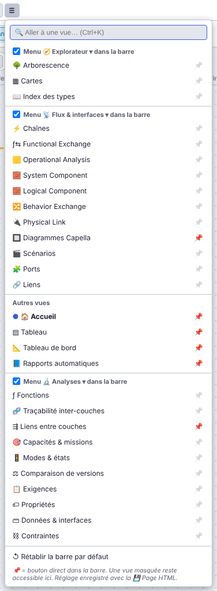

**☰ Toutes les vues** (ou **Ctrl+K**) :

- **🔍 Vue, élément du modèle, diagramme…** : tapez quelques lettres, flèches ↑ ↓ pour choisir, **Entrée** pour ouvrir. La recherche trouve les **vues**, les **éléments du modèle** (nom, type, couche, identifiant ; le type et le chemin de l'élément sont rappelés, Entrée l'affiche dans le panneau de détail) et les **diagrammes** du .aird chargé (nom, sigle, couche ; Entrée l'ouvre dans 🔲 Diagrammes). La section la plus pertinente vient en tête ; 8 éléments et 5 diagrammes au plus sont proposés, précisez la recherche au besoin ;
- **🕘 Derniers ouverts** : sans recherche, les derniers éléments et diagrammes ouverts par ce menu ;
- **cases « Menu … dans la barre »** : affichent ou masquent un menu entier (une vue masquée reste accessible ici) ;
- **📌** : épingler / désépingler chaque vue ;
- **Autres vues** : 🏠 Accueil, ▤ Tableau, 📐 Tableau de bord (vues sans menu) ;
- **↺ Rétablir la barre par défaut** (en bas de la liste).

Le réglage de la barre est enregistré avec la 💾 page HTML et dans le fichier ⚙ Interface et vues.

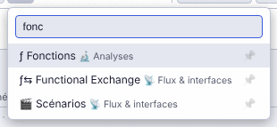

<br clear="right">

Quand une vue du menu 📡 Flux & interfaces ou 🔬 Analyses est ouverte, une **rangée d'onglets** sous la barre permet de passer directement aux autres vues du même menu.

### 3.3 📁 Fichier


| Entrée | Ce qu'elle fait |
|---|---|
| **🔷 Ouvrir un modèle Capella…** | Remplace le modèle affiché (avertissement si un modèle est déjà ouvert). |
| **📁 Ouvrir le dossier du projet…** | Charge le `.capella` et ses `.aird` ensemble (Edge / Chrome). |
| **📄 Ouvrir un projet de travail (page HTML)…** | Reprend une page enregistrée par une version précédente d'Arcalyse ; vous choisissez les parties à reprendre. |
| **🔄 Charger une mise à jour du modèle…** | Compare un autre `.capella` au modèle affiché, **montre le delta**, puis met à jour après validation ([§ 16](#16--suivi-du-fichier-et-mises-à-jour-du-modèle)). Alerte si moins de la moitié des éléments sont communs. |
| **💾 Enregistrer** (Ctrl+S) | Écrit la page complète (application + modèle + votre travail) dans un fichier choisi une fois, puis l'écrase à chaque enregistrement. |
| **💾 Enregistrer sous…** (Ctrl+Maj+S) | Choisit un nouveau fichier. |
| **🌐 Télécharger la page HTML** | Télécharge la page complète (dossier Téléchargements). |
| **⚙ Enregistrer l'interface et les vues…** | Fichier `.json` des réglages **sans le modèle** (parties au choix, [§ 17](#17--enregistrer-partager-réutiliser)). |
| **⚙ Charger une interface et des vues…** | Réapplique un tel fichier, par exemple à un autre modèle. |

<br clear="right">

### 3.4 ⚙ Préférences


La roue crantée **⚙** (à droite de ❓ Aide) ouvre un menu rapide ; **⚙ Préférences…** ouvre la fenêtre complète (onglets ☰ Affichage, 💾 Enregistrement, 🎨 Thème, ⚙ Interface et vues).

<br clear="right">

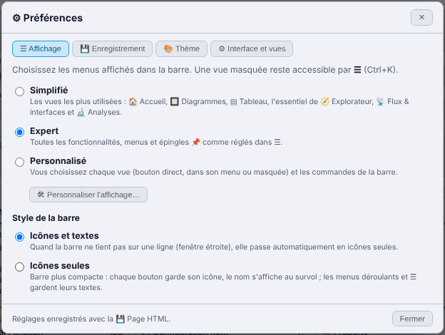

**Affichage des menus** — trois modes, à changer à tout moment :

| Mode | Barre des vues |
|---|---|
| **Expert** (par défaut) | Toutes les fonctionnalités, menus et épingles 📌 comme réglés dans ☰. |
| **Simplifié** | Boutons 🏠 Accueil, 🔲 Diagrammes, ▤ Tableau ; menus réduits à l'essentiel : 🧭 Arborescence, Cartes · 📡 ⚡ Chaînes, ƒ⇆ Functional Exchange, 🧱 System / Logical Component, 🔀 Behavior Exchange, 🔌 Physical Link · 🔬 ƒ Fonctions, 🧬 Traçabilité, 📋 Exigences. 🗺 Relation Map, 🔄 Suivi et 🎨 Thème quittent la barre (le thème reste dans ⚙). Les onglets de 📡 et 🔬 ne montrent que ces vues. |
| **Personnalisé** | **🛠 Personnaliser l'affichage…** : pour chaque vue, *Bouton* (bouton direct), *Menu* (dans son menu) ou *Masquée* ; cases des commandes de la barre (🗺, 🔄, 💬, 🎨). « Partir de : Simplifié / Expert » recopie un mode existant. |

| Barre en mode Simplifié | Barre en icônes seules |
|---|---|
|  |  |

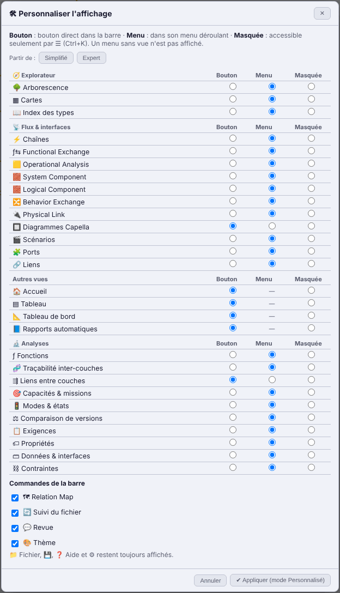

Une vue **masquée** reste accessible par **☰ / Ctrl+K**, marquée « (masquée) ». Un 📌 cliqué hors du mode Expert passe au mode Personnalisé. 📁 Fichier, 💾, ❓ Aide et ⚙ restent toujours affichés.

**Style de la barre** : *Icônes et textes* ou *Icônes seules* (barre compacte, nom au survol ; 🧱 marqué **SA** / **LA** ; les menus déroulants et ☰ gardent leurs textes). Le style se combine avec chaque mode. En *Icônes et textes*, la barre passe **automatiquement** en icônes seules tant qu'elle ne tient pas sur une ligne (fenêtre étroite), et retrouve ses textes quand la place revient ; le menu ⚙ l'indique.

**💾 Enregistrement automatique** (désactivé par défaut, Edge / Chrome) : toutes les 2 à 30 minutes, la page est écrite dans son fichier (celui de 💾 / Ctrl+S), seulement si elle a changé. Option **Garder la version précédente** : avant chaque enregistrement (automatique ou 💾), l'ancien contenu est copié dans un fichier de secours (par exemple `mon-projet.backup.html`, qui s'ouvre comme une page normale). Le navigateur oublie les fichiers choisis quand la page est fermée : à la réouverture, un bandeau propose de les choisir à nouveau.

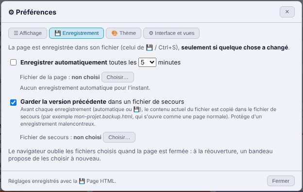

Tous ces réglages sont enregistrés avec la 💾 page HTML et dans la partie « ☰ Barre des vues et ⚙ préférences » du fichier ⚙ Interface et vues.

---

### 3.5 ⬇ Exports Excel

**⚙ › Exports des tableaux : CSV / Excel** : tous les boutons ⬇ CSV des vues produisent alors un classeur **.xlsx** (une feuille, en-tête en gras figé, filtres automatiques, largeurs de colonnes, nombres typés) ; le réglage est enregistré avec la barre. **📁 Fichier › 📗 Classeur Excel des analyses** : un classeur, une feuille par analyse (éléments, fonctions, échanges fonctionnels, composants, Component Exchanges, Physical Links, chaînes, exigences, statuts de revue, contrôles, santé). Le fichier est écrit par Arcalyse, sans bibliothèque.

### 3.6 🩺 Profil de contrôles

**⚙ › 🩺 Profil de contrôles…** (ou le bouton **🩺 Profil** en tête de chaque onglet 🩺 Contrôles) liste, vue par vue, tous les contrôles d'Arcalyse avec le nombre de lignes qu'ils signalent sur le modèle chargé. Pour chacun :

- **activé** ou non : un contrôle désactivé disparaît des vues et des indicateurs du tableau de bord ; il reste listé en bas de l'onglet 🩺 Contrôles pour être réactivé ;
- **gravité** : ℹ information (compté à part, hors « points à vérifier »), ⚠ à vérifier (défaut), ✖ bloquant (signalé dans le total) ;
- **seuils** : longueur minimale d'une description, nom trop long (caractères, mots), nombre de statuts pour qu'une couche soit « majoritairement validée ».

Le profil est enregistré avec la 💾 page, repris par 📄 Ouvrir un projet et par le fichier ⚙ Interface et vues ; **💾 Exporter / 📂 Importer .json** permettent de partager le profil d'une équipe. Les contrôles sont désignés par leur titre : un profil est propre à une langue de l'interface.
### 3.7 ◀ ▶ Historique de navigation

Les boutons **◀ ▶** en tête de la barre (**Alt+←** / **Alt+→**, boutons latéraux de la souris) reviennent sur les étapes précédentes, comme dans un navigateur : vues ouvertes (sous-vues de 🔬 Analyses comprises), éléments ouverts dans le panneau de détail, diagrammes ouverts. L'infobulle nomme l'étape visée. **Clic droit** sur ◀ ou ▶ : liste des étapes (la plus récente en haut, l'étape courante marquée ●), clic pour y aller directement. Ouvrir une nouvelle vue après un retour oublie les étapes « suivantes », comme dans un navigateur. L'historique est vidé à l'ouverture d'un autre modèle (une mise à jour 🔄 du même modèle le conserve).


## 4. 🏠 Accueil du projet

Vue affichée à l'ouverture d'un modèle (bouton **🏠 Accueil**, tout à gauche). Quatre onglets : **🏠 Projet**, **☑ Check-lists & plans de revue**, **🧾 Tableaux blancs**, **📑 Dossiers** (dossiers de relecture et rapports, [§ 4.5](#45--dossiers-de-relecture-et--rapports)). Tout ce qui y est saisi est enregistré dans la page (💾).

### 4.1 🏠 Projet


En tête, l'**accès rapide** aux vues les plus utiles (🔲 Diagrammes Capella, ▤ Tableau, 🌳 Arborescence, ⚡ Chaînes, ƒ Fonctions…). Puis **six cartes** sur deux lignes :

| Carte | Contenu |
|---|---|
| **🔷 Projet** | Nom du projet Capella, fichier, version de Capella (lue dans le fichier), diagrammes chargés et leur nombre par couche (clic sur le nom du `.aird` : 🔲 Diagrammes Capella ; **📂 Ouvrir le .aird…** s'il n'y en a pas), nombre d'éléments, **dernière mise à jour** du modèle et **🔄** pour en charger une, version d'Arcalyse. |
| **📝 Fiche projet** | Champs libres : objet, phase / jalon, version du modèle, responsable, équipe, notes. |
| **☑ Check-lists & plans de revue** | Avancement de chaque document ; **⚡ Check-list rapide** (liste vide, curseur sur le premier point) ; **☑ Modèles et plans de revue** (ouvre l'onglet) ; **⧉** ouvre un document dans une fenêtre séparée. |
| **🧾 Tableaux blancs** | Pages existantes (nombre d'objets) ; **✚ Nouveau tableau blanc** ; **⧉** fenêtre séparée. |
| **🧩 Contenu du modèle** | Une carte par couche (OA, SA, LA, PA, EPBS, Transverse) : principaux types et leur nombre. |
| **💬 Revue** | État de la revue : commentaires non clos, par criticité, à vérifier, en retard ; **Ouvrir la revue**. |

**⚙ Disposer les cartes** (en haut à droite) réorganise la page, comme un tableau de bord :

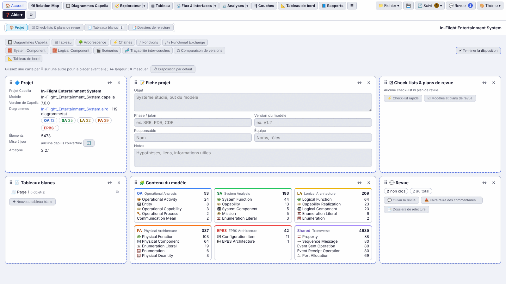

- **glissez une carte par ⠿** sur une autre pour la placer avant elle ;
- **⇔** passe sa largeur de 1 à 2 colonnes ; **✕** la masque (**＋ nom** pour la réafficher) ;
- **↺ Disposition par défaut** ; **✔ Terminer la disposition** pour revenir à l'affichage normal.

La disposition est enregistrée dans la page.

### 4.2 ☑ Check-lists & plans de revue

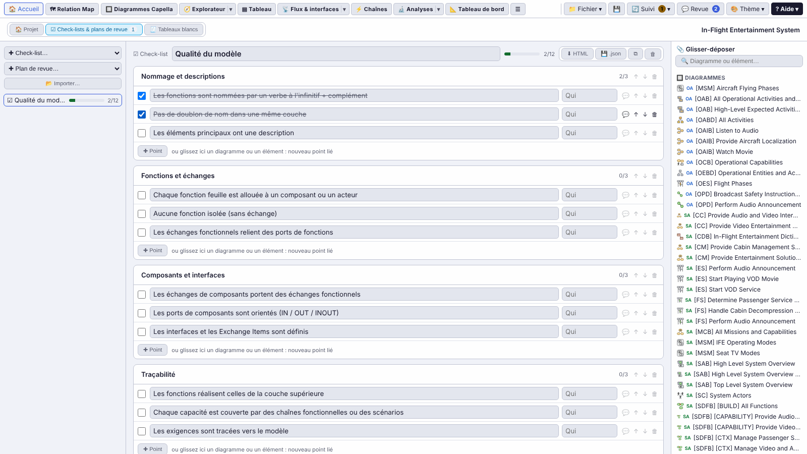

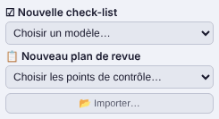

**Créer une check-list** : liste **☑ Nouvelle check-list** (colonne de gauche) → **Vide (à remplir)** (le curseur est placé sur le premier point ; Entrée ajoute le suivant) ou un modèle (**Qualité du modèle**, **revue OA / SA / LA / PA**). Depuis 🏠 Projet, **⚡ Check-list rapide** crée aussi une liste vide. **📂 Importer…** reprend une check-list enregistrée en `.json`. La check-list s'ouvre au centre :

<br clear="right">


- cocher un point le barre et fait avancer la jauge (« 2/12 ») ;
- **Qui** : responsable du point ; **💬** (au survol) : ajouter un constat ; **↑ ↓ 🗑** (au survol) : déplacer, supprimer ;
- **✚ Point** ajoute un point ; **Entrée** dans un point en crée un nouveau dessous ; **✚ Section** ajoute une section ;
- en-tête : **⬇ HTML** (document imprimable), **💾 .json** (pour réutiliser dans un autre projet via **📂 Importer…**), **⧉** dupliquer (cases décochées), **🗑** supprimer ;
- **⧉** à droite d'un document dans la liste de gauche : l'ouvre dans une **fenêtre séparée** ([§ 4.4](#44--fenêtres-séparées-et-glisser-déposer-depuis-les-vues)).

**Glisser-déposer depuis la palette 📎** (colonne de droite « Glisser-déposer ») : cherchez un **diagramme ou un élément**, puis faites-le glisser :

- **sur un point** : il y est **lié** (pastille cliquable qui ouvre le diagramme ou le panneau de détail) ;
- **sur « ✚ Point »** (ou la zone « ou glissez ici… ») : un **nouveau point** lié est créé.

**Créer un plan de revue** : liste **📋 Nouveau plan de revue** → **Plan vide (points à écrire)** ou les points de contrôle d'un modèle.

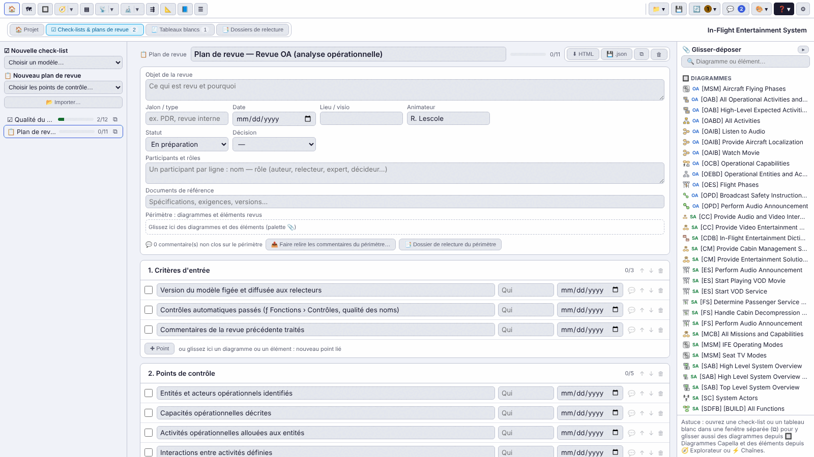

| Zone du plan | Contenu |
|---|---|
| En-tête | Objet de la revue, jalon / type (SRR, PDR, CDR, revue interne…), date, lieu / visio, animateur, statut (en préparation, en cours, terminée), décision (acceptée, avec réserves, refusée, reportée), participants et rôles, documents de référence. |
| Périmètre | Diagrammes et éléments revus, **glissés depuis la palette 📎** ; nombre de commentaires de revue non clos sur ce périmètre ; **📤 Revue ciblée du périmètre…** (page à envoyer aux relecteurs, [§ 15.6](#156--revue-ciblée-relecture-par-dautres-personnes)). |
| Sections | 1. Critères d'entrée · 2. Points de contrôle (repris du modèle choisi) · 3. Critères de sortie · 4. Actions et décisions (responsable, **échéance**). |

### 4.3 🧾 Tableaux blancs


Pages libres pour préparer une réunion, schématiser ou noter des idées.


| Commande | Effet |
|---|---|
| **Page 1, Page 2…** · **✚** | Onglets de pages ; ✚ ajoute une page ; double-clic sur un onglet pour le renommer. |
| **↖ Sélection** | Clic sur un objet : le sélectionner (cadre pointillé) ; glisser : le déplacer ; **Suppr** : le retirer. **Double-clic dans le vide** : nouvelle note. |
| **🗒 Note** | Clic sur le tableau : note colorée, déplacée par son bandeau, redimensionnée par le coin. |
| **T Texte** | Clic sur le tableau : texte libre, sans fond. |
| **▭ Rectangle · ◯ Ellipse** | Glisser sur le tableau (**Maj** : carré, cercle). Coin ▫ : redimensionner. Les formes non remplies laissent cliquer ce qu'elles entourent. |
| **╱ Trait · → Flèche** | Glisser d'un bout à l'autre ; **⇅** inverse le sens d'un trait. |
| **Couleurs** · **◼ Rempli / ◻ Contour** | Pour les nouveaux objets et pour l'objet sélectionné. |
| **✎ · 🗑 · ⧉** | Renommer la page, la supprimer, l'ouvrir dans une fenêtre séparée. |

**Glisser depuis la palette 📎** (à droite) un diagramme ou un élément : il apparaît en **icône cliquable** (ouvre le diagramme ou le panneau de détail) et se déplace à la souris. Un élément supprimé du modèle, ou un diagramme dont le `.aird` n'est pas chargé, apparaît **grisé**.

### 4.4 ⧉ Fenêtres séparées et glisser-déposer depuis les vues

Le **⧉** d'une check-list, d'un plan (liste de gauche, carte de 🏠 Projet) ou d'un tableau blanc (barre, carte) l'ouvre dans **sa propre fenêtre** (par exemple sur un autre écran ; autoriser les fenêtres surgissantes), liée à la page : les modifications se voient des deux côtés. La vue montre un rappel (**⧉ Afficher la fenêtre**, **⧈ Ramener ici**).

Pendant ce temps, vous pouvez **glisser dans cette fenêtre** directement depuis les vues :

- un diagramme de la liste de **🔲 Diagrammes Capella** ;
- une carte ou une ligne de l'arborescence de **🧭 Explorateur** ;
- une chaîne de **⚡ Chaînes** (liste de la vue Relation Map ou en-tête d'une carte).

Sur une check-list : déposez sur un point, sur « ✚ Point » ou sur le périmètre d'un plan ; sur un tableau blanc : l'objet devient une icône cliquable. Dans la vue 🏠 Accueil elle-même, la palette 📎 sert de source.

### 4.5 📑 Dossiers de relecture et 📘 Rapports

Un **dossier de relecture** rassemble, chapitre par chapitre, ce que d'autres personnes doivent relire et commenter. **📑 Nouveau dossier**, puis :

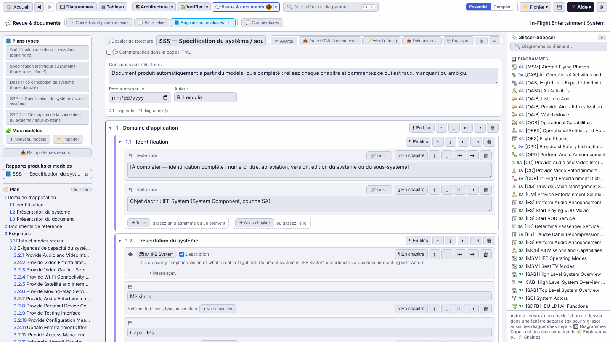

| Commande | Effet |
|---|---|
| **✚ Chapitre** / glisser un élément | Chapitre à titre libre ; un élément glissé (capacité, chaîne, fonction…) donne un chapitre avec son nom, sa description et les diagrammes dont il est l'élément représenté. |
| **✚ Texte** · glisser un diagramme ou un élément | Blocs du chapitre : texte libre, diagramme (description, éléments représentés), élément (avec sa description), ▤ tableau d'éléments. |
| **🔗 Texte du modèle** | Un **texte libre** devient le **nom**, la **description** ou le **nom et la description** d'un élément ou d'un diagramme, relus sur le modèle à chaque export : glisser l'élément sur l'en-tête du bloc, **🔗 Lier…** (recherche par nom) ou clic droit. Si le texte est déjà le nom ou la description d'un élément, la pastille **🔗 lier à … ?** le propose. Le texte d'origine est gardé (**↺ Texte d'origine**) ; **¶ Figer** le remplace par le texte actuel du modèle, modifiable. |
| **🔗** (titre de chapitre) | Chapitre associé à un élément : titre **suivi** = nom de l'élément, mis à jour quand il change dans le modèle. |
| **Clic droit** | Sur un bloc ou un chapitre : transformer en texte du modèle, figer, nom / description, associer un élément, titre suivi, ouvrir l'élément ou le diagramme, insérer un texte ou un chapitre après, convertir § / ¶, dupliquer, copier le texte, monter / descendre, sortir / entrer, retirer. Sur le 🧭 Plan : aller au chapitre, tout replier / déplier. Dans une zone de saisie : menu du navigateur (**Ctrl+clic droit** : celui d'Arcalyse). |
| **§ En chapitre · ¶ En bloc · ↑ ↓ ⇤ ⇥ 🗑** | Convertir, déplacer, changer de niveau, retirer. |
| **👁 Aperçu** | Rendu du rapport tel que l'exporte la page HTML (⧉ : fenêtre séparée). |
| **📤 Page HTML à commenter · 📝 Word (.docx)** | Exports à faire relire ; **📥 Réimporter…** rattache chaque retour à son bloc et le verse dans 💬 Revue (un retour sur un texte du modèle vise le nom ou la description de l'élément). |

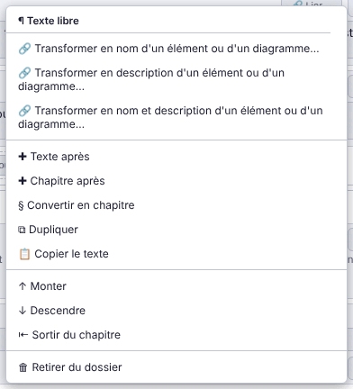

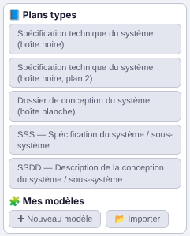

**📘 Rapports automatiques** (bouton **📘 Rapports** de la barre, ou cadre en haut de la liste) : dossier créé selon un plan type, rempli à partir du modèle, puis entièrement modifiable — 📘 Spécification technique du système (boîte noire, deux plans), 📗 Dossier de conception du système (boîte blanche), **📘 SSS** et **📗 SSDD** (ci-dessous). **🧩 Mes modèles** : modèles de rapport personnels (chapitres en boucle sur des éléments, contenus automatiques), **▶ Générer**, **💾 .json** / **📂 Importer** pour les réutiliser.

**📘 SSS et 📗 SSDD (MIL-STD-498)** — *System/Subsystem Specification* (DID DI-IPSC-81431) et *System/Subsystem Design Description* (DID DI-IPSC-81432), avec la numérotation du DID. Une fenêtre demande le **périmètre** : **▶ Système** (System de la SA) ou un **sous-système** (composant SA, LA ou PA, cherché par son nom). Arcalyse en déduit l'intérieur (sous-composants, composants déployés), les fonctions allouées, les échanges avec l'extérieur et les partenaires.

<br clear="right">

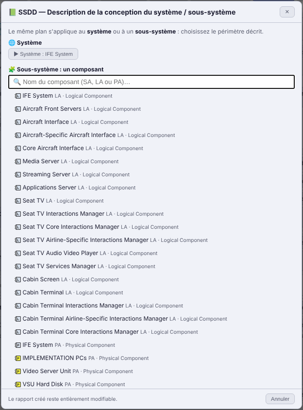

| SSS | Rempli à partir du modèle |
|---|---|
| 1 Domaine d'application · 2 Documents | description et diagrammes du sujet, missions et capacités (système) |
| 3.1 États et modes requis | machines à états du sujet et leurs diagrammes |
| 3.2 Exigences de capacité | une section par capacité (sinon par fonction) : fonctions, chaînes, diagrammes, exigences liées |
| 3.3 Interfaces externes | 3.3.1 diagrammes et partenaires, puis une interface par partenaire (échanges de composants et fonctionnels) |
| 3.4 · 3.5 | échanges internes ; éléments échangés avec l'extérieur |
| 3.6 à 3.17 | exigences repérées par mots-clés (sûreté, sécurité, environnement, qualité, personnel, formation, logistique, emballage…) ; 3.10 : nœuds, comportements et liens physiques (PA) ; 3.12 : ⛓ contraintes |
| 3.18 · 4 · 5 | tableaux d'exigences (priorité, vérification, éléments liés) ; ⇶ liens entre couches |

| SSDD | Rempli à partir du modèle |
|---|---|
| 3 Décisions de conception | description de l'architecture, entrées et sorties, exigences critiques |
| 4.1 Composants | un chapitre par composant : sous-composants, fonctions allouées, réalisations, déploiement, diagrammes |
| 4.2 Concept d'exécution | chaînes fonctionnelles, scénarios, flux de données, modes et états |
| 4.3 Conception des interfaces | 4.3.1 diagrammes et liste, puis une interface par échange : éléments échangés, échanges fonctionnels alloués, liens physiques porteurs |
| 5 Traçabilité | ⇶ liens entre couches, exigences |

**Priorité** et **vérification** d'une exigence : attribut d'exigence ou propriété PVMT dont le nom contient « priorit », « vérif », « qualif » ou « méthode » ; sinon la colonne reste vide. Ce que le modèle ne contient pas devient une invite **[À compléter — …]** qui rappelle ce que le DID attend.

---

## 5. 🗺 Relation Map

Graphe centré sur un **élément de contexte** : ses voisins sont affichés jusqu'à la **profondeur** choisie, en suivant les **relations Capella cochées** (allocations, échanges, réalisations, décompositions, chaînes…).

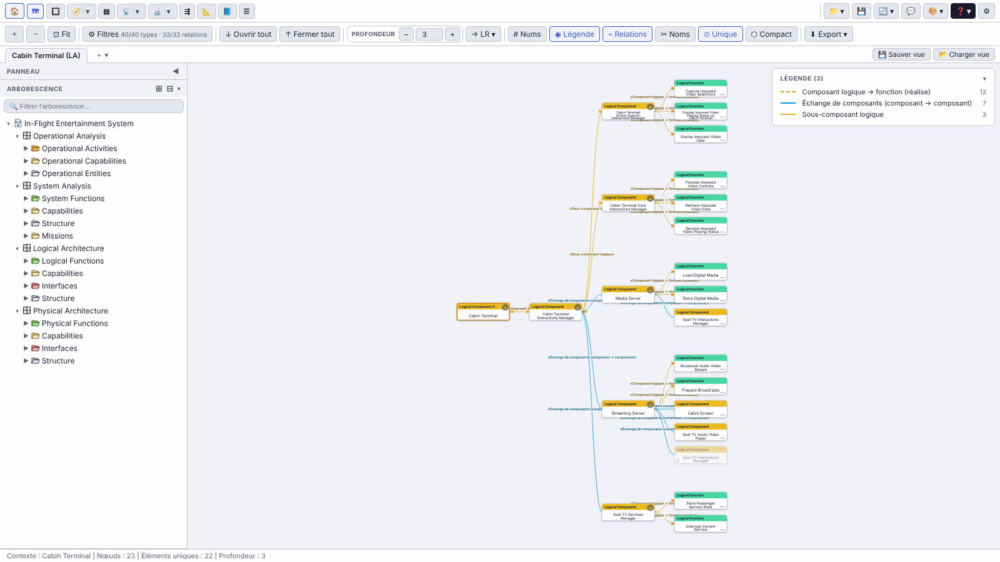

L'écran comprend : la **2ᵉ barre** (commandes du graphe), la **barre d'onglets de vues**, le **panneau gauche** (arborescence), le **graphe**, la **légende** (en haut à droite) et la **barre d'état** (en bas).

### 5.1 La 2ᵉ barre (commandes du graphe)

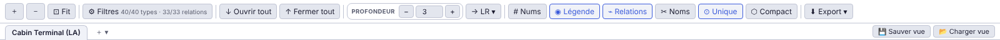

| Bouton | Nom | Description |
|---|---|---|
|  | Zoom avant | Agrandit le graphe (aussi Ctrl + ou Ctrl + molette). |
|  | Zoom arrière | Réduit le graphe (aussi Ctrl −). |
|  | Ajuster | Ajuste le graphe à la fenêtre (aussi Ctrl+W). |
|  | Filtres | Ouvre le tiroir des **types d'éléments** et **critères de relation** (compteurs « cochés / total »), voir [§ 5.3](#53-filtres-types-déléments-et-critères-de-relation). |
| 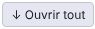 | Ouvrir tout | Développe tous les nœuds du graphe. |
|  | Fermer tout | Replie tous les nœuds. |
|  | Profondeur | Profondeur de voisinage autour du contexte (1 à 10) : − / + ou saisie. |
| 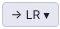 | Disposition ▾ | → LR (gauche → droite), ↓ TB (haut → bas), ← RL, ◉ radiale, ⚡ zigzag (lecture de séquences). Le bouton affiche la disposition courante. |
| 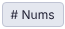 | Numéros | Numérote les relations. |
|  | Légende | Affiche / masque la légende (relations présentes dans le graphe, avec leur nombre ; clic sur son titre pour la replier). |
|  | Relations | Écrit le nom des relations sur les arêtes. |
|  | Noms | Coupe les noms trop longs. |
|  | Unique | *Actif par défaut* : chaque élément n'est déployé qu'une fois, à sa plus courte distance du contexte ; ses autres occurrences restent grisées et repliées (↺). Un clic sur une occurrence grisée sélectionne la première et centre la vue dessus. Plusieurs relations du même type vers le même élément forment une seule arête « ×n ». |
| 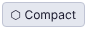 | Compact | Nœuds réduits, pour les grands graphes. |
|  | Export ▾ | Image **PNG**, **JPEG** ou **SVG** du graphe ; **▦ Arbre par niveaux…** (CSV) ; **⇄ Relations affichées…** (CSV). Voir [§ 5.9](#59-exports-de-la-relation-map). |
|  | Nouvelle vue ▾ | Ajoute un onglet de vue, voir [§ 5.2](#52-onglets-de-vues--créer-une-nouvelle-page-relation-map). |
|  | Sauver vue | Enregistre la vue affichée dans un fichier `.json`. |
|  | Charger vue | Ouvre une vue `.json` dans un nouvel onglet. |

| Menu Disposition | Menu Export |
|---|---|
| 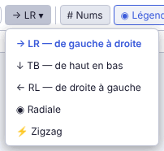 | 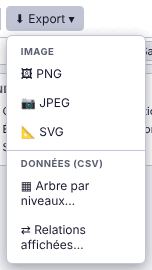 |

### 5.2 Onglets de vues : créer une nouvelle page Relation Map

Sous la 2ᵉ barre, une rangée d'onglets **Vue 1 · Vue 2 · ＋ ▾**. Chaque vue retient : l'élément de contexte, la profondeur, la disposition, les types et relations cochés, les options d'affichage (# Nums, ⌁ Relations, ✂ Noms, ⊙ Unique, ⬡ Compact, légende), les éléments masqués, les nœuds repliés à la main, le zoom et la chaîne affichée. **Tout changement est enregistré automatiquement** dans la vue active (pas de bouton « Enregistrer »).


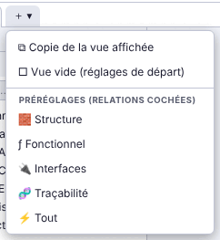

**Créer une nouvelle page (vue)** :

1. cliquez sur **＋ ▾** à droite des onglets ;
2. choisissez :
   - **⧉ Copie de la vue affichée** — même contexte, mêmes filtres et options ;
   - **☐ Vue vide (réglages de départ)** — même contexte, réglages par défaut ;
   - un **préréglage** qui ne coche que certaines relations :
     - **🧱 Structure** : décompositions, déploiement ;
     - **ƒ Fonctionnel** : sous-fonctions, allocations, échanges fonctionnels, chaînes ;
     - **🔌 Interfaces** : échanges de composants, liens physiques, ports, éléments échangés ;
     - **🧬 Traçabilité** : réalisations entre couches, capacités ;
     - **⚡ Tout** : toutes les relations ;
3. le nouvel onglet s'ouvre ; choisissez un contexte (clic dans l'arborescence) et ajustez.

<br clear="right">

**Gérer les onglets** : **clic** = afficher la vue · **double-clic** = renommer (un nom vidé redevient automatique : nom du contexte et couche, ex. « Cabin Terminal (LA) ») · **✕** = fermer · **glisser** un onglet = le déplacer. Un **⚠** signale que l'élément de contexte n'existe pas dans le modèle chargé.

Les vues sont enregistrées dans la 💾 page HTML et dans le fichier ⚙ Interface et vues (partie « 🗺 Relation Map ») ; elles sont gardées quand on charge un autre modèle.

### 5.3 Filtres : types d'éléments et critères de relation

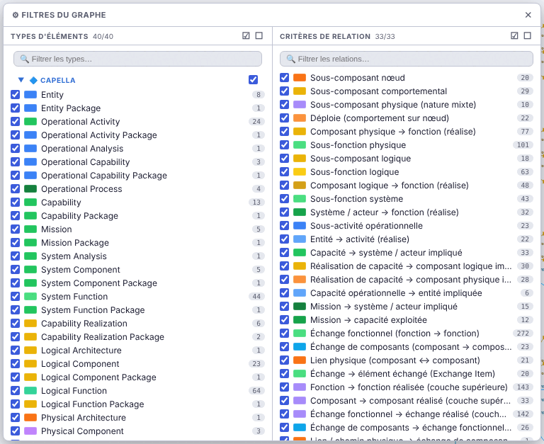

Le bouton **⚙ Filtres** ouvre un tiroir au-dessus du graphe, en deux colonnes :

- **Types d'éléments** : couleur par couche ARCADIA, nombre d'éléments ; seuls les types présents dans l'arborescence sont listés ;
- **Critères de relation** : les relations Capella à suivre (sous-composants, allocations, échanges, réalisations, capacités, chaînes…), avec leur nombre.

Dans chaque colonne : champ de **recherche**, **☑ / ☐** tout cocher / décocher, **groupes cochables en bloc**, compteur « cochés / total » (repris sur le bouton). **×** ou **Échap** referme le tiroir. Les couleurs restent réglables ; la Relation Map ne modifie pas le modèle.

### 5.4 Panneau gauche : arborescence

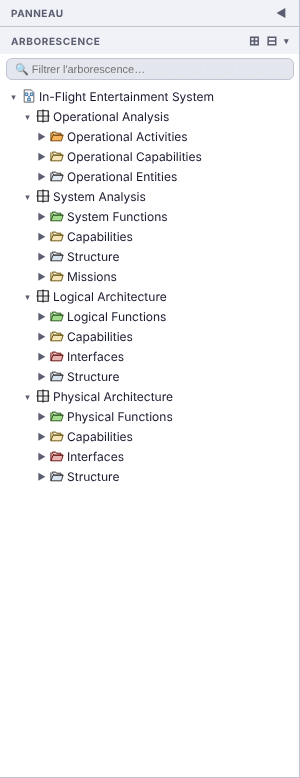

- Éléments du modèle ayant au moins une relation, à leur place hiérarchique (chaînes comprises) ; au chargement, les couches sont dépliées.
- **Filtrer l'arborescence…** : filtre texte avec surbrillance.
- **Clic** sur un élément : il devient le **contexte** du graphe.
- **Ctrl/Cmd + clic**, **Maj + clic** : sélection multiple (propre à chaque vue).
- **Clic droit** : 🔎 Détail, définir comme contexte.
- **⊞ / ⊟ ▾** : tout déplier / replier.
- **◀** (en haut) replie le panneau ; le bord droit se **glisse** pour l'élargir.
- **Clic sur une chaîne (⚡)** : affiche la chaîne dans le graphe ([§ 5.8](#58-vue-chaîne)).

<br clear="right">

### 5.5 Interactions dans le graphe

| Geste | Effet |
|---|---|
| **Clic** sur un nœud | Sélectionne l'élément (le panneau 🔎 Détail, s'il est ouvert, suit la sélection). |
| **Double-clic** sur un nœud | En fait le **nouveau contexte**. |
| **Clic droit** sur un nœud | Menu contextuel (ci-dessous). |
| **+ / −** dans le coin d'un nœud | Développe / replie ce nœud. |
| **Survol** d'un nœud | Infobulle (type, nom) ; les voisins directs restent en évidence, le reste s'estompe. |
| **Glisser le fond** | Déplace le graphe. |
| **Molette** | Zoom. |

| Menu contextuel | Survol d'un nœud |
|---|---|
| 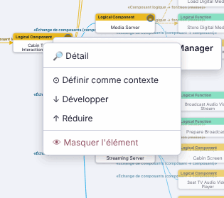 | 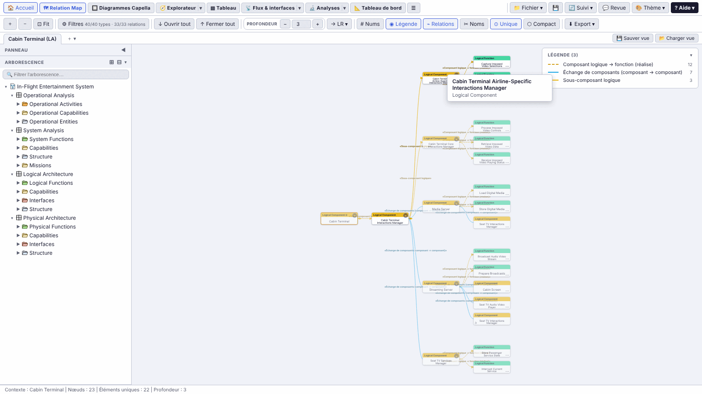 |

Menu contextuel : **🔎 Détail** (panneau à droite du graphe), **⊙ Définir comme contexte**, **↓ Développer**, **↑ Réduire**, **👁 Masquer l'élément** (les éléments masqués sont mémorisés dans la vue).

### 5.6 Panneau 🔎 Détail de la Relation Map

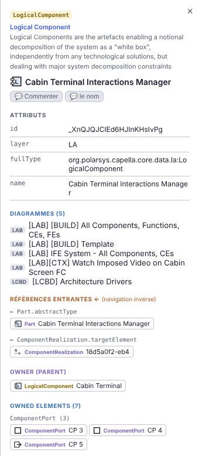

Ouvert par le clic droit › 🔎 Détail : type et description du type, **attributs**, **références sortantes** et **entrantes**, exigences, propriétaire (owner) et éléments possédés — tous les liens sont **cliquables** pour naviguer de proche en proche. **×** le ferme.

<br clear="right">

### 5.7 Légende et barre d'état

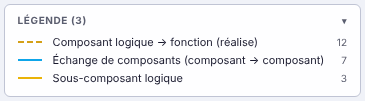


La **légende** ne liste que les relations présentes dans le graphe affiché, avec leur nombre. La **barre d'état** rappelle le contexte, le nombre de nœuds, d'éléments uniques et la profondeur.

### 5.8 Vue chaîne

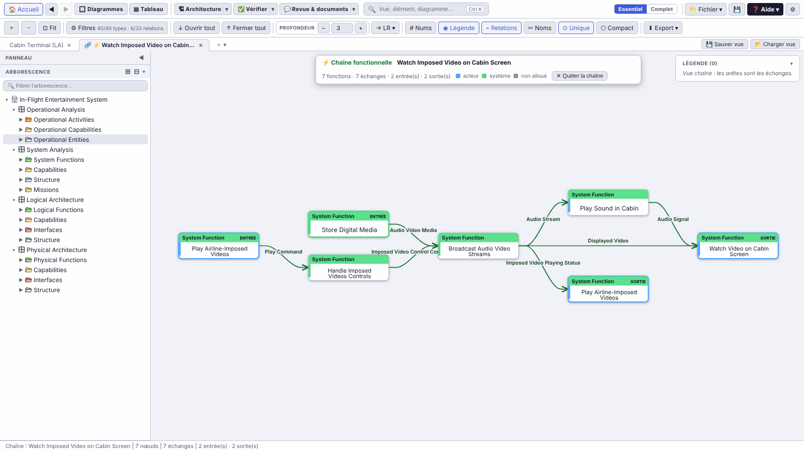

Un clic sur une **chaîne (⚡)** dans l'arborescence, ou le bouton **🗺 Ouvrir en vue Relation Map** d'une carte de ⚡ Chaînes, affiche le **graphe complet de la chaîne** : plusieurs entrées et sorties, ramifications et boucles, disposé en couches selon la disposition choisie (→ LR, ↓ TB, ← RL).

- liseré **bleu** = fonction portée par un acteur, **vert** = par le système, **gris** = non allouée ;
- badges **ENTRÉE** / **SORTIE** ; arêtes étiquetées par le nom de l'échange ;
- un **bandeau** résume la chaîne (fonctions, échanges, entrées, sorties) ;
- **✕ Quitter la chaîne**, un double-clic sur un nœud ou un clic dans l'arborescence reviennent à la Relation Map.

### 5.9 Exports de la Relation Map

| Export | Contenu |
|---|---|
| **PNG / JPEG / SVG** | Image du graphe affiché. |
| **▦ Arbre par niveaux…** (CSV) | Graphe déplié de gauche à droite : contexte en 1ʳᵉ colonne, puis une colonne par niveau et par relation (« N2 · Échange fonctionnel »). Options : **Relation dans une colonne à part** (« Relation Nn » + « Nn » : nombre de colonnes fixe) et **Répéter les cellules des parents** (utile pour filtrer ou faire un tableau croisé). « ×n » = relations fusionnées, « ↺ » = occurrence déjà déployée. Seuls les nœuds affichés sont exportés. |
| **⇄ Relations affichées…** (CSV) | Une ligne par arête : source, relation, cible, nombre, profondeur, chemin depuis le contexte (en vue chaîne : source, échange, cible). |

Les exports CSV passent par la fenêtre **« Colonnes de l'export »** ([§ 9.9](#99--csv-enrichi-colonnes-de-lexport)) : vous pouvez y ajouter ID, type, couche, owner, description… pour chaque colonne d'éléments.

---

## 6. ▤ Tableau

Tableau de **tous les éléments du modèle**, un par ligne. Les lignes suivent les **types cochés** dans la barre latérale ; un **double-clic** sur une ligne ouvre le panneau de détail.

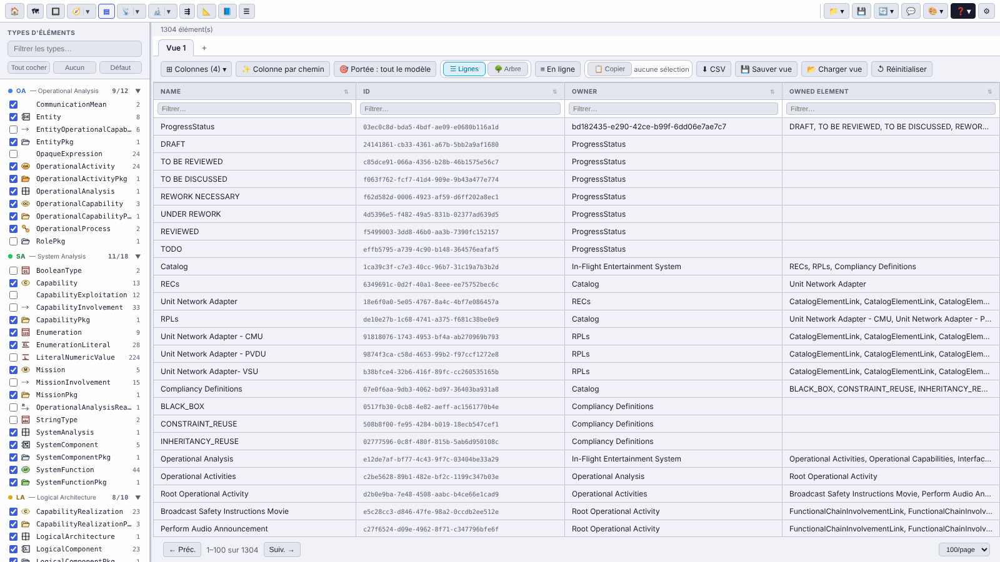

### 6.1 Barre du tableau

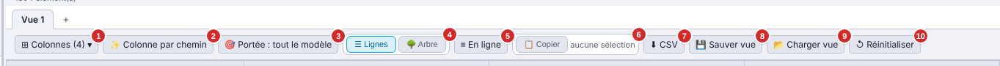

| N° | Commande | Description |
|---|---|---|
| 1 | **⊞ Colonnes (n) ▾** | Choix des colonnes affichées, par section ([§ 6.4](#64-colonnes--colonnes-calculées-attributs-relations)). |
| 2 | **✨ Colonne par chemin** | Ajoute une colonne calculée en suivant un chemin de relations ([§ 6.5](#65--colonne-par-chemin-metachain)). |
| 3 | **🎯 Portée** | Limite les lignes aux éléments contenus dans des éléments choisis ([§ 6.6](#66--portée)). |
| 4 | **☰ Lignes · 🌳 Arbre ▾** | Affichage à plat ou en arbre sous les conteneurs ([§ 6.7](#67--lignes-et--arbre)). |
| 5 | **≡ En ligne / ☰ Empilé** | Cellules à plusieurs valeurs : séparées par des virgules, ou une par ligne. |
| 6 | **📋 Copier** | Copie la sélection de cellules (indique « aucune sélection » ou le nombre de cellules) ([§ 6.9](#69-sélectionner-et-copier-des-cellules)). |
| 7 | **⬇ CSV** | Exporte les colonnes affichées, pour toutes les lignes filtrées (toutes pages), dans l'ordre du tri. |
| 8 | **💾 Sauver vue** | Enregistre la vue de l'onglet affiché (`.json`). |
| 9 | **📂 Charger vue** | Recharge une vue enregistrée dans l'onglet. |
| 10 | **↺ Réinitialiser** | Revient aux colonnes, à l'ordre, aux largeurs et au tri de départ, sans filtre. |

En bas : **← Préc. / Suiv. →**, « 1–100 sur 1304 », et le nombre de lignes par page (**50 / 100 /page**).

### 6.2 Types d'éléments (barre latérale)

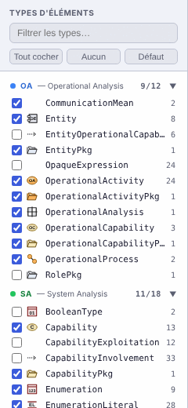

La barre latérale (aussi dans 🧭 Explorateur) liste les **types présents**, groupés par couche (OA, SA, LA, PA, EPBS, Transverse) avec leur nombre et le compteur « cochés / total » de la couche.

- **cocher / décocher** un type pour l'afficher ou non ; **▼** sur une couche pour la replier ;
- **Filtrer les types…** ; **Tout cocher**, **Aucun**, **Défaut** (types usuels) ;
- le bord droit de la barre se **glisse** pour l'élargir.

Il n'y a pas de recherche globale ni de filtre de couche dans le ▤ Tableau : les champs **Filtrer…** de chaque colonne les remplacent.

<br clear="right">

### 6.3 Onglets de vues


Chaque onglet garde **sa propre vue** : types cochés, 🎯 portée, colonnes et leur ordre, filtres, largeurs, tri.

- **+** ajoute un onglet (copie des colonnes de la vue affichée, **sans type coché** : cochez ceux à lister) ;
- **double-clic** sur un onglet : le renommer ; **✕** : le fermer.

### 6.4 Colonnes : colonnes calculées, attributs, relations

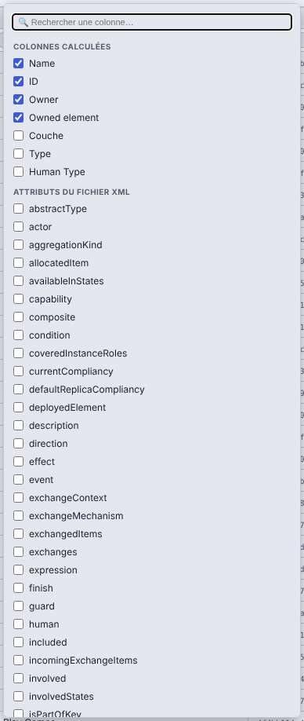

Le menu **⊞ Colonnes ▾** coche les colonnes affichées, par section :

- **Colonnes calculées** : *Name, ID, Owner, Owned element* (affichées par défaut) ; *Couche, Type, Human Type* ;
- **Colonnes par chemin** : vos colonnes ✨ (**✏** modifier, **✕** supprimer) ;
- **Attributs** du fichier XML (`kind`, `nature`, `orientation`, `summary`…) ;
- **Relations** : les relations de la vue 🔗 Liens, par groupe (décomposition, allocation, échanges, réalisation, capacités, chaînes), avec leur nombre de liens. **Deux cases par relation** : **→ cibles** (éléments vers lesquels pointe la ligne, ex. fonctions réalisées par un composant) et **← sources** (éléments qui pointent vers la ligne, ex. composant qui réalise une fonction).

Le champ **🔍 Rechercher une colonne…** filtre toutes les sections :

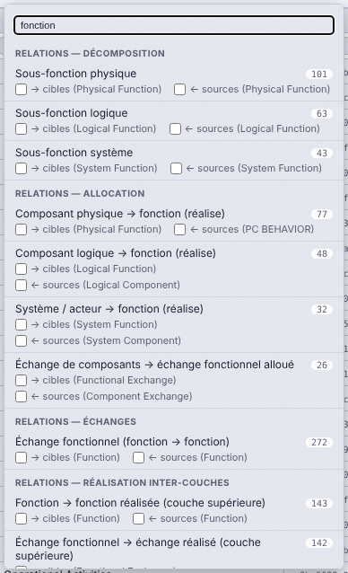

<br clear="right">

**Dans les en-têtes** :

| Geste | Effet |
|---|---|
| **Clic** sur un en-tête | Tri ▲ croissant, ▼ décroissant, puis sans tri (cellules vides en bas). |
| **Glisser** un en-tête sur un autre | Change l'ordre des colonnes. |
| **Glisser le bord droit** | Largeur de la colonne. |
| Champ **Filtrer…** | Filtre la colonne. |
| **✎** (colonne par chemin) | Renomme la colonne (Entrée valide, Échap annule). |

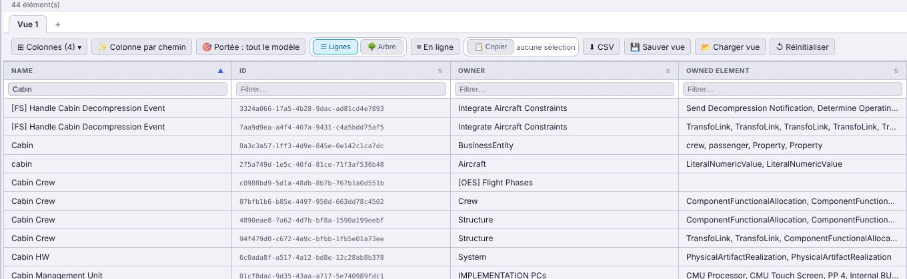

### 6.5 ✨ Colonne par chemin (metachain)

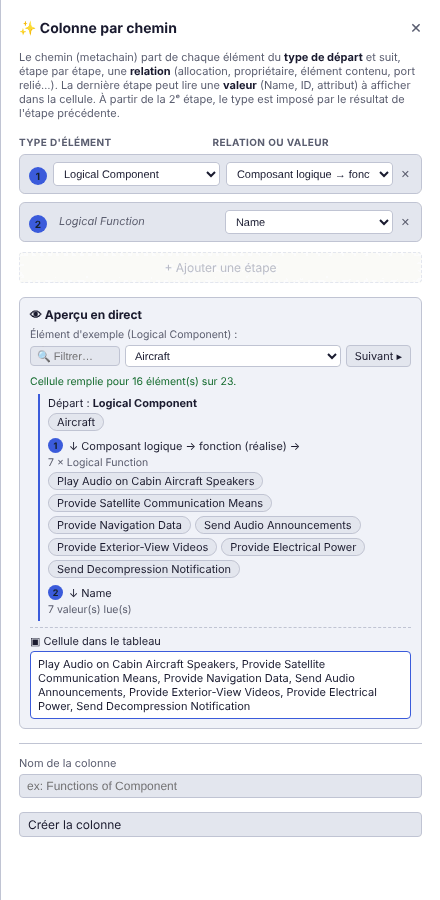

Ajoute une colonne calculée qui, pour chaque élément, **suit un chemin de relations** et affiche ce qu'elle trouve au bout. Exemples : les fonctions réalisées par chaque composant, les composants reliés par leurs ports, le paquetage propriétaire d'une exigence.

**Pas à pas** (exemple : fonctions de chaque Logical Component) :

1. **✨ Colonne par chemin** ouvre le panneau à droite ;
2. **étape 1** — *Type d'élément* : **Logical Component** (seules ses lignes seront remplies) ; *Relation ou valeur* : **Composant logique → fonction (réalise) →** ;
3. **+ Ajouter une étape** : le type est déduit (Logical Function) ; choisissez **Name** pour afficher le nom ;
4. l'**👁 Aperçu en direct** montre, pour un élément d'exemple (filtre 🔍, liste, **Suivant ▸** pour passer au prochain élément dont la cellule sera remplie), les éléments atteints à chaque étape, où le chemin s'arrête s'il ne trouve rien, la **cellule** finale et le nombre d'éléments remplis ;
5. donnez un **Nom de la colonne** (facultatif) puis **Créer la colonne**.

**✕** supprime une étape et les suivantes ; **✏** dans ⊞ Colonnes modifie une colonne existante.

<br clear="right">

| Choix proposés à chaque étape | Signification |
|---|---|
| Name · ID · Type · Human Type · attributs | Valeur affichée (fin du chemin). |
| Owner [Type] | Premier élément propriétaire du type choisi. |
| Owned element [Type] | Éléments contenus directement, du type choisi (ex. ports d'un composant). |
| Relations Capella | Allocation, réalisation, implication… dans les deux sens. |
| attribut → Type | Élément désigné par un attribut (`source`, `target`, `involved`…). |
| ← référence entrante | Éléments qui désignent celui-ci (sens inverse). |
| via [Type] → [Type] | Passage par un élément intermédiaire (ex. port → Physical Link → port opposé). |

### 6.6 🎯 Portée

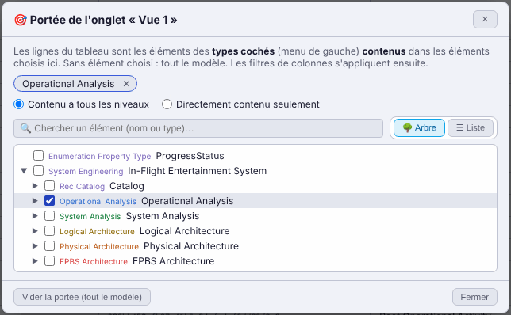

Critère facultatif de l'onglet : les lignes sont limitées aux éléments **contenus dans** des éléments choisis (paquetage, couche, composant, fonction…).

- éléments choisis en pastilles (**✕** pour retirer) ;
- **Contenu à tous les niveaux** ou **Directement contenu seulement** ;
- arbre du modèle (**▶** déplier, **case** pour ajouter) et **recherche** par nom ou type ;
- affichage **🌳 Arbre** (résultats dans leurs conteneurs, grisés s'ils ne correspondent pas) ou **☰ Liste** (à plat, avec le chemin, 300 lignes au plus) ;
- **Vider la portée (tout le modèle)**, **Fermer**.

Lignes d'un onglet = **types cochés ∩ portée**, puis filtres de colonnes ; le bouton rappelle la portée.

<br clear="right">

### 6.7 ☰ Lignes et 🌳 Arbre

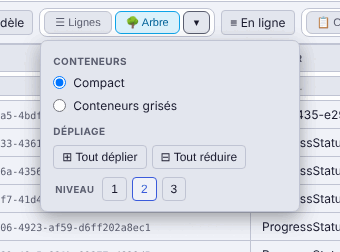

**🌳 Arbre** range les lignes sous leurs conteneurs (▶ / ▼ dans la première colonne). Le menu **▾** à côté regroupe les options :

- **Compact** (défaut) : chaque ligne directement sous son plus proche ancêtre qui est lui-même une ligne ;
- **Conteneurs grisés** : paquetages et conteneurs intermédiaires affichés, grisés et sans valeurs ;
- **⊞ Tout déplier**, **⊟ Tout réduire**, **Niveau 1 · 2 · 3**.

L'ordre des éléments de même niveau suit le tri ; **⬇ CSV** ajoute alors les colonnes *Niveau* et *Chemin*.

<br clear="right">

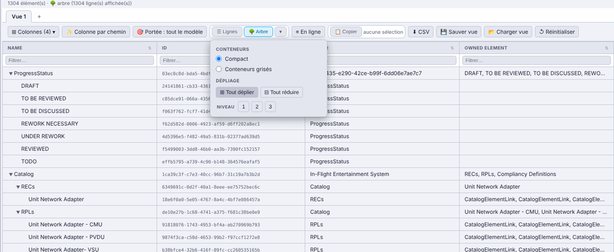

### 6.8 Filtres de colonnes

Sous chaque en-tête, un champ **Filtrer…**. Le compteur en haut indique le nombre d'éléments retenus.

### 6.9 Sélectionner et copier des cellules

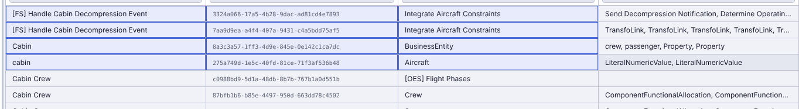

- **clic** sur une cellule ; **clic-glisser** pour un rectangle ; **Ctrl+clic** pour ajouter / retirer une cellule ; **Maj+clic** pour étendre ;
- **Ctrl+C** ou **📋 Copier** : à coller dans Excel ou Word ; une cellule à plusieurs éléments reste **une seule cellule**, un élément par ligne ;
- **Échap** ou un clic hors du tableau efface la sélection.

---

## 7. 🧭 Explorateur : Arborescence, Cartes, Index des types

Trois onglets ; le menu rouvre le dernier utilisé. La barre latérale des types ([§ 6.2](#62-types-déléments-barre-latérale)) n'est affichée que dans l'Explorateur et le ▤ Tableau.

### 7.1 🌳 Arborescence

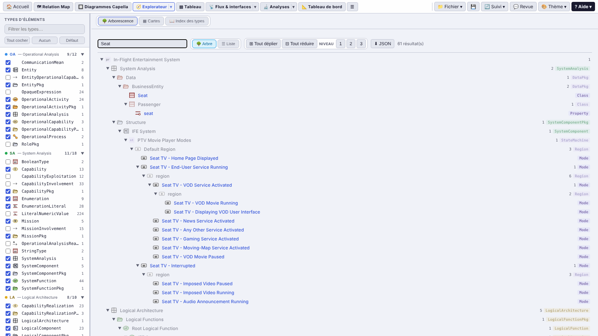

Arbre complet du modèle (types cochés dans la barre latérale) :

- **🔍 recherche** par nom ou type (ici « Seat » : 61 résultats) ;
- **🌳 Arbre** (résultats dans leurs conteneurs, grisés quand ils ne correspondent pas eux-mêmes) ou **☰ Liste** (à plat, triée par nom, avec le chemin, 300 lignes au plus) ;
- **⊞ Tout déplier / ⊟ Tout réduire**, **Niveau 1 · 2 · 3** ;
- **⬇ JSON** : export de l'arbre ;
- **clic** sur un élément : panneau de détail.

### 7.2 ▦ Cartes

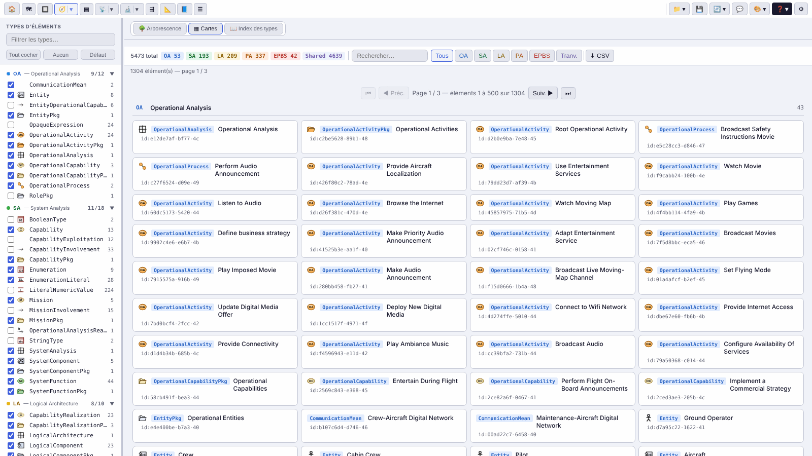

Éléments groupés par **couche ARCADIA**, une carte par élément (type, nom, identifiant) :

- compteurs par couche en tête (total, OA, SA, LA, PA, EPBS, Shared) ;
- **Rechercher…** et filtres de couche **Tous · OA · SA · LA · PA · EPBS · Tranv.** ;
- **⬇ CSV** ;
- pagination par **500 cartes** (**⏮ ◀ Préc. · Suiv. ▶ ⏭**, en haut et en bas) ;
- **clic** sur une carte : panneau de détail.

### 7.3 📖 Index des types

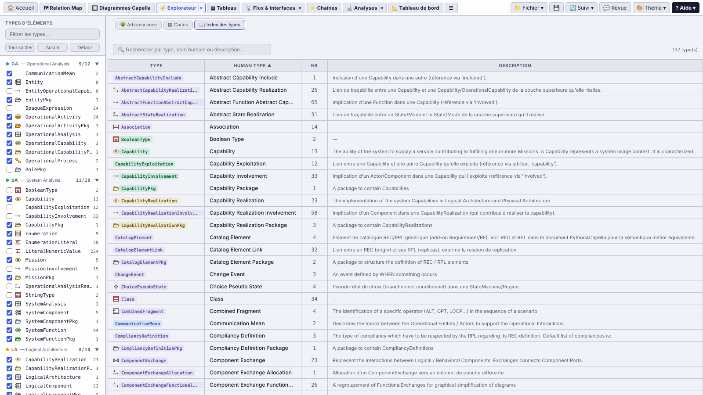

Glossaire des **types présents** dans le modèle : type technique, nom lisible (*Human Type*), nombre d'éléments, description du type. Idéal pour découvrir la composition d'un modèle inconnu.

---

## 8. ⚡ Chaînes

**FunctionalChain**, **OperationalProcess** et **PhysicalPath** sont reconstruits sous forme de **graphe** : plusieurs entrées, plusieurs sorties, ramifications (⑂ ramifiée) et boucles sont conservées.

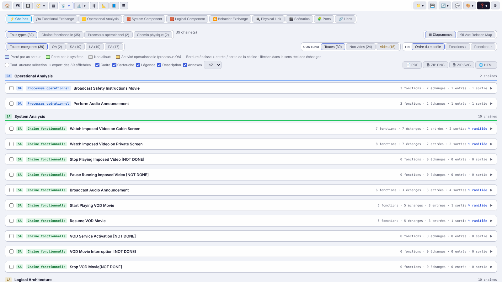

### 8.1 Filtres et sous-vues

| Commande | Effet |
|---|---|
| **Tous types · Chaîne fonctionnelle · Processus opérationnel · Chemin physique** | Filtre par type (avec effectifs). |
| **Toutes catégories · OA · SA · LA · PA** | Filtre par couche. |
| **Contenu : Toutes · Non vides · Vides** | Une chaîne vide n'implique aucune fonction ni aucun échange. |
| **Tri : Ordre du modèle · Fonctions ↓ · Fonctions ↑** | Ordre des cartes. |
| **▦ Diagrammes** | Une carte par chaîne (vue par défaut). |
| **🗺 Vue Relation Map** | Graphe interactif de la chaîne choisie (dispositions LR / TB / RL / radiale / zigzag, ⬡ Compact, ✂ Noms) et envoi vers la Relation Map principale. |

### 8.2 Contenu d'une carte

⚡ Chaînes est dans le menu **📡 Flux & interfaces** (📌 dans ☰ pour en faire un bouton direct). Cliquez sur l'en-tête d'une carte (▶) pour l'ouvrir :


- **diagramme** de haut en bas, style Capella : **bleu** porté par un acteur, **vert** par le système, **gris** non alloué ; bordure épaisse = **entrée** ou **sortie** ; processus opérationnels (OA) aux couleurs de Capella (activités jaunes, flèches brunes) ;
- **Entrées / Sorties** cliquables ;
- **Fonctions impliquées** : ordre du flux, type, allocation, rôle entrée / sortie, nombre d'échanges entrants / sortants ;
- **Functional Exchanges impliqués** : source → cible numérotées, Exchange Items, Component Exchange porteur (pour un chemin physique : composants, Physical Links et CE alloués) ;
- boutons **ℹ Infos · 🖼 PNG · 📐 SVG · 📋 Copier** (coller dans Word / PowerPoint) **· ⬇ CSV · 🗺 Ouvrir en vue Relation Map** ;
- l'en-tête d'une carte se **glisse** vers une check-list ou un tableau blanc ouvert en fenêtre séparée ([§ 4.4](#44--fenêtres-séparées-et-glisser-déposer-depuis-les-vues)).


**ℹ Infos** (carte dépliée, ou barre de la vue Relation Map) affiche dans le panneau de détail les informations de la chaîne : type, couche, nombre de fonctions (ou composants) et d'échanges, entrées, sorties, porteurs, capacités qui l'impliquent, description, fonctions ; **🔎 Détail complet de l'élément** ouvre le détail Capella, **🗺 Vue Relation Map** le graphe.

<br clear="right">


### 8.3 Export groupé

1. cochez les cartes à exporter (case à gauche de chaque carte, ou **☐ Tout**) — sans sélection, **toutes les chaînes affichées** sont exportées ;
2. réglez les options : **Cadre** (cadre et onglet [FC], [OP] ou [PP] + nom, bande à la couleur de la couche), **Cartouche** (projet, diagramme, type, couche, contenu, date et fichier, numéro de planche), **Légende**, **Description** (description Capella), **Annexes** (PDF : planches d'annexe paginées ; ZIP : un CSV par chaîne), résolution **×1 · ×2 · ×3** ;
3. cliquez sur le format : **📄 PDF** (sommaire, une planche A4 par chaîne orientée automatiquement, signets), **🗜 ZIP PNG**, **🗜 ZIP SVG**, **🌐 HTML** (rapport autonome à onglets avec recherche).

---

### 8.4 🩺 Contrôles

Troisième présentation de ⚡ Chaînes (à côté de ▦ Diagrammes et 🗺 Vue Relation Map), filtrée par la catégorie ARCADIA choisie : chaînes **vides** ; **discontinues** (étapes en plusieurs morceaux non reliés) ; **implications vers un élément introuvable** (fonction, composant ou échange supprimé ou dans une bibliothèque) ; **échanges dont une extrémité n'est pas dans la chaîne** ; **références** vers une chaîne introuvable ou **cycliques** ; chaînes **non réalisées à la couche inférieure** ou **ne réalisant rien à la couche supérieure** (seulement là où des réalisations existent déjà) ; chaînes **hors capacité** (seulement si d'autres chaînes de la couche en ont une) ; **sans description** ; **en double** ; **étapes portées par des fonctions non allouées** ; **composants isolés** dans un chemin physique. Chaque ligne ouvre le détail de la chaîne ou sa vue 🗺. Soumis au 🩺 profil de contrôles (§ 3.5) ; indicateur « Contrôles des chaînes » au 📐 Tableau de bord ; pris en compte par la 💚 santé du modèle, y compris par couche.

## 9. 📡 Flux & interfaces

Vues d'interfaces, du fonctionnel au physique, accessibles par le menu **📡 Flux & interfaces ▾** ou par la rangée d'onglets : ƒ⇆ Functional Exchange, 🟨 Operational Analysis, 🧱 System Component, 🧱 Logical Component, 🔀 Behavior Exchange, 🔌 Physical Link, 🎬 Scénarios, 🧩 Ports, 🔗 Liens (et ⚡ Chaînes, 🔲 Diagrammes Capella quand ils ne sont pas épinglés).

**Organisation commune** à ƒ⇆, 🟨, 🧱, 🔀 et 🔌 : chaque vue s'ouvre en **◧ Vue Blocs** (rendu façon Capella, navigation d'un bloc à l'autre) et propose aussi **≡ Vue Ligne**, **▣ Vue Composant / Fonction / Activité**, **▦ Matrice** N² et **🩺 Contrôles**. Les commandes de chaque barre sont **entourées par catégorie** (vues, filtres et champs, exports) et restent visibles en haut lors du défilement.

> 💡 En thème sombre, la Vue Blocs est plus lisible — et plus proche de Capella — avec le thème **Office 2007** ou **Clair**.

| Commande commune | Effet |
|---|---|
| Champs **Fonction / Composant** et **🔍 Échange** | Filtre texte (un échange est gardé si l'une de ses deux extrémités correspond). |
| Cases **Système · Acteurs · Non allouées** (ou Nature) | **Clic** : afficher / masquer ; **double-clic** : uniquement celle-ci (double-clic à nouveau : tout réafficher). |
| Liste **Tous les allocataires / Tous les composants** | Un acteur précis, ou le système et ses sous-systèmes en arbre (sous-composants compris). |
| **avec ports** / **avec ports ou échanges** | Masque les blocs sans port (ou les fonctions mères). |
| **◀ ▶** | Pages de 100 blocs (exports : tout le résultat filtré). |
| **⬇ CSV · ⬇ HTML · ⬇ HTML (toutes les vues)** | CSV enrichi ([§ 9.9](#99--csv-enrichi-colonnes-de-lexport)) ; rapport HTML de la vue affichée ; rapport à onglets Ligne / Composant / Matrice / Contrôles, avec recherche et matrice cliquable. |

### 9.1 ƒ⇆ Functional Exchange

Échanges entre fonctions (toutes couches), avec filtre par couche **Toutes · OA · SA · LA · PA** et filtre **Allocation** (🧩 Système, 👤 Acteurs, ∅ Non allouées).


**◧ Vue Blocs** (défaut) : chaque fonction dessinée comme dans Capella — boîte **verte** si allouée au système, **bleue** si allouée à un acteur, **grise** si non allouée (ou fonction mère) ; **pins d'entrée** (verts) à gauche, **de sortie** (orange) à droite, avec le nom du port ; à côté de chaque pin, l'**échange** et la **fonction distante**. En petit en haut du bloc : son rattachement (composant ou acteur d'allocation, sinon fonction mère).

- **clic sur la fonction distante** : affiche son bloc (changement de page et filtres relâchés si besoin) ; **↩ Revenir** ramène au bloc de départ ;
- **clic sur le titre** d'un bloc : panneau de détail ;
- pin **pâle** : port non connecté ; pin **en pointillés** : échange relié directement à la fonction, sans port (cas normal en OA).

| ≡ Vue Ligne | ▣ Vue Fonction |
|---|---|
|  |  |
| Fonction source, pin de sortie et port → **échange** → pin d'entrée et port, fonction cible ; Exchange Items (▤), Component Exchanges qui l'allouent (🔀), chaînes (⚡). | Une carte par fonction : échanges reçus (←) et émis (→). |

| ▦ Matrice | 🩺 Contrôles |
|---|---|
|  |  |
| Fonction × fonction (ligne = source, colonne = cible), limitée aux **100 fonctions les plus connectées** ; **clic sur une cellule** = liste des échanges. | Ports orphelins, échanges sans Exchange Item, fonctions feuilles sans échange, fonctions mères portant des ports, échanges sans port (hors OA), échanges LA / PA non alloués à un Component Exchange. |

### 9.2 🟨 Operational Analysis


Activités opérationnelles (OA) et leurs interactions, dans l'esprit des diagrammes **OAIB** : blocs jaunes à coins arrondis avec le pictogramme OA, interactions entrantes à gauche et sortantes à droite (clic sur une activité distante : aller à son bloc), entité ou acteur porteur en petit en haut du bloc. Filtres : activité, interaction ou Exchange Item, allocation (🏢 Entités, 👤 Acteurs, non allouées, ou une entité / un acteur précis).

| ≡ Vue Ligne | ▣ Vue Activité | ▦ Matrice | 🩺 Contrôles |
|---|---|---|---|
|  |  |  |  |

### 9.3 🧱 System Component (SA) et 🧱 Logical Component (LA)

Deux vues identiques : **System Component** pour la couche SA, **Logical Component** pour la couche LA ; composants avec leurs **Component Ports** et **Component Exchanges**.


**◧ Vue Blocs** : chaque composant dessiné comme dans Capella (bleu = système, bleu clair = acteur), avec le nombre de fonctions allouées (ƒ) et de sous-composants (⧉). Ports selon leur **orientation** : UNSET, **IN** (chevron vers l'intérieur, à gauche), **OUT** (vers l'extérieur, à droite), **INOUT** (côté le moins chargé). À côté de chaque port : l'échange, son sens (de / vers / ⇄) et le composant distant (cliquable, **↩ Revenir**). Port pâle : non connecté.

**ƒ n fonctions ▾** sous le nom d'un bloc déplie la liste des **fonctions allouées** (numérotées, filtre au-delà de 12) ; clic sur une fonction : son bloc dans ƒ⇆ Functional Exchange.

| ▣ Vue Composant | ≡ Vue Ligne |
|---|---|
|  |  |
| Une carte par composant : échanges émis (→), reçus (←), bidirectionnels (⇄) ou non orientés. | Un Component Exchange par ligne. |

| ▦ Matrice | 🩺 Contrôles |
|---|---|
|  |  |
| Composant × composant (100 composants au plus). | Ports orphelins, ports connectés sans orientation, orientations incohérentes, composants feuilles sans port ou sans fonction allouée. |

La vue **🧱 System Component** a la même organisation :


**Sens d'un échange** déduit des deux ports : **→ Orienté / ← Inversé** (un port IN ou OUT impose le sens) · **⇄ Bidirectionnel** (ports INOUT) · **? Non orienté** (deux ports UNSET, trait pointillé) · **⚠ Incohérent** (OUT→OUT ou IN→IN, sauf pour une **DELEGATION**, dont le sens est déduit de l'imbrication).

### 9.4 🔀 Behavior Exchange (PA)


Component Exchanges de la couche **PA** entre **Physical Components Behavior**, et entre un Behavior et un acteur relié (affiché avec ses seuls ports concernés). Le nombre retenu sur le total du modèle est rappelé en haut. Chaque échange affiche son **kind** (ASSEMBLY, DELEGATION, FLOW), ses FE alloués (ƒ), ses Exchange Items (▤) et ses Physical Links porteurs (🔌).

| ≡ Vue Ligne | ▣ Vue Composant | ▦ Matrice | 🩺 Contrôles |
|---|---|---|---|
|  |  |  |  |

Contrôles : CE sans FE, ports orphelins, orientations incohérentes, CE non orientés, CE de couche PA non alloués à un lien physique.

### 9.5 🔌 Physical Link


Liens entre **Physical Components Node** (et acteurs) via leurs **PhysicalPort**. **◧ Vue Blocs** : nœud jaune (système) ou bleu clair (acteur), ports physiques en carré jaune ; à côté de chaque port, le Physical Link (⇄) et le nœud distant (cliquable). Pour chaque lien : les Component Exchanges alloués (⇢) et, sur chaque port, un badge **n CP** (Component Ports alloués). Les listes longues sont repliées après 4 éléments : **+N autres** pour les déplier. Filtres Nature (🖥 Nœuds, 👤 Acteurs), sous-composants, avec / sans CE.

| ≡ Vue Ligne | ▣ Vue Composant | ▦ Matrice | 🩺 Contrôles |
|---|---|---|---|
|  |  |  |  |

Contrôles : liens sans CE, ports physiques non reliés ou sans Component Port, CE de couche PA non alloués.

### 9.6 🧩 Ports

Traçabilité **Function Port ↔ Component Port ↔ Physical Port**, reconstruite à partir des PortAllocation et ComponentPortAllocation.


| Sous-vue | Contenu |
|---|---|
| **≡ Traçabilité** | Une ligne par Function Port / Component Port, avec FE, CE, ports physiques et liens. Filtres couche (**Toutes · SA · LA · PA**), texte, **Seulement les chaînes incomplètes**. ⬇ CSV. |
| **▣ Par composant** | Ports physiques → Component Ports portés ; Component Ports ← Function Ports alloués. |
| **🩺 Contrôles** | Ports non alloués à chaque niveau ; sens incohérent entre port de fonction et port de composant ; alignement FE ↔ CE et CE ↔ PL ; délégations suivies de proche en proche. |

| ▣ Par composant | 🩺 Contrôles |
|---|---|
|  |  |

### 9.7 🎬 Scénarios


Diagrammes de séquence des scénarios Capella — **ES** (Exchange Scenario), **FS** (Functional Scenario), **OES / OAS** (OA), **IS** (Interface Scenario) — redessinés à partir du seul `.capella`.

- **à gauche**, la liste rangée par couche puis par capacité ; filtres **Couche** (Toutes, OA, SA, LA), **Type** (Tous, OES, FS, ES…) et recherche ;
- **à droite**, le diagramme : lignes de vie (bleu clair = acteur, bleu = composant, vert = fonction, gris = entité), messages (avec, pour les ES, le contexte d'échange entre accolades), barres d'activation, fonctions, états (ellipses gris clair) et modes (gris foncé), **fragments combinés** (ALT, OPT, LOOP, PAR…) avec leurs gardes, références **« ref »** vers un autre scénario (clic : l'ouvrir) ;
- **clic** sur un élément : son détail ; les noms des lignes de vie restent visibles en haut au défilement ;
- défilement par les barres, la molette (**Maj + molette** : horizontal) ou en **cliquant-glissant sur le fond** ;
- **− 100 % +** : zoom ; **⬇ PNG · ⬇ SVG · 📋 Copier** l'image ;
- **🩺 Contrôles** : scénarios vides, messages sans échange, lignes de vie sans élément représenté, scénarios hors capacité, références introuvables.


> L'ordre des événements est celui du modèle ; les espacements sont calculés (la mise en page dessinée dans Capella est dans le `.aird`) : le contenu est fidèle, pas la position au pixel près.

### 9.8 🔗 Liens


Relations Capella extraites du modèle (décompositions, allocations, échanges fonctionnels / de composants / liens physiques, éléments échangés, réalisations inter-couches, chaînes, capacités) :

- **🔍 Rechercher** un élément, un échange, un ID ;
- **Toutes les relations (n)**, ou **clic sur un nom de groupe** (DÉCOMPOSITION, ALLOCATION…) ou **sur une relation** pour filtrer ;
- case **ID** : colonnes d'identifiants ; **⬇ CSV** des lignes affichées ;
- « n types de relations présents · n absents » : les relations absentes du modèle sont listées en infobulle ;
- **clic sur un nom** : panneau de détail.

### 9.9 ⬇ CSV enrichi (colonnes de l'export)

Dans 📡 Flux & interfaces et 🔬 Analyses, **⬇ CSV** ouvre d'abord la fenêtre **« Colonnes de l'export »** :

- **retirer** des colonnes ;
- pour chaque colonne qui désigne des éléments (fonction, port, échange, composant…), **ajouter des informations** insérées juste à côté : ID, type, type lisible, couche, owner, chemin des owners, description, summary, n'importe quel attribut (**＋ Attribut…**), et les ✨ colonnes par chemin du ▤ Tableau dont le type correspond ;
- **↺ Colonnes de base** revient à l'export d'origine.

Les choix sont **retenus pour chaque export** et enregistrés avec la 💾 page HTML et le fichier ⚙.

---

## 10. 🔲 Diagrammes Capella

Diagrammes du projet (fichier `.aird`, à côté du `.capella`), dessinés **comme dans Capella** par la visionneuse d'Arcature. Lecture seule.

### 10.1 Charger les diagrammes

- **📂 Ouvrir le .aird…** (le sélecteur s'ouvre dans le dossier du `.capella` sous Edge / Chrome) ;
- **📁 Dossier du projet…** sur l'écran d'accueil (`.capella` et `.aird` chargés ensemble) ;
- ou **glisser-déposer** le `.aird` (seul ou avec le `.capella`) sur la fenêtre.


### 10.2 L'explorateur de diagrammes (à gauche)


- **Filtrer (nom, type, sigle, couche)…** ;
- **classement** : *Couche* (défaut), *Couche › type* (OA › OAB…), *Type de diagramme* ou *Nom* ;
- groupes repliables (**⊞ / ⊟**) ;
- **largeur réglable** en glissant le séparateur (double-clic : largeur d'origine) ;
- **ℹ** au survol d'un diagramme : ses informations dans le panneau de détail ;
- **▣ Carte** sous l'explorateur (▾ pour la replier, **⇲** pour la remettre dans le diagramme, **⇱** pour la ramener).

<br clear="right">

### 10.3 Un diagramme ouvert


Au-dessus du diagramme, **deux lignes** qui ne bougent pas d'un diagramme à l'autre :


| Ligne | Commandes |
|---|---|
| **Identité** | Sigle et nom du diagramme ; **Chercher dans le diagramme** (Ctrl+F) avec **▲ ▼** ; **Thème** (Thème Capella…) ; **⬇ Exporter** (SVG / PNG / impression) ; **✕** fermer. |
| **Outils** | **📝 Note de revue** et **💬 Calque** ([§ 15.3](#153-notes-de-revue-sur-les-diagrammes)) ; chaînes et chemins (ceux dessinés dans le diagramme) ; **▽ Filtres** (ports, étiquettes, catégories d'échanges) ; **− 99 % +**, **⤢ Ajuster**, **1:1**, mise en page. |

Molette : zoom ; glisser : déplacement ; infobulles au survol ; mini-carte.

**Clic sur un élément** du diagramme : son **panneau de détail** s'ouvre. Inversement, dans le panneau de détail d'un élément, la section **Diagrammes** ouvre un diagramme où il est représenté, **centré et mis en évidence**.


**ℹ Infos** : le panneau de détail présente le diagramme — type, couche, nature, nombre d'éléments, date de dernière modification, description, élément représenté et éléments affichés, groupés par type et cliquables.


### 10.4 ⬇ Exporter… (planches)


1. **☐ Sélectionner…** permet de cocher des diagrammes dans la liste (sinon : *affichés* ou *tous* ; les tableaux sont exclus) ;
2. **⬇ Exporter…** ouvre la fenêtre : **Diagrammes** (cochés dans la liste, affichés, tous), **Mise en page** (Cadre et en-tête, Cartouche, Description, Annexes, Sommaire, Résolution), **Format** (**📄 PDF**, **🗜 ZIP PNG**, **🗜 ZIP SVG**, **🌐 HTML**) ;
3. l'**aperçu de la planche** montre le résultat (cadre et en-tête : couche, sigle, nom, type ; élément représenté ; cartouche : projet, type, couche, contenu, sources, date, planche) ;
4. **⬇ Exporter**. PDF : sommaire, signets, annexes (alerte si le PDF risque de dépasser 40 Mo) ; ZIP : un dossier par couche et un CSV d'annexe par diagramme ; HTML : planches repliables par couche et type.

---

## 11. ƒ Fonctions

Premier onglet de 🔬 Analyses : activités OA et fonctions SA / LA / PA, **couche par couche**, avec leurs descriptions mises en avant.

**Barre commune** : sous-vues **🌳 Hiérarchie · 📋 Tableau · ⛓ Traçabilité · 📊 Métriques · 🩺 Contrôles** ; couches **OA · SA · LA · PA · Toutes** ; **Nom ou description…** ; **Descriptions** (afficher dans l'arbre) ; **⊞ / ⊟** ; filtre **ALLOCATION** (🧩 Système, 👤 Acteurs, ∅ Non allouées — clic : afficher / masquer, double-clic : uniquement celle-ci) ; liste **Tous les allocataires** (un acteur, ou le système et ses sous-systèmes en arbre) ; **⬇ CSV** ; **📄 Dossier fonctionnel**.

### 11.1 🌳 Hiérarchie


Arbre numéroté (1, 1.1, 1.2…) avec badges : allocation, échanges ⇄, **réalise ⬆ / réalisée par ⬇**, *sans description*, *nom à revoir*. **Clic sur une fonction** : **fiche** à droite (chemin, description, résumé, sous-fonctions, allocation, ports, échanges entrants et sortants, chaînes, capacités, états, arbre de traçabilité vers le haut et vers le bas) ; ses liens naviguent d'une fonction ou d'une couche à l'autre. Le séparateur **⋮** se glisse pour ajuster les largeurs (double-clic : défaut). Chaque fonction porte un liseré de la couleur de son allocation (double liseré si allouée au système et à un acteur).

### 11.2 📋 Tableau


Une ligne par fonction, indentée (option **À plat**) :

- colonnes **redimensionnables** (bord de l'en-tête), **triables** (clic), **filtrables** par texte (champ sous l'en-tête) ou **par valeurs comme dans Excel** (**▼** : tri, recherche, cases à cocher avec effectifs ; une colonne à plusieurs valeurs est éclatée), **masquables** (**⊞ Colonnes**) ;
- descriptions complètes en option, filtres rapides, nombre de fonctions affichées / total ;
- colonnes *Nature de l'allocation*, *Sous-système* (chemin des composants englobants), *Qualité du nom* ;
- **sélection de cellules** : clic-glisser, Ctrl+clic, Maj+clic, puis **📋 Copier** ou Ctrl+C ;
- exports **⬇ CSV** et **🌐 HTML** (colonnes, largeurs, filtres et tri actuels).


### 11.3 ⛓ Traçabilité


Chemins **OA → SA → LA → PA** passant par la couche choisie, avec descriptions ; **∅** = rupture de traçabilité. Les en-têtes et la ligne de filtres restent visibles au défilement.

### 11.4 📊 Métriques


Comparatif des couches : nombre, feuilles, profondeur, taux de description, d'allocation, d'échanges, de traçabilité, de couverture par chaînes et capacités, qualité des noms ; répartition par niveau ; fonctions les plus connectées. **◂** réduit une couche (**▸** pour la déplier) ; seules les couches dépliées sont exportées : **🌐 HTML**, **🖼 PNG** haute définition ou **📋 copie de l'image**.

### 11.5 🩺 Contrôles et ✍ qualité des noms


Qualité des noms, descriptions absentes ou trop courtes, marqueurs TODO / TBD / NOT DONE, doublons, allocations manquantes, multiples ou sur une fonction mère, feuilles sans échange, échanges sur fonctions mères, ports inutilisés, ruptures de traçabilité.

**✍ Qualité des noms** (hors ligne) : verbe en tête (infinitif en français, forme de base en anglais — environ 1 000 verbes intégrés), forme en -ing ou nom d'action en tête, verbes vagues, majuscule, espaces, ponctuation, longueur, langue minoritaire dans la couche. **⚙ Règles de nommage** : verbes métier acceptés et faux verbes, conservés dans la 💾 page HTML.

### 11.6 📄 Dossier fonctionnel

Rapport HTML imprimable : un onglet par couche, une section numérotée par fonction (description, allocation, entrées / sorties, réalisations, chaînes, capacités), plus métriques et contrôles.

---

## 12. 🔬 Analyses

Onglets : **ƒ Fonctions · 🧬 Traçabilité inter-couches · ⇶ Liens entre couches · 🎯 Capacités & missions · 🚦 Modes & états · ⚖ Comparaison de versions · 📋 Exigences · 🏷 Propriétés · 🗃 Données & interfaces · ⛓ Contraintes**, et **↻ Recalculer**.

Les résultats sont **gardés en mémoire** ; **↻ Recalculer** les rafraîchit. Les contrôles ne sont calculés qu'à l'ouverture de l'onglet 🩺 Contrôles. Une rubrique absente du modèle est simplement signalée comme vide.

**Tableaux des analyses** : sous chaque en-tête, un champ **Filtrer…** (plusieurs mots : tous requis ; **!mot** : exclure) ; le nombre de lignes affichées est indiqué au-dessus, avec **✕** pour effacer. Glisser le bord droit d'un en-tête règle la largeur (double-clic : automatique). Un tableau plus large que la vue a une barre de défilement horizontal collée en bas de l'écran (aussi **Maj + molette**).

### 12.1 🧬 Traçabilité inter-couches


Exploite tous les liens *…Realization* (fonctions, composants, échanges, ports, capacités, chaînes, scénarios, états, données, éléments de configuration) et, en option, les **TransfoLink**.

| Sous-vue | Contenu |
|---|---|
| **▦ Couverture** | Par catégorie et passage OA→SA→LA→PA→EPBS : **▼ réalisés** (éléments du haut réalisés par le bas) et **▲ réalisants** (éléments du bas qui réalisent le haut), en % avec code couleur. **Clic sur une cellule** : éléments non tracés. |
| **⛓ Chemins de traçabilité** | Une ligne par chemin, une colonne par couche. |
| **🔗 Liens** | Liste filtrable de tous les liens de réalisation. |
| Options | **Fonctions feuilles** (ignore les fonctions mères), **Inclure les TransfoLink**, **⬇ CSV**. |

| ⛓ Chemins | 🔗 Liens |
|---|---|
|  |  |

### 12.2 🎯 Capacités & missions


Capacités opérationnelles, capacités système, Capability Realizations (LA / PA) et missions : fonctions, chaînes, acteurs / composants impliqués, scénarios, inclusions, missions qui les exploitent, réalisations entre couches. Filtre de couche.

| Sous-vue | Contenu |
|---|---|
| **▣ Cartes** | Une carte par capacité ou mission, groupées par couche. |
| **▦ Matrice** | Capacités × acteurs / composants, × fonctions, × chaînes, ou missions × capacités. |
| **🩺 Contrôles** | Capacités sans fonction ni chaîne, sans acteur, sans scénario, non réalisées plus bas, non exploitées par une mission ; missions vides ; fonctions feuilles hors de toute capacité. |

| ▦ Matrice | 🩺 Contrôles |
|---|---|
|  |  |

### 12.3 🚦 Modes & états


| Sous-vue | Contenu |
|---|---|
| **◈ Machines à états** | Par composant : diagramme (états bleus, modes jaunes, ● initial, ◉ final, ◆ choix ; transitions *déclencheur [garde] / effet*), tables des états (entry / do / exit, fonctions disponibles) et des transitions. |
| **▦ Fonctions × états** | Disponibilité des fonctions dans chaque état ou mode (*availableInStates*). |
| **🩺 Contrôles** | Régions sans état initial, états inatteignables, états sans issue, transitions sans déclencheur ni garde, fonctions jamais disponibles. |

| ▦ Fonctions × états | 🩺 Contrôles |
|---|---|
|  |  |

### 12.4 ⚖ Comparaison de versions


**Comparer deux versions** :

1. ouvrez ⚖ Comparaison de versions ;
2. **📂 Charger une autre version (.capella)…** — elle est considérée par défaut comme l'**ancienne** version (référence) ; **⇄** inverse ;
3. les éléments sont appariés par identifiant et les changements classés en **8 catégories** : ➕ Création, ➖ Suppression (avec les éléments contenus), ✏ Renommage, 📝 Description, ⚙ Propriétés, 🔗 Liens (+ / −), ↪ Déplacement, 🔁 Type.

| Réglage | Choix |
|---|---|
| **Niveau** | Synthèse (compteurs) · Simple (une phrase par changement) · Détaillé (chaque propriété avant → après) · Complet (+ identifiant, type technique, chemin). |
| **Préréglage** | 📰 Notes de version (Simple) · 🔍 Revue (Détaillé) · 🧾 Audit (Complet, éléments techniques non regroupés). |
| **Catégories, couches, familles, recherche** | Filtres ; **Regrouper par** catégorie, couche, famille ou élément parent. |
| **Rattacher le technique à son élément** | (coché par défaut) allocations, réalisations, implications apparaissent comme 🔗 liens de l'élément concerné. |
| **Exclure une ligne** | Décochez-la : elle reste visible (barrée) mais disparaît de la copie et des exports. |
| **📋 Copier** | Exactement ce qui est affiché, au **Format** choisi : mis en forme (Word, Outlook, Teams, OneNote), texte brut, tableau Excel ou Markdown. |
| **Exports** | ⬇ CSV, ⬇ HTML autonome, 🖨 Imprimer (ou PDF). |

L'onglet **🔲 Diagrammes** compare le `.aird` chargé à un `.aird` de référence (gardé automatiquement après une 🔄 mise à jour, ou chargé par **📂 Charger un .aird de référence**) : ➕ nouveaux, ➖ supprimés, ✎ renommés, 🧩 contenu modifié, 🎨 mise en page / style seulement ; ⚠ éléments absents du modèle ; 🔷 touchés par le modèle. Filtres, ▸ détail, 🔲 ouvrir le diagramme, ⬇ CSV.

### 12.5 📋 Exigences


Exigences du **Requirements Viewpoint** (identifiant, texte, attributs, relations entrantes / sortantes et relations entre exigences) et exigences Capella de base (*SystemUserRequirement*…, traces *RequirementsTrace*). Filtres : recherche, famille, type, valeur d'attribut, liées ou non au modèle.

| Sous-vue | Contenu |
|---|---|
| **📋 Liste** | ID, nom, dossier, texte, attributs, éléments liés (avec leur couche), exigences liées. |
| **▦ Couverture** | Nombre d'éléments liés à chaque exigence, par couche. |
| **🩺 Contrôles** | Exigences liées à aucun élément, sans texte, sans identifiant, identifiants en double, relations vers un élément introuvable ; fonctions feuilles et composants sans exigence. |

| ▦ Couverture | 🩺 Contrôles |
|---|---|
|  |  |

### 12.6 🏷 Propriétés (PVMT)


Propriétés des extensions **PVMT** (domaines, groupes, propriétés et unités) et propriétés simples posées sur les éléments ; **○** = valeur par défaut jamais saisie.

| Sous-vue | Contenu |
|---|---|
| **▦ Grille par groupe** | Une ligne par élément, une colonne par propriété du groupe ; total des propriétés numériques. |
| **Σ Synthèse** | Par propriété : somme, minimum, maximum, moyenne, ou répartition des valeurs. |
| **📖 Définitions** | Groupes définis, classes et architectures auxquelles ils s'appliquent, éléments renseignés et manquants. |
| **🩺 Contrôles** | Éléments concernés par un groupe mais non renseignés, valeurs restées par défaut, groupes sans lien vers leur définition. |

| Σ Synthèse | 📖 Définitions | 🩺 Contrôles |
|---|---|---|
|  |  |  |

### 12.7 🗃 Données & interfaces


| Sous-vue | Contenu |
|---|---|
| **📦 Exchange Items** | Mécanisme, éléments (nom : type [cardinalité]), Functional / Component Exchanges qui les portent, interfaces qui les allouent. |
| **🔌 Interfaces** | Exchange Items alloués, ports qui les fournissent ou les requièrent, composants qui les utilisent ou les implémentent. |
| **🧱 Classes & types** | Classes (propriétés typées), énumérations (littéraux), grandeurs physiques (unité), héritage et usages ; types prédéfinis en option. |
| **🩺 Contrôles** | Exchange Items non portés ou sans contenu, FE sans Exchange Item, interfaces vides ou inutilisées, incohérences FE / interfaces des ports du CE porteur, types jamais utilisés. |

| 🔌 Interfaces | 🧱 Classes & types | 🩺 Contrôles |
|---|---|---|
|  |  |  |

### 12.8 ⛓ Contraintes


Toutes les contraintes : rôle (garde, pré / post-condition), expression (liens de texte remplacés par le nom de l'élément cité), langage, éléments contraints, propriétaire. **🩺 Contrôles** : contraintes vides ou sans expression, éléments cités introuvables, sans élément contraint, doublons.


---

### 12.9 ⇶ Liens entre couches


Vue **graphique** des réalisations entre couches : une colonne par couche (OA → SA → LA → PA → EPBS), une flèche par lien de réalisation. Mode **élément** (partir d'un élément : fonction, chaîne, capacité, composant… et suivre ses réalisations vers le haut, le bas ou les deux) ou **catégorie** (toutes les réalisations d'une catégorie). Les chaînes sont groupées avec leurs fonctions ; l'ordre limite les croisements. Ouverture aussi par clic droit sur un élément ou par **ℹ Infos** d'une chaîne. Exports **SVG**, **PNG**, **CSV**, et bloc ⇶ d'un 📑 dossier. Bouton direct **⇶ Couches** (épinglé par défaut).

### 12.10 💚 Santé du modèle

Un **score de 0 à 100** bâti sur **tous les contrôles 🩺** de toutes les vues, avec le 🩺 profil de contrôles (§ 3.5) : les contrôles désactivés sont ignorés, les gravités pèsent ℹ 0, ⚠ 1, ✖ 3, et le score vaut 100 × e^−(Σ poids × lignes ÷ nombre d'éléments nommés) : 0,1 anomalie par élément ≈ 90, 0,36 ≈ 70. Niveaux : **Bon** (≥ 90), **À surveiller** (≥ 70), **À reprendre**. Un score **par couche** ARCADIA est calculé pour les contrôles qui le permettent (fonctions, échanges fonctionnels, composants).

- **🏠 Carte de l'accueil** : score, niveau, points à vérifier et bloquants, barres par couche, écart avec la version précédente et courbe des dernières versions ; boutons 📊 Détail et 🩺 Profil. Au-delà de 30 000 éléments, le calcul attend un clic. **✕ Masquer** retire la carte de l'accueil (⚙ Disposer › Masquées pour la réafficher) ; dans la sous-vue, l'onglet ▦ Par vue permet de **masquer les contrôles d'une vue** du score (case « Comptée », réglage conservé avec le projet). **Décocher une couche** (case devant OA, SA, LA, PA, EPBS, aussi dans la sous-vue) l'exclut du score global : ses lignes de contrôles par couche et ses éléments ne comptent plus, par exemple pour une couche non encore travaillée ; le réglage est conservé avec le projet et noté dans l'historique.
- **📋 Contrôles × couches** : chaque contrôle avec sa vue, sa gravité, son nombre de lignes global et par couche ; ⬇ CSV.
- **▦ Par vue** : contrôles, contrôles sans anomalie, points et bloquants de chaque vue.
- **📈 Historique** : une ligne par version du modèle ouverte dans le projet (même fichier : entrée mise à jour), conservée avec la 💾 page. Indicateurs « Santé du modèle — … » au 📐 Tableau de bord (score, points, bloquants, par couche, par vue, historique).

### 12.11 🖧 Déploiement & EPBS

- **🖧 Déploiement** : chaque nœud physique (PhysicalComponent de nature NODE) avec les comportements (nature BEHAVIOR) qu'il héberge par PartDeploymentLink, le nombre de fonctions portées et ses liens physiques ; comportements non déployés en bas ; ⬇ CSV.
- **🧰 EPBS** : arbre des Configuration Items (COTS, logiciel, matériel, interface, NDI, système…) et les composants ou liens physiques qu'ils réalisent (PhysicalArtifactRealization) ; répartition par nature.
- **🩺 Contrôles** : comportements non déployés, nœuds sans comportement (seulement si le modèle pratique le déploiement), **échanges entre comportements déployés sur des nœuds qu'aucun lien physique ne relie**, déploiements multiples, nœuds non réalisés par un Configuration Item, Configuration Items vides, réalisations vers un élément introuvable, éléments réalisés par plusieurs articles, articles sans nature.

Le panneau de détail d'un composant physique indique où il est déployé, ce qu'il héberge et le Configuration Item qui le réalise. ⚡ Chaînes › 🩺 contrôle aussi la **continuité des chemins physiques** (lien impliqué dont les extrémités ne sont pas sur les composants voisins).

### 12.12 📦 REC / RPL

Les **éléments réutilisables** de Capella : un **REC** est un gabarit (ensemble d'éléments du modèle), une **RPL** une réplique instanciée de ce REC (suffixe, conformité BLACK_BOX / CONSTRAINT_REUSE / INHERITANCY_REUSE). Chaque élément d'une réplique garde un lien vers son origine dans le REC.

- **🧬 Répliques** : chaque RPL avec son REC, son suffixe, sa conformité, le nombre d'éléments et les écarts : manquants (éléments du REC sans équivalent), ajoutés (sans origine dans le REC), types différents, renommés hors règle « nom du REC + suffixe », cibles introuvables ; filtre par REC ; ⬇ CSV.
- **📦 REC** : chaque gabarit avec sa conformité par défaut, ses éléments et ses répliques (✔ conforme ou nombre d'écarts).
- **⇄ Comparaison** : une réplique face à son REC, élément par élément, avec l'état de chacun (✔, manquant, ajouté, type différent, renommé). Accessible aussi par ⇄ dans les tableaux et le panneau de détail.
- **🩺 Contrôles** : répliques incomplètes, enrichies, types différents, noms hors règle, liens vers un élément introuvable, REC introuvable, REC sans réplique, REC en double, éléments appartenant à plusieurs répliques.

Le panneau de détail d'un élément indique le REC ou la réplique dont il fait partie ; celui d'un élément de catalogue, son contenu. Indicateurs « REC / RPL — … » au 📐 Tableau de bord.

### 12.13 📚 Bibliothèques

Un modèle peut référencer des éléments d'un autre fichier .capella (**bibliothèque** Capella) : la référence s'écrit `platform:/resource/Projet/Fichier.capella#id` et les bibliothèques utilisées sont déclarées (LibraryReference). Arcalyse ne lit qu'un fichier : sans la bibliothèque, ces cibles sont « introuvables ».

- **📚 Bibliothèques** : chaque bibliothèque référencée avec son projet, déclarée ou non, le nombre de références et d'éléments visés, chargée ou non. **📂 Charger…** ouvre le fichier .capella de la bibliothèque (plusieurs à la fois). Avec **📁 Dossier du projet** ouvert sur le dossier parent (modèle et bibliothèques côte à côte), les bibliothèques référencées sont chargées d'elles-mêmes. Une bibliothèque chargée n'est pas enregistrée dans la page : rechargez-la à la réouverture.
- **🔗 Références** : élément source, attribut, bibliothèque, cible (📚 nom et type de l'élément visé si la bibliothèque est chargée) ; ⬇ CSV. Même affichage dans le panneau de détail (attributs et section « Références externes »).
- **🩺 Contrôles** : références vers une bibliothèque non chargée, cibles introuvables dans une bibliothèque chargée (version différente), bibliothèques déclarées sans référence, références vers une bibliothèque non déclarée.

### 12.14 🏷 Catégories d'échanges

Les catégories que Capella permet de poser sur les échanges : **ExchangeCategory** (Functional Exchanges), **ComponentExchangeCategory** (Component Exchanges), **PhysicalLinkCategory** (Physical Links).

- **🏷 Catégories** : couche, nature, nombre et liste des échanges de chaque catégorie ; **▸** ouvre la vue de flux filtrée sur la catégorie.
- **⇆ Échanges** : taux d'échanges catégorisés par nature et par couche, puis chaque échange avec ses catégories (filtre catégorisés / sans catégorie) ; ⬇ CSV.
- **🩺 Contrôles** : échanges sans catégorie (seulement dans les natures et couches où des catégories sont déjà utilisées), catégories vides, référençant un échange introuvable, en double, échanges dans plusieurs catégories.

Les vues ƒ⇆ Functional Exchange, 🔀 Behavior Exchange et 🔌 Physical Link gagnent une liste **🏷 Toutes catégories** (affichée seulement si le modèle en a) ; le panneau de détail d'un échange liste ses catégories, celui d'une catégorie ses échanges. Indicateurs « Catégories d'échanges — … » au 📐 Tableau de bord.

### 12.15 🔖 Statut de revue

Les champs natifs de revue de Capella, portés par n'importe quel élément : **Status** (littéral de l'énumération *ProgressStatus* du projet : DRAFT, TO BE REVIEWED, TO BE DISCUSSED, REWORK NECESSARY, REVIEWED…) et **Review** (texte libre). Les statuts sont rangés en **classes** d'après leur nom : brouillon, en attente, validé, à retravailler.

- **📋 Liste** : éléments ayant un statut ou un commentaire Capella, avec couche, type, statut et commentaire ; filtres par couche, statut ou classe, type, présence d'un commentaire, recherche ; ⬇ CSV. Le bouton **💬** crée un commentaire de 💬 Revue sur l'élément (le nombre de commentaires existants est affiché).
- **▦ Répartition** : nombre d'éléments par statut et par couche, puis par type d'élément et classe.
- **🩺 Contrôles** : éléments à retravailler ; en attente de revue ; brouillons dans une couche majoritairement validée ; commentaire Capella sans statut ; à retravailler sans commentaire dans 💬 Revue ; statut référencé introuvable.

Le panneau de détail d'un élément affiche son statut et son commentaire (🔖 *voir tous* ouvre la liste filtrée sur ce statut) ; la colonne *status* du ▤ Tableau montre le nom du littéral. Indicateurs « Statut de revue — … » dans le catalogue du 📐 Tableau de bord.

---

## 13. 📐 Tableau de bord

Composez vos propres tableaux de bord à partir de **tous les indicateurs calculés** (≈ 130 sur un modèle complet). Un tableau de bord d'exemple est créé au premier affichage.


| Commande | Effet |
|---|---|
| **Onglets** de pages | Un onglet par tableau de bord ; **＋** ajoute une page vide ; double-clic (ou **✎** sur l'onglet actif) pour renommer. |
| **✏ Modifier / ✔ Terminer** | Passe en édition. |
| **A4 portrait / paysage** + **🖨 Imprimer** | Éléments redessinés à la taille de la page, couleurs claires, en-tête (nom, modèle, date). « Enregistrer au format PDF » dans la fenêtre d'impression pour un PDF. |
| **🌐 HTML** | Page autonome, telle qu'affichée. |
| **⬇ JSON / ⬆ JSON** | Exporter / importer une disposition pour la réutiliser sur un autre modèle. |

### 13.1 Modifier un tableau de bord


En édition :

- **＋ Ajouter un élément** (barre), **＋** au survol d'un élément pour en insérer un avant lui, ou tuile **＋ Ajouter un élément** en fin de page ;
- **⚙** configurer, **⧉** dupliquer, **✕** retirer un élément ;
- **glisser un élément par son titre** pour le déplacer ; **coin inférieur droit** pour le redimensionner (aimanté à une grille de 3, 4 ou 6 colonnes) ;
- **⧉ Dupliquer**, **✨ Exemple**, **🗑 Supprimer** la page.

### 13.2 Catalogue des indicateurs


À gauche, le **catalogue** avec recherche et catégories repliables (« Mise en page » en tête : texte libre ; Modèle, Fonctions par couche, Chaînes, Component Exchanges, Physical Links, Ports, Traçabilité, Capacités, Modes & états, Contrôles, Exigences, Propriétés, Données & interfaces, Contraintes, Diagrammes…). À droite : **Titre**, **Représentation** (indicateur chiffré, jauge — vert ≥ 90 %, orange ≥ 50 %, rouge sinon —, barres horizontales ou verticales, anneau, barres empilées ou groupées, tableau, texte), **Taille** (colonnes, lignes), nombre de catégories affichées (le reste en « Autres ») et tri, avec **aperçu en direct**. **＋ Ajouter** valide.

---

## 14. 🔎 Panneau de détail

Un **clic sur un nom** (presque partout : cartes, tableaux, blocs, listes, diagrammes) ouvre le panneau de détail à droite.


- type technique et **Human Type**, description du type ;
- nom de l'élément, avec son **icône Capella** ;
- **💬 Commenter**, **💬 le nom**, **💬 la description** (revue) ;
- **description** mise en forme comme dans Capella (bouton **‹/› HTML** : code d'origine ; liens vers d'autres éléments cliquables) ;
- **attributs** (un 💬 apparaît au survol de chacun) ;
- **Diagrammes** où l'élément est représenté (clic : ouvert et centré sur lui) ;
- **références sortantes** et **entrantes** (« qui pointe vers cet élément ? ») ;
- exigences liées, propriétés, contraintes ;
- **💬 Commentaires de revue** sur l'élément ;
- **owner (parent)** et **owned elements**.

Tout est **cliquable** pour naviguer de proche en proche. **×** ferme le panneau.

<br clear="right">

---

## 15. 💬 Revue

Le bouton **💬 Revue** ouvre le panneau de revue à droite. Son badge compte les commentaires non clos ; **⚠ n** signale des commentaires à vérifier après une mise à jour du modèle.

### 15.1 Commenter un élément

- **Panneau de détail** : **💬 Commenter** (l'élément), **💬 le nom**, **💬 la description**, ou **💬** au survol d'un attribut ;
- **clic droit** sur un élément dans les vues (blocs, cartes, tableaux, listes, liens du panneau de détail, diagrammes) : commenter l'élément, son nom ou sa description, voir ses commentaires ;
- **✚ Nouveau** dans le panneau 💬 Revue : commentaire sur l'élément du panneau de détail, ou commentaire général.


### 15.2 L'éditeur de commentaire


**Seul le texte est obligatoire.** Champs facultatifs :

- **Titre** ;
- **Criticité** : Information, Mineure, Majeure, Bloquante ;
- **Catégorie** : ❓ Question, 💡 Remarque, ❌ Erreur, ✨ Amélioration ;
- **Statut** : Ouvert, En cours, Corrigé à vérifier, Validé, Rejeté ;
- **Auteur** (pré-rempli par ⚙ Réglages › Votre nom), **Échéance** ;
- **Responsables** (participants déclarés dans ⚙ Réglages, ou saisis puis Entrée) ;
- **Étiquettes** (séparées par des virgules) ;
- **Éléments commentés** : la partie commentée (élément, nom, description, autre attribut) se choisit dans la liste ; **+ Ajouter un élément** (recherche par nom ou type).

La date de création est notée automatiquement. **Ctrl+Entrée** ou **✔ Enregistrer** valide.

<br clear="right">

### 15.3 Notes de revue sur les diagrammes


- **📝 Note de revue** (à côté de la recherche du diagramme) : **glissez-la** sur le diagramme — déposée **sur un élément**, elle lui est **liée** — ou **cliquez** pour la poser au centre ;
- **clic droit** dans le diagramme, sur un élément ou un espace vide › **📝 Note de revue ici** (sur un élément : liée à l'élément, à son nom ou à sa description) ;
- les notes forment un **calque** indépendant du `.aird` (bouton **💬 Calque**, avec le nombre de notes) : elles suivent le zoom, se **déplacent par leur en-tête**, se **redimensionnent par le coin**, se **réduisent en pastille** (▁) ;
- **lier** : tirez un trait depuis la **poignée ●** de la note jusqu'à un élément (vers un élément déjà lié : il est délié), ou **🔗** puis clic sur les éléments (Échap pour terminer) ; la pastille ● au milieu d'un trait le délie ;
- hors des notes, les éléments du diagramme restent cliquables ; **💬 Calque** masque le calque.

### 15.4 Le panneau 💬 Revue

| 💬 Commentaires | 🔁 Vérifier | 📄 Rapport | ⚙ Réglages |
|---|---|---|---|
|  |  |  |  |

| Onglet | Contenu |
|---|---|
| **💬 Commentaires** | Recherche (texte, élément, personne, #n) ; filtres **statut**, **criticité**, **personne**, **portée** (partout, projet chargé, diagramme ouvert, élément du panneau de détail, en retard, qui me sont attribués) ; **tri**. Clic sur une carte : texte complet, **réponses**, statut, **✔ Valider**, **🗑** ; **➜** va à la note du diagramme ou à l'élément ; **✎** modifie. |
| **🔁 Vérifier** | Après un nouveau chargement ou une 🔄 mise à jour : commentaires non clos dont la **valeur commentée a changé** (avant / maintenant) ou dont l'élément a disparu, et commentaires « Corrigé, à vérifier ». **✔ Valider** clôt (date et vérificateur notés) ; **↻ Garder ouvert** prend la version actuelle comme nouvelle référence. |
| **📄 Rapport** | Synthèse statut × criticité ; **📄 Rapport HTML** autonome et imprimable (groupé par statut, criticité, responsable ou élément ; réponses en option ; état de chaque commentaire par rapport au modèle) ; **⬇ CSV**. |
| **⚙ Réglages** | Votre nom, participants, champs proposés, affichage (calque des diagrammes, notes closes, marque 💬 des éléments commentés dans les vues), **🗑 Tout supprimer**. |

En haut du panneau : **✚ Nouveau**, **💾 Revue ▾**, **🎓** (visite guidée du panneau, aussi par **❓ Aide ▾ › 💬 Visite de la revue**), **⧉** (ouvre le panneau dans une **fenêtre séparée**, par exemple sur un autre écran — autoriser les fenêtres surgissantes ; la fermer ou **⧈** le ramène dans la page), **✕**.

### 15.5 💾 Revue ▾ : enregistrer, exporter, fusionner


- les commentaires sont enregistrés **dans la page** (💾 Enregistrer, Ctrl+S) ;
- **⬇ Exporter les commentaires (.json)** : sauvegarde ou envoi hors de la page ;
- **📂 Importer / fusionner une revue** (.json, ou page de revue ciblée .html relue) : nouveaux commentaires ajoutés, version la plus récente gardée pour les autres, réponses réunies ;
- **📤 Revue ciblée** (ci-dessous) ;
- le nombre de commentaires modifiés depuis le dernier enregistrement est rappelé (pastille sur le bouton).

Chaque commentaire note l'**identifiant du projet Capella** : à l'import, la revue est comparée au modèle chargé (même projet → import direct ; sinon, part des éléments retrouvés ; en cas de doute, une fenêtre propose **Importer quand même** ou **Annuler**). Les commentaires d'un autre projet sont marqués **⧉ autre projet**.

<br clear="right">

### 15.6 📤 Revue ciblée (relecture par d'autres personnes)


Pour faire relire des commentaires par des personnes qui n'ont **ni Capella ni Arcalyse** :

1. **💾 Revue ▾ › 📤 Revue ciblée** (ou **📄 Rapport**, ou **🏠 Accueil › plan de revue › 📤 Revue ciblée du périmètre**) ;
2. choisissez les commentaires (de la liste filtrée, non clos, tous, du périmètre du plan, puis cases), un **titre**, des **consignes** et une **date de retour** ; options : réponses déjà faites, description des éléments visés, diagrammes commentés avec leurs notes (`.aird` chargé) ;
3. une **page HTML autonome** est créée : elle s'ouvre dans n'importe quel navigateur, hors ligne ;
4. le relecteur indique son nom, **répond** à chaque commentaire (avis 👍 d'accord, 👎 pas d'accord, ❓ question, 💡 proposition, ✔ correction vérifiée, et texte), peut **ajouter des commentaires**, puis **💾 Enregistrer la page avec mes réponses** (à renvoyer, ou à transmettre au relecteur suivant : les réponses s'accumulent) ou **⬇ Exporter mes réponses (.json)** ;
5. au retour : **💾 Revue ▾ › 📂 Importer / fusionner** la page relue (.html) ou le .json ; réimporter deux fois le même fichier n'ajoute rien.

---

## 16. 🔄 Suivi du fichier et mises à jour du modèle


Le bouton **🔄 Suivi** (à côté de 📁 Fichier) détecte qu'une **nouvelle version** du fichier chargé a été enregistrée (par Capella) et propose de mettre à jour l'affichage. **Rien n'est appliqué sans votre validation.**

| Entrée du menu | Effet |
|---|---|
| En-tête | Fichier suivi, type d'accès, date du fichier affiché, dernière vérification. |
| **🔍 Vérifier maintenant** | Contrôle immédiat. |
| **Détecter les nouvelles versions toutes les** 10 s / 30 s / 1 min / 5 min | Détection automatique (désactivée par défaut). |
| **Vérifier au retour dans la fenêtre** | Contrôle quand vous revenez dans l'onglet. |
| **🕘 Historique des mises à jour** | Mises à jour de la session, avec le delta de chacune. |
| **⚖ Comparer avec la version avant la dernière mise à jour / d'ouverture** | Ouvre ⚖ Comparaison de versions. |
| **📂 Suivre un autre fichier (nouvelle version)…** | Choisir manuellement la nouvelle version. |

<br clear="right">

**Quand une nouvelle version est détectée**, une notification apparaît en bas à droite (et le badge du bouton compte les enregistrements en attente) :


- **🔍 Voir le delta** : liste filtrable (➕ ajoutés, ➖ supprimés, ✎ modifiés, ↪ déplacés), détail propriété par propriété (▸), synthèse par couche, **⬇ CSV**, **⚖ Ouvrir dans Comparaison de versions** ;
- **✔ Mettre à jour (l'affichage)** : recharge le modèle ; **la vue en cours est conservée** ;
- **Plus tard** : masque la notification.


**Plusieurs enregistrements** : le delta **cumulé** (modèle affiché → dernier enregistrement) est celui qui sera appliqué ; chaque enregistrement est aussi listé avec son propre delta. Si le fichier revient à la version affichée, la proposition disparaît.

**Depuis un autre fichier** : **📁 Fichier › 🔄 Charger une mise à jour du modèle…** : choisissez le nouveau fichier ; le même delta s'affiche avant validation et ce fichier devient celui qui est suivi. Si moins de 50 % des éléments sont communs, un avertissement signale que ce n'est peut-être pas le même projet.

**Diagrammes** : après une mise à jour, un `.aird` ouvert avec un accès direct (dossier du projet, 📂 Ouvrir le .aird sous Edge / Chrome) est relu et repris s'il a changé ; sinon, une fenêtre propose **📂 Choisir le .aird à jour**, de garder les diagrammes actuels ou de les retirer.

**Navigateur** : sous Edge / Chrome, ouvrez le modèle par 📁 Fichier › 🔷 Ouvrir ou par glisser-déposer pour un **accès direct** (relecture automatique). Sinon (autre navigateur, page HTML sauvegardée), la modification est signalée quand c'est possible et il faut resélectionner le fichier (📂).

---

## 17. 💾 Enregistrer, partager, réutiliser

| Besoin | Commande | Ce qui est enregistré |
|---|---|---|
| Garder tout son travail | **💾** / **Ctrl+S** (Maj+clic ou Ctrl+Maj+S : enregistrer sous) ; **📁 Fichier › 🌐 Télécharger la page HTML** | **Toute l'application avec le modèle embarqué** et ses diagrammes (`.aird`), l'🏠 accueil (fiche projet, check-lists, plans de revue, tableaux blancs), les commentaires de 💬 revue, la barre des vues (menus, épingles), les tableaux de bord, les onglets et colonnes du ▤ Tableau (colonnes par chemin, filtres, largeurs, tri), les vues de la Relation Map, les choix d'export CSV, le thème et les règles de nommage. À l'ouverture du fichier, le modèle se recharge tout seul. |
| Partager une analyse avec quelqu'un qui n'a pas Capella | Envoyer la page HTML enregistrée | Elle s'ouvre hors ligne dans n'importe quel navigateur. |
| Réutiliser ses réglages avec un autre modèle | **📁 Fichier › ⚙ Enregistrer l'interface et les vues…** puis **⚙ Charger une interface et des vues…** | Fichier `.json` **sans le modèle**, parties au choix (ci-dessous). |
| Passer à une nouvelle version d'Arcalyse | **📄 Projet de travail (.html)…** (accueil) ou **📁 Fichier › 📄 Ouvrir un projet de travail** | Reprend les données d'une page enregistrée (≥ 2.1) dans la nouvelle version ; Ctrl+S réécrit ensuite le même fichier. |
| Ne rien perdre en cours de travail | **⚙ › 💾 Enregistrement automatique** (désactivé par défaut) | La page dans son fichier, toutes les 2 à 30 min si elle a changé ; version précédente dans un fichier de secours `….backup.html` (option), [§ 3.4](#34--préférences). |
| Une vue de la Relation Map ou du ▤ Tableau | **💾 Sauver vue / 📂 Charger vue** | Fichier `.json` de la vue. |
| Une check-list ou un plan de revue | **💾 .json / 📂 Importer…** (🏠 Accueil) | Le document. |
| Les commentaires de revue | **💾 Revue ▾ › ⬇ Exporter / 📂 Importer-fusionner** | Les commentaires et leurs réponses. |
| Un tableau de bord | **⬇ JSON / ⬆ JSON** (📐) | La disposition et les indicateurs. |


Parties de la fenêtre **⚙ Interface et vues** : ☰ Barre des vues et ⚙ préférences · 📐 Tableaux de bord · ▤ Tableau · 🗺 Relation Map · ⬇ Exports CSV · 🎨 Thème · 🔤 Règles de nommage.

Ne sont **pas** conservés dans la page : la version chargée pour ⚖ Comparaison et les filtres des autres vues.

---

## 18. 🎨 Thèmes et personnalisation


**🎨 Thème ▾** : **Sombre** (par défaut), **Office 2007**, **Clair**, **Marine**, **Nature**, **Contraste**, et **🎨 Personnalisé** une fois créé. Les vues se redessinent avec des couleurs adaptées ; en thème clair, les textes colorés sont automatiquement foncés pour rester lisibles.

**🎨 Thème › Personnaliser…** ouvre l'éditeur de thème :

- toutes les couleurs (fonds, textes, accent, bordures, statuts, Relation Map, **couleurs des couches ARCADIA**) ;
- **aperçu en direct** ; **Partir de** un thème existant ; **contraste** du texte affiché ;
- **⬇ JSON / ⬆ JSON** pour échanger un thème ; **🗑 Supprimer** ;
- **✔ Enregistrer et appliquer** : il apparaît comme « 🎨 Personnalisé » et est conservé dans la page enregistrée.

<br clear="right">


**Autres personnalisations** : barre des vues (☰, épingles ; ⚙ modes Expert / Simplifié / Personnalisé et icônes seules, [§ 3.4](#34--préférences)), colonnes du ▤ Tableau, vues de la Relation Map, tableaux de bord, ⚙ Règles de nommage (ƒ Fonctions), champs proposés dans la revue (💬 › ⚙ Réglages).

---

## 19. ❓ Aide, visites guidées, À propos


| Entrée | Effet |
|---|---|
| **📖 Aide complète** | Documentation intégrée, en onglets (Démarrage, Accueil, Interface, Relation Map, Tableau, Vues Capella, Chaînes, Interfaces & ports, Fonctions · Analyses, Revue, Cas d'usage). |
| **🎯 Visite de cette vue** | Présente les menus et commandes de la vue affichée (modèle chargé). |
| **💬 Visite de la revue** | Présente le panneau 💬 Revue pas à pas (aussi par 🎓 dans le panneau). |
| **🎓 Visite guidée** | Découverte de l'interface pas à pas : zone mise en évidence, reste de l'écran assombri ; **◀ Précédent / Suivant ▶** ou flèches du clavier ; **✕** ou **Échap** pour quitter. |
| **ℹ À propos** | Version, auteur, licence Apache 2.0, contact, composants tiers (licence D3.js), **informations techniques** à copier pour signaler un problème. |

<br clear="right">

| 🎯 Visite d'une vue | 💬 Visite de la revue | 📖 Aide complète |
|---|---|---|
|  |  |  |

Les visites signalent aussi les fenêtres séparées (⧉) : panneau de revue, check-lists, plans et tableaux blancs.


---

## 20. Raccourcis clavier et gestes de souris

| Raccourci / geste | Effet |
|---|---|
| **Tab** / **Maj+Tab** | Passe de commande en commande (boutons, menus, onglets, liens du détail, lignes de tableau) avec un contour visible. |
| **Entrée** / **Espace** | Active la commande qui a le focus ; dans une boîte de dialogue, Entrée = OK et Échap = annuler. |
| **Ctrl+K** | Recherche dans ☰ : vue, élément du modèle ou diagramme (Entrée pour ouvrir). |
| **Ctrl+S** / **Ctrl+Maj+S** | Enregistrer / enregistrer sous. |
| **Échap** | Ferme la fenêtre, le menu ou la sélection en cours. |
| **Ctrl +** / **Ctrl −** / **Ctrl+molette** | Zoom du graphe (Relation Map). |
| **Ctrl+W** | Ajuster la Relation Map à la fenêtre. |
| **Ctrl+F** | Recherche dans le diagramme Capella ouvert. |
| **Ctrl+C** | Copier la sélection de cellules. |
| **Ctrl+Entrée** | Enregistrer un commentaire de revue. |
| **Ctrl/Cmd+clic**, **Maj+clic** | Sélection multiple (arborescence, cellules). |
| **Ctrl+V** | Colle une liste (texte ou Excel) sous l'élément sélectionné de l'arborescence de la Relation Map *(sans effet : la Relation Map est en lecture seule)*. |
| **Maj+molette** | Défilement horizontal (tableaux larges, scénarios). |
| **← →** | Étapes d'une visite guidée. |
| **Double-clic** | Nouveau contexte (Relation Map) ; renommer un onglet ; détail d'une ligne du ▤ Tableau ; « uniquement celle-ci » sur un filtre d'allocation ; note sur un tableau blanc ; largeur auto d'une colonne (bord d'en-tête). |
| **Clic droit** | Menu contextuel (Relation Map, arborescence) ; commentaires de revue sur un élément (vues, diagrammes) ; commandes d'un bloc, d'un chapitre ou du plan dans un 📑 dossier. |
| **Ctrl+clic droit** | Dans une zone de saisie d'un 📑 dossier : menu d'Arcalyse au lieu de celui du navigateur. |
| **Glisser-déposer** | Ouvrir un fichier / dossier (sur la fenêtre) ; élément ou diagramme sur un bloc texte d'un 📑 dossier (🔗 texte du modèle) ; réordonner colonnes et onglets ; déplacer / redimensionner un élément de tableau de bord ; cartes de 🏠 Projet (⚙ Disposer) ; palette 📎 — ou 🔲 / 🧭 / ⚡ vers une fenêtre séparée — vers check-lists, plans et tableaux blancs ; formes du tableau blanc ; 📝 note de revue sur un diagramme ; trait depuis la poignée ● d'une note ; séparateurs de panneaux. |

---

## 21. Pas à pas : scénarios d'utilisation

### 21.1 Revue d'un modèle Capella (de bout en bout)

1. **Charger** le projet : 📁 Dossier du projet… (ou glisser-déposer le `.capella` et le `.aird`).
2. **🏠 Accueil** : remplir la **📝 fiche projet** ; **📋 Nouveau plan de revue** à partir du modèle de la couche revue (ex. SA) ; glisser depuis la palette 📎 les diagrammes et éléments du **périmètre**.
3. **🧭 Explorateur › 📖 Index des types** : composition du modèle ; **▦ Cartes** et **🌳 Arborescence** pour parcourir ; panneau de détail pour suivre les références.
4. **🔲 Diagrammes Capella** : parcourir les diagrammes de la couche ; **📝 Note de revue** sur les points à discuter.
5. **ƒ Fonctions › 🩺 Contrôles** et **✍ qualité des noms** ; **📊 Métriques** pour la maturité par couche.
6. **📡 Flux & interfaces** : 🧱 System / Logical Component (ports orphelins, non orientés), ƒ⇆ Functional Exchange (échanges sans Exchange Item), 🔌 Physical Link (liens sans CE), 🧩 Ports (alignement FE ↔ CE ↔ PL).
7. **⚡ Chaînes** : entrées / sorties, fonctions non allouées (gris), chaînes vides.
8. **🔬 Analyses › 🧬 Traçabilité** : couverture entre couches ; clic sur une cellule rouge pour lister les éléments non tracés.
9. Commenter au fil de l'eau (**💬** dans le panneau de détail, **clic droit** dans les vues).
10. **📤 Revue ciblée du périmètre** vers les relecteurs ; **📂 Importer / fusionner** leurs retours.
11. **💬 › 📄 Rapport HTML** pour la réunion ; décider dans le plan de revue (statut, décision, actions).
12. **💾 Enregistrer** la page.

### 21.2 Préparer les notes de version entre deux livraisons

1. Ouvrir la nouvelle version du modèle.
2. **🔬 Analyses › ⚖ Comparaison de versions › 📂 Charger une autre version** (l'ancienne).
3. Préréglage **📰 Notes de version** ; filtrer les couches et catégories utiles ; décocher les lignes à exclure.
4. **📋 Copier** au format *mis en forme* et coller dans Word / Outlook / Teams (ou **⬇ HTML**, **🖨 Imprimer**).

### 21.3 Suivre un modèle en cours de modification dans Capella

1. Sous Edge / Chrome, ouvrir le `.capella` par **📁 Fichier › 🔷 Ouvrir** ou par glisser-déposer (accès direct).
2. **🔄 Suivi ▾** : cocher **Détecter les nouvelles versions toutes les 30 s**.
3. À chaque enregistrement dans Capella : **🔍 Voir le delta**, puis **✔ Mettre à jour**.
4. **💬 Revue › 🔁 Vérifier** : valider les commentaires corrigés.

### 21.4 Produire un tableau Excel « composants → fonctions réalisées »

1. **▤ Tableau** ; **+** pour un nouvel onglet ; dans la barre latérale, cocher seulement **LogicalComponent**.
2. **⊞ Colonnes** : garder Name, Owner ; dans **Relations**, cocher **→** « Composant logique → fonction (réalise) » (ou créer une **✨ Colonne par chemin**, [§ 6.5](#65--colonne-par-chemin-metachain)).
3. Trier, filtrer ; **⬇ CSV**, ou sélectionner les cellules et **Ctrl+C** pour coller dans Excel.
4. **💾 Sauver vue** pour réutiliser l'onglet.

### 21.5 Explorer le voisinage d'un composant (Relation Map)

1. **🗺 Relation Map** ; **＋ ▾ › 🔌 Interfaces** pour une nouvelle vue centrée sur les interfaces.
2. Clic sur le composant dans l'arborescence (il devient le contexte) ; **Profondeur** 2 ou 3 ; disposition **◉ radiale**.
3. **⌁ Relations** pour lire les noms d'arêtes ; **clic droit › 👁 Masquer** les éléments sans intérêt.
4. Renommer l'onglet (double-clic) ; **Export ▾ › PNG** pour une présentation, ou **⇄ Relations affichées…** en CSV.

### 21.6 Livrer un dossier de diagrammes

1. **🔲 Diagrammes Capella** ; filtrer la liste (ex. « LAB ») ou **☐ Sélectionner…** les diagrammes.
2. **⬇ Exporter…** : Cadre, Cartouche, Description, Annexes, Sommaire ; format **📄 PDF** ; **⬇ Exporter**.

---

## 22. Questions fréquentes et dépannage

| Question | Réponse |
|---|---|
| Mon `.aird` est refusé à l'ouverture. | Le `.aird` ne contient pas les éléments du modèle : ouvrez d'abord le `.capella`, puis le `.aird` dans 🔲 Diagrammes Capella (ou ouvrez le dossier du projet). |
| Rien ne s'affiche dans une analyse. | La rubrique est absente du modèle (pas d'exigences, pas de machine à états…) : elle est signalée comme vide. |
| Les résultats ne tiennent pas compte de la dernière mise à jour. | **↻ Recalculer** dans 🔬 Analyses. |
| Ctrl+S télécharge un nouveau fichier au lieu de réécrire le même. | L'enregistrement direct nécessite Edge ou Chrome ; ailleurs, la page est téléchargée. |
| Le suivi ne détecte pas mes enregistrements Capella. | Ouvrez le modèle par 📁 Fichier › 🔷 Ouvrir ou glisser-déposer (accès direct, Edge / Chrome), cochez la détection automatique, ou utilisez **🔍 Vérifier maintenant** / **📂 Suivre un autre fichier**. |
| La Vue Blocs est peu lisible en thème sombre. | Passez en **Office 2007** ou **Clair** (🎨 Thème). |
| La matrice n'affiche pas toutes les fonctions. | Elle est limitée aux 100 plus connectées : filtrez par couche ou par fonction. |
| Je veux renommer ou supprimer un élément. | Arcalyse est en lecture seule : modifiez le modèle dans Capella, puis 🔄 mettez à jour. |
| Le panneau de revue en fenêtre séparée ne s'ouvre pas. | Autorisez les fenêtres surgissantes pour le fichier. |
| Signaler un problème. | **❓ Aide › ℹ À propos** : copiez les informations techniques ; joignez le message de la console (F12). |

---

## Annexe A — Index des vues et de leurs clés

| Vue | Menu | Sous-vues |
|---|---|---|
| 🏠 Accueil | (bouton) | 🏠 Projet (⚙ Disposer les cartes) · ☑ Check-lists & plans de revue · 🧾 Tableaux blancs · 📑 Dossiers (📘 Rapports) · ⧉ fenêtres séparées |
| 📘 Rapports | (épinglé) | 🏠 Accueil › 📑 Dossiers : rapports automatiques, 🧩 mes modèles |
| 🗺 Relation Map | (bouton) | onglets de vues ; vue chaîne |
| 🔲 Diagrammes Capella | 📡 (épinglé) | liste, diagramme, ℹ Infos, ⬇ Exporter |
| 🌳 Arborescence · ▦ Cartes · 📖 Index des types | 🧭 Explorateur | — |
| ▤ Tableau | (épinglé) | onglets, ☰ Lignes / 🌳 Arbre |
| ⚡ Chaînes | 📡 | ▦ Diagrammes · 🗺 Vue Relation Map · ℹ Infos |
| ƒ⇆ Functional Exchange · 🟨 Operational Analysis | 📡 | ◧ Blocs · ≡ Ligne · ▣ Fonction / Activité · ▦ Matrice · 🩺 Contrôles |
| 🧱 System Component · 🧱 Logical Component · 🔀 Behavior Exchange · 🔌 Physical Link | 📡 | ◧ Blocs · ▣ Composant · ≡ Ligne · ▦ Matrice · 🩺 Contrôles |
| 🎬 Scénarios | 📡 | 🎬 Diagramme · 🩺 Contrôles |
| 🧩 Ports | 📡 | ≡ Traçabilité · ▣ Par composant · 🩺 Contrôles |
| 🔗 Liens | 📡 | — |
| ƒ Fonctions | 🔬 | 🌳 Hiérarchie · 📋 Tableau · ⛓ Traçabilité · 📊 Métriques · 🩺 Contrôles · 📄 Dossier |
| 🧬 Traçabilité inter-couches | 🔬 | ▦ Couverture · ⛓ Chemins · 🔗 Liens |
| ⇶ Liens entre couches | 🔬 (épinglé : ⇶ Couches) | modes élément / catégorie, exports SVG · PNG · CSV |
| 🎯 Capacités & missions | 🔬 | ▣ Cartes · ▦ Matrice · 🩺 Contrôles |
| 🚦 Modes & états | 🔬 | ◈ Machines à états · ▦ Fonctions × états · 🩺 Contrôles |
| ⚖ Comparaison de versions | 🔬 | 🔷 Modèle · 🔲 Diagrammes |
| 📋 Exigences | 🔬 | 📋 Liste · ▦ Couverture · 🩺 Contrôles |
| 🏷 Propriétés | 🔬 | ▦ Grille · Σ Synthèse · 📖 Définitions · 🩺 Contrôles |
| 🗃 Données & interfaces | 🔬 | 📦 Exchange Items · 🔌 Interfaces · 🧱 Classes & types · 🩺 Contrôles |
| ⛓ Contraintes | 🔬 | 📋 Liste · 🩺 Contrôles |
| 📐 Tableau de bord | (épinglé) | pages, édition, catalogue |

## Annexe B — Formats d'export

| Format | Où |
|---|---|
| **Page HTML autonome** (application + modèle) | 💾, 📁 Fichier |
| **CSV** | ▤ Tableau, 🔗 Liens, ⚡ Chaînes, toutes les vues 📡 et 🔬 (CSV enrichi), Relation Map (arbre par niveaux, relations), 🔄 delta, ⚖ comparaison, 💬 revue, ▦ Cartes |
| **PDF** | ⚡ Chaînes (planches), 🔲 Diagrammes (planches), 📐 / ⚖ / rapports via 🖨 Imprimer |
| **ZIP PNG / SVG** | ⚡ Chaînes, 🔲 Diagrammes |
| **PNG / SVG / JPEG / copie d'image** | Relation Map, cartes de chaînes, 🎬 Scénarios, 📊 Métriques, diagrammes Capella |
| **HTML (rapports)** | ⚡ Chaînes, 🔲 Diagrammes, vues 📡 (vue ou toutes les vues), ƒ Fonctions (tableau, dossier fonctionnel, métriques), ⚖ comparaison, 📐 tableau de bord, 💬 rapport de revue, 📤 revue ciblée, ☑ check-lists et plans |
| **JSON** | vues (▤, 🗺), ⚙ interface et vues, 📐 tableaux de bord, 🎨 thème, 💬 revue, ☑ check-lists, 🌳 arborescence |
| **Texte mis en forme / Markdown / tableau Excel** | ⚖ Comparaison › 📋 Copier |

## Annexe C — Régénérer les captures du guide

Les captures de ce guide sont produites automatiquement :

```
node build.js                     # assemble dist/arcalyse-fr.html
node tools/guide-captures.js      # toutes les captures → docs/guide/img/
node tools/guide-captures.js rm tableau   # seulement certaines parties
```

Le script (Playwright, Chromium hors ligne, fenêtre 1600 × 900, thème Clair) charge `tests/models/In-Flight_Entertainment_System.capella` et son `.aird`, parcourt les vues, menus et fenêtres, pose les repères numérotés, puis allège les images (PNG 256 couleurs, si ImageMagick est installé). Parties : `accueil`, `rm`, `tableau`, `explorateur`, `chaines`, `flux`, `diagrammes`, `analyses`, `fonctions`, `tableaubord`, `comparaison`, `revue`, `home`, `divers`, `interface`, `aida`.
