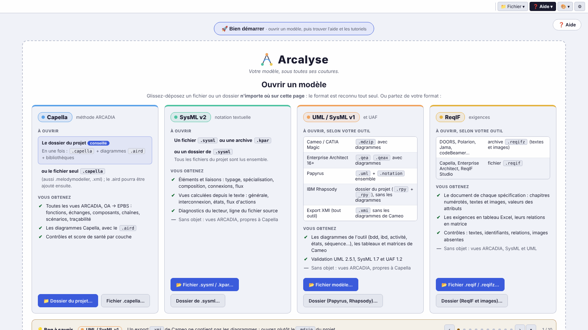
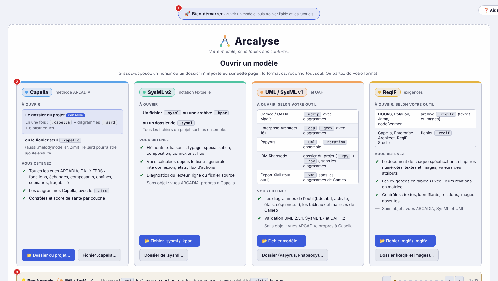

[📘 Sommaire du guide](../GUIDE-UTILISATION.md) · ◀ [1. Présentation et prérequis](01-presentation.md) · [3. L'interface : barre principale et menus](03-interface.md) ▶

# 2. Démarrer : écran d'accueil et ouverture d'un modèle

À l'ouverture du fichier HTML, l'écran d'accueil invite à charger un modèle. Sans modèle, la barre du haut se réduit à 📁 Fichier, ❓ Aide et ⚙ (plus 🌐 et 🎨 ▾) ; le bouton **❓ Aide** en haut à droite de l'écran ouvre l'aide complète.

| N° | Commande | Ce qu'elle fait |
|---|---|---|
| 1 | **🚀 Bien démarrer** | Courte visite : montre où ouvrir votre fichier ; elle reprend automatiquement une fois le modèle chargé pour montrer où trouver l'aide et les tutoriels. |
| 2 | **Cartes par format** | Une carte par format lu (**Capella**, **SysML v2**, **UML / SysML v1**, **ReqIF** ; une seule dans une version réduite à un format) : quoi ouvrir (pour UML / SysML v1, selon l'outil : `.mdzip` de Cameo, `.qea` d'Enterprise Architect, `.uml` + `.notation` de Papyrus, dossier d'un projet Rhapsody, `.xmi` ; pour ReqIF : archive `.reqifz` de DOORS, Polarion, Jama, codeBeamer…, ou `.reqif` de Capella, Enterprise Architect, ReqIF Studio), ce que vous obtiendrez, ce qui est sans objet. Ses boutons ouvrent le **dossier du projet** (Edge / Chrome : le `.capella`, ses `.aird`, ses bibliothèques et les images du projet ensemble ; plusieurs modèles : une liste vous laisse choisir) ou un sélecteur **filtré sur ce format** (plusieurs fichiers pour les `.sysml` d'un projet, un `.uml` et son `.notation`, ou un `.reqif` et ses images). |
| 3 | **💡 Bon à savoir** | Astuces qui défilent sur les pièges courants (export `.xmi` de Cameo sans diagrammes, `.notation` seul, anciens projets d'EA, `.reqif` sans ses images…) ; ‹ ›, les points et ⏸ pour les parcourir ; le défilement s'arrête au survol. |
| 4 | **📄 Ouvrir une page de projet…** | Reprend une page Arcalyse enregistrée avec une version précédente (à partir de la 2.1) : modèle, diagrammes, revue, accueil, tableaux de bord, ▤ Tableau, vues, barre, thème, règles de nommage — au choix. La page n'est pas exécutée, seules ses données sont lues. |
| 5 | **📖 Que peut-on analyser ?** | Ouvre l'aide complète (onglet Démarrage). |
| 6 | **🎓 Visite guidée de l'interface** | Présente chaque zone de l'interface pas à pas (plus complète avec un modèle chargé). |
| 7 | **ℹ À propos** | Version, auteur, licence, composants tiers, informations techniques. |
|  | **🌐 English version** | Versions bilingues (les cinq livrables) : passe l'interface en anglais (🌐 Version française pour revenir) ; aussi par le bouton 🌐 de la barre. |

## Les quatre façons d'ouvrir un modèle

1. **Glisser-déposer** : faites glisser le fichier modèle depuis l'explorateur de fichiers **n'importe où dans la fenêtre** : le format est reconnu. Vous pouvez aussi déposer **le `.capella` et le `.aird` ensemble** (ou un `.uml` et son `.notation`, un `.reqif` et ses images), **le dossier du projet** (Edge / Chrome), ou une **page de projet de travail** `.html`. Une fois un modèle Capella ouvert, un `.aird` déposé ajoute ses diagrammes et un fichier pure::variants (`.xfm`, `.vdm`, `.ccfm`) ses variantes (🎚 Variantes).
2. **Bouton « Fichier… » de la carte du format** sur l'écran d'accueil (ex. **Fichier .capella…**).
3. **Menu 📁 Fichier › 📂 Ouvrir un modèle…** (voir [§ 3.3](03-interface.md#33--fichier)). Si un modèle est déjà ouvert, un avertissement rappelle que le travail non enregistré sera perdu et propose d'abord 💾 Enregistrer la page.
4. **📁 Dossier du projet…** (bouton d'accueil ou 📁 Fichier › 📁 Ouvrir le dossier du projet…) : la façon conseillée pour Capella — modèle, diagrammes, bibliothèques et **images du projet** (formes « image » des diagrammes, dossier `images/`) en une fois.

L'écran d'accueil présente une carte par format, chacune expliquée (pour Capella : **📁 Dossier du projet…**, conseillé — modèle, diagrammes et bibliothèques en une fois — ou **Fichier .capella…**, le modèle seul), puis le bandeau **Projet de travail** (**📄 Ouvrir une page de projet…** : reprendre une page enregistrée). Si le dossier contient **plusieurs modèles**, la liste « lequel ouvrir ? » les présente avec leur sous-dossier ; les autres `.capella` du dossier sont chargés comme bibliothèques si le modèle choisi y fait référence.

Le modèle est analysé (quelques secondes pour un gros modèle), puis la vue **🏠 Accueil du projet** s'ouvre automatiquement. Ouvert par la carte du format, 📂 Ouvrir un modèle… ou le dossier du projet (Edge / Chrome), le fichier est ensuite **suivi** : une nouvelle version enregistrée par l'outil de modélisation est signalée par 🔄 au retour dans la fenêtre (ou à intervalle régulier, ⚙ › 🔄 Suivi du fichier), et le modèle n'est mis à jour qu'après validation ([§ 16](16-suivi-fichier.md)).

Une version réduite à un format (par exemple `arcalyse-capella.html`) refuse un fichier d'un autre format et indique la version qui l'ouvre (celle du format, ou `arcalyse-complet.html`).

> ⚠ Quand un modèle est chargé, le navigateur demande une confirmation avant de quitter la page (← Précédent, fermeture de l'onglet) : pensez à **💾 Enregistrer** pour garder votre travail (commentaires, vues, tableaux de bord…).

---

[📘 Sommaire du guide](../GUIDE-UTILISATION.md) · ◀ [1. Présentation et prérequis](01-presentation.md) · [3. L'interface : barre principale et menus](03-interface.md) ▶
