[📘 Sommaire du guide](../GUIDE-UTILISATION.md) · ◀ [2. Démarrer : écran d'accueil et ouverture d'un modèle](02-demarrer.md) · [4. 🏠 Accueil du projet](04-accueil.md) ▶

# 3. L'interface : barre principale et menus

## 3.1 La barre principale

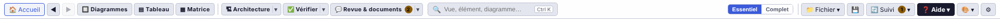

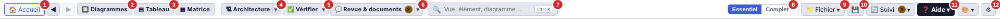

| N° | Bouton | Rôle |
|---|---|---|
| ◀ ▶ | **Historique** | À droite de 🏠 Accueil. Précédent / Suivant (Alt+← / Alt+→) : vues, éléments du détail et diagrammes ouverts ([§ 3.7](#37---historique-de-navigation)). |
| 1 | **🏠 Accueil** | Accueil du projet : fiche, contenu du modèle, check-lists et plans de revue ([§ 4](04-accueil.md)). |
| 2 | **🔲 Diagrammes** | Diagrammes du projet (`.aird`) dessinés comme dans Capella ; pour un modèle UML / SysML v1, diagrammes et tableaux du fichier ; pour SysML v2, vues calculées ; ⇄ Avant / après d'un diagramme ([§ 10](10-diagrammes.md)). |
| 3 | **▤ Tableau** | Tous les éléments en tableau configurable ([§ 6](06-tableau.md)). |
| 3b | **▦ Matrice** | Éléments en lignes et en colonnes reliés par les relations choisies, comme la Dependency Matrix de Catia Magic ([§ 25](25-matrice.md)). |
| 4 | **🏗 Architecture ▾** | Comment le système est construit : fonctions et échanges, composants et interfaces, chaînes et scénarios, modes et états, capacités, données, déploiement ; 🗺 Relation Map et 🌳 arborescence ([§ 3.2](#32-menus-des-vues-épingles-et-ctrlk)). |
| 5 | **✅ Vérifier ▾** | Le modèle est-il juste et complet ? Santé et contrôles, traçabilité, exigences, propriétés, contraintes, comparaison de versions, variantes (modèle 150 %), statut de revue. |
| 6 | **💬 Revue & documents ▾** | Commentaires de revue (badge : commentaires non clos ; ⚠ n : à vérifier après une mise à jour), check-lists et plans de revue, dossiers à faire relire, rapports automatiques, tableaux de bord. |
| 7 | **🔍** (Ctrl+K) | Recherche d'une vue, d'un élément du modèle ou d'un diagramme ; sans texte, toutes les vues ([§ 3.2](#32-menus-des-vues-épingles-et-ctrlk)). |
| 8 | **Essentiel · Complet** | Niveau d'affichage des menus : les vues les plus utilisées (par défaut) ou toutes les vues ([§ 3.4](#34--préférences)). |
| 9 | **📁 Fichier ▾** | Ouvrir, mettre à jour, 🔄 suivre le fichier, enregistrer, classeur Excel, exporter les réglages ([§ 3.3](#33--fichier)). |
| 10 | **💾** | Enregistrement direct de la page (Ctrl+S ; Maj+clic : enregistrer sous). |
| 11 | **❓ Aide ▾** | Aide complète, visite guidée, 🎯 visite de la vue affichée, visites des panneaux, À propos ([§ 19](19-aide.md)). |
| 11b | **🌐 · 🎨 ▾** | Langue de l'interface (FR / EN, versions bilingues) et **thème** : Sombre, Clair, Office 2007, Contraste, personnalisé ([§ 18](18-themes.md)). |
| 12 | **⚙** | Préférences : niveau des menus, barre en icônes seules, thème, enregistrement automatique, format des exports, 🩺 profil de contrôles ([§ 3.4](#34--préférences)). |

Sans modèle ouvert, la barre se réduit à 📁 Fichier, ❓ Aide, 🌐, 🎨 ▾ et ⚙. Quand une nouvelle version du fichier du modèle est détectée (`.capella`, `.sysml`, `.uml`, `.xmi`, `.mdzip`, `.qea`, `.reqif`…), un bouton **🔄 Suivi** apparaît après 💾, avec un badge ([§ 16](16-suivi-fichier.md)).

> Refonte 3.0 : les anciens menus 🧭 Explorateur, 📡 Flux & interfaces et 🔬 Analyses sont remplacés par 🏗 Architecture, ✅ Vérifier et 💬 Revue & documents ; les boutons 🗺 Relation Map, 🔄 Suivi, 💬 Revue et 📜 Scripts ont quitté la barre (Relation Map : 🏗 Architecture › Explorer ; Suivi : 📁 Fichier, le bouton ne revient qu'à la détection d'une nouvelle version ; Revue et Scripts : 💬 Revue & documents). Le thème est au bouton 🎨 ▾ (à côté de 🌐) et dans ⚙.

## 3.2 Menus des vues, épingles et Ctrl+K

Les vues proches sont réunies en **familles** : une seule entrée de menu, puis une **barre de famille** sous la barre principale pour passer d'une vue de la famille à l'autre.

| 🏗 Architecture ▾ | ✅ Vérifier ▾ | 💬 Revue & documents ▾ |
|---|---|---|
| **ƒ Fonctions & échanges** : ƒ Fonctions, ƒ⇆ échanges fonctionnels, 🟨 activités OA | 💚 Santé & contrôles | 💬 Commentaires (panneau de revue) |
| **🧱 Composants & interfaces** : SA · System Component, LA · Logical Component, PA · Behavior Exchange, PA · Physical Link, 🧩 Ports | **🧬 Traçabilité entre couches** : tableau de traçabilité, ⇶ graphe des réalisations | ☑ Check-lists & plans de revue |
| **⚡ Chaînes & scénarios** : ⚡ Chaînes, 🎬 Scénarios | 🧾 Exigences, **🎛 Propriétés & contraintes** (propriétés PVMT, 🔒 contraintes) | 📑 Faire relire (dossiers de relecture) |
| 🚦 Modes & états, 🎯 Capacités & missions, 🗃 Données & interfaces, 🖧 Déploiement & EPBS | ⚖ Comparaison de versions, 🎚 Variantes (150 %), 🔖 Statut de revue | 📘 Rapports automatiques, 📐 Tableau de bord |
| *Explorer* : 🗺 Relation Map, 🌳 Arborescence ; *Complet* : 🃏 Cartes | *Avancé (Complet)* : 🏷 Catégories d'échanges, 📦 REC / RPL, 📚 Bibliothèques | *Complet* : 📜 Scripts |

Pour un modèle **UML / SysML v1**, 🏗 Architecture et ✅ Vérifier proposent à la place des vues ARCADIA la famille **🧬 UML / SysML v1** et ses vues de vérification ([§ 24.4](24-sysml-uml.md#244--uml--sysml-v1)) ; pour **SysML v2**, la vue **🧩 SysML v2** ([§ 24.3](24-sysml-uml.md#243--sysml-v2)) ; pour des exigences **ReqIF**, la vue **📑 ReqIF** (document, exigences, relations, types, pièces jointes, contrôles).

Les **vues sans données** dans le modèle ouvert (pas de scénario, d'exigence, de variante…) quittent les menus en mode Essentiel — une ligne en bas du menu en donne le nombre — et restent, grisées, avec la mention « (absent de ce modèle) » en mode Complet et dans la recherche (réglage ⚙ Préférences › ☰ Affichage).

| 🏗 Architecture (mode Essentiel) | 💬 Revue & documents |
|---|---|
| 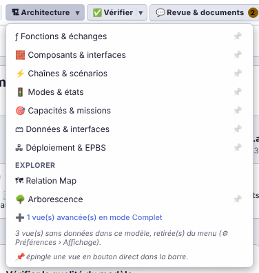 | 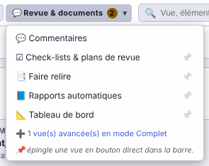 |

Une famille s'ouvre sur la dernière vue utilisée. **Couche commune** : 🧱 Composants & interfaces a une puce par couche (SA, LA, PA comportement, PA nœuds) ; ƒ Fonctions & échanges et ⚡ Chaînes & scénarios ont un sélecteur **Couche** (Toutes, OA, SA, LA, PA, EPBS). La couche choisie est **mémorisée** (avec la page) et reprise d'une famille à l'autre : choisir LA dans 🧱 puis ouvrir ƒ Fonctions & échanges affiche les fonctions LA. À droite de la barre de famille, la pastille 🩺 mène aux contrôles de la vue dans 💚 Santé & contrôles. Chaque vue reste trouvable seule par la recherche 🔍 et peut être épinglée (📌).

En mode **Essentiel**, les vues marquées *Complet* n'apparaissent pas dans les menus ; une ligne « ➕ n vue(s) avancée(s) en mode Complet » en bas du menu bascule en mode Complet. Elles restent accessibles par la recherche.

Dans chaque menu, l'icône **📌** à droite d'une vue l'**épingle** : elle devient un bouton direct de la barre (un second clic la retire). Par défaut, les boutons directs sont 🏠 Accueil, 🔲 Diagrammes, ▤ Tableau et ▦ Matrice.

**🔍 Recherche** (champ de la barre, ou **Ctrl+K**) :

- tapez quelques lettres, flèches ↑ ↓ pour choisir, **Entrée** pour ouvrir. La recherche trouve les **vues**, les **éléments du modèle** (nom, type, couche, identifiant ; le type et le chemin de l'élément sont rappelés, Entrée l'affiche dans le panneau de détail) et les **diagrammes** (du `.aird` chargé, du fichier UML / SysML v1, ou vues calculées SysML v2 : nom, sigle, couche ou famille ; Entrée l'ouvre dans 🔲 Diagrammes). Chaque vue trouvée rappelle son menu ; une vue sans données porte « (absent de ce modèle) ». La section la plus pertinente vient en tête ; 8 éléments et 5 diagrammes au plus sont proposés, précisez la recherche au besoin ;
- sans texte : **🕘 Derniers ouverts** (éléments et diagrammes ouverts par la recherche), puis **toutes les vues**, y compris celles du mode Complet, avec leurs **📌** : les **boutons directs** d'abord, puis chaque menu (🏗 Architecture, ✅ Vérifier, 💬 Revue & documents), familles et vues membres comprises ; la vue affichée est marquée ● ;
- **↺ Rétablir la barre par défaut** (en bas de la liste) ; **Échap** referme la liste.

| Recherche « fonc » | Sans texte : toutes les vues |
|---|---|
| 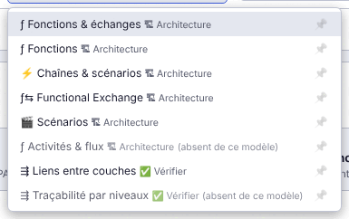 | 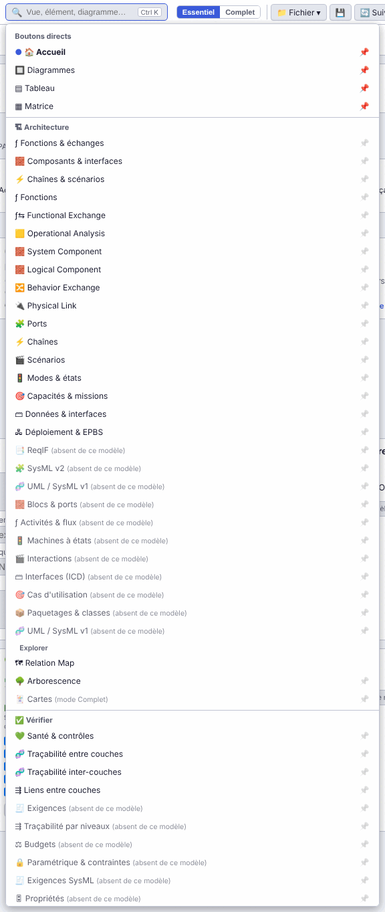 |

Le réglage de la barre est enregistré avec la 💾 page HTML et dans le fichier ⚙ Interface et vues. Un réglage enregistré avant la 3.0 est converti à l'ouverture : Expert → Complet, Simplifié ou Personnalisé → Essentiel ; les vues que vous aviez épinglées vous-même restent des boutons directs.

## 3.3 📁 Fichier

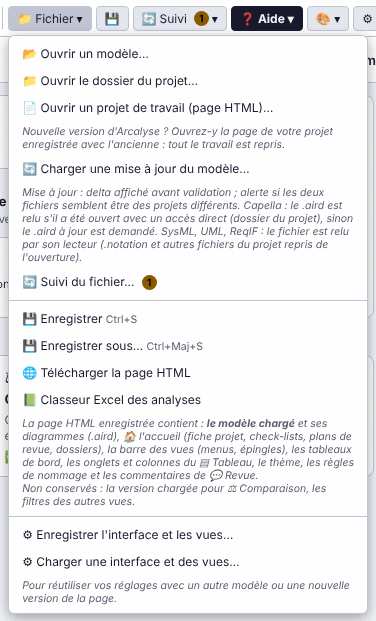

| Entrée | Ce qu'elle fait |
|---|---|
| **📂 Ouvrir un modèle…** | Remplace le modèle affiché par un autre fichier modèle — Capella, SysML v2, UML / SysML v1, ReqIF (avertissement si un modèle est déjà ouvert). Le sélecteur propose d'office le type **« Tous les modèles »** : pas besoin de changer de type de fichier pour passer d'un format à l'autre. |
| **📁 Ouvrir le dossier du projet…** | Charge le `.capella` avec ses `.aird`, ses bibliothèques et les images du projet, les `.sysml` d'un projet, un modèle UML et son `.notation`, un projet Rhapsody (`.rpy` et son dossier `_rpy`), ou des `.reqif` et leurs images (Edge / Chrome). Si le dossier contient plusieurs modèles, une **fenêtre au centre de l'écran** demande lequel ouvrir (filtre, flèches, Entrée ; Échap la ferme et « 📁 Choisir le modèle… » la rouvre). |
| **📄 Ouvrir un projet de travail (page HTML)…** | Reprend une page enregistrée par une version précédente d'Arcalyse ; vous choisissez les parties à reprendre. |
| **🔄 Charger une mise à jour du modèle…** | Compare une nouvelle version du fichier modèle (Capella, SysML v2, UML / SysML v1, ReqIF) au modèle affiché, **montre le delta**, puis met à jour après validation ([§ 16](16-suivi-fichier.md)). Alerte si les deux fichiers semblent être des projets différents. Capella : le `.aird` est relu s'il a été ouvert avec un accès direct (dossier du projet), sinon il est demandé ; SysML, UML, ReqIF : le fichier est relu par son lecteur (`.notation` et autres fichiers repris de l'ouverture). |
| **🔄 Suivi du fichier…** | Pour tous les formats (`.capella`, `.sysml`, `.kpar`, `.uml`, `.xmi`, `.mdzip`, `.qea`, `.reqif`…) : vérifier maintenant, détection automatique, delta en attente, historique ([§ 16](16-suivi-fichier.md)). Un badge signale les enregistrements en attente. |
| **💾 Enregistrer** (Ctrl+S) | Écrit la page complète (application + modèle + votre travail) dans un fichier choisi une fois, puis l'écrase à chaque enregistrement. |
| **💾 Enregistrer sous…** (Ctrl+Maj+S) | Choisit un nouveau fichier. |
| **🌐 Télécharger la page HTML** | Télécharge la page complète (dossier Téléchargements). |
| **📗 Classeur Excel des analyses** | Un classeur `.xlsx`, une feuille par analyse ([§ 3.5](#35--exports-excel)). |
| **⚙ Enregistrer l'interface et les vues…** | Fichier `.json` des réglages **sans le modèle** (parties au choix, [§ 17](17-enregistrer.md)). |
| **⚙ Charger une interface et des vues…** | Réapplique un tel fichier, par exemple à un autre modèle. |

 

## 3.4 ⚙ Préférences

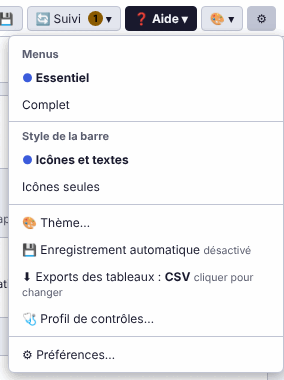

La roue crantée **⚙** (à droite de ❓ Aide) ouvre un menu rapide (niveau des menus, style de la barre, 🎨 Thème…, enregistrement automatique, format des exports, 🩺 profil de contrôles) ; **⚙ Préférences…** ouvre la fenêtre complète, rubriques à gauche ; **🎓** dans son en-tête en lance la visite guidée, rubrique par rubrique :

| Rubrique | Réglages |
|---|---|
| ☰ Affichage | Niveau des menus (Essentiel / Complet), **masquer les vues sans données** dans le modèle ouvert (coché par défaut), style de la barre. |
| 🎨 Thème | Sombre, Clair, Office 2007, Contraste (et 🎨 Personnalisé une fois créé), avec aperçu ; **🎨 Ajuster les couleurs…** ouvre l'éditeur de thème ([§ 18](18-themes.md)). |
| 🔄 Suivi du fichier | Détection automatique des nouvelles versions du fichier du modèle, quel que soit son format (10 s, 30 s, 1 min, 5 min), vérification au retour dans la fenêtre, fichier suivi et type d'accès ; enregistré avec la page ([§ 16](16-suivi-fichier.md)). Un dossier de `.sysml` ou de `.reqif` n'est pas suivi. |
| 💾 Enregistrement | Enregistrement automatique et fichier de secours (voir plus bas). |
| ⚙ Interface et vues | Parties du fichier `.json` de réglages, enregistrer / charger ([§ 17](17-enregistrer.md)). |
| 🩺 Contrôles et nommage | 🩺 Profil de contrôles ([§ 3.6](#36--profil-de-contrôles)), ✍ règles de nommage (verbes acceptés, mots refusés ; aussi dans ƒ Fonctions › 🩺 Contrôles). |
| ⬇ Exports | Excel (.xlsx) ou CSV pour les boutons ⬇ CSV ; 📗 Classeur Excel des analyses ([§ 3.5](#35--exports-excel)). |

 

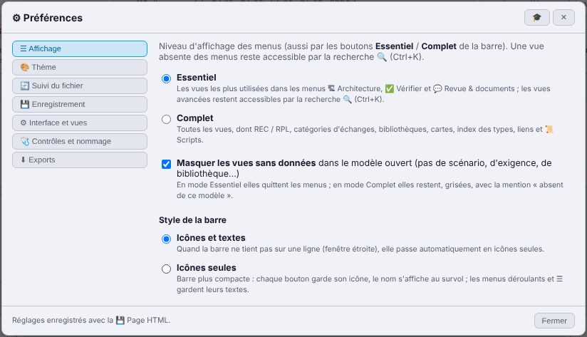

**Menus** — deux niveaux, aussi par les boutons **Essentiel** / **Complet** de la barre :

| Niveau | Menus |
|---|---|
| **Essentiel** (par défaut) | Les vues les plus utilisées dans 🏗 Architecture, ✅ Vérifier et 💬 Revue & documents ; les vues sans données dans le modèle ouvert sont retirées des menus. |
| **Complet** | Ajoute 🃏 Cartes, 🏷 Catégories d'échanges, 📦 REC / RPL, 📚 Bibliothèques et 📜 Scripts ; les vues sans données restent, grisées. |

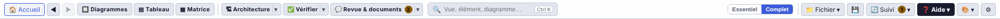

| Menu ✅ Vérifier en mode Complet | Barre en icônes seules |
|---|---|
| 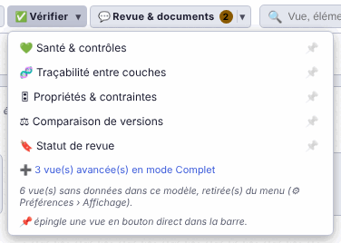 | 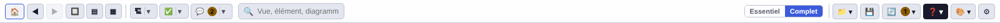 |

**Style de la barre** : *Icônes et textes* ou *Icônes seules* (barre compacte, nom au survol ; 🧱 marqué **SA** / **LA** ; les menus déroulants gardent leurs textes). Le style se combine avec chaque niveau. En *Icônes et textes*, la barre passe **automatiquement** en icônes seules tant qu'elle ne tient pas sur une ligne (fenêtre étroite), et retrouve ses textes quand la place revient ; le menu ⚙ l'indique.

**💾 Enregistrement automatique** (désactivé par défaut, Edge / Chrome) : toutes les 2 à 30 minutes, la page est écrite dans son fichier (celui de 💾 / Ctrl+S), seulement si elle a changé. Option **Garder la version précédente** : avant chaque enregistrement (automatique ou 💾), l'ancien contenu est copié dans un fichier de secours (par exemple `mon-projet.backup.html`, qui s'ouvre comme une page normale). Le navigateur oublie les fichiers choisis quand la page est fermée : à la réouverture, un bandeau propose de les choisir à nouveau.

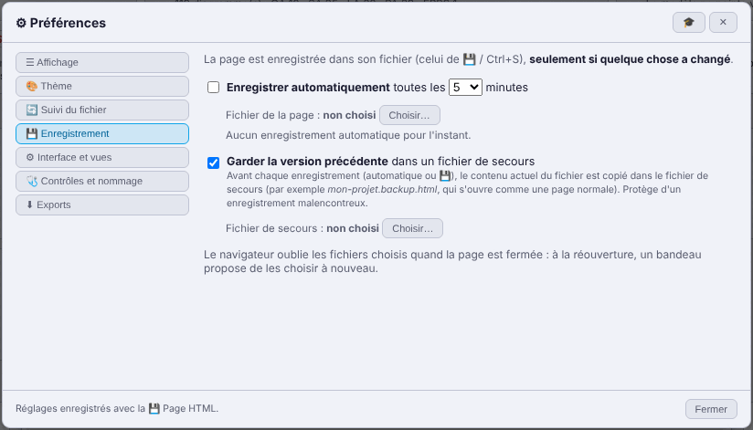

Tous ces réglages sont enregistrés avec la 💾 page HTML et dans la partie « ☰ Barre des vues et ⚙ préférences » du fichier ⚙ Interface et vues.

---

## 3.5 ⬇ Exports Excel

**⚙ › Exports des tableaux : CSV / Excel** : tous les boutons ⬇ CSV des vues produisent alors un classeur **.xlsx** (une feuille, en-tête en gras figé, filtres automatiques, largeurs de colonnes, nombres typés) ; le réglage est enregistré avec la barre. **📁 Fichier › 📗 Classeur Excel des analyses** : un classeur, une feuille par analyse (éléments, fonctions, échanges fonctionnels, composants, Component Exchanges, Physical Links, chaînes, exigences, statuts de revue, contrôles, santé). Le fichier est écrit par Arcalyse, sans bibliothèque.

## 3.6 🩺 Profil de contrôles

**⚙ › 🩺 Profil de contrôles…** (ou le bouton **🩺 Profil** en tête de chaque onglet 🩺 Contrôles) liste, vue par vue, tous les contrôles d'Arcalyse avec le nombre de lignes qu'ils signalent sur le modèle chargé. Pour chacun :

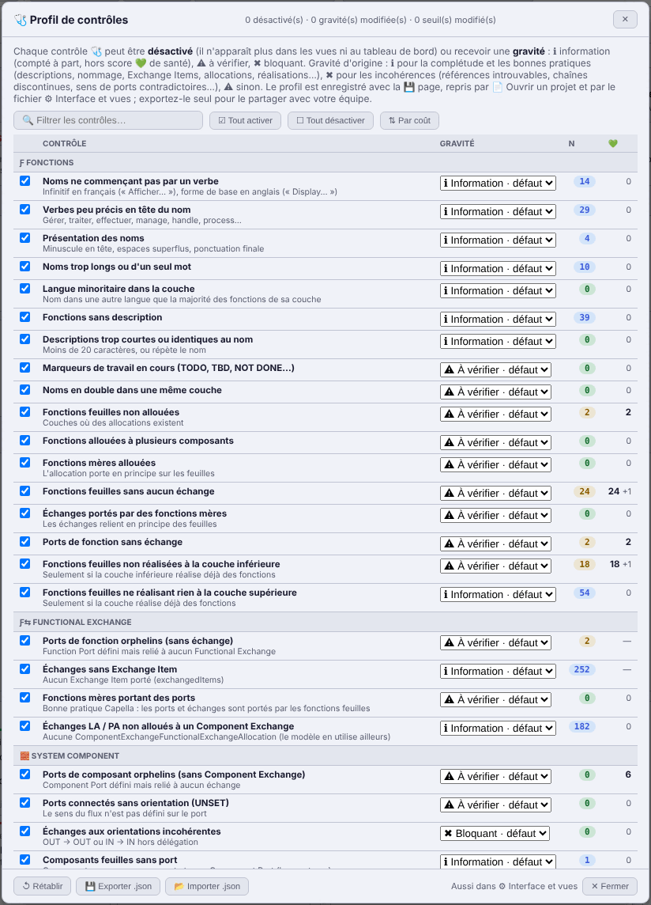

- **activé** ou non : un contrôle désactivé disparaît des vues et des indicateurs du tableau de bord ; il reste listé en bas de l'onglet 🩺 Contrôles pour être réactivé ;
- **gravité** : ℹ information (compté à part, hors « points à vérifier » et hors score 💚 de santé), ⚠ à vérifier (défaut), ✖ bloquant (signalé dans le total) ;
- **seuils** : longueur minimale d'une description, nom trop long (caractères, mots), nombre de statuts pour qu'une couche soit « majoritairement validée ».

En tête : filtre des contrôles, **☑ Tout activer** / **☐ Tout désactiver** (contrôles affichés) et, modèle chargé, **⇅ Par coût** (tous les contrôles à plat, les plus coûteux pour le score 💚 d'abord ; colonne 💚 : coût et gain de score). **Poids du score 💚** : poids de chaque gravité dans le score de santé (0 sort la gravité du score). **↺ Rétablir** revient au profil par défaut.

Pour un modèle UML / SysML v1, chaque **règle de validation** du lecteur se coche ou se décoche aussi directement dans 🧬 UML / SysML v1 › 🩺 Diagnostics › **Σ Répartition par règle** ([§ 24.4](24-sysml-uml.md#244--uml--sysml-v1)) ; une règle décochée n'est plus comptée nulle part (🏠 Accueil, 💚 Santé, tableau de bord), et ce choix est gardé dans le profil.

Le profil est enregistré avec la 💾 page, repris par 📄 Ouvrir un projet et par le fichier ⚙ Interface et vues ; **💾 Exporter .json / 📂 Importer .json** permettent de partager le profil d'une équipe. Les contrôles sont désignés par leur titre : un profil est propre à une langue de l'interface.
## 3.7 ◀ ▶ Historique de navigation

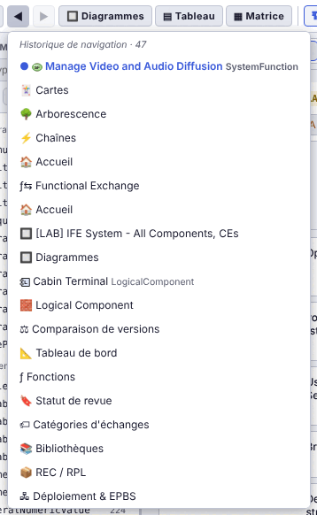

Les boutons **◀ ▶** à droite de 🏠 Accueil (**Alt+←** / **Alt+→**, boutons latéraux de la souris) reviennent sur les étapes précédentes, comme dans un navigateur : vues ouvertes (analyses des menus 🏗 et ✅ comprises), éléments ouverts dans le panneau de détail, diagrammes ouverts. L'infobulle nomme l'étape visée. **Clic droit** sur ◀ ou ▶ : liste des étapes (la plus récente en haut, l'étape courante marquée ●), clic pour y aller directement. Ouvrir une nouvelle vue après un retour oublie les étapes « suivantes », comme dans un navigateur. L'historique est vidé à l'ouverture d'un autre modèle (une mise à jour 🔄 du même modèle le conserve).

 

---

[📘 Sommaire du guide](../GUIDE-UTILISATION.md) · ◀ [2. Démarrer : écran d'accueil et ouverture d'un modèle](02-demarrer.md) · [4. 🏠 Accueil du projet](04-accueil.md) ▶
