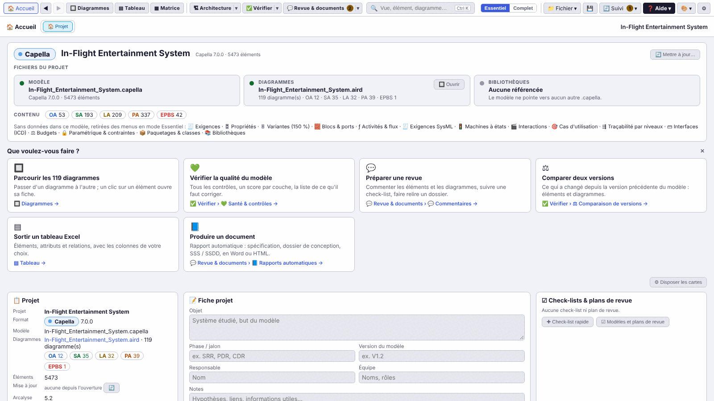
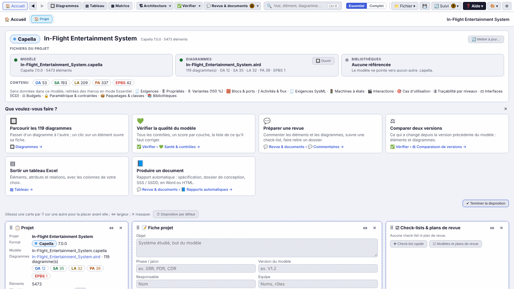
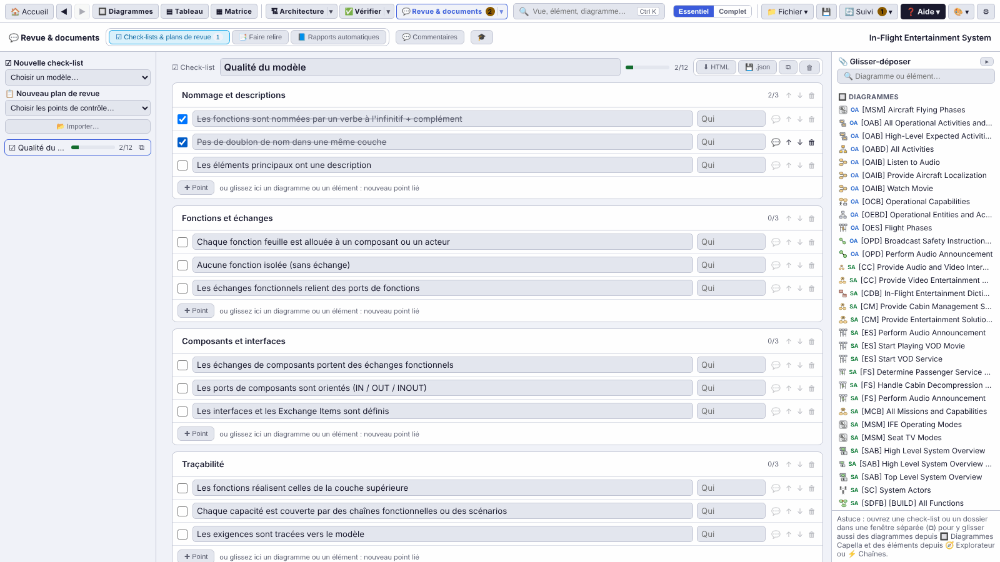
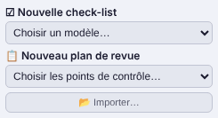
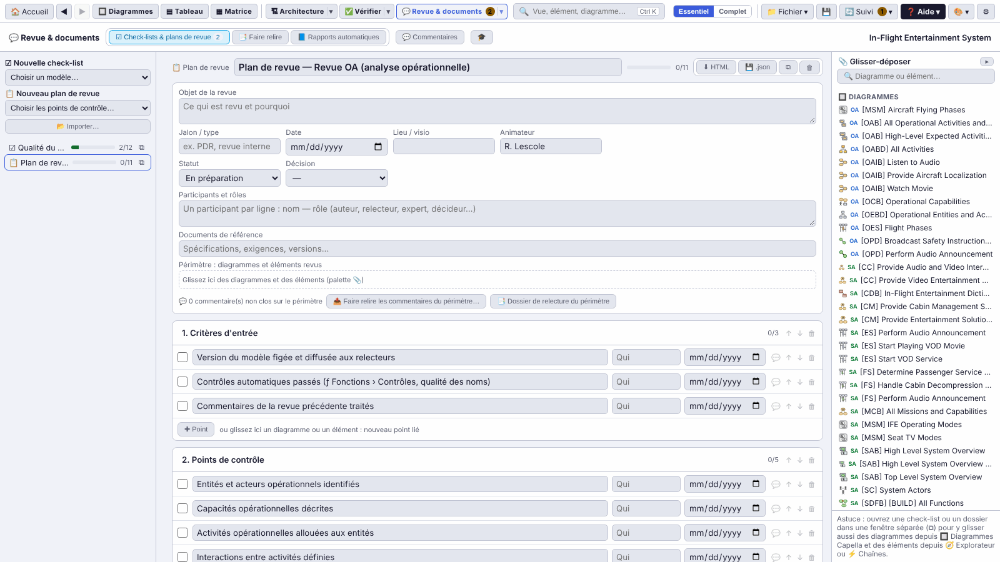
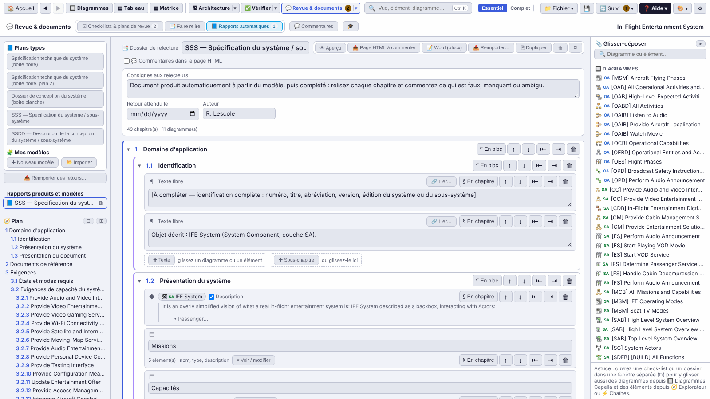
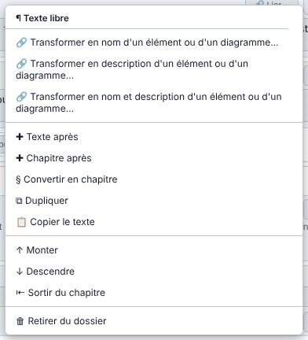
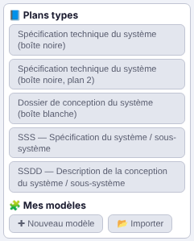
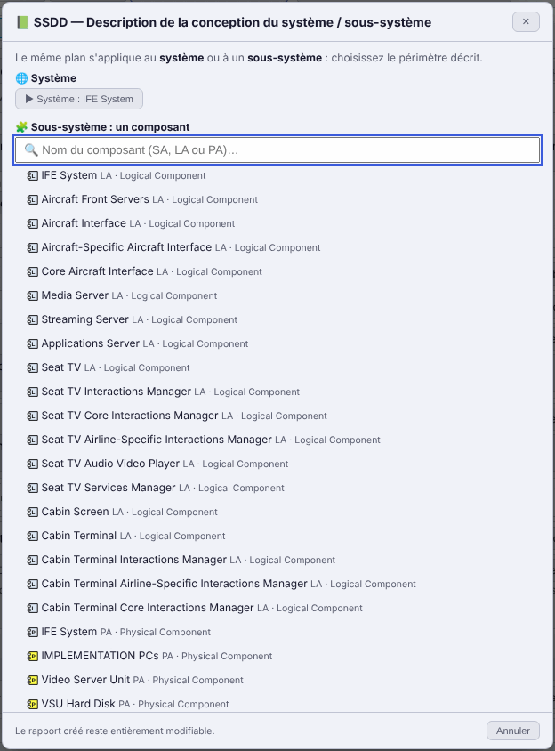

[📘 Sommaire du guide](../GUIDE-UTILISATION.md) · ◀ [3. L'interface : barre principale et menus](03-interface.md) · [5. 🗺 Relation Map](05-relation-map.md) ▶

# 4. 🏠 Accueil du projet

Vue affichée à l'ouverture d'un modèle (bouton **🏠 Accueil**, tout à gauche). Deux espaces : **🏠 Accueil** — onglet **🏠 Projet** (bouton 🏠 de la barre) — et **💬 Revue & documents** — onglets **☑ Check-lists & plans de revue**, **📑 Faire relire** (dossiers de relecture) et **📘 Rapports automatiques** ([§ 4.4](#44--dossiers-de-relecture-et--rapports)), ouverts par le menu 💬 Revue & documents ; un bouton **💬 Commentaires** y ouvre le panneau de revue et **🎓** en lance la visite guidée (onglets, check-lists, dossiers, rapports, 🧩 modèles). Tout ce qui y est saisi est enregistré dans la page (💾).

## 4.1 🏠 Projet

**En-tête du projet**, adapté au format du modèle : **pastille de format** (Capella, SysML v2, UML / SysML v1, ReqIF), nom du projet, version de Capella ou outil d'origine et nombre d'éléments, bouton **🔄 Mettre à jour…** ([§ 16](16-suivi-fichier.md)), puis **Fichiers du projet** — une case par fichier attendu, avec son état (vert : présent ; pointillés : à compléter ; rouge : en erreur) et l'action qui manque :

| Format | Cases |
|---|---|
| Capella | **Modèle** (fichier, version de Capella) ; **Diagrammes** (le `.aird` chargé, son nombre de diagrammes par couche, **🔲 Ouvrir** ; ou « Pas de .aird » et **📂 Ajouter le .aird…**) ; **Bibliothèques** : « n chargée(s) · m à traiter », **Détail ▾** déplie le tableau des bibliothèques référencées avec leur état — *Chargée*, *Chargée, cibles absentes* (des éléments visés n'y sont pas), *Fichier absent* (bouton **Charger le fichier…**), *Jamais utilisée* (déclarée sans référence : la déclaration peut sans doute être retirée dans Capella) — et **Voir les références** (📚 Bibliothèques). |
| SysML v2 | **Modèle** (fichiers lus), **Vues calculées**, **Lecture** (diagnostics du lecteur). |
| UML / SysML v1 | **Modèle** (outil d'origine), **Diagrammes** (de l'outil, tableaux et matrices de Cameo ; dit pourquoi il n'y en a pas : export `.xmi` de Cameo, `.uml` sans son `.notation`), **Validation** (erreurs et avertissements, **Voir** : 🩺 Diagnostics). |
| ReqIF | **Exigences** (fichiers, spécifications, nombre d'exigences, **📄 Document**), **Pièces jointes** (images ; celles citées mais absentes), **Lecture** (diagnostics du lecteur ReqIF). |

En dessous, le **contenu** (éléments par couche ARCADIA, ou par famille hors Capella) et les **vues sans données** dans ce modèle (pas de scénario, d'exigence, de bibliothèque…) : en mode Essentiel elles sont retirées des menus, en mode Complet elles restent grisées (réglage ⚙ Préférences › Affichage). Pour un modèle SysML, UML ou ReqIF, les vues ARCADIA propres à Capella sont comptées à part (**Voir la liste ▾**).

**Que voulez-vous faire ?** : six tâches courantes, choisies selon le format et l'état du modèle, la plus utile en premier (ajouter le `.aird` manquant, regarder les incohérences d'un modèle UML…) ; chacune ouvre la bonne vue. Pour Capella : parcourir les diagrammes, vérifier la qualité du modèle (💚 Santé), préparer une revue (💬 Commentaires), comparer deux versions, sortir un tableau Excel (▤ Tableau), produire un document (📘 Rapports automatiques) ; pour SysML ou UML : parcourir les diagrammes ou les vues calculées, explorer les éléments et liaisons, vérifier le modèle, revue, comparaison, tableau. **✕** masque la section ; **⚙ Disposer les cartes** › « ＋ Que voulez-vous faire ? » la réaffiche.

Puis **six cartes** :

| Carte | Contenu |
|---|---|
| **📋 Projet** | Nom du projet, **format** (pastille et version de Capella lue dans le fichier, ou outil d'origine), fichier(s), diagrammes chargés et leur nombre par couche (clic sur le nom du `.aird` : 🔲 Diagrammes ; **📂 Ouvrir le .aird…** s'il n'y en a pas) — ou vues calculées, diagrammes et tableaux du fichier, spécifications ReqIF —, nombre d'éléments, **dernière mise à jour** du modèle et **🔄** pour en charger une, page de projet reprise, version d'Arcalyse. |
| **📝 Fiche projet** | Champs libres : objet, phase / jalon, version du modèle, responsable, équipe, notes. |
| **☑ Check-lists & plans de revue** | Avancement de chaque document ; **✚ Check-list rapide** (liste vide, curseur sur le premier point) ; **☑ Modèles et plans de revue** (ouvre l'onglet) ; **⧉** ouvre un document dans une fenêtre séparée. |
| **🧩 Contenu du modèle** | Une carte par couche (OA, SA, LA, PA, EPBS, Transverse), ou par famille hors Capella : principaux types et leur nombre (infobulle : description du type). |
| **💚 Santé du modèle** | **💚 Calculer la santé du modèle**, puis score, points à vérifier, bloquants, évolution depuis la version précédente et score par couche ; **📊 Détail** (💚 Santé & contrôles), **🩺 Profil** ([§ 12.10](12-analyses.md#1210--santé--contrôles)). |
| **💬 Revue** | État de la revue : commentaires non clos, par criticité, à vérifier, en retard ; **💬 Ouvrir la revue** ; **📤 Faire relire des commentaires…** ([§ 15.6](15-revue.md#156--faire-relire-des-commentaires-relecture-par-dautres-personnes)). |

**⚙ Disposer les cartes** (en haut à droite) réorganise la page, comme un tableau de bord :

- **glissez une carte par ⠿** sur une autre pour la placer avant elle ;
- **⇔** passe sa largeur de 1 à 2 colonnes ; **✕** la masque (**＋ nom** pour la réafficher) ;
- **↺ Disposition par défaut** ; **✔ Terminer la disposition** pour revenir à l'affichage normal.

La disposition est enregistrée dans la page.

## 4.2 ☑ Check-lists & plans de revue

**Créer une check-list** : liste **☑ Nouvelle check-list** (colonne de gauche) → **Vide (à remplir)** (le curseur est placé sur le premier point ; Entrée ajoute le suivant) ou un modèle (**Qualité du modèle**, **revue OA / SA / LA / PA**). Depuis 🏠 Projet, **✚ Check-list rapide** crée aussi une liste vide. **📂 Importer…** reprend une check-list enregistrée en `.json`. La check-list s'ouvre au centre :

 

- cocher un point le barre et fait avancer la jauge (« 2/12 ») ;
- **Qui** : responsable du point ; **💬** (au survol) : ajouter un constat ; **↑ ↓ 🗑** (au survol) : déplacer, supprimer ;
- **✚ Point** ajoute un point ; **Entrée** dans un point en crée un nouveau dessous ; **✚ Section** ajoute une section ;
- en-tête : **⬇ HTML** (document imprimable ; pour un plan, avec les commentaires de revue du périmètre), **💾 .json** (pour réutiliser dans un autre projet via **📂 Importer…**), **⧉** dupliquer (cases décochées), **🗑** supprimer ;
- **⧉** à droite d'un document dans la liste de gauche : l'ouvre dans une **fenêtre séparée** ([§ 4.3](#43--fenêtres-séparées-et-glisser-déposer-depuis-les-vues)).

**Glisser-déposer depuis la palette 📎** (colonne de droite « Glisser-déposer ») : cherchez un **diagramme ou un élément**, puis faites-le glisser :

- **sur un point** : il y est **lié** (pastille cliquable qui ouvre le diagramme ou le panneau de détail) ;
- **sur « ✚ Point »** (ou la zone « ou glissez ici… ») : un **nouveau point** lié est créé.

**Créer un plan de revue** : liste **📋 Nouveau plan de revue** → **Plan vide (points à écrire)** ou les points de contrôle d'un modèle.

| Zone du plan | Contenu |
|---|---|
| En-tête | Objet de la revue, jalon / type (SRR, PDR, CDR, revue interne…), date, lieu / visio, animateur, statut (en préparation, en cours, terminée), décision (acceptée, avec réserves, refusée, reportée), participants et rôles, documents de référence. |
| Périmètre | Diagrammes et éléments revus, **glissés depuis la palette 📎** ; nombre de commentaires de revue non clos sur ce périmètre ; **📤 Faire relire les commentaires du périmètre…** (page à envoyer aux relecteurs, [§ 15.6](15-revue.md#156--faire-relire-des-commentaires-relecture-par-dautres-personnes)) ; **📑 Dossier de relecture du périmètre** (un chapitre par élément ou diagramme du périmètre, [§ 4.4](#44--dossiers-de-relecture-et--rapports)). |
| Sections | 1. Critères d'entrée · 2. Points de contrôle (repris du modèle choisi) · 3. Critères de sortie · 4. Actions et décisions (responsable, **échéance**). |

## 4.3 ⧉ Fenêtres séparées et glisser-déposer depuis les vues

Le **⧉** d'une check-list, d'un plan (liste de gauche, carte de 🏠 Projet) ou d'un 📑 dossier l'ouvre dans **sa propre fenêtre** (par exemple sur un autre écran ; autoriser les fenêtres surgissantes), liée à la page : les modifications se voient des deux côtés. La vue montre un rappel (**⧉ Afficher la fenêtre**, **⧈ Ramener ici**).

Pendant ce temps, vous pouvez **glisser dans cette fenêtre** directement depuis les vues :

- un diagramme de l'explorateur de **🔲 Diagrammes** (tous formats) ;
- une carte de **🃏 Cartes** ou une ligne de **🌳 Arborescence** (🏗 Architecture › Explorer) ;
- une chaîne de **⚡ Chaînes** (liste de la vue Relation Map ou en-tête d'une carte).

Sur une check-list : déposez sur un point, sur « ✚ Point » ou sur le périmètre d'un plan. Dans la vue 🏠 Accueil elle-même, la palette 📎 sert de source.

## 4.4 📑 Dossiers de relecture et 📘 Rapports

**💬 Revue & documents › 📑 Faire relire** liste les dossiers de relecture (📑 Nouveau dossier, 📥 Réimporter des retours…) ; **💬 Revue & documents › 📘 Rapports automatiques** présente les plans types, vos modèles (🧩) et les rapports produits. Les deux partagent le même éditeur et les mêmes exports (HTML à commenter, Word) ; un rapport produit reste dans 📘. Pour faire relire des **commentaires** plutôt qu'un document : panneau 💬 Revue › **📤 Faire relire** ([§ 15.6](15-revue.md#156--faire-relire-des-commentaires-relecture-par-dautres-personnes)).

Un **dossier de relecture** rassemble, chapitre par chapitre, ce que d'autres personnes doivent relire et commenter. **📑 Nouveau dossier**, puis :

| Commande | Effet |
|---|---|
| **✚ Chapitre** / glisser un élément | Chapitre à titre libre ; un élément glissé (capacité, chaîne, fonction…) donne un chapitre avec son nom, sa description et les diagrammes dont il est l'élément représenté. |
| **✚ Texte** · glisser un diagramme ou un élément | Blocs du chapitre : texte libre, diagramme (description, éléments représentés), élément (avec sa description), ▤ tableau d'éléments. |
| **🔗 Texte du modèle** | Un **texte libre** devient le **nom**, la **description** ou le **nom et la description** d'un élément ou d'un diagramme, relus sur le modèle à chaque export : glisser l'élément sur l'en-tête du bloc, **🔗 Lier…** (recherche par nom) ou clic droit. Si le texte est déjà le nom ou la description d'un élément, la pastille **🔗 lier à … ?** le propose. Le texte d'origine est gardé (**↺ Texte d'origine**) ; **¶ Figer** le remplace par le texte actuel du modèle, modifiable. |
| **🔗** (titre de chapitre) | Chapitre associé à un élément : titre **suivi** = nom de l'élément, mis à jour quand il change dans le modèle. |
| **Clic droit** | Sur un bloc ou un chapitre : transformer en texte du modèle, figer, nom / description, associer un élément, titre suivi, ouvrir l'élément ou le diagramme, insérer un texte ou un chapitre après, convertir § / ¶, dupliquer, copier le texte, monter / descendre, sortir / entrer, retirer. Sur le 🧭 Plan : aller au chapitre, tout replier / déplier. Dans une zone de saisie : menu du navigateur (**Ctrl+clic droit** : celui d'Arcalyse). |
| **§ En chapitre · ¶ En bloc · ↑ ↓ ⇤ ⇥ 🗑** | Convertir, déplacer, changer de niveau, retirer. |
| **👁 Aperçu** | Rendu du rapport tel que l'exporte la page HTML (⧉ : fenêtre séparée). |
| **📤 Page HTML à commenter · 📝 Word (.docx)** | Exports à faire relire (descriptions avec leur mise en forme d'origine, y compris dans les tableaux) ; **📥 Réimporter…** rattache chaque retour à son bloc et le verse dans 💬 Revue (un retour sur un texte du modèle vise le nom ou la description de l'élément). Case **💬 Commentaires dans la page HTML** (en-tête) : décochée, la page est un simple rapport à lire et imprimer (décochée par défaut pour les rapports automatiques). |

**Éléments représentés d'un diagramme** : un bloc diagramme joint par défaut le tableau des éléments qu'il montre (case **Éléments représentés**). Le bouton **⚙** à côté (il résume les réglages) les règle d'après ce qui est **présent sur ce diagramme** :

| Réglage | Choix |
|---|---|
| Types d'éléments | Catégories (ƒ Fonctions, 🧱 Composants, ⇆ Échanges fonctionnels, 🔀 Échanges entre composants, 🔌 Liens physiques, 🧩 Ports…, avec leur nombre) à garder ou écarter, types exacts à écarter. |
| Informations affichées | Type, couche, description, **ports montrés** d'une fonction ou d'un composant (avec leur sens), source → cible d'un échange, éléments échangés, allocation, propriétaire, ID ; **attributs du modèle** au choix. |
| Présentation | Tableau sous la figure (un par catégorie si regroupés), **un sous-chapitre par catégorie** ou **un sous-chapitre par élément** (description et informations choisies ; option « élément déjà détaillé plus haut : simple renvoi *voir §* »). Les sous-chapitres suivent le diagramme et se numérotent avec lui. |

**Appliquer à tous les diagrammes du dossier** recopie ces réglages. Chaque ligne et chaque sous-chapitre se commente (💬 dans la page, commentaire Word) ; le retour versé dans 💬 Revue vise l'élément (une implication sans nom est remplacée par l'élément impliqué, une Part par son composant).

**📘 Rapports automatiques** (💬 Revue & documents › 📘 Rapports automatiques, bouton **📘 Rapports** si vous l'avez épinglé, ou cadre en haut de la liste) : dossier créé selon un plan type, rempli à partir du modèle, puis entièrement modifiable — 📘 Spécification technique du système (boîte noire, deux plans), 📗 Dossier de conception du système (boîte blanche), **📘 SSS** et **📗 SSDD** (ci-dessous). **🧩 Mes modèles** : modèles de rapport personnels (chapitres en boucle sur des éléments, contenus automatiques), **▶ Générer**, **💾 .json** / **📂 Importer** pour les réutiliser. Une boucle peut ne garder que les éléments **montrés sur le diagramme de la boucle englobante**, sur au moins un diagramme ou sur aucun, ou les diagrammes qui montrent l'élément englobant ; le contenu automatique **présence des éléments sur les diagrammes** donne un tableau croisé élément × diagramme.

**📘 SSS et 📗 SSDD (MIL-STD-498)** — *System/Subsystem Specification* (DID DI-IPSC-81431) et *System/Subsystem Design Description* (DID DI-IPSC-81432), avec la numérotation du DID. Une fenêtre demande le **périmètre** : **▶ Système** (System de la SA) ou un **sous-système** (composant SA, LA ou PA, cherché par son nom). Arcalyse en déduit l'intérieur (sous-composants, composants déployés), les fonctions allouées, les échanges avec l'extérieur et les partenaires.

 

| SSS | Rempli à partir du modèle |
|---|---|
| 1 Domaine d'application · 2 Documents | description et diagrammes du sujet, missions et capacités (système) |
| 3.1 États et modes requis | machines à états du sujet et leurs diagrammes |
| 3.2 Exigences de capacité | une section par capacité (sinon par fonction) : fonctions, chaînes, diagrammes, exigences liées |
| 3.3 Interfaces externes | 3.3.1 diagrammes et partenaires, puis une interface par partenaire (échanges de composants et fonctionnels) |
| 3.4 · 3.5 | échanges internes ; éléments échangés avec l'extérieur |
| 3.6 à 3.17 | exigences repérées par mots-clés (sûreté, sécurité, environnement, qualité, personnel, formation, logistique, emballage…) ; 3.10 : nœuds, comportements et liens physiques (PA) ; 3.12 : 🔒 contraintes |
| 3.18 · 4 · 5 | tableaux d'exigences (priorité, vérification, éléments liés) ; ⇶ liens entre couches |

| SSDD | Rempli à partir du modèle |
|---|---|
| 3 Décisions de conception | description de l'architecture, entrées et sorties, exigences critiques |
| 4.1 Composants | un chapitre par composant : sous-composants, fonctions allouées, réalisations, déploiement, diagrammes |
| 4.2 Concept d'exécution | chaînes fonctionnelles, scénarios, flux de données, modes et états |
| 4.3 Conception des interfaces | 4.3.1 diagrammes et liste, puis une interface par échange : éléments échangés, échanges fonctionnels alloués, liens physiques porteurs |
| 5 Traçabilité | ⇶ liens entre couches, exigences |

**Modèles SysML ou UML** : le cadre propose **🧩 Plans SysML à adapter** (SSS et SSDD livrés comme modèles réglables : type ou stéréotype, portée, relation, ✨ chemin, colonnes au choix, 🎯 sujet) ; tutoriel pas à pas au [§ 21.8](21-pas-a-pas.md#218-tutoriel--un-ssdd-sur-mesure-pour-un-modèle-sysml).

**Priorité** et **vérification** d'une exigence : attribut d'exigence ou propriété PVMT dont le nom contient « priorit », « vérif », « qualif » ou « méthode » ; sinon la colonne reste vide. Ce que le modèle ne contient pas devient une invite **[À compléter — …]** qui rappelle ce que le DID attend.

---

[📘 Sommaire du guide](../GUIDE-UTILISATION.md) · ◀ [3. L'interface : barre principale et menus](03-interface.md) · [5. 🗺 Relation Map](05-relation-map.md) ▶
