[📘 Sommaire du guide](../GUIDE-UTILISATION.md) · ◀ [4. 🏠 Accueil du projet](04-accueil.md) · [6. ▤ Tableau](06-tableau.md) ▶

# 5. 🗺 Relation Map

Graphe centré sur un **élément de contexte** : ses voisins sont affichés jusqu'à la **profondeur** choisie, en suivant les **relations Capella cochées** (allocations, échanges, réalisations, décompositions, chaînes…). Pour un modèle SysML v2, UML / SysML v1 ou ReqIF, les relations proposées sont celles du format, lues par le lecteur d'Arcature (contenance, typage, généralisation, satisfy, allocate, relations ReqIF…).

Menu **🏗 Architecture › Explorer › 🗺 Relation Map**. **❓ Aide ▾ › 🎯 Visite de cette vue** la présente pas à pas (elle choisit un élément de contexte s'il n'y en a pas encore, pour montrer un graphe).

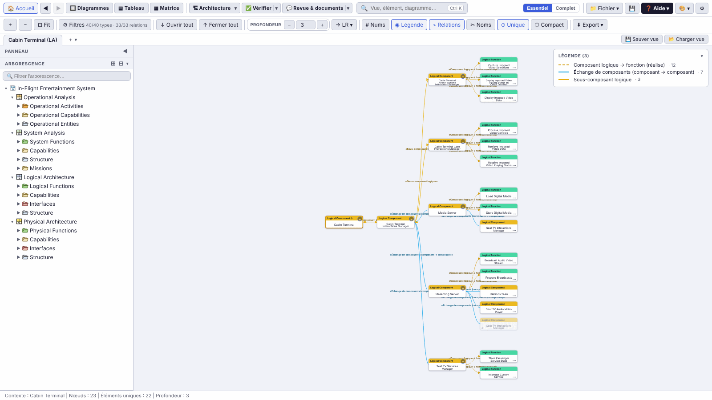

L'écran comprend : la **2ᵉ barre** (commandes du graphe), la **barre d'onglets de vues**, le **panneau gauche** (arborescence), le **graphe**, la **légende** (en haut à droite) et la **barre d'état** (en bas).

## 5.1 La 2ᵉ barre (commandes du graphe)

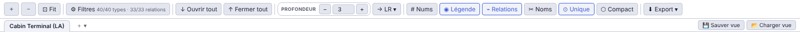

| Bouton | Nom | Description |
|---|---|---|
| 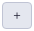 | Zoom avant | Agrandit le graphe (aussi Ctrl + ou Ctrl + molette). |
|  | Zoom arrière | Réduit le graphe (aussi Ctrl −). |
| 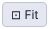 | Ajuster | Ajuste le graphe à la fenêtre (aussi Ctrl+W). |
| 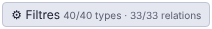 | Filtres | Ouvre le tiroir des **types d'éléments** et **critères de relation** (compteurs « cochés / total »), voir [§ 5.3](#53-filtres--types-déléments-et-critères-de-relation). |
| 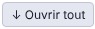 | Ouvrir tout | Développe tous les nœuds du graphe. |
| 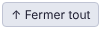 | Fermer tout | Replie tous les nœuds. |
| 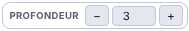 | Profondeur | Profondeur de voisinage autour du contexte (1 à 10) : − / + ou saisie. |
| 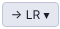 | Disposition ▾ | → LR (gauche → droite), ↓ TB (haut → bas), ← RL, ◉ radiale, ⚡ zigzag (lecture de séquences). Le bouton affiche la disposition courante. |
| 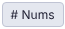 | Numéros | Numérote les relations. |
|  | Légende | Affiche / masque la légende (relations présentes dans le graphe, avec leur nombre ; clic sur son titre pour la replier). |
|  | Relations | Écrit le nom des relations sur les arêtes. |
| 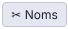 | Noms | Coupe les noms trop longs. |
|  | Unique | *Actif par défaut* : chaque élément n'est déployé qu'une fois, à sa plus courte distance du contexte ; ses autres occurrences restent grisées et repliées (↺). Un clic sur une occurrence grisée sélectionne la première et centre la vue dessus. Plusieurs relations du même type vers le même élément forment une seule arête « ×n ». |
| 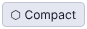 | Compact | Nœuds réduits, pour les grands graphes. |
| 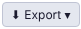 | Export ▾ | Image **PNG**, **JPEG** ou **SVG** du graphe ; **▦ Arbre par niveaux…** (CSV) ; **⇄ Relations affichées…** (CSV). Voir [§ 5.9](#59-exports-de-la-relation-map). |
| 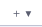 | Nouvelle vue ▾ | Ajoute un onglet de vue, voir [§ 5.2](#52-onglets-de-vues--créer-une-nouvelle-page-relation-map). |
| 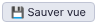 | Sauver vue | Enregistre la vue affichée dans un fichier `.json` (bouton à droite des onglets de vues). |
| 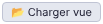 | Charger vue | Ouvre une vue `.json` dans un nouvel onglet (à droite des onglets de vues). |

| Menu Disposition | Menu Export |
|---|---|
| 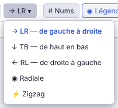 | 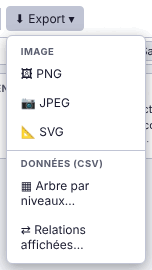 |

## 5.2 Onglets de vues : créer une nouvelle page Relation Map

Sous la 2ᵉ barre, une rangée d'onglets **Vue 1 · Vue 2 · ＋ ▾**. Chaque vue retient : l'élément de contexte, la profondeur, la disposition, les types et relations cochés, les options d'affichage (# Nums, ⌁ Relations, ✂ Noms, ⊙ Unique, ⬡ Compact, légende), les éléments masqués, les nœuds repliés à la main, le zoom et la chaîne affichée. **Tout changement est enregistré automatiquement** dans la vue active (pas de bouton « Enregistrer »).

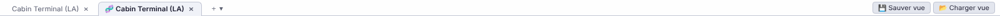

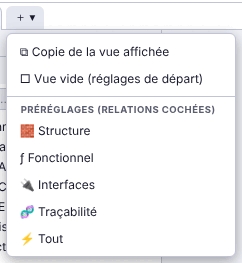

**Créer une nouvelle page (vue)** :

1. cliquez sur **＋ ▾** à droite des onglets ;
2. choisissez :
   - **⧉ Copie de la vue affichée** — même contexte, mêmes filtres et options ;
   - **☐ Vue vide (réglages de départ)** — même contexte, réglages par défaut ;
   - un **préréglage** qui ne coche que certaines relations :
     - **🧱 Structure** : décompositions, déploiement ;
     - **ƒ Fonctionnel** : sous-fonctions, allocations, échanges fonctionnels, chaînes ;
     - **🔌 Interfaces** : échanges de composants, liens physiques, ports, éléments échangés ;
     - **🧬 Traçabilité** : réalisations entre couches, capacités ;
     - **⚡ Tout** : toutes les relations ;
3. le nouvel onglet s'ouvre ; choisissez un contexte (clic dans l'arborescence) et ajustez.

 

**Gérer les onglets** : **clic** = afficher la vue · **double-clic** = renommer (un nom vidé redevient automatique : nom du contexte et couche, ex. « Cabin Terminal (LA) ») · **✕** = fermer · **glisser** un onglet = le déplacer. Un **⚠** signale que l'élément de contexte n'existe pas dans le modèle chargé.

Les vues sont enregistrées dans la 💾 page HTML et dans le fichier ⚙ Interface et vues (partie « 🗺 Relation Map ») ; elles sont gardées quand on charge un autre modèle.

## 5.3 Filtres : types d'éléments et critères de relation

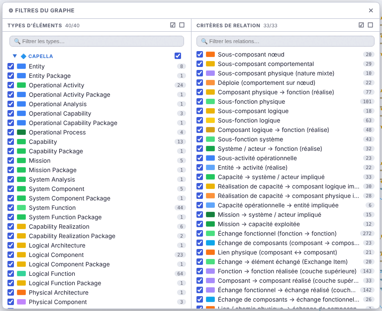

Le bouton **⚙ Filtres** ouvre un tiroir au-dessus du graphe, en deux colonnes :

- **Types d'éléments** : couleur par couche ARCADIA, nombre d'éléments ; seuls les types présents dans l'arborescence sont listés ;
- **Critères de relation** : les relations Capella à suivre (sous-composants, allocations, échanges, réalisations, capacités, chaînes…), avec leur nombre.

Dans chaque colonne : champ de **recherche**, **☑ / ☐** tout cocher / décocher, **groupes cochables en bloc**, compteur « cochés / total » (repris sur le bouton). **×** ou **Échap** referme le tiroir. Les couleurs restent réglables ; la Relation Map ne modifie pas le modèle.

## 5.4 Panneau gauche : arborescence

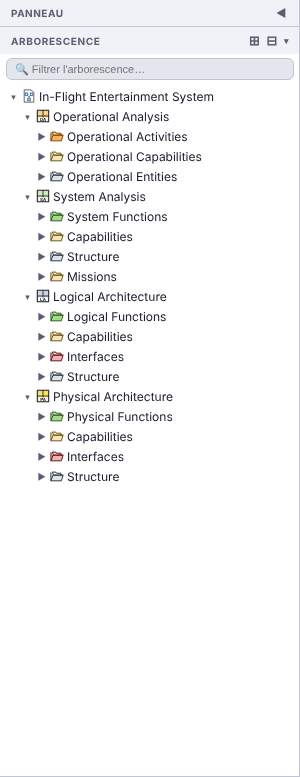

- Éléments du modèle ayant au moins une relation, à leur place hiérarchique (chaînes comprises) ; au chargement, les couches sont dépliées.
- **Filtrer l'arborescence…** : filtre texte avec surbrillance.
- **Clic** sur un élément : il devient le **contexte** du graphe.
- **Ctrl/Cmd + clic**, **Maj + clic** : sélection multiple (propre à chaque vue).
- **Clic droit** : 🔎 Détail, définir comme contexte.
- **⊞ / ⊟ ▾** : tout déplier / replier.
- **◀** (en haut) replie le panneau ; le bord droit se **glisse** pour l'élargir.
- **Clic sur une chaîne (⚡)** : affiche la chaîne dans le graphe ([§ 5.8](#58-vue-chaîne)).

 

## 5.5 Interactions dans le graphe

| Geste | Effet |
|---|---|
| **Clic** sur un nœud | Sélectionne l'élément (le panneau 🔎 Détail, s'il est ouvert, suit la sélection). |
| **Double-clic** sur un nœud | En fait le **nouveau contexte**. |
| **Clic droit** sur un nœud | Menu contextuel (ci-dessous). |
| **+ / −** dans le coin d'un nœud | Développe / replie ce nœud. |
| **Survol** d'un nœud | Infobulle (type, nom) ; les voisins directs restent en évidence, le reste s'estompe. |
| **Glisser le fond** | Déplace le graphe. |
| **Molette** | Zoom. |

| Menu contextuel | Survol d'un nœud |
|---|---|
| 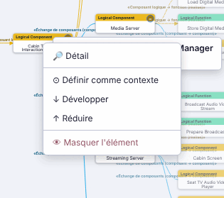 | 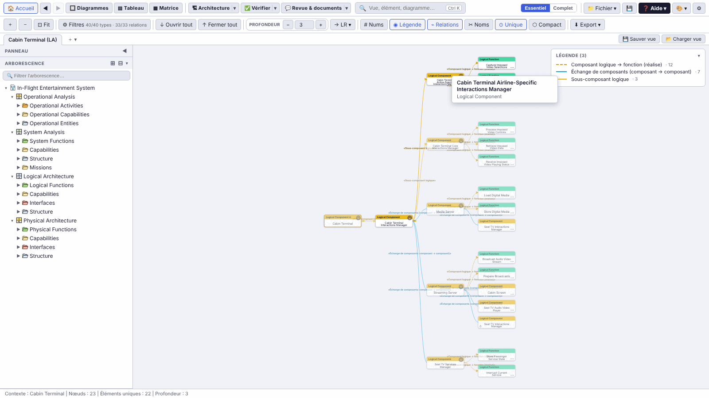 |

Menu contextuel : **🔎 Détail** (panneau à droite du graphe), **⊙ Définir comme contexte**, **↓ Développer**, **↑ Réduire**, **👁 Masquer l'élément** (les éléments masqués sont mémorisés dans la vue).

## 5.6 Panneau 🔎 Détail de la Relation Map

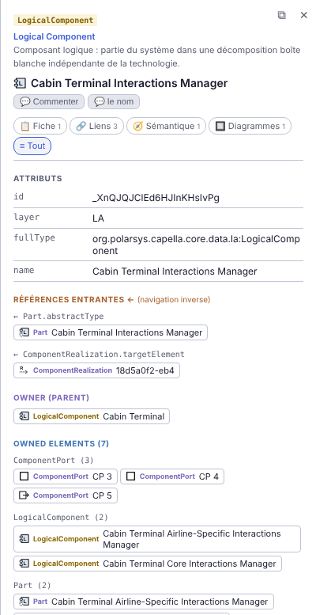

Ouvert par le clic droit › 🔎 Détail : type et description du type, **attributs**, **références sortantes** et **entrantes**, exigences, propriétaire (owner) et éléments possédés — tous les liens sont **cliquables** pour naviguer de proche en proche. **×** le ferme.

 

## 5.7 Légende et barre d'état

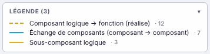

La **légende** ne liste que les relations présentes dans le graphe affiché, avec leur nombre. La **barre d'état** rappelle le contexte, le nombre de nœuds, d'éléments uniques et la profondeur.

## 5.8 Vue chaîne

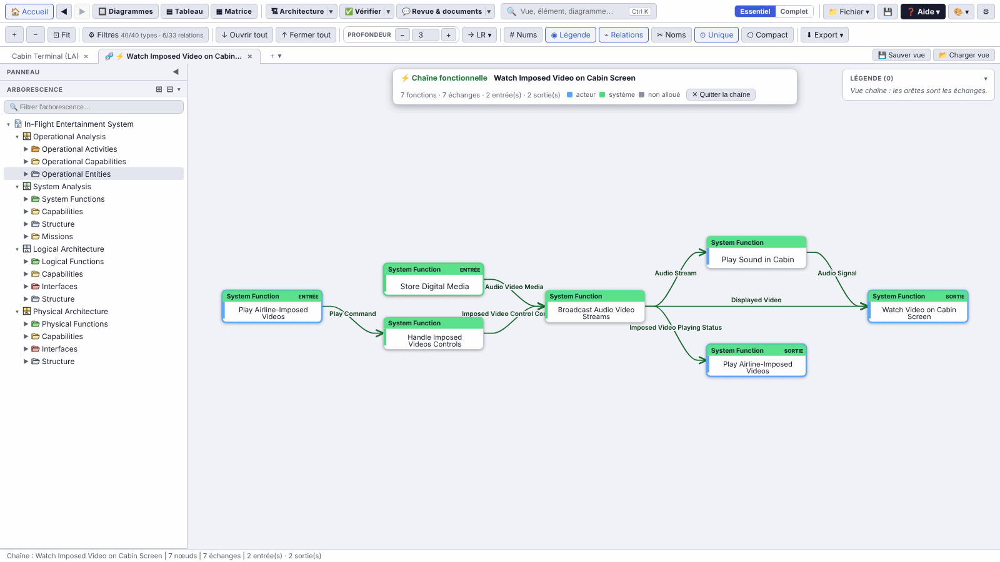

Un clic sur une **chaîne (⚡)** dans l'arborescence, ou le bouton **🗺 Ouvrir en vue Relation Map** d'une carte de ⚡ Chaînes, affiche le **graphe complet de la chaîne** : plusieurs entrées et sorties, ramifications et boucles, disposé en couches selon la disposition choisie (→ LR, ↓ TB, ← RL).

- liseré **bleu** = fonction portée par un acteur, **vert** = par le système, **gris** = non allouée ;
- badges **ENTRÉE** / **SORTIE** ; arêtes étiquetées par le nom de l'échange ;
- un **bandeau** résume la chaîne (fonctions, échanges, entrées, sorties) ;
- **✕ Quitter la chaîne**, un double-clic sur un nœud ou un clic dans l'arborescence reviennent à la Relation Map.

## 5.9 Exports de la Relation Map

| Export | Contenu |
|---|---|
| **PNG / JPEG / SVG** | Image du graphe affiché. |
| **▦ Arbre par niveaux…** (CSV) | Graphe déplié de gauche à droite : contexte en 1ʳᵉ colonne, puis une colonne par niveau et par relation (« N2 · Échange fonctionnel »). Options : **Relation dans une colonne à part** (« Relation Nn » + « Nn » : nombre de colonnes fixe) et **Répéter les cellules des parents** (utile pour filtrer ou faire un tableau croisé). « ×n » = relations fusionnées, « ↺ » = occurrence déjà déployée. Seuls les nœuds affichés sont exportés. |
| **⇄ Relations affichées…** (CSV) | Une ligne par arête : source, relation, cible, nombre, profondeur, chemin depuis le contexte (en vue chaîne : source, échange, cible). |

Les exports CSV passent par la fenêtre **« Colonnes de l'export »** ([§ 9.8](09-flux-interfaces.md#98--csv-enrichi-colonnes-de-lexport)) : vous pouvez y ajouter ID, type, couche, owner, description… pour chaque colonne d'éléments.

---

[📘 Sommaire du guide](../GUIDE-UTILISATION.md) · ◀ [4. 🏠 Accueil du projet](04-accueil.md) · [6. ▤ Tableau](06-tableau.md) ▶
