[📘 Sommaire du guide](../GUIDE-UTILISATION.md) · ◀ [5. 🗺 Relation Map](05-relation-map.md) · [7. 🧭 Explorateur : Arborescence et Cartes](07-explorateur.md) ▶

# 6. ▤ Tableau

Tableau de **tous les éléments du modèle**, un par ligne, ouvert par le bouton direct **▤ Tableau** de la barre (tous les formats : Capella, SysML v2, UML / SysML v1, ReqIF). Les lignes suivent les **types cochés** dans la barre latérale ; un **double-clic** sur une ligne ouvre le panneau de détail. **❓ Aide ▾ › 🎯 Visite de cette vue** le présente pas à pas.

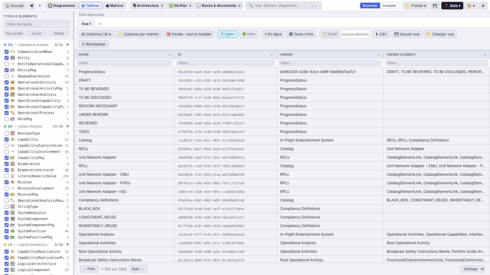

## 6.1 Barre du tableau

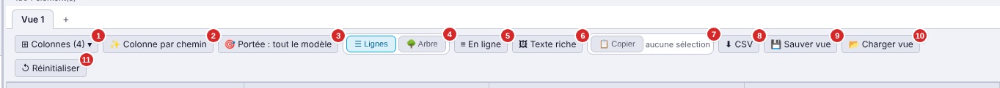

| N° | Commande | Description |
|---|---|---|
| 1 | **⊞ Colonnes (n) ▾** | Choix des colonnes affichées, par section ([§ 6.4](#64-colonnes--colonnes-calculées-attributs-relations)). |
| 2 | **✨ Colonne par chemin** | Ajoute une colonne calculée en suivant un chemin de relations ([§ 6.5](#65--colonne-par-chemin-metachain)). |
| 3 | **🎯 Portée** | Limite les lignes aux éléments contenus dans des éléments choisis ([§ 6.6](#66--portée)). |
| 4 | **☰ Lignes · 🌳 Arbre ▾** | Affichage à plat ou en arbre sous les conteneurs ([§ 6.7](#67--lignes-et--arbre)). |
| 5 | **≡ En ligne / ☰ Empilé** | Cellules à plusieurs valeurs : séparées par des virgules, ou une par ligne. |
| 6 | **🖼 Texte riche** | Colonne *Description* en **texte riche** (gras, listes, tableaux, images, dans une cellule à hauteur limitée qui défile) ou en **texte simple** (le nombre d'images est alors signalé par 🖼 n). Par défaut : texte riche pour des exigences ReqIF, texte simple sinon ; le choix est enregistré avec les vues. |
| 7 | **📋 Copier** | Copie la sélection de cellules (indique « aucune sélection » ou le nombre de cellules) ([§ 6.9](#69-sélectionner-et-copier-des-cellules)). |
| 8 | **⬇ CSV** | Exporte les colonnes affichées, pour toutes les lignes filtrées (toutes pages), dans l'ordre du tri (classeur `.xlsx` si ⚙ › Exports est réglé sur Excel). |
| 9 | **💾 Sauver vue** | Enregistre la vue de l'onglet affiché (`.json`). |
| 10 | **📂 Charger vue** | Recharge une vue enregistrée dans l'onglet. |
| 11 | **↺ Réinitialiser** | Revient aux colonnes, à l'ordre, aux largeurs et au tri de départ, sans filtre. |

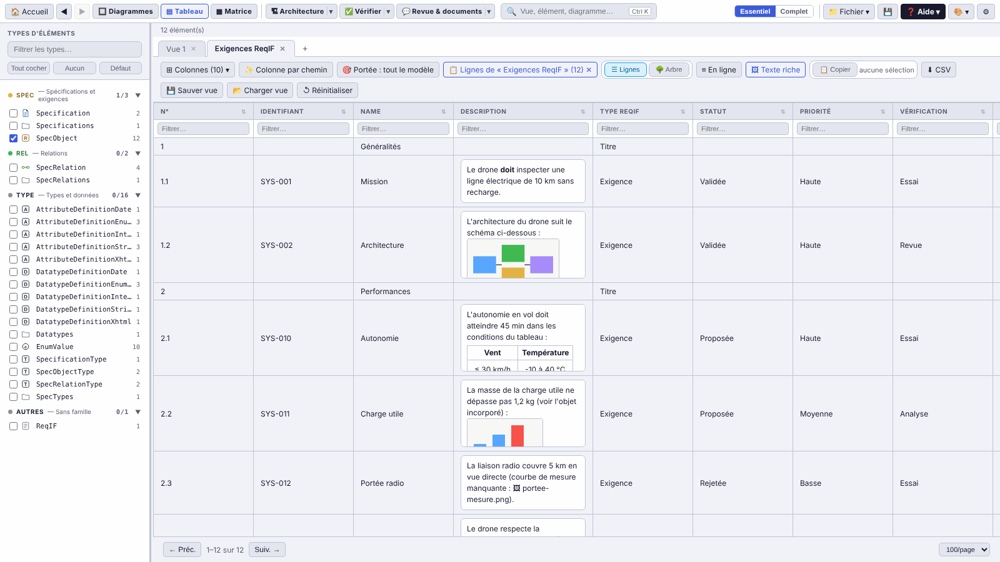

Un onglet ouvert depuis un **tableau de Cameo** (🔲 Diagrammes › **▤ Tableau**, [§ 10](10-diagrammes.md)) montre en plus, après 🎯 Portée, le bouton **📋 Lignes de « … » (n) ✕** : les lignes sont celles du tableau de Cameo, dans son ordre ; un clic les retire (après confirmation), l'onglet liste alors les éléments des types cochés.

En bas : **← Préc. / Suiv. →**, « 1–100 sur 1304 », et le nombre de lignes par page (**50 / 100 / 200 par page**).

## 6.2 Types d'éléments (barre latérale)

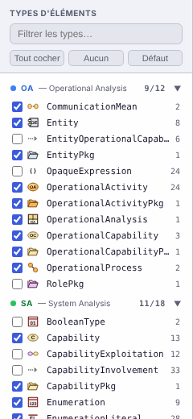

La barre latérale (aussi dans 🧭 Explorateur) liste les **types présents**, groupés par couche (OA, SA, LA, PA, EPBS, Transverse) avec leur nombre et le compteur « cochés / total » de la couche. Pour un modèle hors Capella, les groupes sont des **familles** : STR Structure, BEH Comportement, REQ Exigences & cas, ORG Organisation (SysML v2, UML / SysML v1) ; SPEC, REL, TYPE (spécifications, relations, types d'un fichier ReqIF) ; « Autres » pour les éléments sans famille.

- **cocher / décocher** un type pour l'afficher ou non ; **▼** sur une couche pour la replier ;
- **Filtrer les types…** ; **Tout cocher**, **Aucun**, **Défaut** (types usuels) ;
- le bord droit de la barre se **glisse** pour l'élargir.

Il n'y a pas de recherche globale ni de filtre de couche dans le ▤ Tableau : les champs **Filtrer…** de chaque colonne les remplacent.

 

## 6.3 Onglets de vues

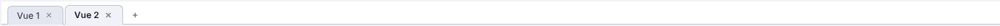

Chaque onglet garde **sa propre vue** : types cochés, 🎯 portée, colonnes et leur ordre, filtres, largeurs, tri.

- **+** ajoute un onglet (copie des colonnes de la vue affichée, **sans type coché** : cochez ceux à lister) ;
- **double-clic** sur un onglet : le renommer ; **✕** : le fermer.

## 6.4 Colonnes : colonnes calculées, attributs, relations

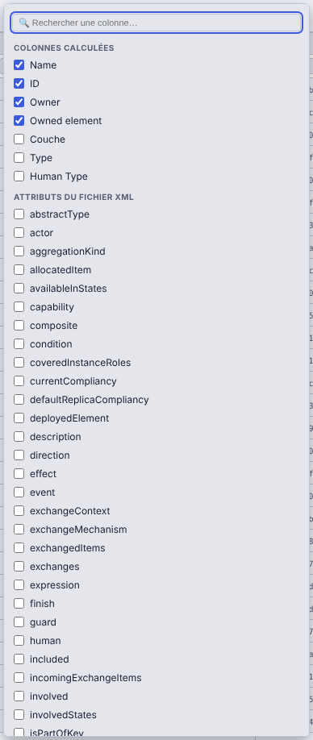

Le menu **⊞ Colonnes ▾** coche les colonnes affichées, par section :

- **Colonnes calculées** : *Name, ID, Owner, Owned element* (affichées par défaut) ; *Couche, Type, Human Type* ;
- **Colonnes par chemin** : vos colonnes ✨ (**✏** modifier, **✕** supprimer) ;
- **Attributs** du fichier XML (`kind`, `nature`, `orientation`, `summary`…) ;
- **Relations** : les relations du modèle, par groupe (décomposition, allocation, échanges, réalisation, capacités, chaînes), avec leur nombre de liens. **Deux cases par relation** : **→ cibles** (éléments vers lesquels pointe la ligne, ex. fonctions réalisées par un composant) et **← sources** (éléments qui pointent vers la ligne, ex. composant qui réalise une fonction).

Le champ **🔍 Rechercher une colonne…** filtre toutes les sections :

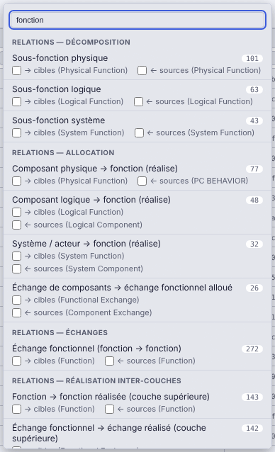

 

**Dans les en-têtes** :

| Geste | Effet |
|---|---|
| **Clic** sur un en-tête | Tri ▲ croissant, ▼ décroissant, puis sans tri (cellules vides en bas). |
| **Glisser** un en-tête sur un autre | Change l'ordre des colonnes. |
| **Glisser le bord droit** | Largeur de la colonne. |
| Champ **Filtrer…** | Filtre la colonne. |
| **✎** (colonne par chemin) | Renomme la colonne (Entrée valide, Échap annule). |

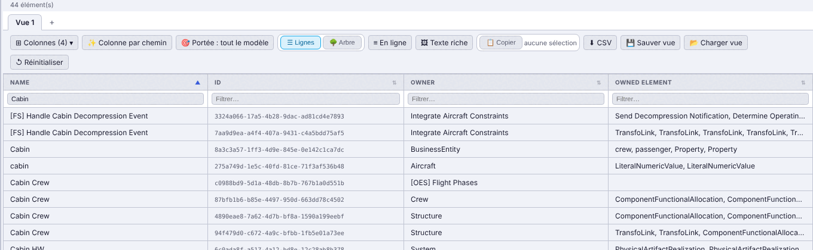

## 6.5 ✨ Colonne par chemin (metachain)

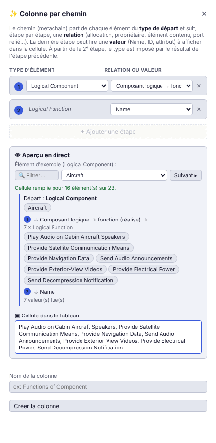

Ajoute une colonne calculée qui, pour chaque élément, **suit un chemin de relations** et affiche ce qu'elle trouve au bout. Exemples : les fonctions réalisées par chaque composant, les composants reliés par leurs ports, le paquetage propriétaire d'une exigence.

**Pas à pas** (exemple : fonctions de chaque Logical Component) :

1. **✨ Colonne par chemin** ouvre le panneau à droite ;
2. **étape 1** — *Type d'élément* : **Logical Component** (seules ses lignes seront remplies) ; *Relation ou valeur* : **Composant logique → fonction (réalise) →** ;
3. **+ Ajouter une étape** : le type est déduit (Logical Function) ; choisissez **Name** pour afficher le nom ;
4. l'**👁 Aperçu en direct** montre, pour un élément d'exemple (filtre 🔍, liste, **Suivant ▸** pour passer au prochain élément dont la cellule sera remplie), les éléments atteints à chaque étape, où le chemin s'arrête s'il ne trouve rien, la **cellule** finale et le nombre d'éléments remplis ;
5. donnez un **Nom de la colonne** (facultatif) puis **Créer la colonne**.

**✕** supprime une étape et les suivantes ; **✏** dans ⊞ Colonnes modifie une colonne existante.

 

| Choix proposés à chaque étape | Signification |
|---|---|
| Name · ID · Type · Human Type · attributs | Valeur affichée (fin du chemin). |
| Owner [Type] | Premier élément propriétaire du type choisi. |
| Owned element [Type] | Éléments contenus directement, du type choisi (ex. ports d'un composant). |
| Relations Capella | Allocation, réalisation, implication… dans les deux sens. |
| Liaisons SysML / UML | Modèle SysML v2 ou UML / SysML v1 : typage, composition, satisfy, allocation… lus par le lecteur d'Arcature, dans les deux sens. |
| attribut → Type | Élément désigné par un attribut (`source`, `target`, `involved`…). |
| ← référence entrante | Éléments qui désignent celui-ci (sens inverse). |
| via [Type] → [Type] | Passage par un élément intermédiaire (ex. port → Physical Link → port opposé). |

## 6.6 🎯 Portée

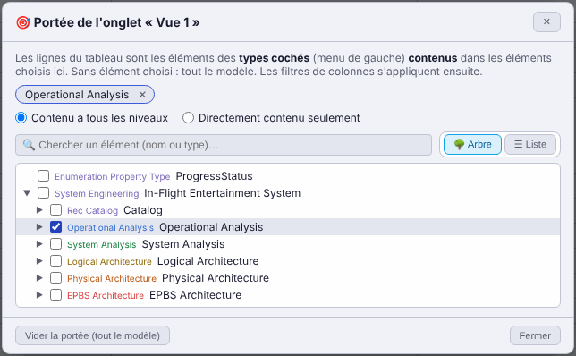

Critère facultatif de l'onglet : les lignes sont limitées aux éléments **contenus dans** des éléments choisis (paquetage, couche, composant, fonction…).

- éléments choisis en pastilles (**✕** pour retirer) ;
- **Contenu à tous les niveaux** ou **Directement contenu seulement** ;
- arbre du modèle (**▶** déplier, **case** pour ajouter) et **recherche** par nom ou type ;
- affichage **🌳 Arbre** (résultats dans leurs conteneurs, grisés s'ils ne correspondent pas) ou **☰ Liste** (à plat, avec le chemin, 300 lignes au plus) ;
- **Vider la portée (tout le modèle)**, **Fermer**.

Lignes d'un onglet = **types cochés ∩ portée**, puis filtres de colonnes ; le bouton rappelle la portée.

 

## 6.7 ☰ Lignes et 🌳 Arbre

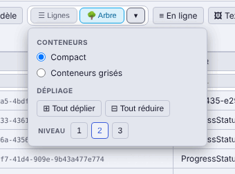

**🌳 Arbre** range les lignes sous leurs conteneurs (▶ / ▼ dans la première colonne). Le menu **▾** à côté regroupe les options :

- **Compact** (défaut) : chaque ligne directement sous son plus proche ancêtre qui est lui-même une ligne ;
- **Conteneurs grisés** : paquetages et conteneurs intermédiaires affichés, grisés et sans valeurs ;
- **⊞ Tout déplier**, **⊟ Tout réduire**, **Niveau 1 · 2 · 3**.

L'ordre des éléments de même niveau suit le tri ; **⬇ CSV** ajoute alors les colonnes *Niveau* et *Chemin*.

 

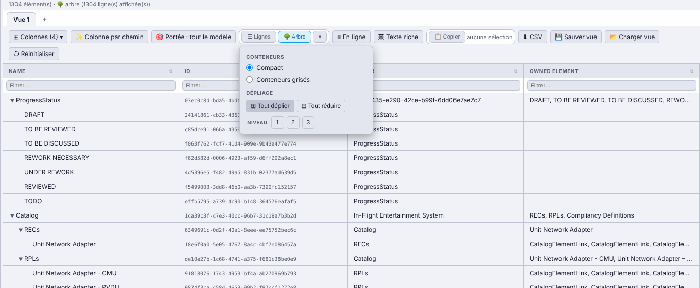

## 6.8 Filtres de colonnes

Sous chaque en-tête, un champ **Filtrer…**. Le compteur en haut indique le nombre d'éléments retenus.

## 6.9 Sélectionner et copier des cellules

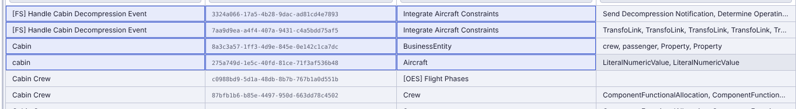

- **clic** sur une cellule ; **clic-glisser** pour un rectangle ; **Ctrl+clic** pour ajouter / retirer une cellule ; **Maj+clic** pour étendre ;
- **Ctrl+C** ou **📋 Copier** : à coller dans Excel ou Word ; une cellule à plusieurs éléments reste **une seule cellule**, un élément par ligne ;
- **Échap** ou un clic hors du tableau efface la sélection.

---

[📘 Sommaire du guide](../GUIDE-UTILISATION.md) · ◀ [5. 🗺 Relation Map](05-relation-map.md) · [7. 🧭 Explorateur : Arborescence et Cartes](07-explorateur.md) ▶
