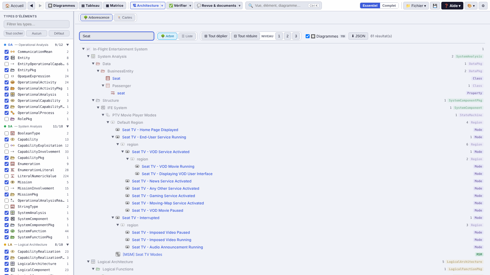
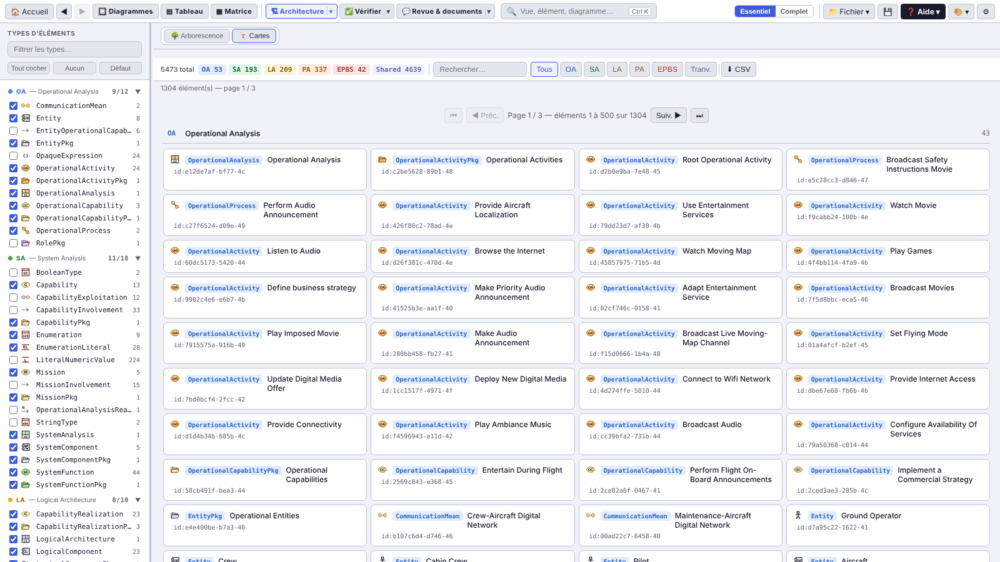
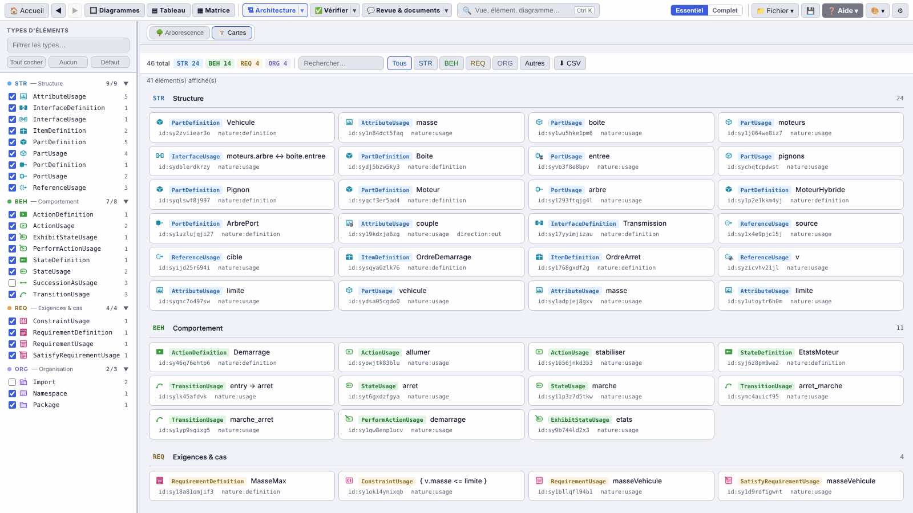

[📘 Sommaire du guide](../GUIDE-UTILISATION.md) · ◀ [6. ▤ Tableau](06-tableau.md) · [8. ⚡ Chaînes](08-chaines.md) ▶

# 7. 🧭 Explorateur : Arborescence et Cartes

Deux onglets, **🌳 Arborescence** et **🃏 Cartes** (en tête de la vue) ; menu **🏗 Architecture › Explorer** (🃏 Cartes : mode Complet). La barre latérale des types ([§ 6.2](06-tableau.md#62-types-déléments-barre-latérale)) n'est affichée que dans l'Explorateur et le ▤ Tableau. La composition du modèle par type est aussi dans 🏠 Accueil › 🧩 Contenu du modèle. Chaque onglet a sa visite : **❓ Aide ▾ › 🎯 Visite de cette vue**.

## 7.1 🌳 Arborescence

Arbre complet du modèle (types cochés dans la barre latérale) :

- **🔍 recherche** par nom ou type (ici « Seat » : 61 résultats) ;
- **🌳 Arbre** (résultats dans leurs conteneurs, grisés quand ils ne correspondent pas eux-mêmes) ou **☰ Liste** (à plat, triée par nom, avec le chemin, 300 lignes au plus) ;
- **⊞ Tout déplier / ⊟ Tout réduire**, **Niveau 1 · 2 · 3** ;
- **⬇ JSON** : export de l'arbre ;
- **clic** sur un élément : panneau de détail.

## 7.2 🃏 Cartes

Éléments groupés par **couche ARCADIA** (modèle Capella) ou par **famille** (autres formats, [§ 7.3](#73-modèles-sysml-uml-et-reqif--familles)), une carte par élément (icône, type, nom, identifiant, et `kind`, `nature`, `direction`, `visibility` quand ils sont renseignés) :

- compteurs par couche en tête (total, OA, SA, LA, PA, EPBS, Shared) ;
- **Rechercher…** (nom, type, identifiant, couche, attributs) et filtres de couche **Tous · OA · SA · LA · PA · EPBS · Tranv.** ;
- **⬇ CSV** ;
- pagination par **500 cartes** (**⏮ ◀ Préc. · Suiv. ▶ ⏭**, en haut et en bas) ;
- **clic** sur une carte : panneau de détail.

## 7.3 Modèles SysML, UML et ReqIF : familles

Pour un modèle **SysML v2**, **UML / SysML v1** ou **ReqIF**, il n'y a pas de couches ARCADIA : l'Explorateur range les éléments par **famille**, comme la ▦ Matrice ([§ 25](25-matrice.md)). La barre latérale des types, les compteurs en tête de 🃏 Cartes, les sections de cartes et les boutons de filtre suivent ce regroupement :

| Format | Familles (boutons de filtre) |
|---|---|
| SysML v2, UML / SysML v1 | **Tous · STR** (Structure) **· BEH** (Comportement) **· REQ** (Exigences & cas) **· ORG** (Organisation) **· Autres** |
| ReqIF | **Tous · SPEC** (spécifications) **· REL** (relations) **· TYPE** (types) **· Autres** |

« Autres » regroupe les éléments sans famille ; le survol d'un bouton donne le nom complet de la famille. Voir aussi [§ 24](24-sysml-uml.md).

---

[📘 Sommaire du guide](../GUIDE-UTILISATION.md) · ◀ [6. ▤ Tableau](06-tableau.md) · [8. ⚡ Chaînes](08-chaines.md) ▶
