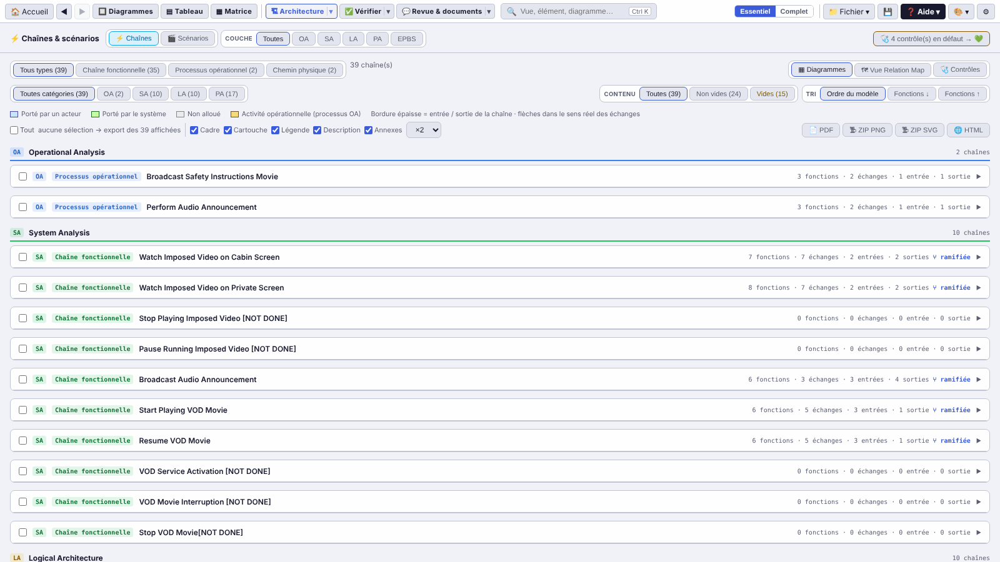
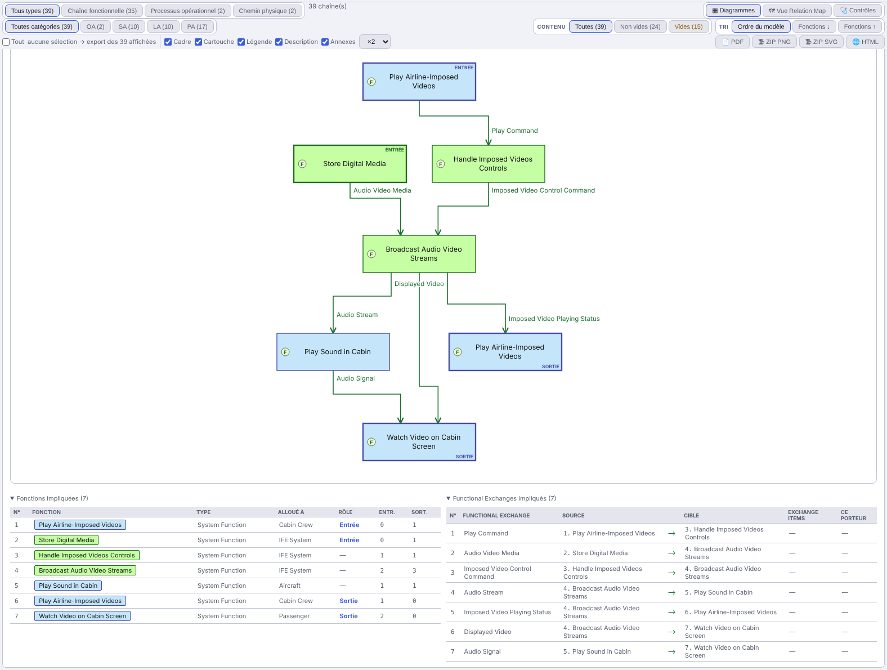
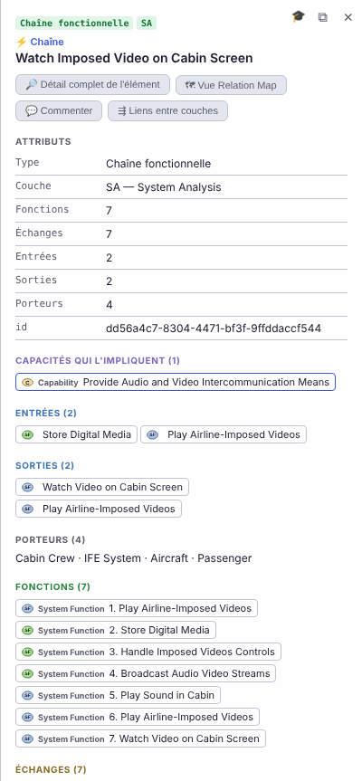
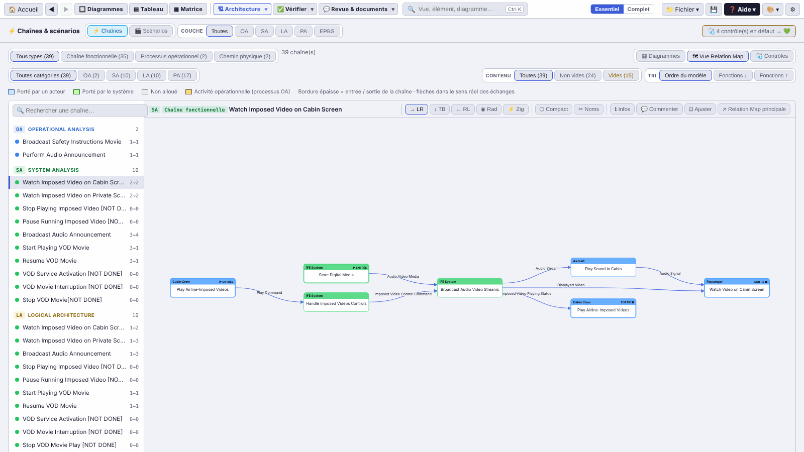
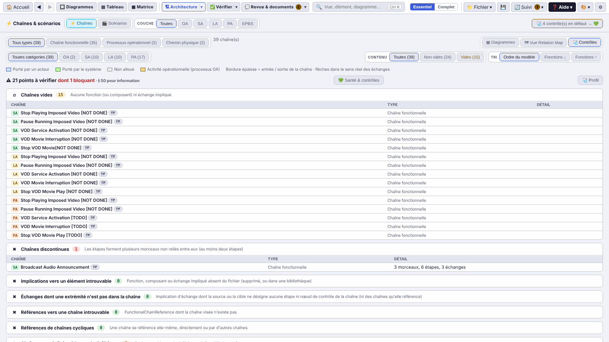

[📘 Sommaire du guide](../GUIDE-UTILISATION.md) · ◀ [7. 🧭 Explorateur : Arborescence et Cartes](07-explorateur.md) · [9. 📡 Flux & interfaces](09-flux-interfaces.md) ▶

# 8. ⚡ Chaînes

**FunctionalChain**, **OperationalProcess** et **PhysicalPath** sont reconstruits sous forme de **graphe** : plusieurs entrées, plusieurs sorties, ramifications (⑂ ramifiée) et boucles sont conservées.

⚡ Chaînes est dans la famille **⚡ Chaînes & scénarios** du menu 🏗 Architecture (barre de famille : ⚡ Chaînes · 🎬 Scénarios). **❓ Aide ▾ › 🎯 Visite de cette vue** la présente pas à pas.

## 8.1 Filtres et sous-vues

| Commande | Effet |
|---|---|
| **Tous types · Chaîne fonctionnelle · Processus opérationnel · Chemin physique** | Filtre par type (avec effectifs) ; à côté, le nombre de chaînes affichées (« 12 / 39 chaîne(s) » quand un filtre est actif). |
| **Toutes catégories · OA · SA · LA · PA** | Filtre par couche (seules les couches qui ont des chaînes sont proposées). Le sélecteur **Couche** de la barre de famille (Toutes · OA · SA · LA · PA · EPBS) règle ce filtre et le garde d'une famille à l'autre ([§ 3.2](03-interface.md#32-menus-des-vues-épingles-et-ctrlk)). |
| **Contenu : Toutes · Non vides · Vides** | Une chaîne vide n'implique aucune fonction ni aucun échange. |
| **Tri : Ordre du modèle · Fonctions ↓ · Fonctions ↑** | Ordre des cartes. |
| **▦ Diagrammes** | Une carte par chaîne (vue par défaut). |
| **🗺 Vue Relation Map** | Graphe interactif de la chaîne choisie (dispositions LR / TB / RL / radiale / zigzag, ⬡ Compact, ✂ Noms) et envoi vers la Relation Map principale. |

## 8.2 Contenu d'une carte

Sous la barre, une **légende** rappelle les couleurs (porté par un acteur, par le système, non alloué, activité opérationnelle) et le sens des flèches. Cliquez sur l'en-tête d'une carte (▶) pour l'ouvrir ; l'en-tête donne le nombre de fonctions, d'échanges, d'entrées et de sorties, et **⑂ ramifiée** si la chaîne se divise :

- **diagramme** de haut en bas, style Capella : **bleu** porté par un acteur, **vert** par le système, **gris** non alloué ; bordure épaisse = **entrée** ou **sortie** ; processus opérationnels (OA) aux couleurs de Capella (activités jaunes, flèches brunes) ;
- **Entrées / Sorties** cliquables ;
- **Fonctions impliquées** : ordre du flux, type, allocation, rôle entrée / sortie, nombre d'échanges entrants / sortants ;
- **Functional Exchanges impliqués** : source → cible numérotées, Exchange Items, Component Exchange porteur (pour un chemin physique : composants, Physical Links et CE alloués) ;
- boutons **🖼 PNG · 📐 SVG · 📋 Copier** (coller dans Word / PowerPoint) **· ⬇ CSV · ℹ Infos · 💬 Commenter · 🗺 Ouvrir en vue Relation Map** ;
- l'en-tête d'une carte se **glisse** vers une check-list ouverte en fenêtre séparée ([§ 4.3](04-accueil.md#43--fenêtres-séparées-et-glisser-déposer-depuis-les-vues)).

**💬 Commentaires de revue** : **💬 Commenter** (carte dépliée, barre de la vue Relation Map, ℹ Infos) ou **clic droit sur l'en-tête** d'une carte commente la chaîne. Un clic droit sur une **fonction** du diagramme ou du graphe lie le commentaire à la fonction et à la chaîne (« 💬 Commenter la chaîne seule » sinon) ; dans la fenêtre du commentaire, **⚡ Lier à des fonctions de « … »** propose les fonctions de la chaîne en un clic (＋). Une chaîne commentée porte 💬 dans son en-tête ([§ 15](15-revue.md)).

**ℹ Infos** (carte dépliée, ou barre de la vue Relation Map) affiche dans le panneau de détail les informations de la chaîne : type, couche, nombre de fonctions (ou composants) et d'échanges, entrées, sorties, porteurs, capacités qui l'impliquent, description, fonctions ; **🔎 Détail complet de l'élément** ouvre le détail Capella, **🗺 Vue Relation Map** le graphe, **💬 Commenter** un commentaire de revue, **⇶ Liens entre couches** les chaînes des autres couches liées à celle-ci, avec leurs fonctions (🔬 Analyses › ⇶ Liens entre couches, [§ 12.9](12-analyses.md#129--liens-entre-couches)).

 

## 8.3 Export groupé

1. cochez les cartes à exporter (case à gauche de chaque carte, ou **☐ Tout**) — sans sélection, **toutes les chaînes affichées** sont exportées ;
2. réglez les options : **Cadre** (cadre et onglet [FC], [OP] ou [PP] + nom, bande à la couleur de la couche), **Cartouche** (projet, diagramme, type, couche, contenu, date et fichier, numéro de planche), **Légende**, **Description** (description Capella), **Annexes** (PDF : planches d'annexe paginées ; ZIP : un CSV par chaîne), résolution **×1 · ×2 · ×3** ;
3. cliquez sur le format : **📄 PDF** (sommaire, une planche A4 par chaîne orientée automatiquement, signets), **🗜 ZIP PNG**, **🗜 ZIP SVG**, **🌐 HTML** (rapport autonome à onglets avec recherche).

---

## 8.4 🩺 Contrôles

Troisième présentation de ⚡ Chaînes (à côté de ▦ Diagrammes et 🗺 Vue Relation Map), filtrée par la catégorie ARCADIA choisie : chaînes **vides** ; **discontinues** (étapes en plusieurs morceaux non reliés) ; **implications vers un élément introuvable** (fonction, composant ou échange supprimé ou dans une bibliothèque) ; **échanges dont une extrémité n'est pas dans la chaîne** ; **références** vers une chaîne introuvable ou **cycliques** ; chaînes **non réalisées à la couche inférieure** ou **ne réalisant rien à la couche supérieure** (seulement là où des réalisations existent déjà) ; chaînes **hors capacité** (seulement si d'autres chaînes de la couche en ont une) ; **sans description** ; **en double** ; **étapes portées par des fonctions non allouées** ; **composants isolés** dans un chemin physique. Chaque ligne ouvre le détail de la chaîne ou sa vue 🗺. Soumis au 🩺 profil de contrôles ([§ 3.6](03-interface.md#36--profil-de-contrôles)) ; indicateur « Contrôles des chaînes » au 📐 Tableau de bord ; pris en compte par la 💚 santé du modèle, y compris par couche.

---

[📘 Sommaire du guide](../GUIDE-UTILISATION.md) · ◀ [7. 🧭 Explorateur : Arborescence et Cartes](07-explorateur.md) · [9. 📡 Flux & interfaces](09-flux-interfaces.md) ▶
