[📘 Sommaire du guide](../GUIDE-UTILISATION.md) · ◀ [9. 📡 Flux & interfaces](09-flux-interfaces.md) · [11. ƒ Fonctions](11-fonctions.md) ▶

# 10. 🔲 Diagrammes

Bouton direct **🔲 Diagrammes** de la barre (épinglé par défaut). Diagrammes du projet (fichier `.aird`, à côté du `.capella`), dessinés **comme dans Capella** par la visionneuse d'Arcature. Lecture seule. La vue est **commune à tous les formats** : même explorateur, même ▣ carte, mêmes ℹ Infos, planches, ⧉ comparaison et ⇄ avant / après pour un modèle SysML v2 (vues calculées) ou UML / SysML v1 (diagrammes et tableaux du fichier) — voir [§ 10.5](#105-modèles-sysml-v2-et-uml--sysml-v1).

## 10.1 Charger les diagrammes

- **📂 Ouvrir le .aird…** (le sélecteur s'ouvre dans le dossier du `.capella` sous Edge / Chrome) ;
- **📁 Dossier du projet…** sur l'écran d'accueil (`.capella` et `.aird` chargés ensemble) ;
- ou **glisser-déposer** le `.aird` (seul ou avec le `.capella`) sur la fenêtre.

**Images du projet** : un élément dont le style est une image du projet (« Set Style to Workspace Image » de Capella, par exemple `images/avion.png`) est dessiné avec cette image quand le projet est ouvert par **📁 Dossier du projet…** ; sans le dossier, un pictogramme d'image la remplace.

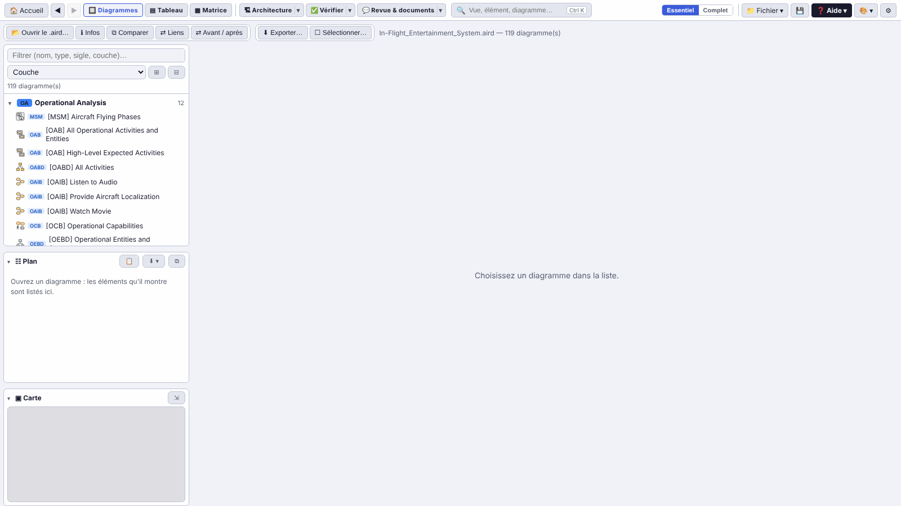

## 10.2 L'explorateur de diagrammes (à gauche)

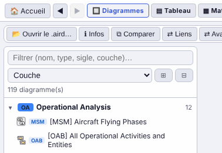

- **Filtrer (nom, type, sigle, couche)…** ;
- **classement** : *Couche* (défaut), *Couche › type* (OA › OAB…), *Type de diagramme*, *Nom* ou **🌳 Arborescence** (chaque diagramme sous l'élément qu'il représente, dans l'arbre du modèle ; explorateur compact ; déplier un nœud garde la position dans la liste) ;
- groupes repliables (**⊞ / ⊟**) ;
- **largeur réglable** en glissant le séparateur (double-clic : largeur d'origine) ;
- **ℹ** au survol d'un diagramme : ses informations dans le panneau de détail ;
- 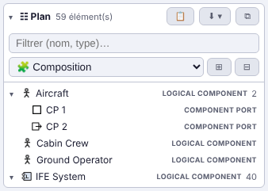 **☷ Plan** sous la liste (l'« Outline » de Capella) : les éléments du modèle présents dans le diagramme ouvert — tels qu'il est affiché, filtres compris. Présentations : **🧩 Composition** (par défaut : chaque élément sous celui qui le contient dans le dessin, composant › sous-composant, fonction › ports et pins ; liens et échanges en fin de liste), par **type**, par **couche**, de **A à Z**, ou **🌳 Arborescence** du modèle (éléments absents du diagramme grisés) ; filtre par nom ou type. **Clic** : l'élément est centré dans le dessin et son détail s'ouvre ; copie, export CSV / Excel des éléments de ce diagramme, de la sélection ou de tous les diagrammes ; **⧉** ouvre le plan dans une fenêtre séparée ;
- **▣ Carte** sous l'explorateur (▾ pour la replier, **⇲** pour la remettre dans le diagramme, **⇱** pour la ramener). Le **séparateur ↕** entre la liste et la carte règle la hauteur de la carte (double-clic : hauteur d'origine). Comme le Zoom de Cameo, quand on dézoome, le **cadre bleu peut déborder le dessin** : la carte montre alors le dessin et le cadre entier, le reste en gris ; on peut toujours glisser le cadre et le redimensionner par ses coins.

 

## 10.3 Un diagramme ouvert

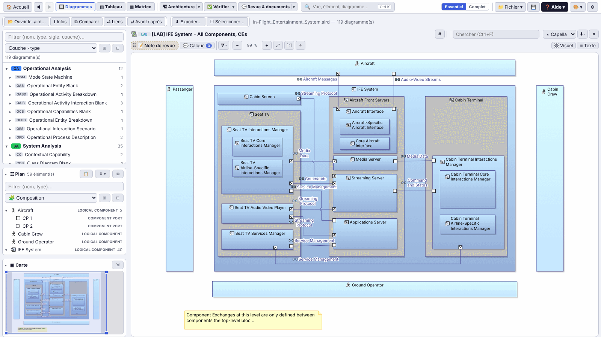

Au-dessus du diagramme, **deux lignes** qui ne bougent pas d'un diagramme à l'autre :

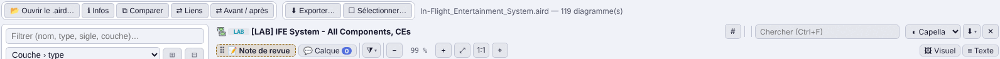

| Ligne | Commandes |
|---|---|
| **Identité** | Sigle et nom du diagramme ; **Chercher dans le diagramme** (Ctrl+F ; **Entrée** : suivant, **Maj+Entrée** : précédent) ; **#** grille ; **◐** thème ; **⬇▾** exports (SVG / PNG / impression) ; **✕** fermer. L'élément représenté est dans **ℹ Infos**. |
| **Outils** | **📝 Note de revue** et **💬 Calque** ([§ 15.3](15-revue.md#153-notes-de-revue-sur-les-diagrammes)) ; chaînes et chemins (ceux dessinés dans le diagramme ; la chaîne mise en évidence est propre à chaque diagramme) ; **⧩ Filtres** (ports, étiquettes, catégories d'échanges) ; zoom ; **▣ Carte**. |

Molette : zoom ; glisser : déplacement ; infobulles au survol ; mini-carte.

**Clic sur un élément** du diagramme : son **panneau de détail** s'ouvre. Inversement, dans le panneau de détail d'un élément, la section **Diagrammes** ouvre un diagramme où il est représenté, **centré et mis en évidence**.

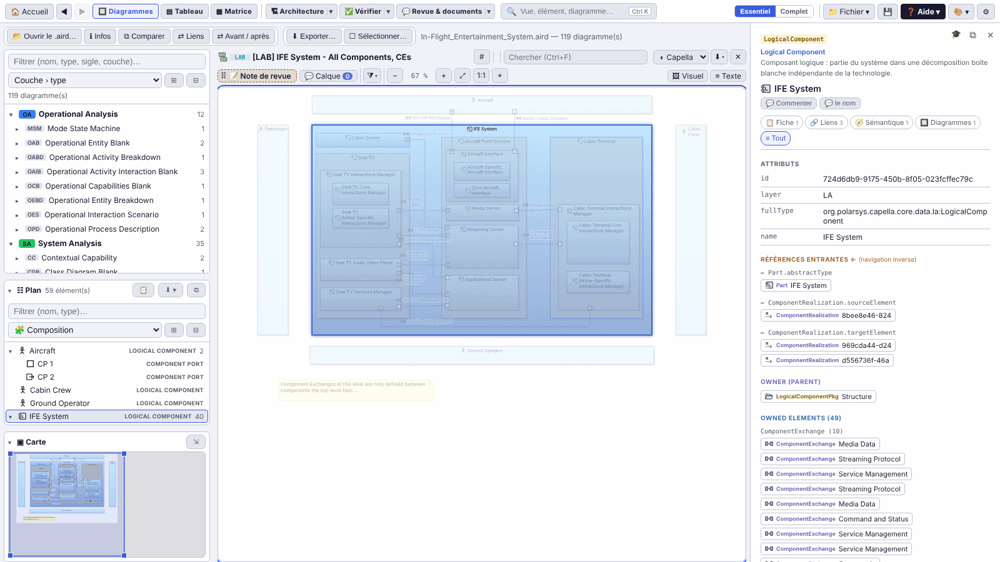

**Barre de la vue** (au-dessus de l'explorateur) :

| Commande | Effet |
|---|---|
| **📂 Ouvrir le .aird…** | Charge ou remplace le `.aird` (Capella). |
| **ℹ Infos** | Fiche du diagramme ouvert dans le panneau de détail (ci-dessous) ; un second clic la referme. |
| **⧉ Comparer** | Le diagramme ouvert dans la fenêtre de comparaison (ci-dessous). |
| **⇄ Liens** | Capella : liens entre les composants affichés dans le diagramme ouvert, avec leurs ports, dans la vue de liens de sa couche, filtrée sur ce diagramme ([§ 9](09-flux-interfaces.md)). SA : 🧱 System Component ; LA : 🧱 Logical Component ; PA : petit menu **🔌 Physical Links** (entre les nœuds) ou **🔀 Component Exchanges (Behavior)**. Diagrammes des couches SA, LA et PA seulement ; ⬇ CSV de la liste dans la vue. |
| **⇄ Avant / après** | Écarts du diagramme ouvert avec une version d'avant ([§ 10.6](#106--avant--après)). |
| **⬇ Exporter… · ☐ Sélectionner…** | Export en planches ([§ 10.4](#104--exporter-planches)). |

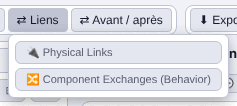

À droite : le fichier chargé et le nombre de diagrammes.

**ℹ Infos** : le panneau de détail présente le diagramme — type, couche, nature, nombre d'éléments, date de dernière modification, description, élément représenté et éléments affichés, groupés par type et cliquables.

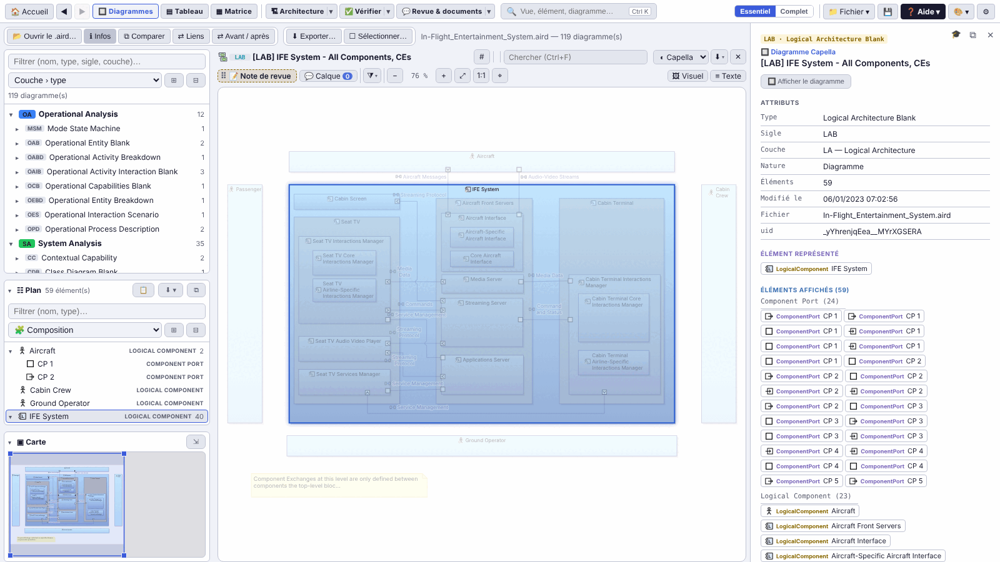

**⧉ Comparer** (barre de la vue) : ouvre le diagramme affiché dans la **fenêtre de comparaison**, une fenêtre séparée (une seule, réutilisée) à placer par exemple sur un autre écran (autoriser les fenêtres surgissantes). Elle a sa propre liste de diagrammes ; molette : zoom, glisser : déplacer, **⤢ Ajuster**, **ℹ** informations, **🔲 Ouvrir ici** ; un clic sur un élément ouvre son détail dans la page ; **🎓** lance la visite guidée de la fenêtre (aussi **❓ Aide ▾ › ⧉ Visite de la fenêtre de comparaison**). **Clic droit** sur un diagramme de l'explorateur (ou dans le diagramme ouvert) › **⧉ Afficher dans la fenêtre de comparaison** : ce diagramme s'y affiche, celui de la page ne change pas.

## 10.4 ⬇ Exporter… (planches)

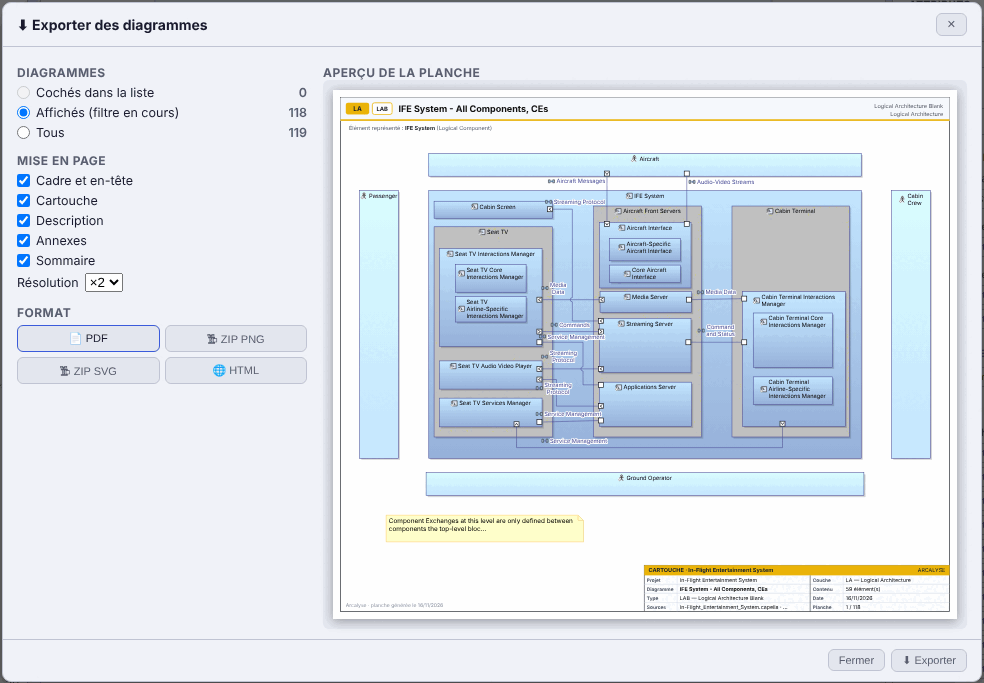

1. **☐ Sélectionner…** permet de cocher des diagrammes dans la liste (sinon : *affichés* ou *tous* ; les tableaux sont exclus) ;
2. **⬇ Exporter…** ouvre la fenêtre : **Diagrammes** (cochés dans la liste, affichés, tous), **Mise en page** (Cadre et en-tête, Cartouche, Description, Annexes, Sommaire, Résolution), **Format** (**📄 PDF**, **🗜 ZIP PNG**, **🗜 ZIP SVG**, **🌐 HTML**) ;
3. l'**aperçu de la planche** montre le résultat (cadre et en-tête : couche, sigle, nom, type ; élément représenté ; cartouche : projet, type, couche, contenu, sources, date, planche) ;
4. **⬇ Exporter**. PDF : sommaire, signets, annexes (alerte si le PDF risque de dépasser 40 Mo) ; ZIP : un dossier par couche et un CSV d'annexe par diagramme ; HTML : planches repliables par couche et type.

## 10.5 Modèles SysML v2 et UML / SysML v1

Pour un modèle lu par un lecteur d'Arcature, l'explorateur, la ▣ carte, ℹ Infos, les planches et ⧉ Comparer fonctionnent comme ci-dessus ; seul le dessin change :

- **classement** : *Genre › origine* (défaut), *Genre*, *Origine* (Cameo, Enterprise Architect, Papyrus, vue calculée), *Nom* ou **🌳 Arborescence** ;
- **SysML v2** : le texte n'a pas de diagrammes, le lecteur **calcule des vues** (GV, IV, STV, AFV) ;
- **UML / SysML v1** : seuls les diagrammes et tableaux **enregistrés dans le fichier** sont montrés (un `.xmi` exporté de Cameo n'a pas de diagrammes : ouvrir le `.mdzip` ; Papyrus : le `.uml` avec son `.notation`) ;
- au-dessus de la vue, deux lignes : **identité** (nom, origine, 🔍 Ctrl+F — Entrée : suivant —, ◐ thème Auto / Clair / Sombre, ⬇ ▾ SVG, PNG, impression ou PDF, texte, ✕) et **outils** (📝 Note et 💬 Calque, ⧩ filtres : étiquettes des liens, compartiments, liens par genre ; zoom − % +, ⤢ tout voir, 1:1, ⌖ centrer sur l'élément choisi — touche **F** ; ▣ ; **🖼 Visuel** ou **≡ Texte** coloré) ; **#** grille (touche **G**), comme pour Capella ;
- **🎨 Style Cameo** (diagrammes de Cameo / CATIA Magic et d'Enterprise Architect seulement) : le dessin comme dans l'outil — couleurs, dégradés, polices et symboles —, au lieu du dessin d'Arcalyse. Désactivé par défaut ; le bouton clignote légèrement à sa première apparition pour le signaler. Un clic change le choix pour toutes ces vues ; il est gardé avec la page ; exports, planches, ⧉ Comparer et ⇄ Avant / après suivent le style affiché ;
- **clic sur un élément** du dessin : son panneau de détail (glisser déplace la vue sans ouvrir le détail) ;
- pas de **⇄ Liens** (propre à Capella) ; **⇄ Avant / après** fonctionne ([§ 10.6](#106--avant--après)).

**▦ Tableaux, matrices et Relation Map de Cameo** (`.mdzip`) : Cameo n'enregistre que leur définition ; Arcalyse les recalcule et les liste avec les diagrammes (genres Tableau, Matrice, Relation Map).

| Genre | Ce qu'on peut faire |
|---|---|
| **Tableau** (Requirement Table, Generic Table, ICD, Instance Table) | tri par clic sur l'en-tête (▲ / ▼ / sans tri), filtre, clic sur un élément → détail ; **▤ Tableau** ouvre ses lignes dans un onglet du ▤ Tableau (colonnes ramenées à celles d'Arcalyse, les autres en lecture seule 🔒 ; 📋 pour retirer les lignes données) |
| **Matrice** (Dependency Matrix, Allocation, Refine / Satisfy / Verify…) | en-têtes verticaux, propriétaires groupés comme dans Cameo, **Éléments reliés seulement**, cellule = sens des relations (↗ ↙ ⤢) |
| **Relation Map** (et cartes de décomposition) | arbre dessiné comme la disposition « Tree » de Cameo, liens colorés par critère et légende ; **⊕ / ⊖** déplie ou replie un nœud, **↺ Dépliage enregistré** ; clic sur un diagramme membre : il s'ouvre ; **🗺 Relation Map** l'ouvre dans un onglet de la 🗺 Relation Map d'Arcalyse |

Pour tous : ⬇ CSV (ou Excel), ≡ Texte, **ℹ Infos** (définition, critères, colonnes, remarques). Non évalué, et signalé : portée d'un Smart Package ou d'une requête de Cameo, critères faits d'un script.

## 10.6 ⇄ Avant / après

**⇄ Avant / après** (barre de la vue) montre les **écarts du diagramme ouvert avec une version d'avant** du modèle, pour Capella, UML / SysML v1 et SysML v2 (pas pour les tableaux et matrices). Un second clic, ou **✕**, referme l'affichage.

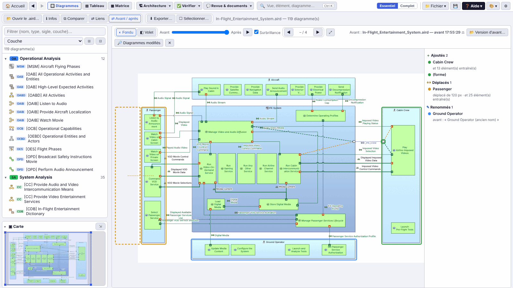

**La version d'avant** :

- **gardée d'elle-même** quand le modèle ou le `.aird` est remplacé par une version plus récente du même fichier : 🔄 mise à jour ([§ 16](16-suivi-fichier.md)), réouverture, 📁 dossier du projet ;
- ou choisie par **📂 Version d'avant…** : `.capella` **et** `.aird`, `.sysml` / `.kpar`, fichiers UML / SysML v1 ;
- ou celle chargée dans **⚖ Comparaison de versions** (marquée ⚖ dans la barre, [§ 12.4](12-analyses.md#124--comparaison-de-versions)). Si le modèle affiché est l'ancienne version (⇄ des deux versions), la version comparée est montrée comme version **d'après**.

| Commande | Effet |
|---|---|
| **◐ Fondu** | Le dessin d'après, dont seuls les écarts bougent avec le curseur **Avant ⟷ Après** : éléments ajoutés qui apparaissent, retirés qui s'effacent, déplacés ou redimensionnés qui glissent de leur ancienne place à la nouvelle, liens retracés et éléments renommés en fondu enchaîné ; **▶** anime l'aller-retour. |
| **◧ Volet** | Les deux dessins entiers, avant à gauche de la barre, après à droite (glisser la barre ou le curseur). |
| **Surbrillance** | Vert : ajouté ; rouge : retiré ; orange : déplacé ou redimensionné (ancienne place en pointillé) ; bleu : renommé ; violet : lien retracé. |
| **◀ n / N ▶** | D'un écart à l'autre. |
| **⤢** | Tout le diagramme. Molette : zoom ; glisser : déplacer. |
| **🔎 Diagrammes modifiés** | Liste les diagrammes qui diffèrent de la version d'avant (clic : l'ouvrir). |

| ◧ Volet | 🔎 Diagrammes modifiés |
|---|---|
| 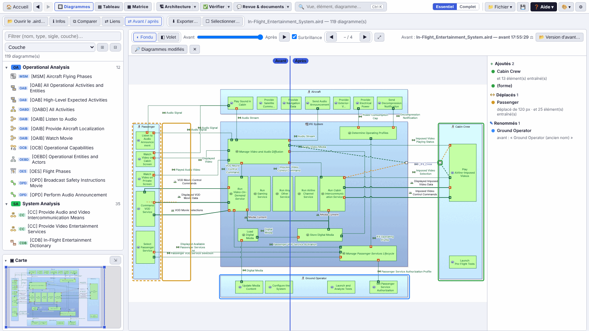 | 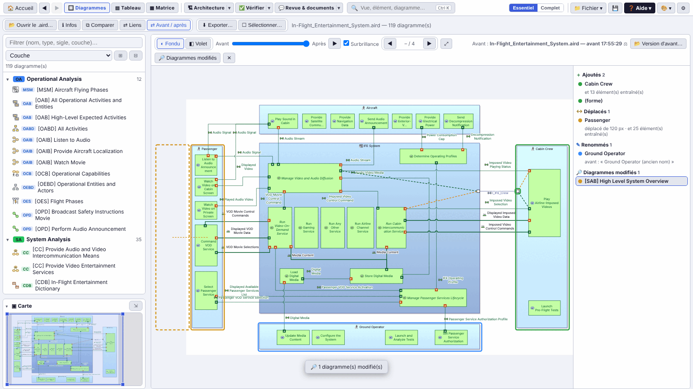 |

À droite, la **liste des écarts** par genre (ajoutés, retirés, déplacés, redimensionnés, renommés, liens retracés) ; les éléments entraînés par un conteneur sont comptés sous lui. **Clic** : centrer et faire clignoter ; **double-clic** : panneau de détail. Un diagramme absent de la version d'avant est signalé.

**Depuis ⚖ Comparaison de versions › 🔲 Diagrammes** : chaque diagramme a **🔲 Ouvrir** et **⇄ Avant / après** ; **⇄ Passer en revue** ouvre le premier de la liste. **⏮ ⏭** passent ensuite d'un diagramme de la liste à l'autre (« Diagramme n / N »), **↩ Comparaison** y ramène.

---

[📘 Sommaire du guide](../GUIDE-UTILISATION.md) · ◀ [9. 📡 Flux & interfaces](09-flux-interfaces.md) · [11. ƒ Fonctions](11-fonctions.md) ▶
