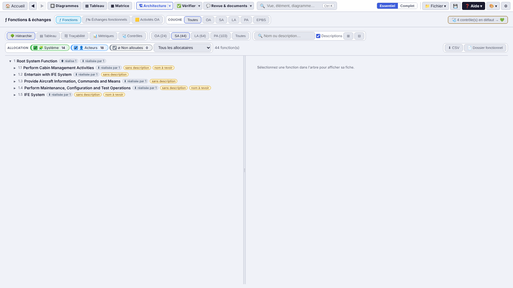
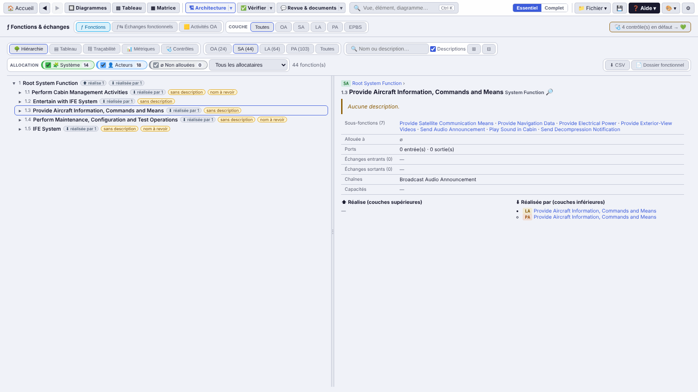
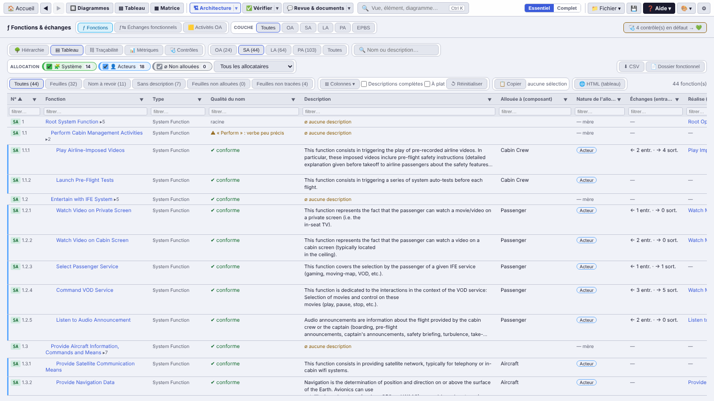
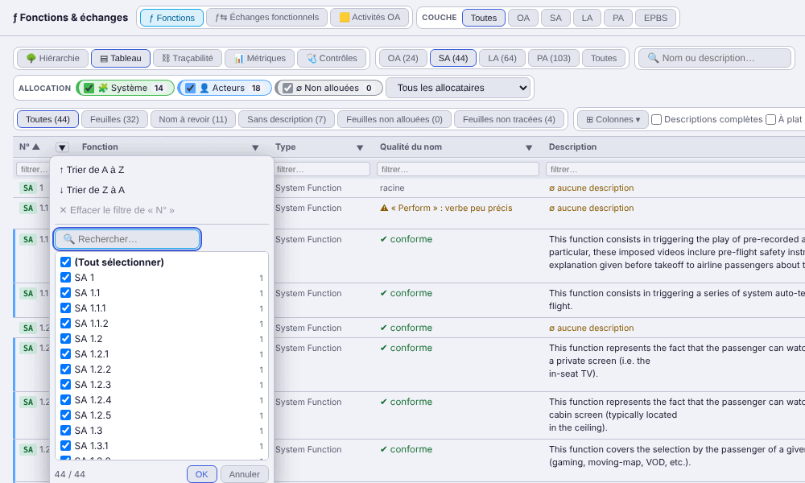
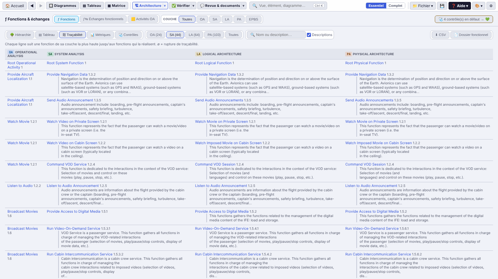
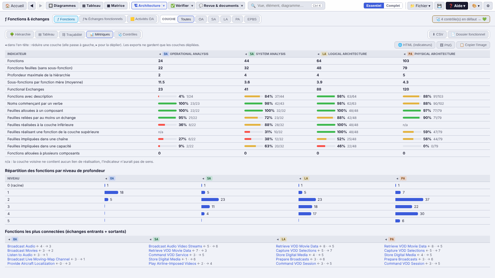
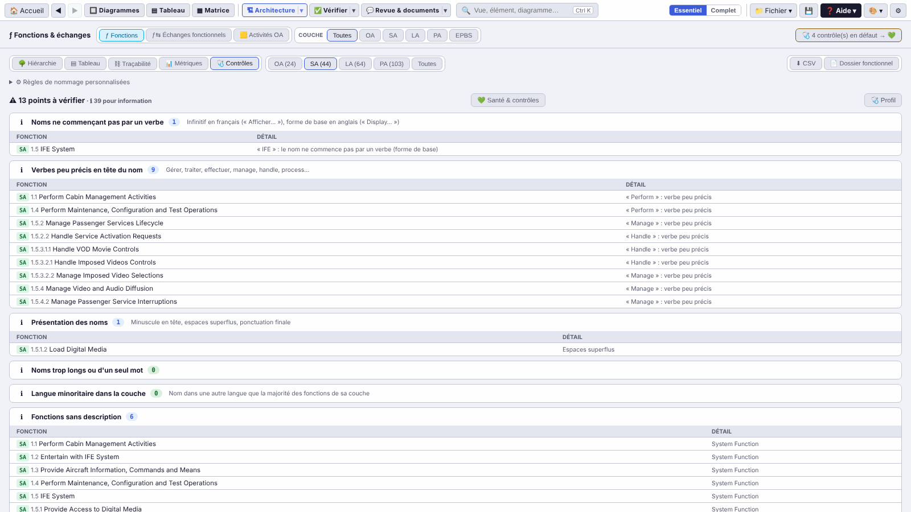

[📘 Sommaire du guide](../GUIDE-UTILISATION.md) · ◀ [10. 🔲 Diagrammes](10-diagrammes.md) · [12. 🔬 Analyses](12-analyses.md) ▶

# 11. ƒ Fonctions

**🏗 Architecture › ƒ Fonctions & échanges**, première vue de la famille (barre de famille : **ƒ Fonctions · ƒ⇆ Échanges fonctionnels · 🟨 Activités OA**, voir [§ 9](09-flux-interfaces.md)) : activités OA et fonctions SA / LA / PA, **couche par couche**, avec leurs descriptions mises en avant. La **couche commune** choisie dans la barre de famille (OA, SA, LA, PA… ou Toutes) est reprise d'une famille à l'autre ; à droite, la pastille **🩺 n contrôle(s) en défaut → 💚** ouvre 💚 Santé & contrôles filtrée sur la vue ([§ 12.10](12-analyses.md#1210--santé--contrôles)).

**Barre de la vue** : sous-vues **🌳 Hiérarchie · ▤ Tableau · ⛓ Traçabilité · 📊 Métriques · 🩺 Contrôles** ; couches **OA · SA · LA · PA · Toutes** ; **Nom ou description…** ; **Descriptions** (afficher dans l'arbre) ; **⊞ / ⊟** ; filtre **ALLOCATION** (🧩 Système, 👤 Acteurs, ∅ Non allouées — clic : afficher / masquer, double-clic : uniquement celle-ci) ; liste **Tous les allocataires** (un acteur, ou le système et ses sous-systèmes en arbre) ; **⬇ CSV** ; **📄 Dossier fonctionnel**.

## 11.1 🌳 Hiérarchie

Arbre numéroté (1, 1.1, 1.2…) avec badges : allocation, échanges ⇄, **réalise ⬆ / réalisée par ⬇**, *sans description*, *nom à revoir*. **Clic sur une fonction** : **fiche** à droite (chemin, description, résumé, sous-fonctions, allocation, ports, échanges entrants et sortants, chaînes, capacités, états, arbre de traçabilité vers le haut et vers le bas) ; ses liens naviguent d'une fonction ou d'une couche à l'autre. Le séparateur **⋮** se glisse pour ajuster les largeurs (double-clic : défaut). Chaque fonction porte un liseré de la couleur de son allocation (double liseré si allouée au système et à un acteur).

## 11.2 ▤ Tableau

Une ligne par fonction, indentée (option **À plat**) :

- colonnes **redimensionnables** (bord de l'en-tête), **triables** (clic), **filtrables** par texte (champ sous l'en-tête) ou **par valeurs comme dans Excel** (**▼** : tri, recherche, cases à cocher avec effectifs ; une colonne à plusieurs valeurs est éclatée), **masquables** (**⊞ Colonnes**) ;
- descriptions complètes en option, filtres rapides, nombre de fonctions affichées / total ;
- colonnes *Nature de l'allocation*, *Sous-système* (chemin des composants englobants), *Qualité du nom* ;
- **sélection de cellules** : clic-glisser, Ctrl+clic, Maj+clic, puis **📋 Copier** ou Ctrl+C ;
- exports **⬇ CSV** et **🌐 HTML** (colonnes, largeurs, filtres et tri actuels).

## 11.3 ⛓ Traçabilité

Chemins **OA → SA → LA → PA** passant par la couche choisie, avec descriptions ; **∅** = rupture de traçabilité. Les en-têtes et la ligne de filtres restent visibles au défilement.

## 11.4 📊 Métriques

Comparatif des couches : nombre, feuilles, profondeur, taux de description, d'allocation, d'échanges, de traçabilité, de couverture par chaînes et capacités, qualité des noms ; répartition par niveau ; fonctions les plus connectées. **◂** réduit une couche (**▸** pour la déplier) ; seules les couches dépliées sont exportées : **🌐 HTML**, **🖼 PNG** haute définition ou **📋 copie de l'image**.

## 11.5 🩺 Contrôles et ✍ qualité des noms

Qualité des noms, descriptions absentes ou trop courtes, marqueurs TODO / TBD / NOT DONE, doublons, allocations manquantes, multiples ou sur une fonction mère, feuilles sans échange, échanges sur fonctions mères, ports inutilisés, ruptures de traçabilité.

**✍ Qualité des noms** (hors ligne) : verbe en tête (infinitif en français, forme de base en anglais — environ 1 000 verbes intégrés), forme en -ing ou nom d'action en tête, verbes vagues, majuscule, espaces, ponctuation, longueur, langue minoritaire dans la couche. **⚙ Règles de nommage** : verbes métier acceptés et faux verbes, conservés dans la 💾 page HTML.

## 11.6 📄 Dossier fonctionnel

Rapport HTML imprimable : un onglet par couche, une section numérotée par fonction (description, allocation, entrées / sorties, réalisations, chaînes, capacités), plus métriques et contrôles.

---

[📘 Sommaire du guide](../GUIDE-UTILISATION.md) · ◀ [10. 🔲 Diagrammes](10-diagrammes.md) · [12. 🔬 Analyses](12-analyses.md) ▶
