[📘 Sommaire du guide](../GUIDE-UTILISATION.md) · ◀ [11. ƒ Fonctions](11-fonctions.md) · [13. 📐 Tableau de bord](13-tableau-de-bord.md) ▶

# 12. 🔬 Analyses

Les analyses n'ont plus de rangée d'onglets commune : chacune s'ouvre depuis les menus de la barre (ou la recherche 🔍 Ctrl+K, et peut être épinglée — [§ 3.2](03-interface.md#32-menus-des-vues-épingles-et-ctrlk)) :

| Menu | Analyses |
|---|---|
| **🏗 Architecture** | 🚦 Modes & états, 🎯 Capacités & missions, 🗃 Données & interfaces, 🖧 Déploiement & EPBS (ƒ Fonctions : [§ 11](11-fonctions.md)) |
| **✅ Vérifier** | 💚 Santé & contrôles ; **🧬 Traçabilité entre couches** (famille : 🧬 Tableau de traçabilité, ⇶ Graphe des réalisations) ; 🧾 Exigences ; **🎛 Propriétés & contraintes** (famille : 🎛 Propriétés (PVMT), 🔒 Contraintes) ; ⚖ Comparaison de versions ; 🎚 Variantes (150 %) ; 🔖 Statut de revue ; *Avancé* (mode Complet) : 🏷 Catégories d'échanges, 📦 REC / RPL, 📚 Bibliothèques |

Les vues propres aux modèles SysML v2, UML / SysML v1 et ReqIF sont décrites au [§ 24](24-sysml-uml.md). Une vue sans données pour le modèle chargé est retirée des menus en mode Essentiel (grisée en Complet).

Les résultats sont **gardés en mémoire** ; **↻ Recalculer** (en haut à droite de chaque analyse) les rafraîchit. Les contrôles ne sont calculés qu'à l'ouverture de l'onglet 🩺 Contrôles. Une rubrique absente du modèle est simplement signalée comme vide.

**Tableaux et listes longs** : affichés par **pages de 200 lignes** (barre ‹ › en tête et en pied : page précédente / suivante, choix de la page, **Tout afficher**) — tableaux des analyses, 🧩 Ports, 🧬 Traçabilité, listes du panneau de détail. Un filtre par colonne actif affiche toutes les lignes pour porter sur l'ensemble ; les exports CSV / Excel contiennent toujours tout.

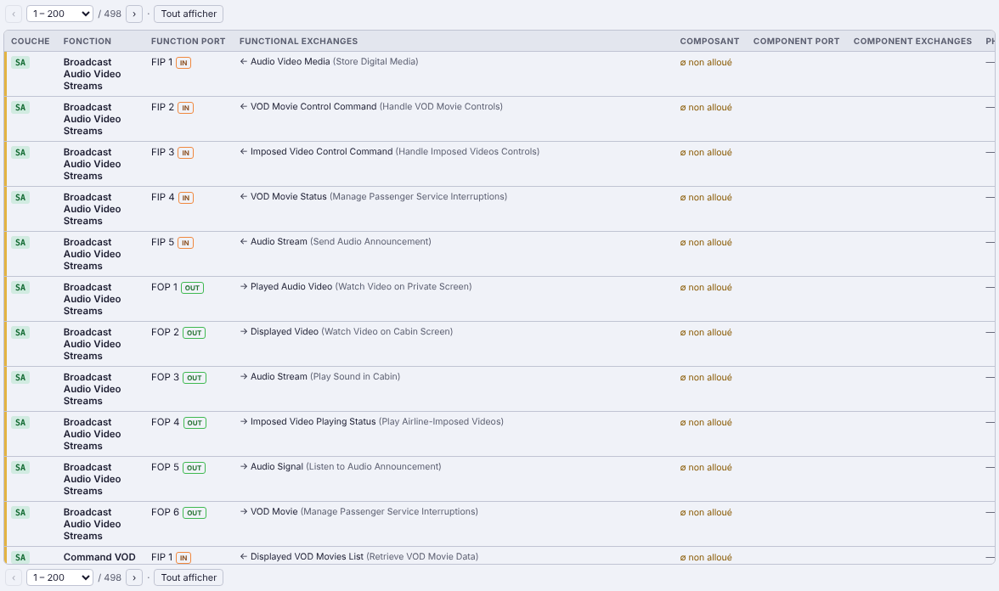

**🎯 Visite de cette vue** (❓ Aide ▾) : visite guidée propre à l'analyse affichée, nommée d'après elle.

**Tableaux des analyses** : sous chaque en-tête, un champ **Filtrer…** (plusieurs mots : tous requis ; **!mot** : exclure) ; le nombre de lignes affichées est indiqué au-dessus, avec **✕** pour effacer. Glisser le bord droit d'un en-tête règle la largeur (double-clic : automatique). Un tableau plus large que la vue a une barre de défilement horizontal collée en bas de l'écran (aussi **Maj + molette**).

## 12.1 🧬 Traçabilité inter-couches

**✅ Vérifier › 🧬 Traçabilité entre couches**, puce **🧬 Tableau de traçabilité** (l'autre puce, ⇶ Graphe des réalisations, est décrite au [§ 12.9](#129--liens-entre-couches)).

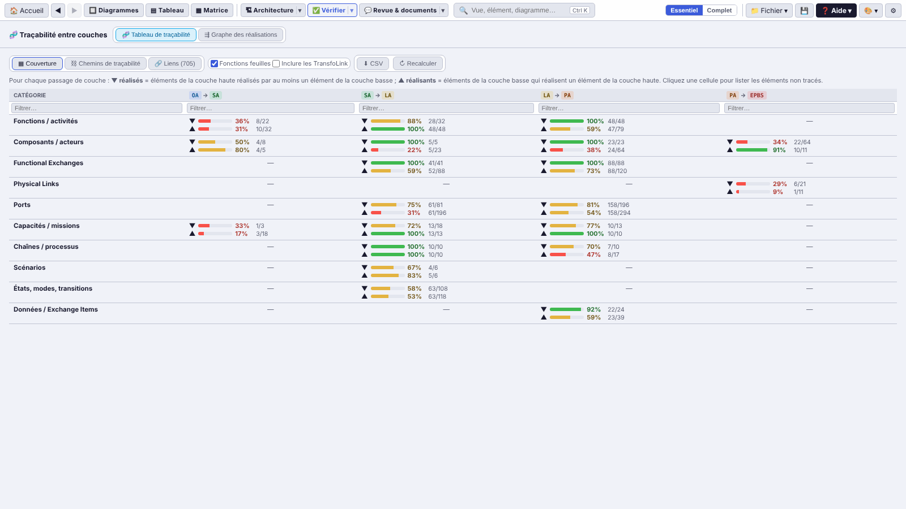

Exploite tous les liens *…Realization* (fonctions, composants, échanges, ports, capacités, chaînes, scénarios, états, données, éléments de configuration) et, en option, les **TransfoLink**.

| Sous-vue | Contenu |
|---|---|
| **▦ Couverture** | Par catégorie et passage OA→SA→LA→PA→EPBS : **▼ réalisés** (éléments du haut réalisés par le bas) et **▲ réalisants** (éléments du bas qui réalisent le haut), en % avec code couleur. **Clic sur une cellule** : éléments non tracés. |
| **⛓ Chemins de traçabilité** | Une ligne par chemin, une colonne par couche. |
| **🔗 Liens** | Liste filtrable de tous les liens de réalisation. |
| Options | **Fonctions feuilles** (ignore les fonctions mères), **Inclure les TransfoLink**, **⬇ CSV**. |

| ⛓ Chemins | 🔗 Liens |
|---|---|
| 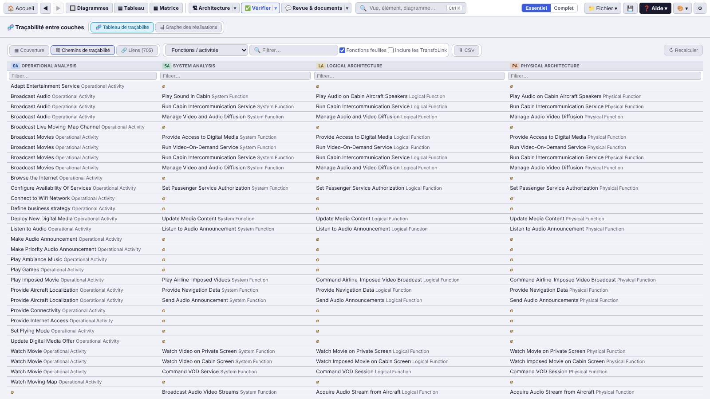 | 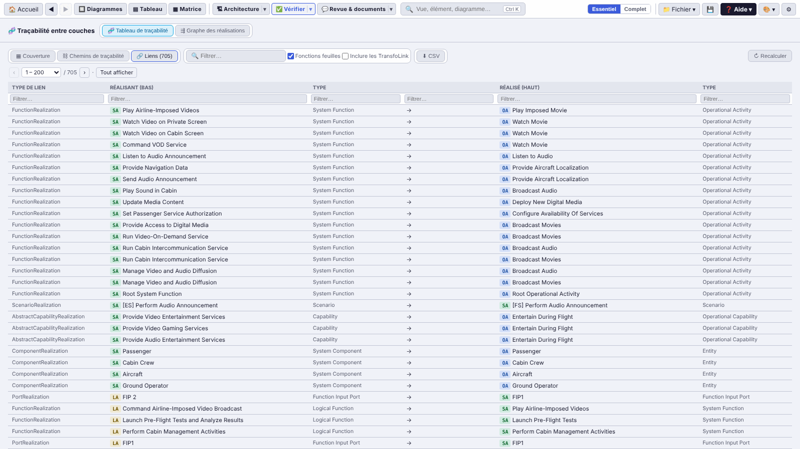 |

## 12.2 🎯 Capacités & missions

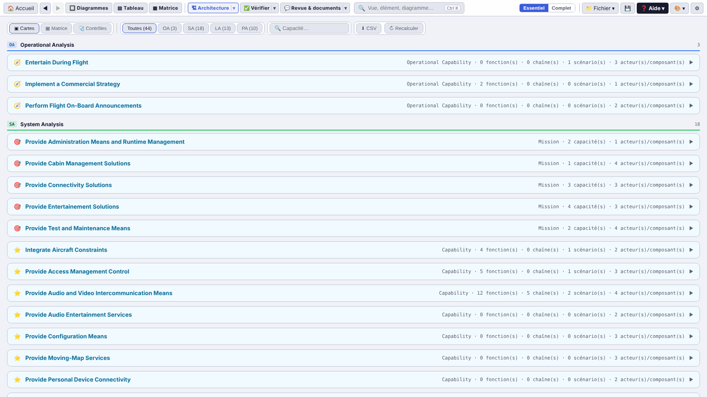

Capacités opérationnelles, capacités système, Capability Realizations (LA / PA) et missions : fonctions, chaînes, acteurs / composants impliqués, scénarios, inclusions, missions qui les exploitent, réalisations entre couches. Filtre de couche.

| Sous-vue | Contenu |
|---|---|
| **▣ Cartes** | Une carte par capacité ou mission, groupées par couche. |
| **▦ Matrice** | Capacités × acteurs / composants, × fonctions, × chaînes, ou missions × capacités. |
| **🩺 Contrôles** | Capacités sans fonction ni chaîne, sans acteur, sans scénario, non réalisées plus bas, non exploitées par une mission ; missions vides ; fonctions feuilles hors de toute capacité. |

| ▦ Matrice | 🩺 Contrôles |
|---|---|
| 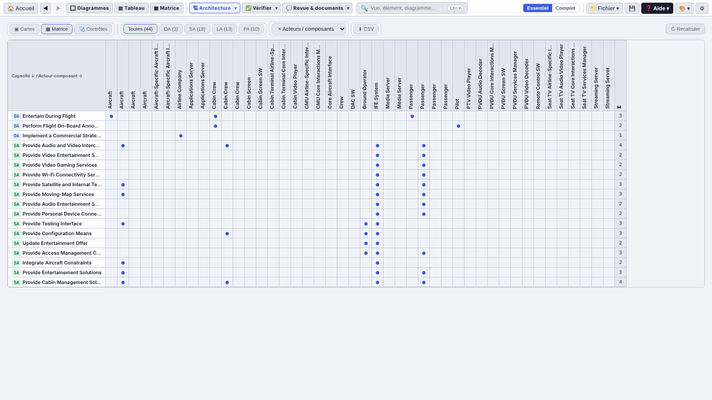 | 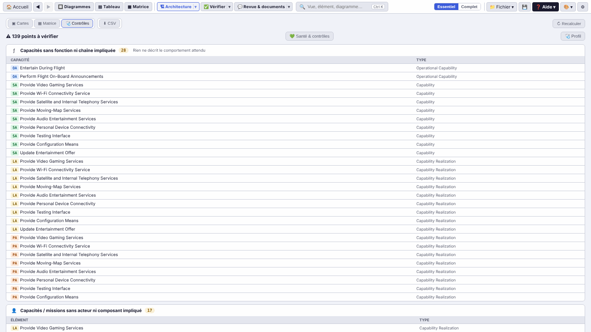 |

## 12.3 🚦 Modes & états

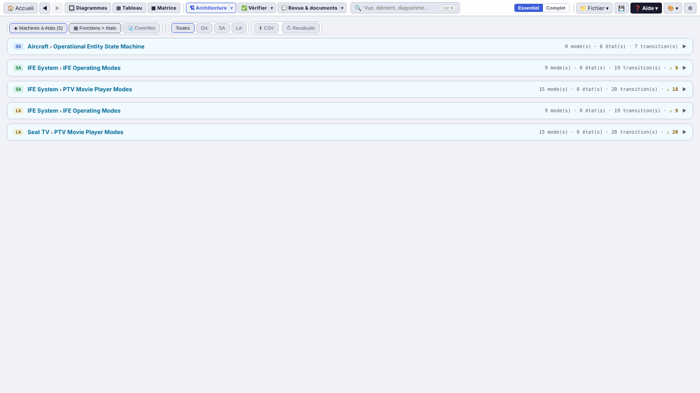

| Sous-vue | Contenu |
|---|---|
| **◈ Machines à états** | Par composant : diagramme (états bleus, modes jaunes, ● initial, ◉ final, ◆ choix ; transitions *déclencheur [garde] / effet*), tables des états (entry / do / exit, fonctions disponibles) et des transitions. |
| **▦ Fonctions × états** | Disponibilité des fonctions dans chaque état ou mode (*availableInStates*). |
| **🩺 Contrôles** | Régions sans état initial, états inatteignables, états sans issue, transitions sans déclencheur ni garde, fonctions jamais disponibles. |

| ▦ Fonctions × états | 🩺 Contrôles |
|---|---|
| 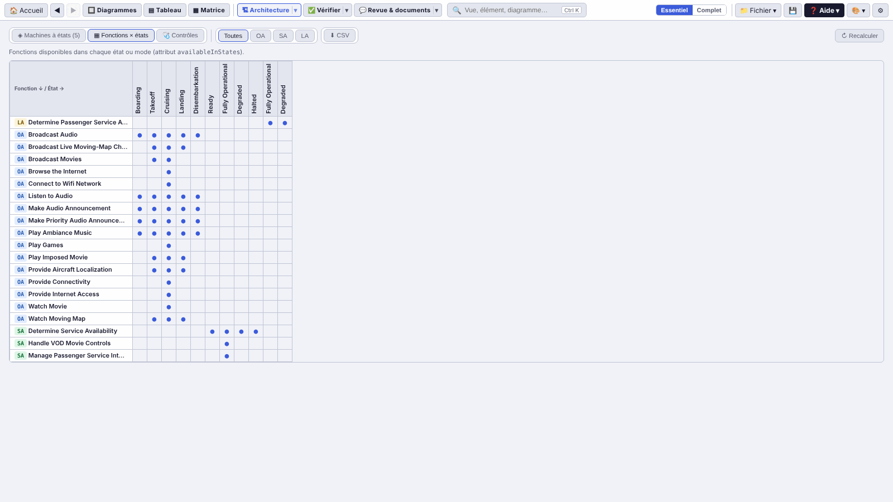 | 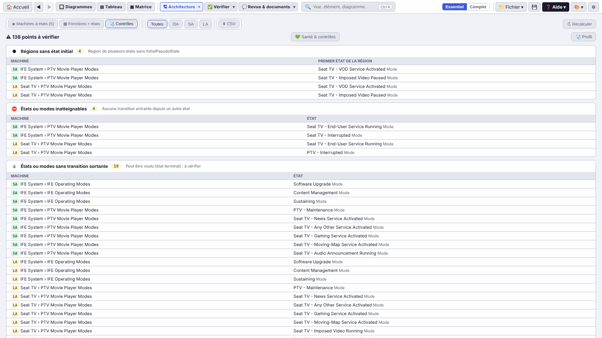 |

## 12.4 ⚖ Comparaison de versions

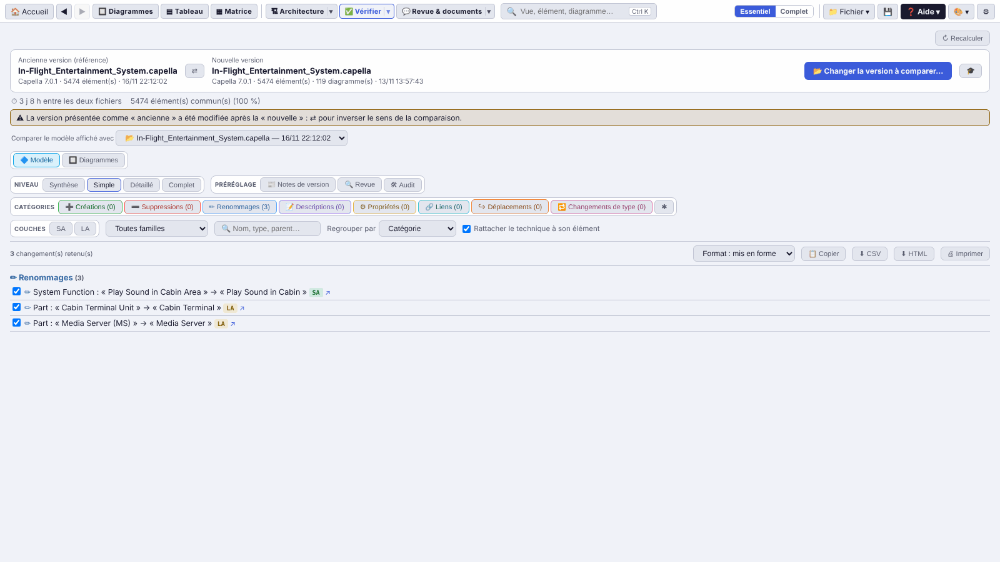

**✅ Vérifier › ⚖ Comparaison de versions**, pour **tous les formats** : l'autre version peut être un `.capella`, un `.sysml` / `.kpar`, un `.uml` / `.xmi` / `.mdzip` / `.qea` ou un `.reqif` / `.reqifz`, du **même format** que le modèle affiché (sinon, un message le refuse ; pour UML, le `.notation` et les autres fichiers du projet sont repris de l'ouverture).

**Comparer deux versions** :

1. ouvrez ⚖ Comparaison de versions ;
2. **📂 Charger une autre version…** (ensuite : **📂 Changer la version à comparer…**) — elle est considérée par défaut comme l'**ancienne** version (référence) ; **⇄** inverse ;
3. les éléments sont appariés par identifiant et les changements classés en **8 catégories** : ➕ Création, ➖ Suppression (avec les éléments contenus), ✏ Renommage, 📝 Description, ⚙ Propriétés, 🔗 Liens (+ / −), ↪ Déplacement, 🔁 Type.

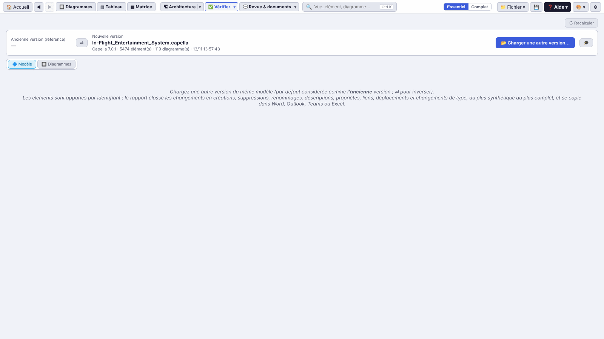

**En-tête des versions** : sous *Ancienne version (référence)* et *Nouvelle version*, le nom du fichier puis l'outil et sa version (Capella, Cameo, Papyrus, Enterprise Architect, outil d'exigences…), la version du modèle, le nombre d'éléments et de diagrammes, la date du fichier. Dessous, la durée entre les deux fichiers et le nombre d'éléments communs, puis des **alertes** : version « ancienne » modifiée après la « nouvelle » (⇄ pour inverser), projets racines différents, outils ou versions d'outil différents (une migration peut expliquer une partie des changements), moins de 30 % d'éléments communs. **Comparer le modèle affiché avec** propose les versions connues : celles du 🔄 suivi du fichier (sur le disque non appliquée, avant la dernière mise à jour, version d'ouverture) et les fichiers déjà chargés pendant la session. Ces informations sont reprises en tête du rapport copié ou exporté. **🎓** (à droite) lance la visite guidée de la comparaison. Deux onglets : **🔷 Modèle** (le rapport ci-dessous) et **🔲 Diagrammes**.

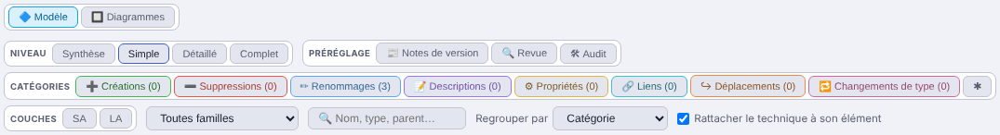

| Réglage | Choix |
|---|---|
| **Niveau** | Synthèse (compteurs) · Simple (une phrase par changement) · Détaillé (chaque propriété avant → après) · Complet (+ identifiant, type technique, chemin). |
| **Préréglage** | 📰 Notes de version (Simple) · 🔍 Revue (Détaillé) · 🛠 Audit (Complet, éléments techniques non regroupés). |
| **Catégories, couches, familles, recherche** | Filtres ; **Regrouper par** catégorie, couche, famille ou élément parent. |
| **Rattacher le technique à son élément** | (coché par défaut) allocations, réalisations, implications apparaissent comme 🔗 liens de l'élément concerné. |
| **Exclure une ligne** | Décochez-la : elle reste visible (barrée) mais disparaît de la copie et des exports. |
| **📋 Copier** | Exactement ce qui est affiché, au **Format** choisi : mis en forme (Word, Outlook, Teams, OneNote), texte brut, tableau Excel ou Markdown. |
| **Exports** | ⬇ CSV, ⬇ HTML autonome, 🖨 Imprimer (ou PDF). |

L'onglet **🔲 Diagrammes** :

- **Capella** : compare le `.aird` chargé à un `.aird` de référence (gardé automatiquement quand le `.aird` est relu ou remplacé après une 🔄 mise à jour, ou choisi par **📂 Charger un .aird de référence…** ; **✕** pour ne plus comparer) ;
- **SysML v2, UML / SysML v1** : compare, **sans .aird**, les diagrammes des deux versions du modèle (lus dans le fichier : Cameo, Papyrus, Enterprise Architect ; vues calculées en SysML v2) ; la version d'avant gardée par le 🔄 suivi du fichier ou une mise à jour est reprise d'elle-même ;
- états : ➕ nouveaux, ➖ supprimés, ✎ renommés, 🧩 contenu modifié (éléments ajoutés au diagramme ou retirés), 🎨 mise en page / style seulement ; même sans référence : ⚠ éléments absents du modèle et 🔷 touchés par le modèle (changements de l'onglet 🔷 Modèle) ;
- filtres, ▸ détail, ⬇ CSV ; sur chaque diagramme **🔲 Ouvrir** et **⇄ Avant / après** ; **⇄ Passer en revue** ouvre le premier diagramme de la liste en avant / après, puis ⏮ ⏭ passent aux suivants ([§ 10.6](10-diagrammes.md#106--avant--après)).

Indicateurs « Diagrammes — … » au 📐 Tableau de bord. Ouvrir un autre modèle efface la référence.

## 12.5 🧾 Exigences

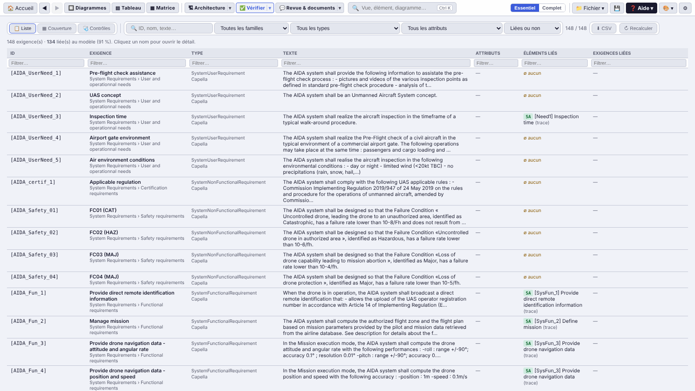

Exigences du **Requirements Viewpoint** (identifiant, texte, attributs, relations entrantes / sortantes et relations entre exigences) et exigences Capella de base (*SystemUserRequirement*…, traces *RequirementsTrace*). Filtres : recherche, famille, type, valeur d'attribut, liées ou non au modèle.

| Sous-vue | Contenu |
|---|---|
| **📋 Liste** | ID, nom, dossier, texte, attributs, éléments liés (avec leur couche), exigences liées. |
| **▦ Couverture** | Nombre d'éléments liés à chaque exigence, par couche. |
| **🩺 Contrôles** | Exigences liées à aucun élément, sans texte, sans identifiant, identifiants en double, relations vers un élément introuvable ; fonctions feuilles et composants sans exigence. |

| ▦ Couverture | 🩺 Contrôles |
|---|---|
| 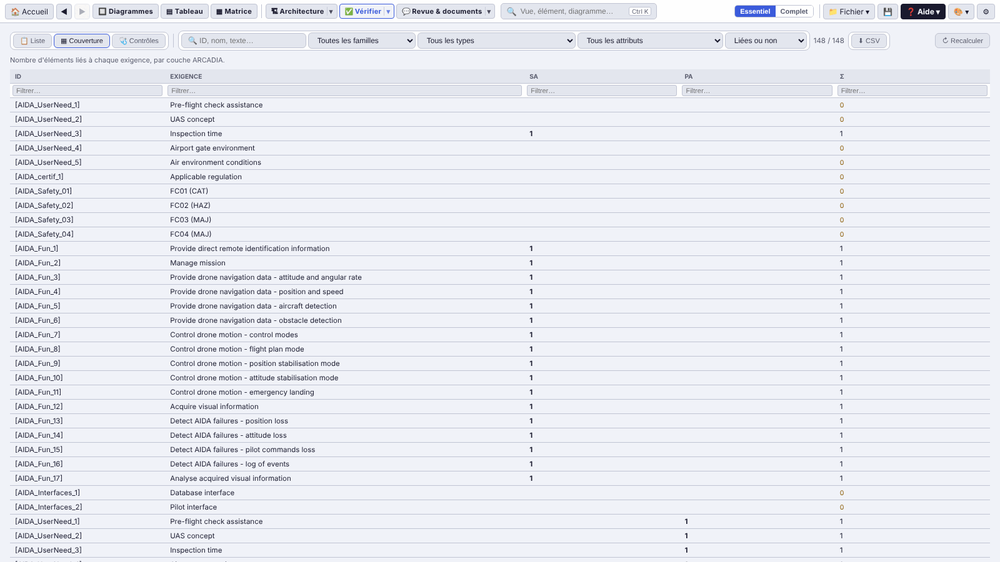 | 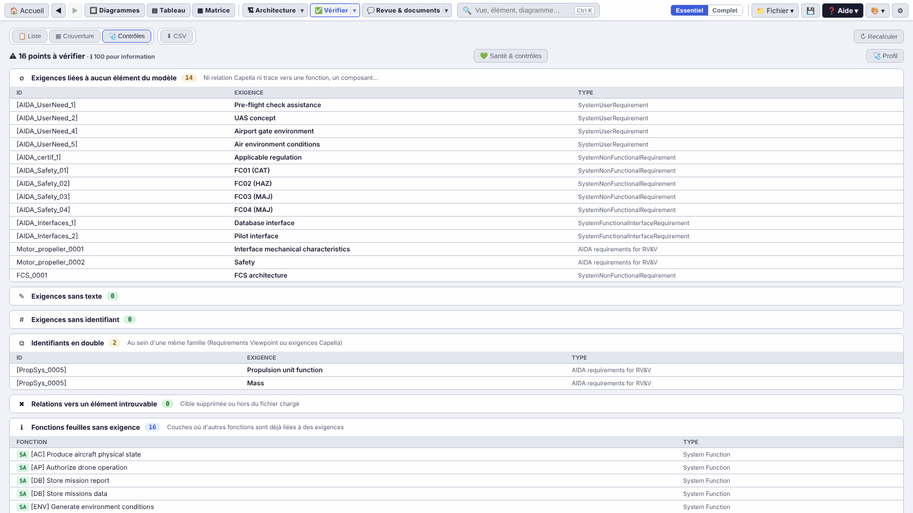 |

## 12.6 🎛 Propriétés (PVMT)

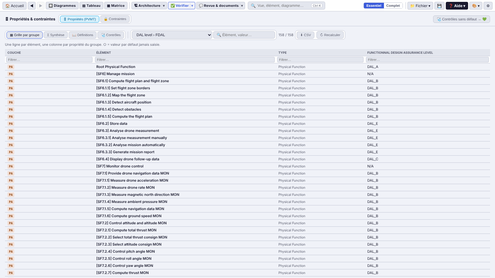

Propriétés des extensions **PVMT** (domaines, groupes, propriétés et unités) et propriétés simples posées sur les éléments ; **○** = valeur par défaut jamais saisie.

| Sous-vue | Contenu |
|---|---|
| **▦ Grille par groupe** | Une ligne par élément, une colonne par propriété du groupe ; total des propriétés numériques. |
| **Σ Synthèse** | Par propriété : somme, minimum, maximum, moyenne, ou répartition des valeurs. |
| **📖 Définitions** | Groupes définis, classes et architectures auxquelles ils s'appliquent, éléments renseignés et manquants. |
| **🩺 Contrôles** | Éléments concernés par un groupe mais non renseignés, valeurs restées par défaut, groupes sans lien vers leur définition. |

| Σ Synthèse | 📖 Définitions | 🩺 Contrôles |
|---|---|---|
| 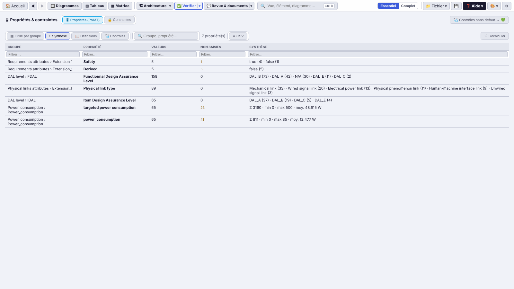 | 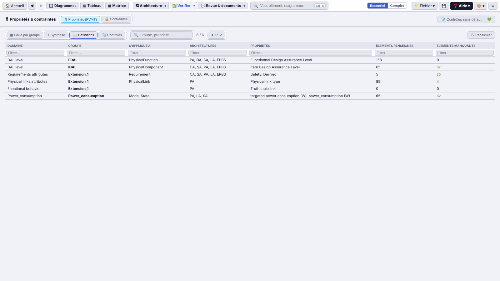 | 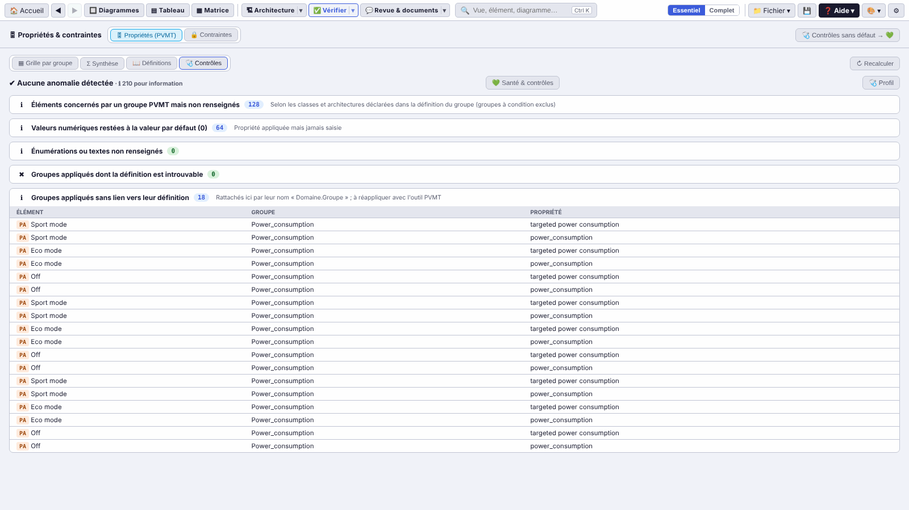 |

## 12.7 🗃 Données & interfaces

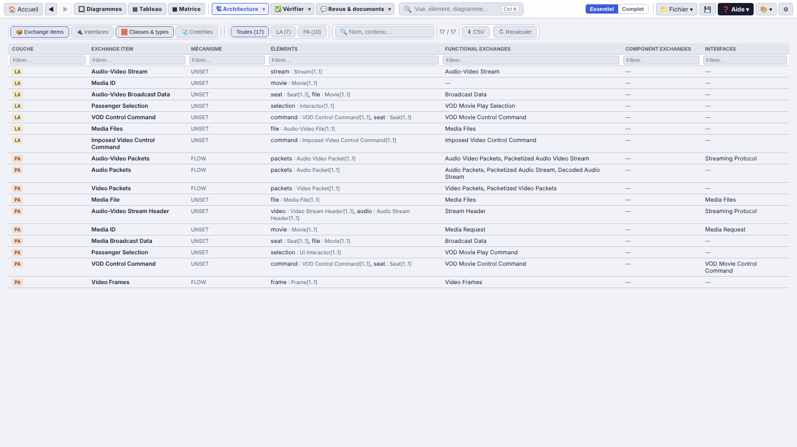

| Sous-vue | Contenu |
|---|---|
| **📦 Exchange Items** | Mécanisme, éléments (nom : type [cardinalité]), Functional / Component Exchanges qui les portent, interfaces qui les allouent. |
| **🔌 Interfaces** | Exchange Items alloués, ports qui les fournissent ou les requièrent, composants qui les utilisent ou les implémentent. |
| **🧱 Classes & types** | Classes (propriétés typées), énumérations (littéraux), grandeurs physiques (unité), héritage et usages ; types prédéfinis en option. |
| **🩺 Contrôles** | Exchange Items non portés ou sans contenu, FE sans Exchange Item, interfaces vides ou inutilisées, incohérences FE / interfaces des ports du CE porteur, types jamais utilisés. |

| 🔌 Interfaces | 🧱 Classes & types | 🩺 Contrôles |
|---|---|---|
| 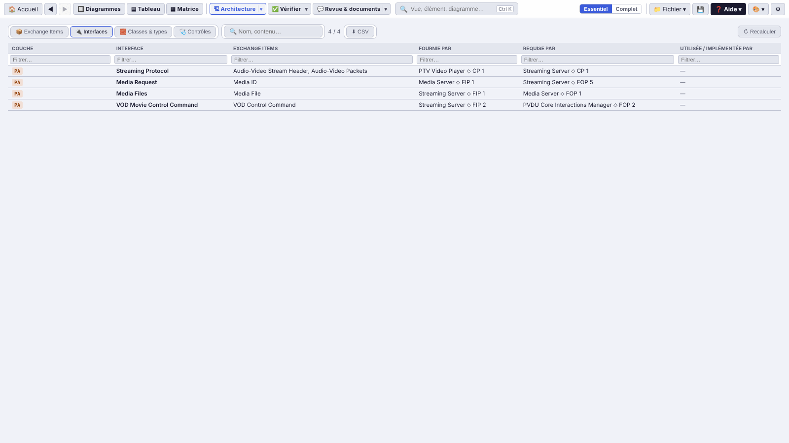 | 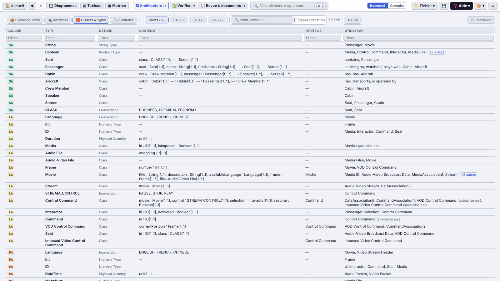 | 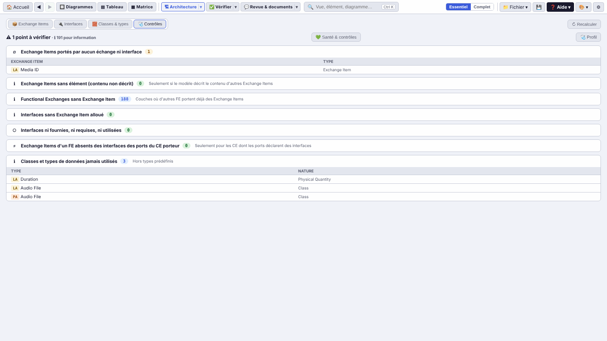 |

## 12.8 🔒 Contraintes

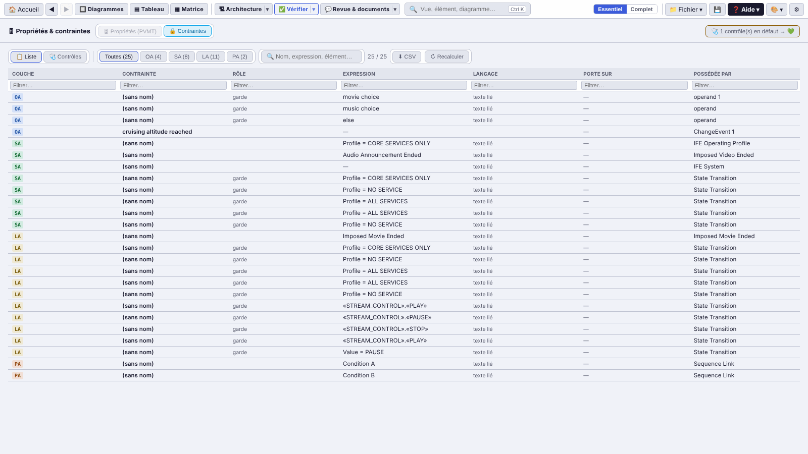

Toutes les contraintes : rôle (garde, pré / post-condition), expression (liens de texte remplacés par le nom de l'élément cité), langage, éléments contraints, propriétaire. **🩺 Contrôles** : contraintes vides ou sans expression, éléments cités introuvables, sans élément contraint, doublons.

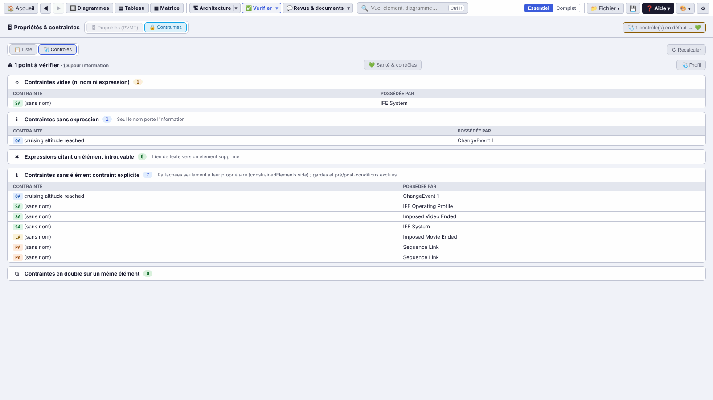

---

## 12.9 ⇶ Liens entre couches

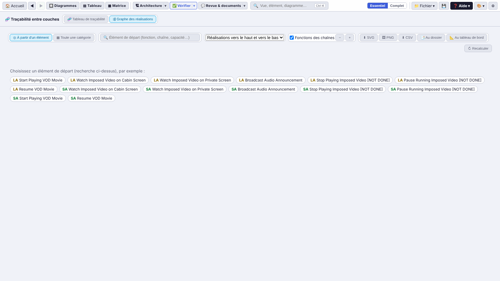

**✅ Vérifier › 🧬 Traçabilité entre couches**, puce **⇶ Graphe des réalisations**. Vue **graphique** des réalisations entre couches : une colonne par couche (OA → SA → LA → PA → EPBS), une flèche par lien de réalisation. Mode **élément** (partir d'un élément : fonction, chaîne, capacité, composant… et suivre ses réalisations vers le haut, le bas ou les deux) ou **catégorie** (toutes les réalisations d'une catégorie). Les chaînes sont groupées avec leurs fonctions ; l'ordre limite les croisements. Ouverture aussi par clic droit sur un élément ou par **ℹ Infos** d'une chaîne. Exports **SVG**, **PNG**, **CSV**, bloc ⇶ d'un 📑 dossier, et **📐 Au tableau de bord**. Épinglée, la vue devient le bouton direct **⇶ Couches**.

## 12.10 💚 Santé & contrôles

**Porte d'entrée unique des contrôles** (✅ Vérifier › 💚 Santé & contrôles). On y arrive aussi depuis chaque vue, la liste étant alors filtrée sur cette vue :

- la pastille **🩺 n contrôle(s) en défaut → 💚** à droite des barres de famille (fonctions, composants, chaînes et scénarios, propriétés) ;
- le bouton **💚 Santé & contrôles** en tête de chaque onglet 🩺 Contrôles, à côté de 🩺 Profil.

Dans l'onglet 📋 Contrôles × couches : puces **Vue** (Toutes, ou une vue avec son nombre de contrôles en défaut), case **En défaut seulement** (cochée par défaut : les contrôles qui ont des lignes, les plus fréquents d'abord) et, sur chaque ligne, **Ouvrir ↗** : la vue s'ouvre sur son onglet 🩺 Contrôles, section du contrôle dépliée et mise en évidence.

Un **score de 0 à 100** bâti sur **tous les contrôles 🩺** de toutes les vues, avec le 🩺 profil de contrôles ([§ 3.6](03-interface.md#36--profil-de-contrôles)) : les contrôles désactivés sont ignorés, les gravités pèsent ℹ 0, ⚠ 1, ✖ 3, et le score vaut 100 × e^−(Σ poids × lignes ÷ nombre d'éléments nommés) : 0,1 anomalie par élément ≈ 90, 0,36 ≈ 70. Niveaux : **Bon** (≥ 90), **À surveiller** (≥ 70), **À reprendre**. Un score **par couche** ARCADIA est calculé pour les contrôles qui le permettent (fonctions, échanges fonctionnels, composants).

| 🏠 Carte de l'accueil | 📋 Contrôles × couches |
|---|---|
| 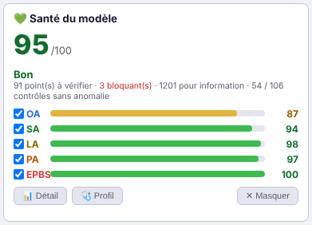 | 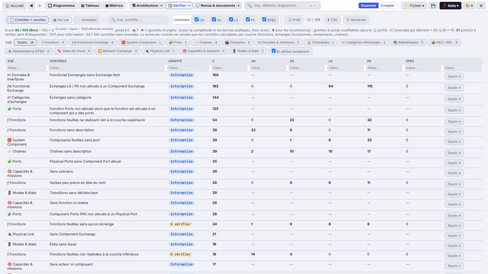 |

- **🏠 Carte de l'accueil** : score, niveau, points à vérifier et bloquants, barres par couche, écart avec la version précédente et courbe des dernières versions ; boutons 📊 Détail et 🩺 Profil. Au-delà de 30 000 éléments, le calcul attend un clic. **✕ Masquer** retire la carte de l'accueil (⚙ Disposer › Masquées pour la réafficher) ; dans la sous-vue, l'onglet ▦ Par vue permet de **masquer les contrôles d'une vue** du score (case « Comptée », réglage conservé avec le projet). **Décocher une couche** (case devant OA, SA, LA, PA, EPBS, aussi dans la sous-vue) l'exclut du score global : ses lignes de contrôles par couche et ses éléments ne comptent plus, par exemple pour une couche non encore travaillée ; le réglage est conservé avec le projet et noté dans l'historique.
- **📋 Contrôles × couches** : chaque contrôle avec sa vue, sa gravité, son nombre de lignes global et par couche, et **Ouvrir ↗** ; ⬇ CSV.
- **▦ Par vue** : contrôles, contrôles sans anomalie, points et bloquants de chaque vue ; case **Comptée** pour retirer une vue du score.
- **📈 Historique** : une ligne par version du modèle ouverte dans le projet (même fichier : entrée mise à jour), conservée avec la 💾 page. Indicateurs « Santé du modèle — … » au 📐 Tableau de bord (score, points, bloquants, par couche, par vue, historique).

| ▦ Par vue | 📈 Historique |
|---|---|
| 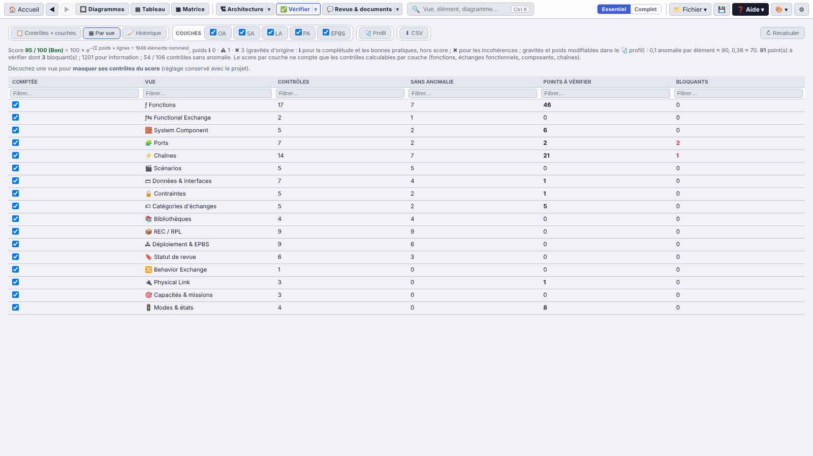 | 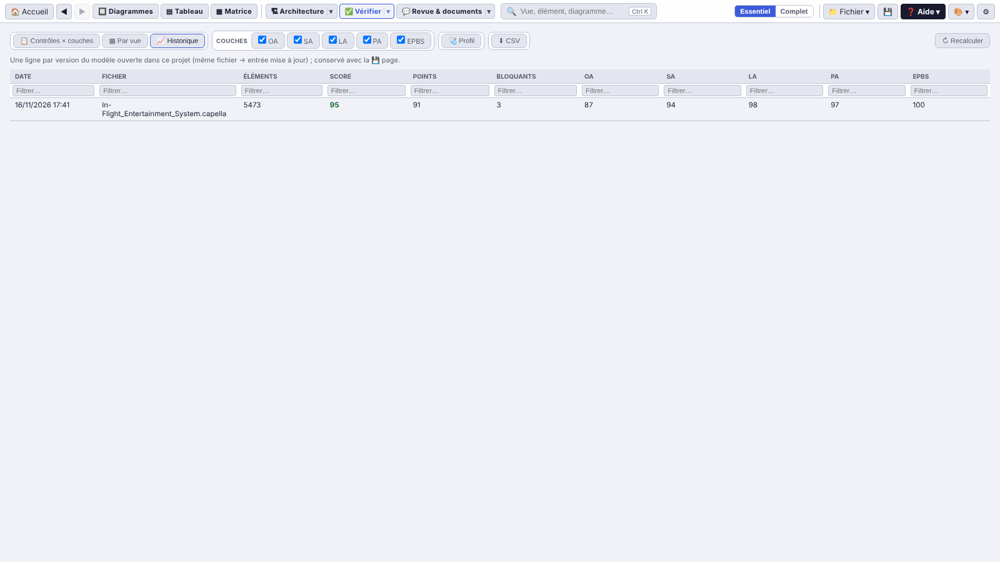 |

## 12.11 🖧 Déploiement & EPBS

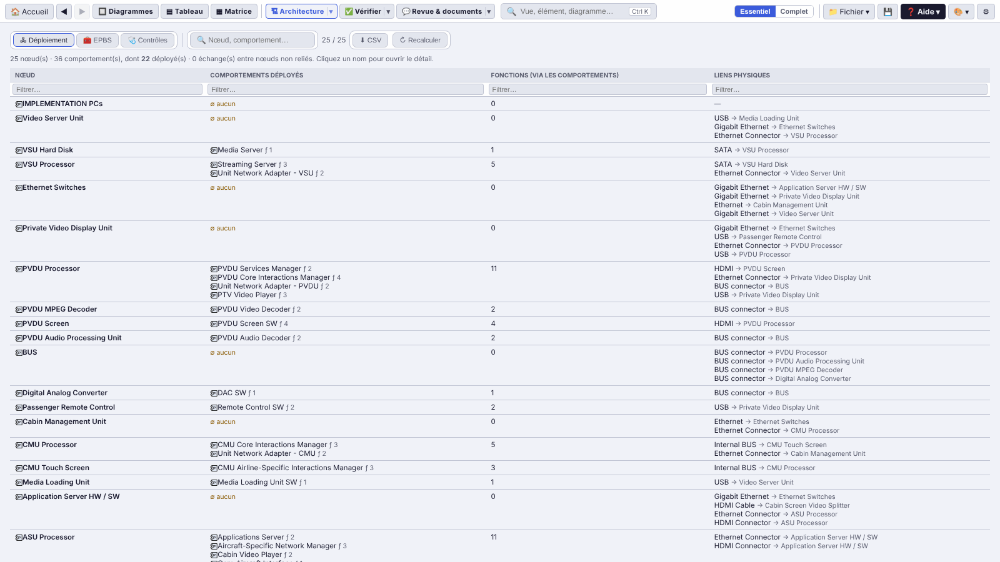

- **🖧 Déploiement** : chaque nœud physique (PhysicalComponent de nature NODE) avec les comportements (nature BEHAVIOR) qu'il héberge par PartDeploymentLink, le nombre de fonctions portées et ses liens physiques ; comportements non déployés en bas ; ⬇ CSV.
- **🧰 EPBS** : arbre des Configuration Items (COTS, logiciel, matériel, interface, NDI, système…) et les composants ou liens physiques qu'ils réalisent (PhysicalArtifactRealization) ; répartition par nature.
- **🩺 Contrôles** : comportements non déployés, nœuds sans comportement (seulement si le modèle pratique le déploiement), **échanges entre comportements déployés sur des nœuds qu'aucun lien physique ne relie**, déploiements multiples, nœuds non réalisés par un Configuration Item, Configuration Items vides, réalisations vers un élément introuvable, éléments réalisés par plusieurs articles, articles sans nature.

| 🧰 EPBS | 🩺 Contrôles |
|---|---|
| 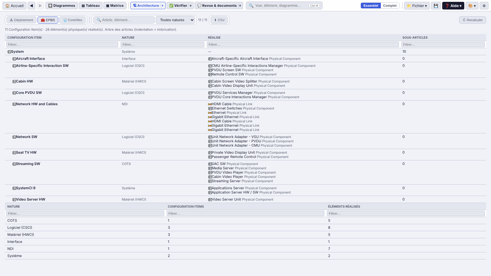 | 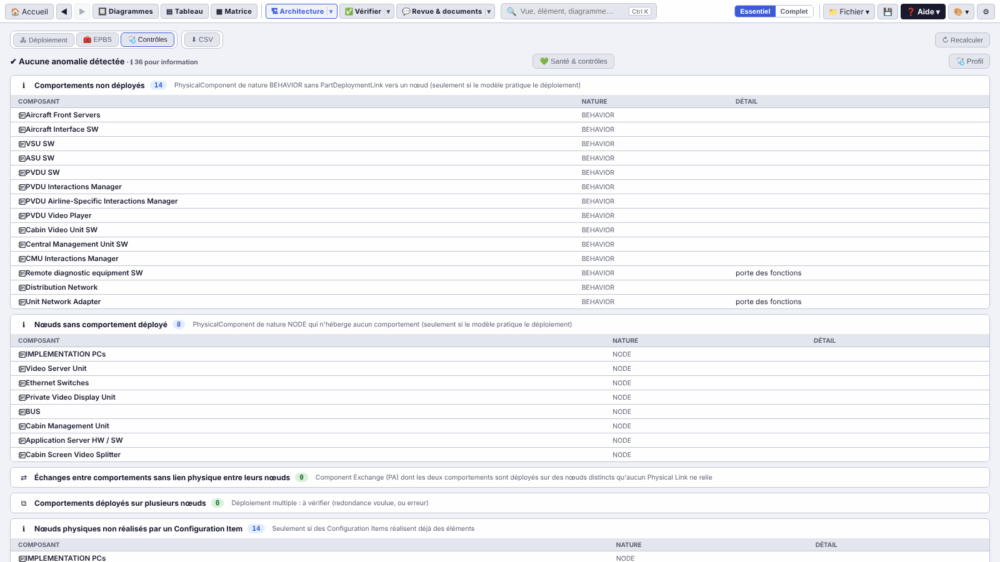 |

Le panneau de détail d'un composant physique indique où il est déployé, ce qu'il héberge et le Configuration Item qui le réalise. ⚡ Chaînes › 🩺 contrôle aussi la **continuité des chemins physiques** (lien impliqué dont les extrémités ne sont pas sur les composants voisins).

## 12.12 📦 REC / RPL

Les **éléments réutilisables** de Capella : un **REC** est un gabarit (ensemble d'éléments du modèle), une **RPL** une réplique instanciée de ce REC (suffixe, conformité BLACK_BOX / CONSTRAINT_REUSE / INHERITANCY_REUSE). Chaque élément d'une réplique garde un lien vers son origine dans le REC.

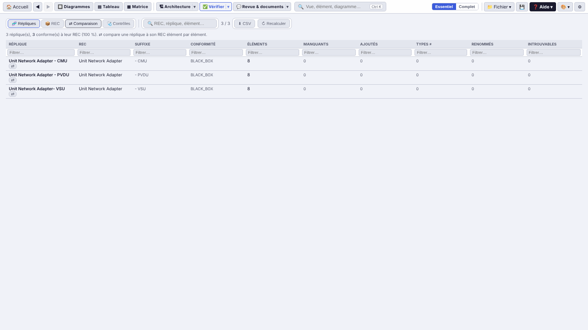

- **🧬 Répliques** : chaque RPL avec son REC, son suffixe, sa conformité, le nombre d'éléments et les écarts : manquants (éléments du REC sans équivalent), ajoutés (sans origine dans le REC), types différents, renommés hors règle « nom du REC + suffixe », cibles introuvables ; filtre par REC ; ⬇ CSV.
- **📦 REC** : chaque gabarit avec sa conformité par défaut, ses éléments et ses répliques (✔ conforme ou nombre d'écarts).
- **⇄ Comparaison** : une réplique face à son REC, élément par élément, avec l'état de chacun (✔, manquant, ajouté, type différent, renommé). Accessible aussi par ⇄ dans les tableaux et le panneau de détail.
- **🩺 Contrôles** : répliques incomplètes, enrichies, types différents, noms hors règle, liens vers un élément introuvable, REC introuvable, REC sans réplique, REC en double, éléments appartenant à plusieurs répliques.

Le panneau de détail d'un élément indique le REC ou la réplique dont il fait partie ; celui d'un élément de catalogue, son contenu. Indicateurs « REC / RPL — … » au 📐 Tableau de bord.

## 12.13 📚 Bibliothèques

Un modèle peut référencer des éléments d'un autre fichier .capella (**bibliothèque** Capella) : la référence s'écrit `platform:/resource/Projet/Fichier.capella#id` et les bibliothèques utilisées sont déclarées (LibraryReference). Arcalyse ne lit qu'un fichier : sans la bibliothèque, ces cibles sont « introuvables ».

- **📚 Bibliothèques** : chaque bibliothèque référencée avec son projet, déclarée ou non, le nombre de références et d'éléments visés, chargée ou non. **📂 Charger…** ouvre le fichier .capella de la bibliothèque (plusieurs à la fois). Avec **📁 Dossier du projet** ouvert sur le dossier parent (modèle et bibliothèques côte à côte), les bibliothèques référencées sont chargées d'elles-mêmes. Une bibliothèque chargée n'est pas enregistrée dans la page : rechargez-la à la réouverture.
- **🔗 Références** : élément source, attribut, bibliothèque, cible (📚 nom et type de l'élément visé si la bibliothèque est chargée) ; ⬇ CSV. Même affichage dans le panneau de détail (attributs et section « Références externes »).
- **🩺 Contrôles** : références vers une bibliothèque non chargée, cibles introuvables dans une bibliothèque chargée (version différente), bibliothèques déclarées sans référence, références vers une bibliothèque non déclarée.

## 12.14 🏷 Catégories d'échanges

Les catégories que Capella permet de poser sur les échanges : **ExchangeCategory** (Functional Exchanges), **ComponentExchangeCategory** (Component Exchanges), **PhysicalLinkCategory** (Physical Links).

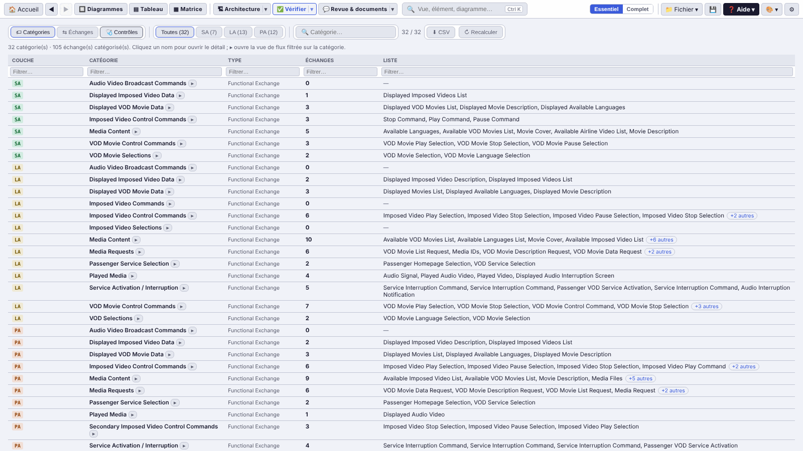

- **🏷 Catégories** : couche, nature, nombre et liste des échanges de chaque catégorie ; **▸** ouvre la vue de flux filtrée sur la catégorie.
- **⇆ Échanges** : taux d'échanges catégorisés par nature et par couche, puis chaque échange avec ses catégories (filtre catégorisés / sans catégorie) ; ⬇ CSV.
- **🩺 Contrôles** : échanges sans catégorie (seulement dans les natures et couches où des catégories sont déjà utilisées), catégories vides, référençant un échange introuvable, en double, échanges dans plusieurs catégories.

| ⇆ Échanges | 🩺 Contrôles |
|---|---|
| 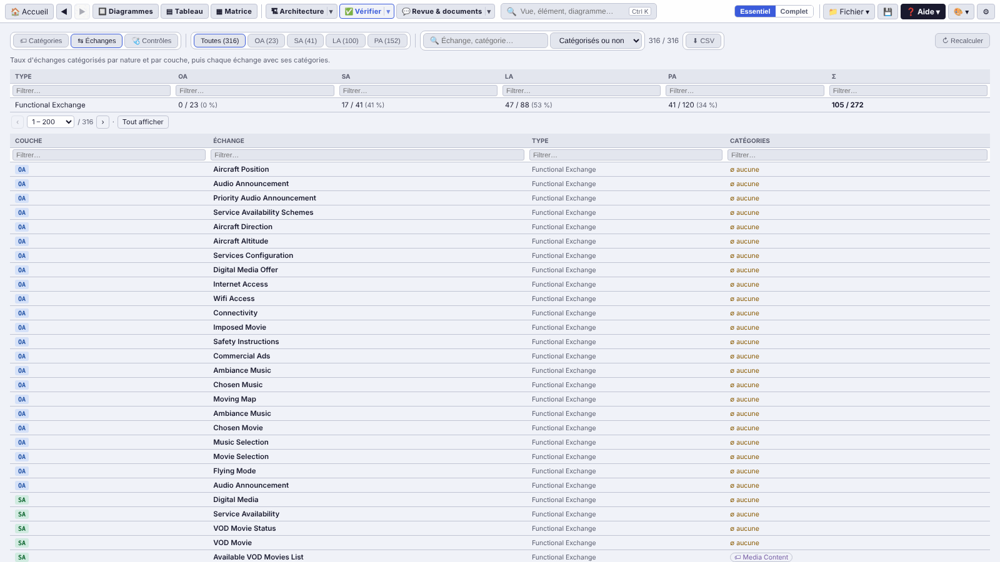 | 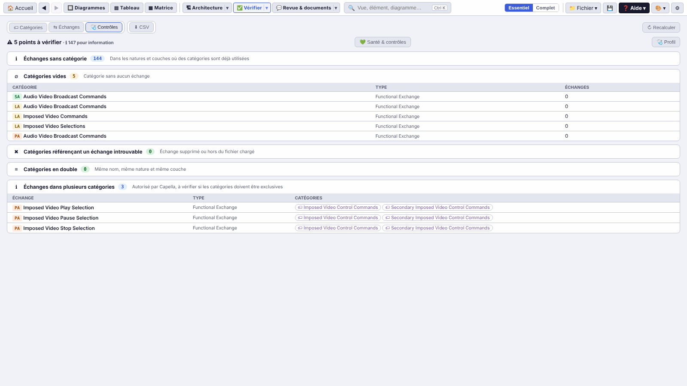 |

Les vues ƒ⇆ Functional Exchange, 🔀 Behavior Exchange et 🔌 Physical Link gagnent une liste **🏷 Toutes catégories** (affichée seulement si le modèle en a) ; le panneau de détail d'un échange liste ses catégories, celui d'une catégorie ses échanges. Indicateurs « Catégories d'échanges — … » au 📐 Tableau de bord.

## 12.15 🔖 Statut de revue

Les champs natifs de revue de Capella, portés par n'importe quel élément : **Status** (littéral de l'énumération *ProgressStatus* du projet : DRAFT, TO BE REVIEWED, TO BE DISCUSSED, REWORK NECESSARY, REVIEWED…) et **Review** (texte libre). Les statuts sont rangés en **classes** d'après leur nom : brouillon, en attente, validé, à retravailler.

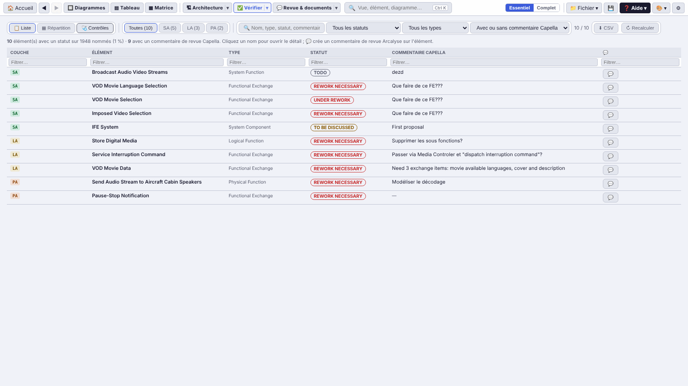

- **📋 Liste** : éléments ayant un statut ou un commentaire Capella, avec couche, type, statut et commentaire ; filtres par couche, statut ou classe, type, présence d'un commentaire, recherche ; ⬇ CSV. Le bouton **💬** crée un commentaire de 💬 Revue sur l'élément (le nombre de commentaires existants est affiché).
- **▦ Répartition** : nombre d'éléments par statut et par couche, puis par type d'élément et classe.
- **🩺 Contrôles** : éléments à retravailler ; en attente de revue ; brouillons dans une couche majoritairement validée ; commentaire Capella sans statut ; à retravailler sans commentaire dans 💬 Revue ; statut référencé introuvable.

| ▦ Répartition | 🩺 Contrôles |
|---|---|
| 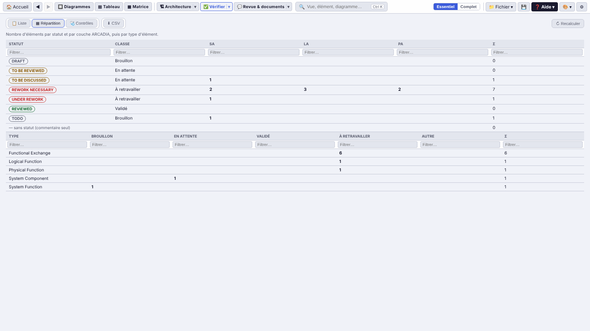 | 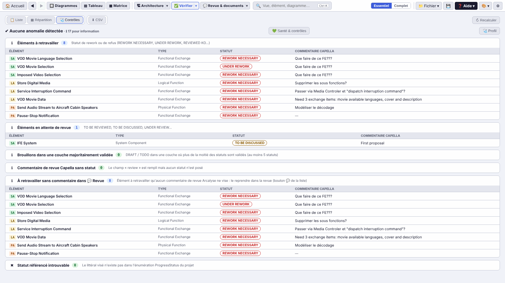 |

Le panneau de détail d'un élément affiche son statut et son commentaire (🔖 *voir tous* ouvre la liste filtrée sur ce statut) ; la colonne *status* du ▤ Tableau montre le nom du littéral. Indicateurs « Statut de revue — … » dans le catalogue du 📐 Tableau de bord.

## 12.16 🎚 Variantes (modèle 150 %)

**✅ Vérifier › 🎚 Variantes (150 %)**. Un modèle « 150 % » réunit toutes les variantes d'une ligne de produits ; les éléments propres à certaines variantes portent une **marque**. La vue lit trois façons de marquer ; quand le modèle en a plusieurs, la liste **Source** de la barre choisit celle qui est affichée.

| Source | Ce qui est lu |
|---|---|
| **🧩 Add-on Filtering de Capella** | Critères de filtrage (*FilteringCriterion*, rangés ou non dans des paquets) posés sur les éléments ; résultats de filtrage (variantes) simples ou composés (union, intersection, exclusion). Lu directement dans le `.capella`. |
| **🎛 Propriétés PVMT** | Propriétés dont le nom, le groupe ou le domaine évoque une variante (Variante, Configuration, Produit, Option, Applicabilité, Restriction…), réglables dans 🏷 Critères & variantes : littéral d'énumération, texte « A ; B », booléen nommé comme la variante, ou restriction « Diesel OR Hybride ». « Tous », « * » ou « All » = élément commun. |
| **🟦 pure::variants** | Fichiers du projet chargés par **📂 Charger des fichiers pure::variants…** (ou lus avec le 📁 dossier du projet, ou déposés sur la page) : `.xfm` (caractéristiques), `.ccfm` / `.xml` (correspondances et restrictions des éléments qui citent un identifiant Capella), `.vdm` (variantes). Lecture tolérante, à valider sur vos fichiers ; ils sont gardés avec le projet de travail. |

Un élément est **présent dans une variante** si son conteneur l'est, si ses propres marques le retiennent (aucune marque = élément commun ; une restriction vraie suffit) et si ses extrémités le sont (échange, lien, allocation, réalisation, part et son type). Les restrictions comprennent AND, OR, NOT, XOR, IMPLIES, &&, ||, !, ->, les parenthèses et hasFeature('X').

| Sous-vue | Contenu |
|---|---|
| **🧱 Blocs 150 %** | Onglet par défaut. Les composants d'une couche (OA, SA, LA, PA, EPBS), imbriqués comme dans le modèle, avec leurs fonctions allouées, les échanges fonctionnels et les échanges de composants. **Trait plein** : commun à toutes les variantes ; **tirets** : variable (couleur et pastilles de ses critères) ; **hachures** : retenu par aucune variante ; **cercle rouge ⚠** : fonction présente sans aucun de ses composants. Choisir une variante estompe ce qui n'en fait pas partie. Survol : critères, présence, raison d'une absence ; clic : détail ; case **Échanges** ; zoom, ⤢ Ajuster, ⬇ SVG / PNG. |
| **🔀 Critères → variantes** | L'arbre des critères (groupés par paquet), avec le nombre d'éléments que chacun marque, relié par des liens colorés aux variantes qui le retiennent ; variantes composées reliées à celles qu'elles combinent (∪, ∩, ∖) ; anomalies signalées (critère qui ne marque rien, jamais retenu, variante sans critère). Clic sur un critère : ses éléments (▦) ; sur une variante : ses blocs (🧱). |
| **📈 Vue d'ensemble** | Chiffres clés (variantes, éléments du 150 %, socle commun, part variable, éléments retenus par aucune variante), puis une **barre empilée par variante** : éléments communs (bleu), partagés avec d'autres variantes (vert), exclusifs (orange) ; à droite, l'avancement de chaque mesure. Clic sur une couleur : les éléments concernés ; sur une mesure : le reste à faire ; filtre par couche ; ⬇ CSV. |
| **📊 Avancement** | Une ligne par variante (et le 150 %), une barre par mesure : fonctions feuilles allouées, fonctions et composants réalisés dans la couche suivante, Functional Exchanges alloués, composants avec fonction, éléments décrits, éléments validés (statut de revue) ; filtre par couche. **Clic sur une barre** : le reste à faire. Puis les éléments nommés par couche dans chaque variante. |
| **✅ Reste à faire** | Pour une variante et une mesure : les éléments qui manquent et **pourquoi** (non allouée, allouée seulement à des composants absents, aucune réalisation…) ; filtres couche, type, recherche ; ⬇ CSV. |
| **▦ Éléments × variantes** | Présence de chaque élément dans chaque variante (✔ / ·, survol : raison de l'absence), marque de l'élément ou de son conteneur (↳) ; éléments variables seulement, ou **Tous les éléments**. |
| **🏷 Critères & variantes** | Sources lues, critères (éléments marqués, variantes qui les retiennent), variantes ; **✚ Nouvelle variante** (nom et critères, gardée avec le projet) ; choix des propriétés PVMT ; fichiers pure::variants. |
| **🩺 Contrôles** | Éléments retenus par aucune variante, allocations et réalisations perdues dans une variante, références introuvables, restrictions illisibles ou citant une caractéristique inconnue, marques sans effet, critères sans élément ou retenus par aucune variante, variantes sans critère ou identiques. |

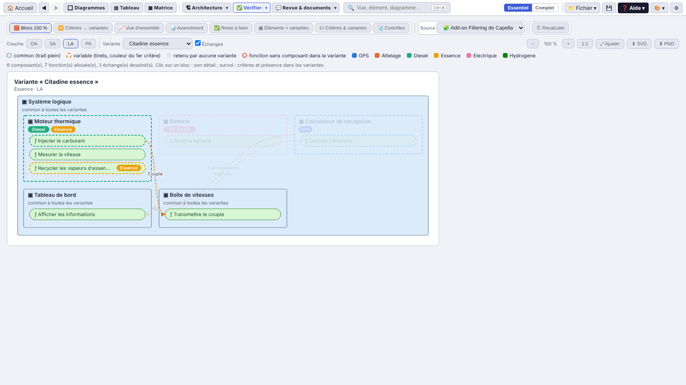

| 🔀 Critères → variantes | 📈 Vue d'ensemble |
|---|---|
| 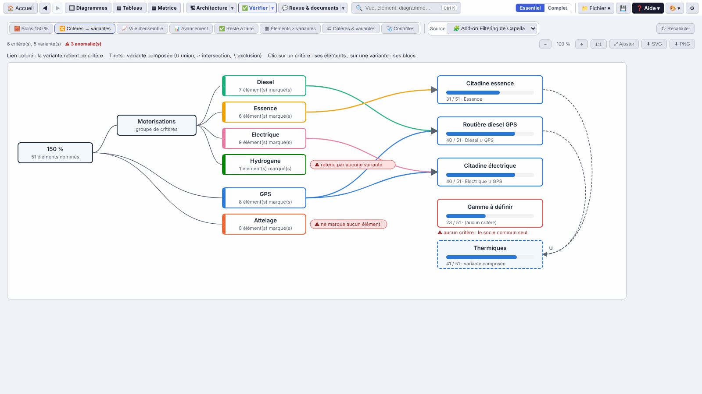 | 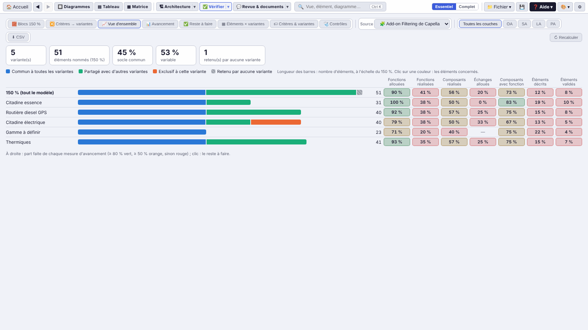 |
| **📊 Avancement** | **✅ Reste à faire** |
| 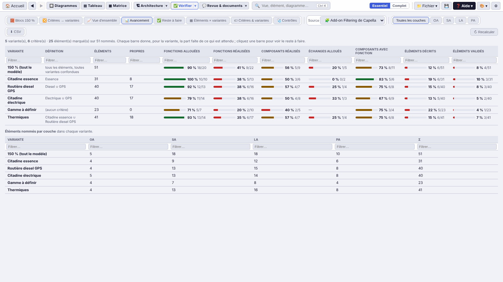 | 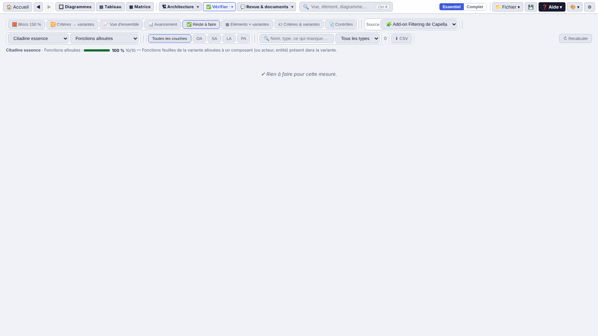 |
| **▦ Éléments × variantes** | **🏷 Critères & variantes** |
| 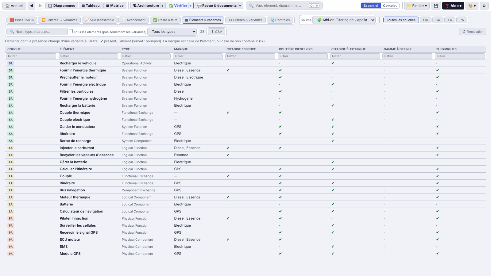 | 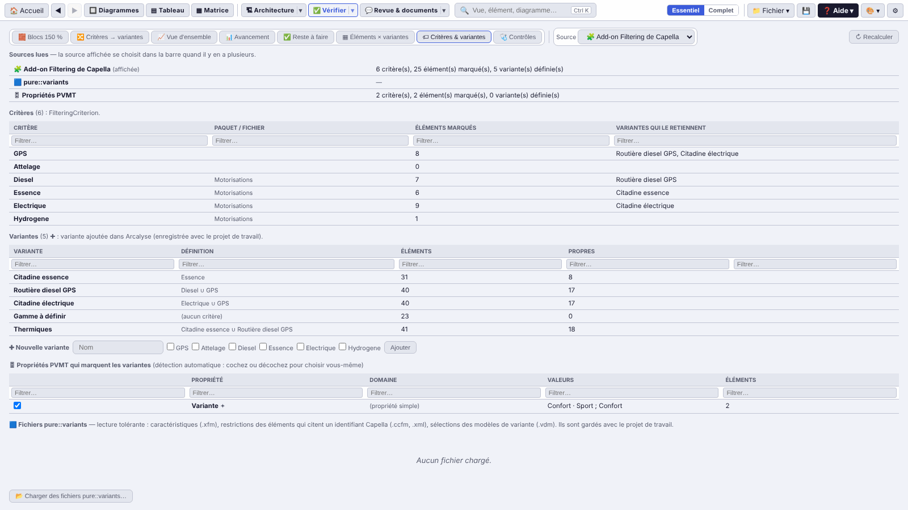 |
| **🩺 Contrôles** | |
| 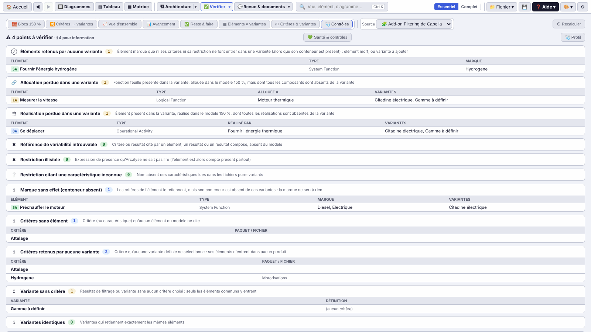 | |

Le panneau de détail (onglet 🔬 Analyses) montre la marque de l'élément (ou celle dont il hérite) et sa présence dans chaque variante. Indicateurs « Variantes — … » au 📐 Tableau de bord ; contrôles repris dans 💚 Santé & contrôles.

---

[📘 Sommaire du guide](../GUIDE-UTILISATION.md) · ◀ [11. ƒ Fonctions](11-fonctions.md) · [13. 📐 Tableau de bord](13-tableau-de-bord.md) ▶
