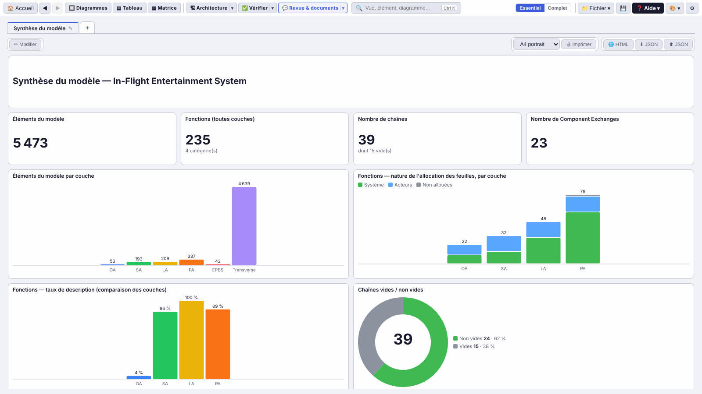
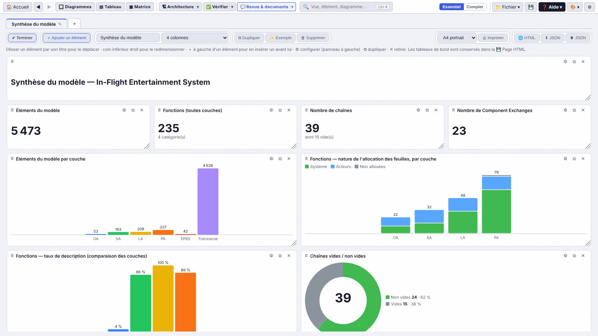
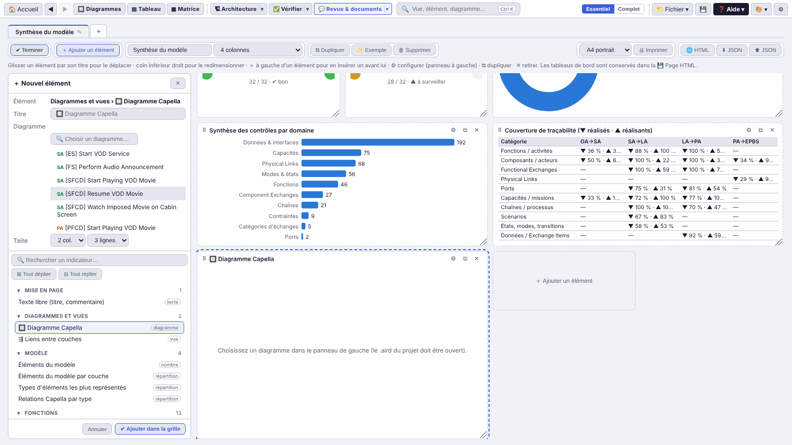

[📘 Sommaire du guide](../GUIDE-UTILISATION.md) · ◀ [12. 🔬 Analyses](12-analyses.md) · [14. 🔎 Panneau de détail](14-panneau-detail.md) ▶

# 13. 📐 Tableau de bord

**💬 Revue & documents › 📐 Tableau de bord**. Composez vos propres tableaux de bord à partir de **tous les indicateurs calculés** (≈ 130 sur un modèle complet), d'images de diagrammes et de vues. Un tableau de bord d'exemple est créé au premier affichage ; les tableaux de bord sont conservés dans la 💾 Page HTML.

| Commande | Effet |
|---|---|
| **Onglets** de pages | Un onglet par tableau de bord ; **＋** ajoute une page vide ; double-clic (ou **✎** sur l'onglet actif) pour renommer. |
| **✏ Modifier / ✔ Terminer** | Passe en édition. |
| **A4 portrait / paysage** + **🖨 Imprimer** | Éléments redessinés à la taille de la page, couleurs claires, en-tête (nom, modèle, date). « Enregistrer au format PDF » dans la fenêtre d'impression pour un PDF. |
| **🌐 HTML** | Page autonome, telle qu'affichée. |
| **⬇ JSON / ⬆ JSON** | Exporter / importer une disposition pour la réutiliser sur un autre modèle. |

Hors modification, un clic sur un diagramme ou une vue du tableau de bord l'ouvre.

## 13.1 Modifier un tableau de bord

En édition :

- **＋ Ajouter un élément** (barre), **＋** au survol d'un élément pour en insérer un avant lui, ou tuile **＋ Ajouter un élément** en fin de page : un **panneau s'ouvre à gauche** ([§ 13.2](#132-catalogue-des-indicateurs)) et le nouvel élément est placé aussitôt **dans la grille**, en pointillé, où il se dessine en direct pendant les réglages ;
- **⚙** configurer un élément existant (dans le même panneau), **⧉** dupliquer, **✕** retirer ;
- **glisser un élément par son titre** pour le déplacer ; **coin inférieur droit** pour le redimensionner (aimanté à une grille de 3, 4 ou 6 colonnes) ;
- nom de la page et nombre de colonnes de la grille (3, 4 ou 6) dans la barre ; **⧉ Dupliquer**, **✨ Exemple**, **🗑 Supprimer** la page.

La vue garde sa position de défilement pendant les modifications.

## 13.2 Catalogue des indicateurs

Le panneau de gauche (**＋ Nouvel élément**, ou ⚙ d'un élément) :

- en haut, les **réglages** de l'élément choisi : **Titre**, **Représentation** (indicateur chiffré, jauge — vert ≥ 90 %, orange ≥ 50 %, rouge sinon —, barres horizontales ou verticales, anneau, barres empilées ou groupées, tableau, texte), **Taille** (colonnes, lignes), nombre de catégories affichées (le reste en « Autres ») et tri ; l'élément se redessine **dans la grille** à chaque réglage ;
- en bas, le **catalogue** : **🔍 Rechercher un indicateur…**, **⊞ Tout déplier / ⊟ Tout replier**, catégories repliables — « Mise en page » (texte libre) et « Diagrammes et vues » en tête, puis Modèle, Fonctions, Chaînes, Component Exchanges, Physical Links, Ports, Traçabilité, Capacités, Modes & états, Contrôles, Exigences, Propriétés, Données & interfaces, Contraintes, Diagrammes, santé, statut de revue, variantes… ;
- **✔ Ajouter dans la grille** valide (**✔ Enregistrer** pour un élément existant), **Annuler** ferme sans rien changer.

**Diagrammes et vues** :

| Élément | Effet |
|---|---|
| **🔲 Diagramme Capella** | **🔍 Choisir un diagramme…** dans la liste du `.aird` ouvert ; son image est enregistrée avec le tableau de bord (**↻ Mettre à jour** pour la reprendre). |
| **⇶ Liens entre couches** | Élément de départ (**🔍 Élément de départ…**) ou catégorie, redessiné sur le modèle chargé ; aussi depuis la vue ⇶, bouton **📐 Au tableau de bord** ([§ 12.9](12-analyses.md#129--liens-entre-couches)). |

---

[📘 Sommaire du guide](../GUIDE-UTILISATION.md) · ◀ [12. 🔬 Analyses](12-analyses.md) · [14. 🔎 Panneau de détail](14-panneau-detail.md) ▶
