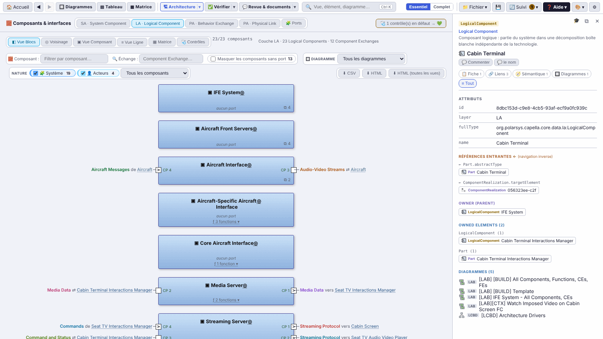
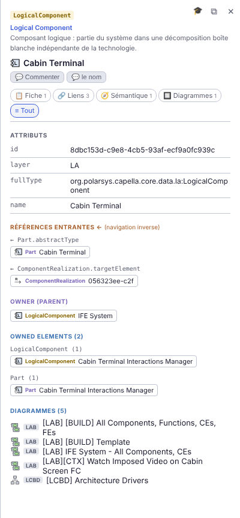
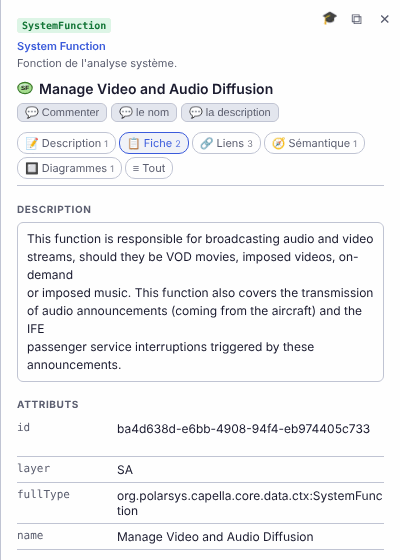
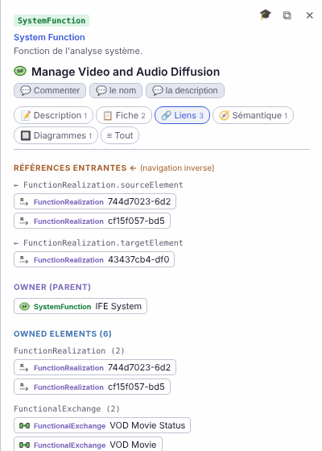

[📘 Sommaire du guide](../GUIDE-UTILISATION.md) · ◀ [13. 📐 Tableau de bord](13-tableau-de-bord.md) · [15. 💬 Revue](15-revue.md) ▶

# 14. 🔎 Panneau de détail

Un **clic sur un nom** (presque partout : cartes, tableaux, blocs, listes, diagrammes) ouvre le panneau de détail à droite.

- type technique et **Human Type**, description du type ;
- nom de l'élément, avec son **icône** (celle de Capella, ou celle du lecteur d'Arcature pour un modèle SysML v2 ou UML / SysML v1) ;
- **💬 Commenter**, **💬 le nom**, **💬 la description** (revue) ;
- **description** mise en forme comme dans Capella (bouton **‹/› HTML** : code d'origine ; liens vers d'autres éléments cliquables) ;
- **attributs** (un 💬 apparaît au survol de chacun) ;
- **Diagrammes** où l'élément est représenté (clic : ouvert et centré sur lui) ;
- **références sortantes** et **entrantes** (« qui pointe vers cet élément ? ») ;
- exigences liées, propriétés, contraintes, statut de revue, variantes, catégories, bibliothèques, REC / RPL, déploiement ; pour un modèle SysML v2, UML / SysML v1 ou ReqIF, la fiche du lecteur d'Arcature ;
- **💬 Commentaires de revue** sur l'élément ;
- **owner (parent)** et **owned elements**.

Tout est **cliquable** pour naviguer de proche en proche. **×** ferme le panneau.

**🗂 Onglets** : ces sections sont réparties en **📝 Description** (la description seule, mise en forme, sur toute la hauteur du panneau), **📋 Fiche** (description, attributs), **🔗 Liens** (références, owner, éléments contenus), **🧭 Sémantique**, **🔲 Diagrammes**, **🔬 Analyses** (exigences, propriétés, contraintes, scénarios, statut de revue, variantes, catégories, bibliothèques, REC / RPL, déploiement) et **💬 Revue** ; **≡ Tout** (par défaut) montre toutes les sections à la suite (sauf 🧭 Sémantique et 📝 Description, déjà dans 📋 Fiche). Chaque onglet indique son nombre de sections ; un onglet vide pour l'élément n'est pas proposé. L'onglet choisi est gardé d'un élément à l'autre et enregistré avec la 💾 page. Les boutons **◀ ▶** de la barre ([§ 3.7](03-interface.md#37---historique-de-navigation)) reviennent sur les éléments ouverts précédemment.

| ≡ Tout (par défaut) et 📋 Fiche | 🔗 Liens |
|---|---|
|  |  |

**🧭 Sémantique** : navigateur sémantique comme le *Semantic Browser* de Capella, en trois colonnes — **← Éléments référençants** (fonctions ou composants réalisants, composants allouant, chaînes et capacités qui l'impliquent, Parts, diagrammes…), **Élément courant** (attributs et éléments contenus, par type) et **Éléments référencés →** (parent, fonctions allouées, éléments réalisés, échanges, attributs de référence…). Un clic sur un élément en fait l'élément courant (◀ ▶ pour revenir) ; le filtre s'applique aux trois colonnes ; **⤢** élargit le panneau.

**🔲 Diagrammes** : les diagrammes dont l'élément est la cible, ceux où il est dessiné et les vues calculées sur lui (SysML v2) ; un clic ouvre le diagramme **centré sur l'élément** ([§ 10](10-diagrammes.md)).

**⧉ Fenêtre séparée** (en haut du panneau, à côté de ×) : tout le panneau, avec ses onglets, s'ouvre dans une fenêtre séparée (autre écran ; autoriser les fenêtres surgissantes) et laisse toute la place aux vues. Elle suit l'élément choisi dans la page, et un clic dans la fenêtre (lien, 🧭, onglet) y navigue ; **⧈**, ou la fermeture de la fenêtre, ramène le panneau dans la page.

**🎓** (en haut du panneau, à côté de ⧉) : **visite guidée** du panneau — en-tête, 💬 commenter, onglets, 📋 Fiche, 🔗 Liens, 🧭 Sémantique, 🔲 Diagrammes, 🔬 Analyses, ⧉ fenêtre séparée, ◀ ▶ historique. Aussi par **❓ Aide ▾ › 🔎 Visite du panneau de détail**.

**Avec le panneau 💬 Revue** : les deux panneaux partagent la colonne de droite ; des onglets **🔎 Propriétés / 💬 Revue** passent de l'un à l'autre (ouvrir le détail d'un élément affiche 🔎 Propriétés). Ils ont la **même largeur**, réglable en glissant leur bord gauche (double-clic : largeur par défaut), enregistrée avec la page ([§ 15](15-revue.md)).

 

---

[📘 Sommaire du guide](../GUIDE-UTILISATION.md) · ◀ [13. 📐 Tableau de bord](13-tableau-de-bord.md) · [15. 💬 Revue](15-revue.md) ▶
