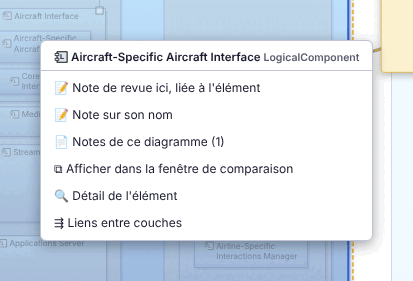
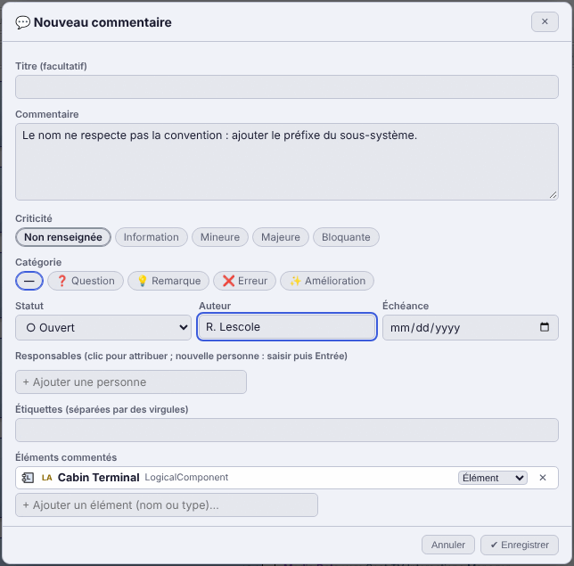
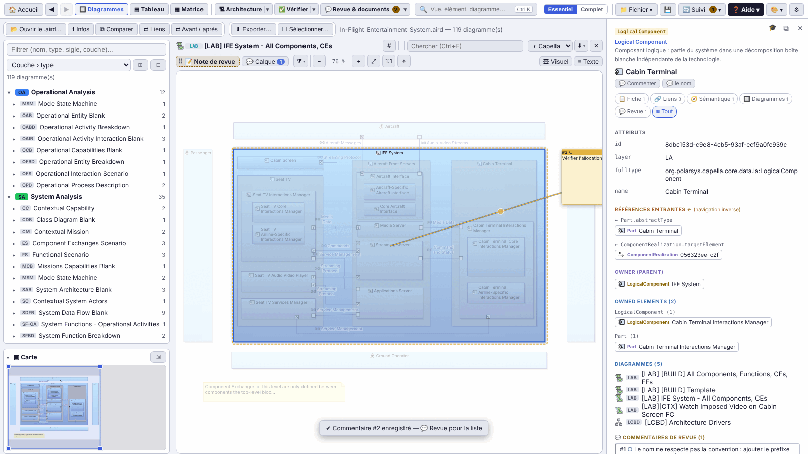
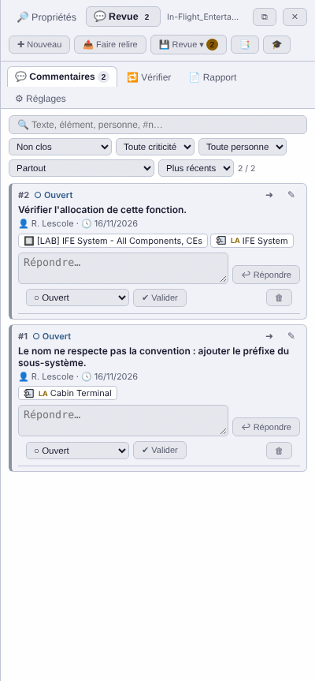
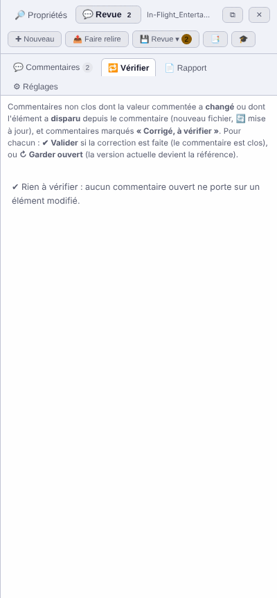
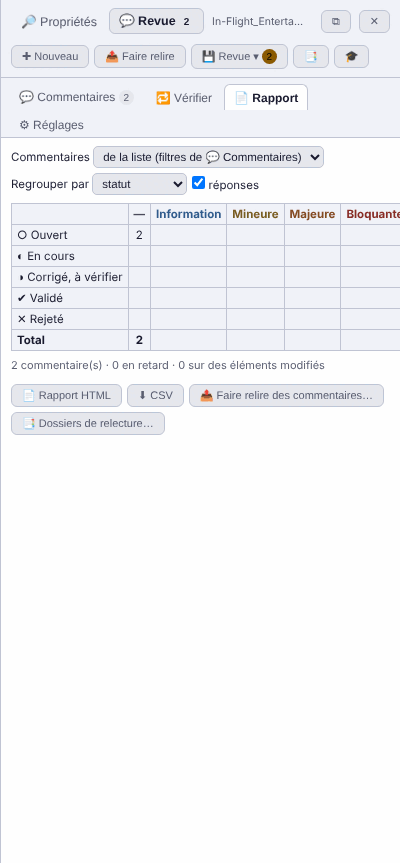
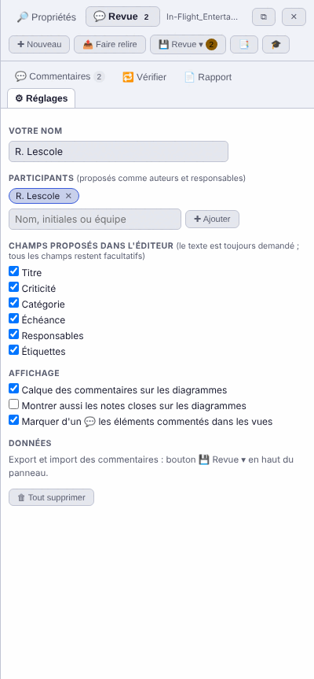
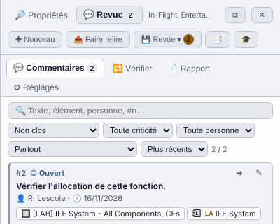
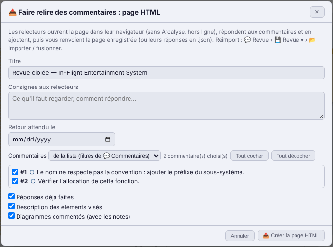

[📘 Sommaire du guide](../GUIDE-UTILISATION.md) · ◀ [14. 🔎 Panneau de détail](14-panneau-detail.md) · [16. 🔄 Suivi du fichier et mises à jour du modèle](16-suivi-fichier.md) ▶

# 15. 💬 Revue

**💬 Revue & documents › 💬 Commentaires** ouvre le panneau de revue, **ancré à droite** : la vue se resserre pour lui laisser la place. Si le panneau de détail est ouvert aussi, des onglets **🔎 Propriétés / 💬 Revue** passent de l'un à l'autre ; **⧉** le détache dans une fenêtre séparée, **✕** le ferme. Les deux panneaux ont la même largeur, réglable en glissant leur bord gauche (double-clic : largeur par défaut), enregistrée avec la page. Le badge du menu compte les commentaires non clos ; **⚠ n** signale des commentaires à vérifier après une mise à jour du modèle.

## 15.1 Commenter un élément

- **Panneau de détail** : **💬 Commenter** (l'élément), **💬 le nom**, **💬 la description**, ou **💬** au survol d'un attribut ;
- **clic droit** sur un élément dans les vues (blocs, cartes, tableaux, listes, liens du panneau de détail, diagrammes de tous les formats) : commenter l'élément, son nom ou sa description, voir ses commentaires ;
- **✚ Nouveau** dans le panneau 💬 Revue : commentaire sur l'élément du panneau de détail, ou commentaire général.

## 15.2 L'éditeur de commentaire

**Seul le texte est obligatoire.** Champs facultatifs :

- **Titre** ;
- **Criticité** : Information, Mineure, Majeure, Bloquante ;
- **Catégorie** : ❓ Question, 💡 Remarque, ❌ Erreur, ✨ Amélioration ;
- **Statut** : Ouvert, En cours, Corrigé à vérifier, Validé, Rejeté ;
- **Auteur** (pré-rempli par ⚙ Réglages › Votre nom), **Échéance** ;
- **Responsables** (participants déclarés dans ⚙ Réglages, ou saisis puis Entrée) ;
- **Étiquettes** (séparées par des virgules) ;
- **Éléments commentés** : la partie commentée (élément, nom, description, autre attribut) se choisit dans la liste ; **+ Ajouter un élément** (recherche par nom ou type).

La date de création est notée automatiquement. **Ctrl+Entrée** ou **✔ Enregistrer** valide.

 

## 15.3 Notes de revue sur les diagrammes

Tous formats : diagrammes Capella, vues SysML v2, diagrammes UML / SysML v1.

- **📝 Note de revue** (ligne d'outils du dessin, [§ 10.3](10-diagrammes.md#103-un-diagramme-ouvert)) : **glissez-la** sur le diagramme — déposée **sur un élément**, elle lui est **liée** — ou **cliquez** pour la poser au centre ;
- **clic droit** dans le diagramme, sur un élément ou un espace vide › **📝 Note de revue ici** (sur un élément : liée à l'élément, à son nom ou à sa description) ;
- les notes forment un **calque** indépendant du `.aird` (bouton **💬 Calque**, avec le nombre de notes) : elles suivent le zoom, se **déplacent par leur en-tête**, se **redimensionnent par le coin**, se **réduisent en pastille** (▁) ;
- **lier** : tirez un trait depuis la **poignée ●** de la note jusqu'à un élément (vers un élément déjà lié : il est délié), ou **🔗** puis clic sur les éléments (Échap pour terminer) ; la pastille ● au milieu d'un trait le délie ;
- un commentaire créé dans un diagramme reste rattaché au diagramme (note du calque) ;
- hors des notes, les éléments du diagramme restent cliquables ; **💬 Calque** masque le calque.

## 15.4 Le panneau 💬 Revue

| 💬 Commentaires | 🔁 Vérifier | 📄 Rapport | ⚙ Réglages |
|---|---|---|---|
|  |  |  |  |

| Onglet | Contenu |
|---|---|
| **💬 Commentaires** | Recherche (texte, élément, personne, #n) ; filtres **statut**, **criticité**, **personne**, **portée** (partout, projet chargé, diagramme ouvert, élément du panneau de détail, en retard, qui me sont attribués) ; **tri**. Clic sur une carte : texte complet, **réponses**, statut, **✔ Valider**, **🗑** ; **➜** va à la note du diagramme ou à l'élément ; **✎** modifie. Un commentaire versé depuis un 📑 dossier de relecture porte un lien **📑** vers son dossier. |
| **🔁 Vérifier** | Après un nouveau chargement ou une 🔄 mise à jour : commentaires non clos dont la **valeur commentée a changé** (avant / maintenant) ou dont l'élément a disparu, et commentaires « Corrigé, à vérifier ». **✔ Valider** clôt (date et vérificateur notés) ; **↻ Garder ouvert** prend la version actuelle comme nouvelle référence. |
| **📄 Rapport** | Synthèse statut × criticité ; **📄 Rapport HTML** autonome et imprimable (groupé par statut, criticité, responsable ou élément ; réponses en option ; état de chaque commentaire par rapport au modèle) ; **⬇ CSV**. |
| **⚙ Réglages** | Votre nom, participants, champs proposés, affichage (calque des diagrammes, notes closes, marque 💬 des éléments commentés dans les vues), **🗑 Tout supprimer**. |

En haut du panneau : **✚ Nouveau**, **📤 Faire relire** ([§ 15.6](#156--faire-relire-des-commentaires-relecture-par-dautres-personnes)), **💾 Revue ▾**, **📑** (📑 Dossiers de relecture, [§ 4.4](04-accueil.md#44--dossiers-de-relecture-et--rapports)), **🎓** (visite guidée du panneau, aussi par **❓ Aide ▾ › 💬 Visite de la revue**) ; sur la ligne du titre, **⧉** (ouvre le panneau dans une **fenêtre séparée**, par exemple sur un autre écran — autoriser les fenêtres surgissantes ; la fermer ou **⧈** le ramène dans la page) et **✕**.

## 15.5 💾 Revue ▾ : enregistrer, exporter, fusionner

- les commentaires sont enregistrés **dans la page** (💾 Enregistrer, Ctrl+S) ;
- **⬇ Exporter les commentaires (.json)** : sauvegarde ou envoi hors de la page ;
- **📂 Importer / fusionner une revue** (.json, page relue .html de « faire relire des commentaires » ou d'un 📑 dossier de relecture) : nouveaux commentaires ajoutés, version la plus récente gardée pour les autres, réponses réunies ;
- **📤 Faire relire des commentaires (page HTML)…** (ci-dessous) ;
- **📑 Dossiers de relecture…** : document chapitré à faire relire (descriptions, diagrammes, texte libre ; [§ 4.4](04-accueil.md#44--dossiers-de-relecture-et--rapports)) ;
- le nombre de commentaires modifiés depuis le dernier enregistrement est rappelé (pastille sur le bouton).

Chaque commentaire note l'**identifiant du projet Capella** : à l'import, la revue est comparée au modèle chargé (même projet → import direct ; sinon, part des éléments retrouvés ; en cas de doute, une fenêtre propose **Importer quand même** ou **Annuler**). Les commentaires d'un autre projet sont marqués **⧉ autre projet**.

 

## 15.6 📤 Faire relire des commentaires (relecture par d'autres personnes)

Pour faire relire des commentaires par des personnes qui n'ont **ni Capella ni Arcalyse** (ancienne « revue ciblée » ; pour faire relire un **document chapitré**, voir plutôt les 📑 dossiers de relecture, [§ 4.4](04-accueil.md#44--dossiers-de-relecture-et--rapports)) :

1. **📤 Faire relire** en haut du panneau, ou **💾 Revue ▾ › 📤 Faire relire des commentaires (page HTML)…** (ou **📄 Rapport › 📤 Faire relire des commentaires…**, ou **🏠 Accueil › plan de revue › 📤 Faire relire les commentaires du périmètre…**) ;
2. choisissez les commentaires (de la liste filtrée, non clos, tous, du périmètre du plan, puis cases), un **titre**, des **consignes** et une **date de retour** ; options : réponses déjà faites, description des éléments visés, diagrammes commentés avec leurs notes (`.aird` chargé) ;
3. **📤 Créer la page HTML** : une **page HTML autonome** est créée ; elle s'ouvre dans n'importe quel navigateur, hors ligne ;
4. le relecteur indique son nom, **répond** à chaque commentaire (avis 👍 d'accord, 👎 pas d'accord, ❓ question, 💡 proposition, ✔ correction vérifiée, et texte), peut **ajouter des commentaires**, puis **💾 Enregistrer la page avec mes réponses** (à renvoyer, ou à transmettre au relecteur suivant : les réponses s'accumulent) ou **⬇ Exporter mes réponses (.json)** ;
5. au retour : **💾 Revue ▾ › 📂 Importer / fusionner** la page relue (.html) ou le .json ; réimporter deux fois le même fichier n'ajoute rien.

---

[📘 Sommaire du guide](../GUIDE-UTILISATION.md) · ◀ [14. 🔎 Panneau de détail](14-panneau-detail.md) · [16. 🔄 Suivi du fichier et mises à jour du modèle](16-suivi-fichier.md) ▶
