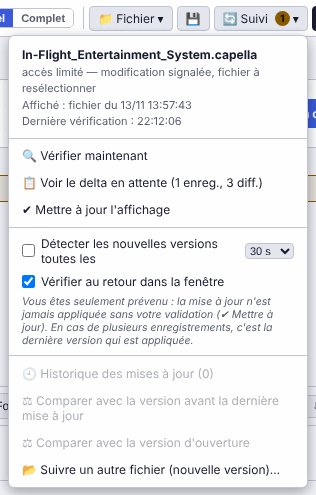
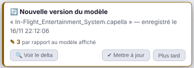
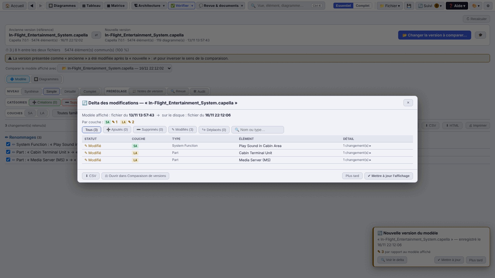

[📘 Sommaire du guide](../GUIDE-UTILISATION.md) · ◀ [15. 💬 Revue](15-revue.md) · [17. 💾 Enregistrer, partager, réutiliser](17-enregistrer.md) ▶

# 16. 🔄 Suivi du fichier et mises à jour du modèle

**📁 Fichier › 🔄 Suivi du fichier…** détecte qu'une **nouvelle version** du fichier chargé a été enregistrée (par Capella, Cameo, Papyrus, Enterprise Architect, un éditeur SysML v2, un outil d'exigences…) et propose de mettre à jour l'affichage. **Rien n'est appliqué sans votre validation.**

**Tous les formats** sont suivis : `.capella` ; `.sysml` et `.kpar` ; `.uml` (avec son `.notation`), `.xmi`, `.mdzip`, `.qea` ; `.reqif` et `.reqifz`. Les fichiers non Capella sont relus par leur lecteur d'Arcature ; les autres fichiers du projet (`.notation`, modèles référencés) sont repris de l'ouverture. Un **dossier** de `.sysml` ou de `.reqif` n'est pas suivi.

| Entrée du menu | Effet |
|---|---|
| En-tête | Fichier suivi, type d'accès (*accès direct — relecture automatique* ou *accès limité — modification signalée, fichier à resélectionner*), date du fichier affiché, dernière vérification. |
| **🔍 Vérifier maintenant** | Contrôle immédiat (sans fichier suivi : **Choisir le fichier à comparer…**). |
| **📋 Voir le delta en attente** · **✔ Mettre à jour l'affichage** | Quand une nouvelle version attend (nombre d'enregistrements et de différences). |
| **Détecter les nouvelles versions toutes les** 10 s / 30 s / 1 min / 5 min | Détection automatique (désactivée par défaut ; aussi dans ⚙ Préférences › 🔄 Suivi du fichier, enregistrée avec la page). |
| **Vérifier au retour dans la fenêtre** | Contrôle quand vous revenez dans l'onglet. |
| **🕘 Historique des mises à jour** | Mises à jour de la session, avec le delta de chacune. |
| **⚖ Comparer avec la version avant la dernière mise à jour / d'ouverture** | Ouvre ⚖ Comparaison de versions. |
| **📂 Suivre un autre fichier (nouvelle version)…** | Choisir manuellement la nouvelle version. |

 

**Quand une nouvelle version est détectée**, une notification apparaît en bas à droite, avec le nombre d'éléments ➕ ajoutés, ➖ supprimés, ✎ modifiés, ↪ déplacés ; un bouton **🔄 Suivi** apparaît à côté de 📁 Fichier, son badge compte les enregistrements en attente :

- **🔍 Voir le delta** : liste filtrable (➕ ajoutés, ➖ supprimés, ✎ modifiés, ↪ déplacés), détail propriété par propriété (▸), synthèse par couche (modèle Capella), **⬇ CSV**, **⚖ Ouvrir dans Comparaison de versions** ;
- **✔ Mettre à jour (l'affichage)** : recharge le modèle ; **la vue en cours est conservée** ;
- **Plus tard** : masque la notification.

**Plusieurs enregistrements** : le delta **cumulé** (modèle affiché → dernier enregistrement) est celui qui sera appliqué ; chaque enregistrement est aussi listé avec son propre delta. Si le fichier revient à la version affichée, la proposition disparaît.

**Depuis un autre fichier** : **📁 Fichier › 🔄 Charger une mise à jour du modèle…** : choisissez le nouveau fichier, **du même format** que le modèle affiché (un fichier d'un autre format est refusé) ; le même delta s'affiche avant validation et ce fichier devient celui qui est suivi. Un nom de fichier différent demande une confirmation ; si moins de 50 % des éléments sont communs, un avertissement signale que ce n'est peut-être pas le même projet, et la mise à jour demande une confirmation.

**Diagrammes** :

- **Capella** : après une mise à jour, un `.aird` ouvert avec un accès direct (dossier du projet, 📂 Ouvrir le .aird sous Edge / Chrome) est relu et repris s'il a changé ; sinon, une fenêtre propose **📂 Choisir le .aird à jour**, de garder les diagrammes actuels ou de les retirer (avec le nombre d'éléments montrés par les diagrammes qui n'existent plus). Avec un `.capella` seul, rien n'est demandé ;
- **SysML v2, UML / SysML v1** : les diagrammes et vues viennent du fichier du modèle, ils sont relus avec lui ;
- la version remplacée sert de **version d'avant** à **⇄ Avant / après** ([§ 10.6](10-diagrammes.md#106--avant--après)) et à ⚖ Comparaison de versions › 🔲 Diagrammes ([§ 12.4](12-analyses.md#124--comparaison-de-versions)).

**Navigateur** : sous Edge / Chrome, ouvrez le modèle par 📁 Fichier › 🔷 Ouvrir ou par glisser-déposer pour un **accès direct** (relecture automatique). Sinon (autre navigateur, page HTML sauvegardée), la modification est signalée quand c'est possible et il faut resélectionner le fichier (📂).

---

[📘 Sommaire du guide](../GUIDE-UTILISATION.md) · ◀ [15. 💬 Revue](15-revue.md) · [17. 💾 Enregistrer, partager, réutiliser](17-enregistrer.md) ▶
