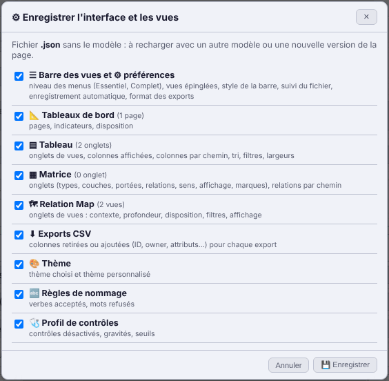

[📘 Sommaire du guide](../GUIDE-UTILISATION.md) · ◀ [16. 🔄 Suivi du fichier et mises à jour du modèle](16-suivi-fichier.md) · [18. 🎨 Thèmes et personnalisation](18-themes.md) ▶

# 17. 💾 Enregistrer, partager, réutiliser

| Besoin | Commande | Ce qui est enregistré |
|---|---|---|
| Garder tout son travail | **💾** / **Ctrl+S** (Maj+clic ou Ctrl+Maj+S : enregistrer sous) ; **📁 Fichier › 🌐 Télécharger la page HTML** | **Toute l'application avec le modèle embarqué** et ses diagrammes (`.aird`), l'🏠 accueil (fiche projet, check-lists, plans de revue, dossiers, réglages des 🎚 variantes), les commentaires de 💬 revue, la barre des vues (menus, épingles, ⚙ préférences, 🔄 réglages du suivi), les tableaux de bord, les onglets et colonnes du ▤ Tableau (colonnes par chemin, filtres, largeurs, tri), les onglets de la ▦ Matrice, les vues de la Relation Map, les choix d'export CSV, le thème, les règles de nommage et le 🩺 profil de contrôles. Exigences ReqIF : les images de leurs textes sont recopiées dans la page. À l'ouverture du fichier, le modèle se recharge tout seul. |
| Partager une analyse avec quelqu'un qui n'a pas Capella | Envoyer la page HTML enregistrée | Elle s'ouvre hors ligne dans n'importe quel navigateur. |
| Réutiliser ses réglages avec un autre modèle | **📁 Fichier › ⚙ Enregistrer l'interface et les vues…** puis **⚙ Charger une interface et des vues…** | Fichier `.json` **sans le modèle**, parties au choix (ci-dessous). |
| Passer à une nouvelle version d'Arcalyse | **📄 Ouvrir une page de projet…** (accueil) ou **📁 Fichier › 📄 Ouvrir un projet de travail** | Reprend les données d'une page enregistrée (≥ 2.1) dans la nouvelle version ; Ctrl+S réécrit ensuite le même fichier. |
| Ne rien perdre en cours de travail | **⚙ › 💾 Enregistrement automatique** (désactivé par défaut) | La page dans son fichier, toutes les 2 à 30 min si elle a changé ; version précédente dans un fichier de secours `….backup.html` (option), [§ 3.4](03-interface.md#34--préférences). |
| Une vue de la Relation Map ou du ▤ Tableau | **💾 Sauver vue / 📂 Charger vue** | Fichier `.json` de la vue. |
| Une matrice | **💾 Enregistrer / 📂 Ouvrir** (▦ Matrice, [§ 25.3](25-matrice.md#253-onglets-préréglages-exports)) | La définition de l'onglet (`.json`). |
| Une check-list ou un plan de revue | **💾 .json / 📂 Importer…** (🏠 Accueil) | Le document. |
| Les commentaires de revue | **💾 Revue ▾ › ⬇ Exporter les commentaires (.json) / 📂 Importer / fusionner une revue** | Les commentaires et leurs réponses. |
| Un tableau de bord | **⬇ JSON / ⬆ JSON** (📐) | La disposition et les indicateurs. |
| Un modèle de rapport | **💾 .json / 📂 Importer** (📘 Rapports automatiques › 🧩 Mes modèles) | Le modèle (boucles, contenus automatiques, colonnes). |
| Le profil de contrôles d'une équipe | **💾 Exporter .json / 📂 Importer .json** (⚙ › 🩺 Profil de contrôles…) | Contrôles désactivés, gravités, poids, seuils ([§ 3.6](03-interface.md#36--profil-de-contrôles)). |
| Un thème | **⬇ JSON / ⬆ JSON** (éditeur de thème, [§ 18](18-themes.md)) | Les couleurs du thème personnalisé. |

Parties de la fenêtre **⚙ Interface et vues** : ☰ Barre des vues et ⚙ préférences (niveau des menus, épingles, style de la barre, suivi du fichier, enregistrement automatique, format des exports) · 📐 Tableaux de bord · ▤ Tableau · ▦ Matrice · 🗺 Relation Map · ⬇ Exports CSV · 🎨 Thème · 🔤 Règles de nommage · 🩺 Profil de contrôles.

Ne sont **pas** conservés dans la page : la version chargée pour ⚖ Comparaison (et la version d'avant de ⇄ Avant / après), les filtres des autres vues, les **images du projet** affichées dans les diagrammes Capella (un pictogramme les remplace : rouvrez le 📁 dossier du projet) et le lien avec le fichier suivi (🔄 : choisissez-le à nouveau par 📁 Fichier › 🔄 Suivi du fichier). Une page enregistrée avec un modèle **SysML v2** rouvre ses éléments mais ni la vue 🧩 SysML v2 ni les vues calculées : rouvrez le `.sysml`.

**Changer de langue** (🌐, versions bilingues) recharge la page sans rien perdre : modèle et diagrammes, revue, check-lists, dossiers et rapports, tableaux de bord, réglages, vue affichée ([§ 1](01-presentation.md)).

---

[📘 Sommaire du guide](../GUIDE-UTILISATION.md) · ◀ [16. 🔄 Suivi du fichier et mises à jour du modèle](16-suivi-fichier.md) · [18. 🎨 Thèmes et personnalisation](18-themes.md) ▶
