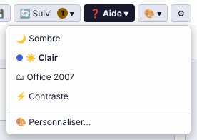
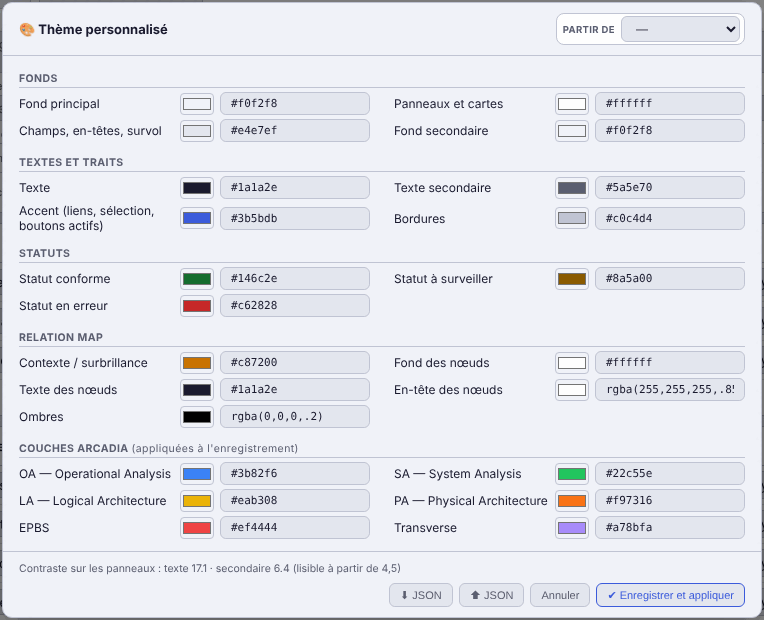

[📘 Sommaire du guide](../GUIDE-UTILISATION.md) · ◀ [17. 💾 Enregistrer, partager, réutiliser](17-enregistrer.md) · [19. ❓ Aide, visites guidées, À propos](19-aide.md) ▶

# 18. 🎨 Thèmes et personnalisation

Bouton **🎨 ▾** de la barre (à côté de 🌐), **⚙ › 🎨 Thème…** ou **⚙ › Préférences… › 🎨 Thème** (avec aperçu) : **🌙 Sombre**, **☀️ Clair**, **🗂 Office 2007**, **⚡ Contraste** (🌊 Marine et 🌿 Nature ont été retirés en 3.0 : une page qui les utilisait passe en Sombre), et **🎨 Personnalisé** une fois créé. Au premier lancement, le thème suit le réglage clair / sombre du système (Sombre sinon) ; une page enregistrée garde son thème. Les vues se redessinent avec des couleurs adaptées ; en thème clair, les textes colorés sont automatiquement foncés pour rester lisibles. Les animations sont réduites si le système le demande.

**🎨 ▾ › 🎨 Personnaliser…** (ou ⚙ Préférences › 🎨 Thème › **🎨 Ajuster les couleurs…**) ouvre l'éditeur de thème :

- toutes les couleurs (fonds, textes, accent, bordures, statuts, Relation Map, **couleurs des couches ARCADIA**) ;
- **aperçu en direct** ; **Partir de** un thème existant ; **contraste** du texte affiché ;
- **⬇ JSON / ⬆ JSON** pour échanger un thème ; **🗑 Supprimer** ;
- **✔ Enregistrer et appliquer** : il apparaît comme « 🎨 Personnalisé » et est conservé dans la page enregistrée.

 

**Autres personnalisations** : barre des vues (épingles 📌 ; ⚙ niveau Essentiel / Complet, vues sans données masquées et icônes seules, [§ 3.4](03-interface.md#34--préférences)), colonnes du ▤ Tableau, onglets de la ▦ Matrice (marques personnalisables), vues de la Relation Map, tableaux de bord, 🩺 profil de contrôles ([§ 3.6](03-interface.md#36--profil-de-contrôles)), ✍ règles de nommage (⚙ Préférences › 🩺 Contrôles et nommage, ou ƒ Fonctions), champs proposés dans la revue (💬 › ⚙ Réglages), langue de l'interface (🌐, versions bilingues).

---

[📘 Sommaire du guide](../GUIDE-UTILISATION.md) · ◀ [17. 💾 Enregistrer, partager, réutiliser](17-enregistrer.md) · [19. ❓ Aide, visites guidées, À propos](19-aide.md) ▶
