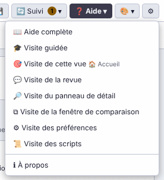
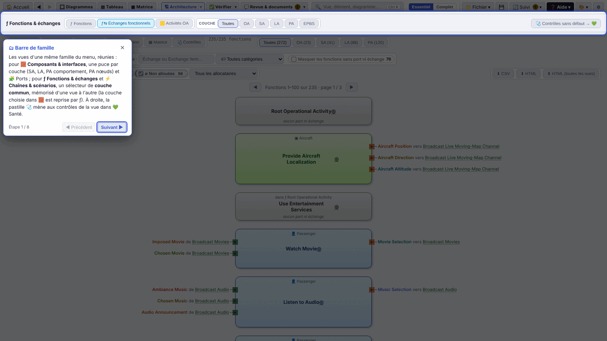
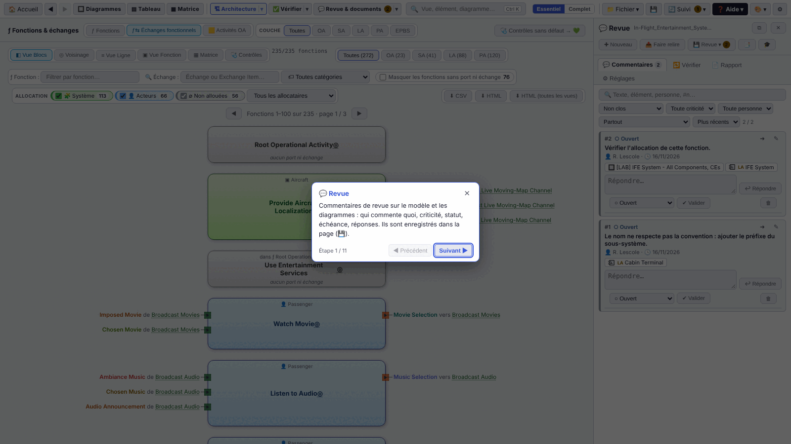
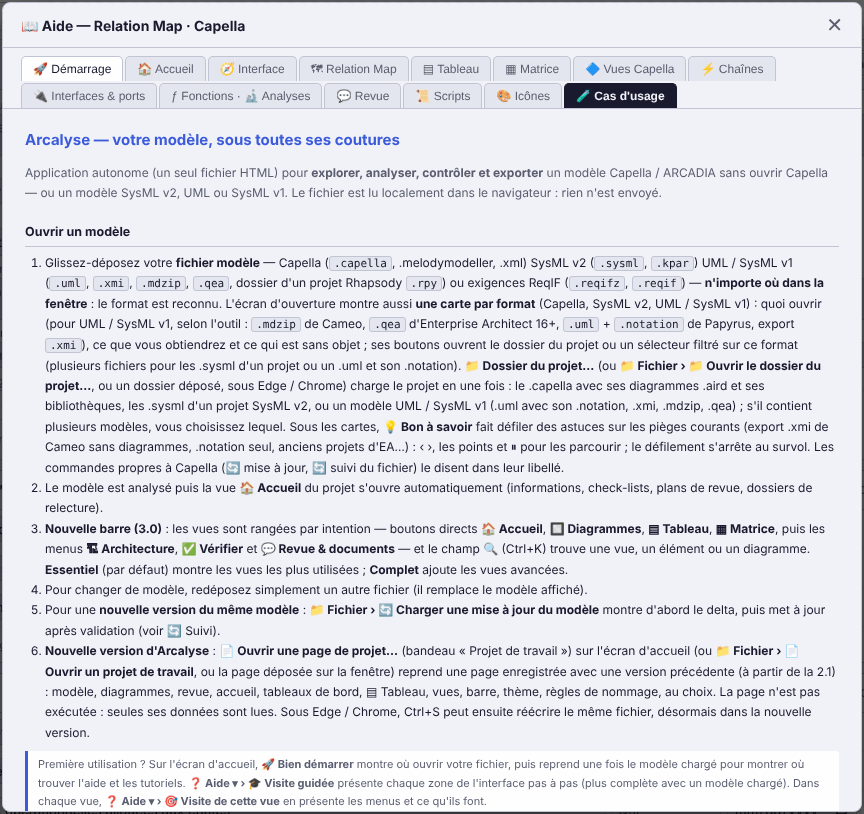
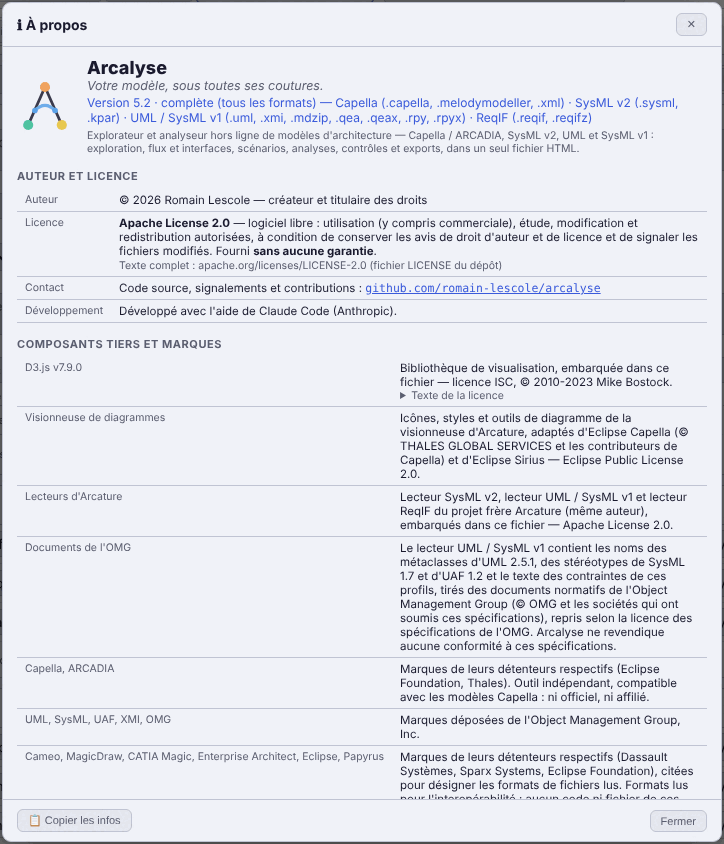

[📘 Sommaire du guide](../GUIDE-UTILISATION.md) · ◀ [18. 🎨 Thèmes et personnalisation](18-themes.md) · [20. Raccourcis clavier et gestes de souris](20-raccourcis.md) ▶

# 19. ❓ Aide, visites guidées, À propos

| Entrée | Effet |
|---|---|
| **📖 Aide complète** | Documentation intégrée, en onglets (🚀 Démarrage, 🏠 Accueil, 🧭 Interface, 🗺 Relation Map, ▤ Tableau, ▦ Matrice, 🔷 Vues Capella, ⚡ Chaînes, 🔌 Interfaces & ports, ƒ Fonctions · 🔬 Analyses, 💬 Revue, 📜 Scripts, **🎨 Icônes**, 🧪 Cas d'usage ; une version réduite à un format masque les onglets propres à Capella si elle ne le lit pas). Aussi par **❓ Aide** et **📖 Que peut-on analyser ?** sur l'écran d'accueil. L'onglet **🎨 Icônes** récapitule les icônes de chaque langage, telles que l'application les dessine : Capella par couche ARCADIA, SysML v2 et UML / SysML v1 par famille, avec les genres de diagrammes et de vues ; un champ filtre par nom, type ou sigle. |
| **🎯 Visite de cette vue** | Présente les menus et commandes de la vue affichée (modèle chargé), dont le nom est rappelé dans le menu (« 🎯 Visite de cette vue · 🏠 Accueil ») : chaque vue de la barre (dont ▦ Matrice et 🔲 Diagrammes, quel que soit le format du modèle) et chaque analyse — une analyse a sa propre visite, nommée d'après elle (💚 Santé & contrôles, 🧬 Traçabilité inter-couches, 🔖 Statut de revue, 🧾 Exigences SysML, ⇶ Traçabilité par niveaux…), qui décrit ses présentations (vues 🧬 UML / SysML v1 comprises). Les textes sont adaptés au format du modèle (Capella, SysML, UML, ReqIF). Sans modèle, le menu invite à en charger un. |
| **💬 Visite de la revue** | Présente le panneau 💬 Revue pas à pas (aussi par 🎓 dans le panneau). |
| **🔎 Visite du panneau de détail** | Présente le panneau de détail sur l'élément affiché (ou sur le système du modèle) : en-tête, 💬 Commenter, onglets et leurs volets (📋 Fiche, 🔗 Liens, 🧭 Sémantique, 🔲 Diagrammes, 🔬 Analyses), ⧉ fenêtre séparée, ◀ ▶ historique (aussi par 🎓 en haut du panneau). |
| **⚙ Visite des préférences** | Ouvre la fenêtre ⚙ Préférences et en présente chaque rubrique (aussi par 🎓 dans son en-tête). |
| **📜 Visite des scripts** | Présente la console 📜 Scripts : bibliothèque, éditeur, exécution, sortie (modèle chargé ; [§ 23](23-scripts.md)). |
| **⧉ Visite de la fenêtre de comparaison** | Proposée quand le modèle a des diagrammes : ouvre au besoin la fenêtre séparée de comparaison sur le diagramme affiché, puis la présente dans cette fenêtre : choix du diagramme, zoom, dessin, façons de l'ouvrir (aussi par 🎓 dans sa barre). |
| **🎓 de ⚖ Comparaison de versions** | Visite de la comparaison (en-tête de ✅ Vérifier › ⚖ Comparaison de versions, ou 🎯 Visite de cette vue quand elle est affichée) : charger une autre version, les deux versions, ⇄ inverser, onglets, niveau et préréglages, catégories et filtres, copier et exporter, 📄 rapport, diagrammes de référence ([§ 12.4](12-analyses.md#124--comparaison-de-versions)). |
| **🎯 dans 💬 Revue & documents** | Visite propre à cet espace (bouton **🎓** de sa barre, ou 🎯 Visite de cette vue quand il est affiché) : onglets, check-lists, dossiers à faire relire, rapports automatiques, 🧩 modèles (sujet, boucles, contenus, colonnes, ▶ Générer). |
| **🎓 Visite guidée** | Découverte de l'interface pas à pas : zone mise en évidence, reste de l'écran assombri ; **◀ Précédent / Suivant ▶** ou flèches du clavier ; **✕** ou **Échap** pour quitter. |
| **ℹ À propos** | Version, auteur, licence Apache 2.0, contact, composants tiers (D3.js sous licence ISC ; visionneuse de diagrammes d'Arcature, dont trois modules sous EPL-2.0 ; lecteurs SysML v2, UML / SysML v1 et ReqIF d'Arcature ; documents de l'OMG), formats lus par la version ouverte, marques citées, **informations techniques** à copier pour signaler un problème. Aussi sur l'écran d'accueil. |

 

| 🎯 Visite d'une vue | 💬 Visite de la revue | 📖 Aide complète |
|---|---|---|
|  |  |  |

**🎓 dans les en-têtes** : chaque visite se relance aussi depuis l'endroit qu'elle présente — panneau 💬 Revue, haut du panneau de détail, en-tête de ⚙ Préférences, barre de 💬 Revue & documents, en-tête de ⚖ Comparaison de versions, barre de la ⧉ fenêtre de comparaison (la visite s'y déroule). Sur l'écran d'accueil, **🚀 Bien démarrer** et **🎓 Visite guidée de l'interface** ([§ 2](02-demarrer.md)).

Les visites signalent aussi les fenêtres séparées (⧉) : panneau de revue, check-lists, plans et dossiers.

---

[📘 Sommaire du guide](../GUIDE-UTILISATION.md) · ◀ [18. 🎨 Thèmes et personnalisation](18-themes.md) · [20. Raccourcis clavier et gestes de souris](20-raccourcis.md) ▶
