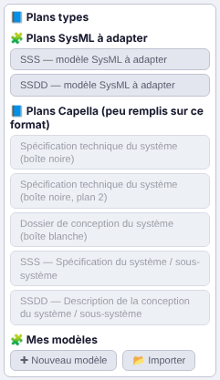
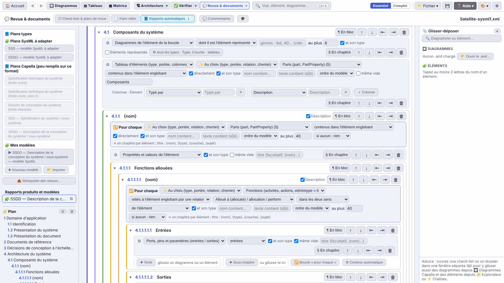
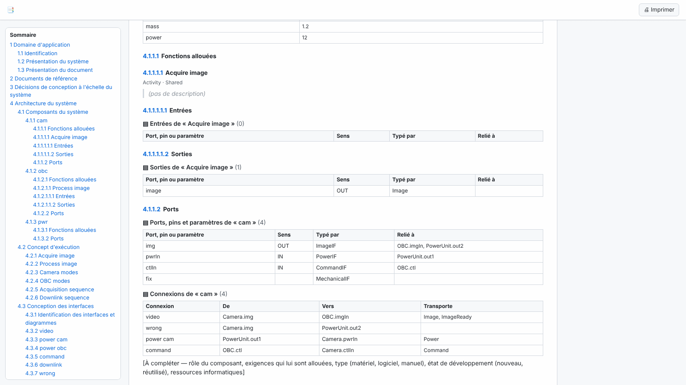

[📘 Sommaire du guide](../GUIDE-UTILISATION.md) · ◀ [20. Raccourcis clavier et gestes de souris](20-raccourcis.md) · [22. Questions fréquentes et dépannage](22-faq.md) ▶

# 21. Pas à pas : scénarios d'utilisation

## 21.1 Revue d'un modèle Capella (de bout en bout)

1. **Charger** le projet : 📁 Dossier du projet… (ou glisser-déposer le `.capella` et le `.aird`).
2. **🏠 Accueil › 🏠 Projet** : remplir la **📝 Fiche projet** ; **💬 Revue & documents › ☑ Check-lists & plans de revue** : **📋 Nouveau plan de revue** à partir du modèle de la couche revue (ex. SA) ; glisser depuis la palette 📎 les diagrammes et éléments du **périmètre**.
3. **🏠 Accueil › 🧩 Contenu du modèle** : composition du modèle (infobulle : description du type) ; **🏗 Architecture › Explorer** (🌳 Arborescence ; 🃏 Cartes en mode Complet) pour parcourir ; panneau de détail pour suivre les références.
4. **🔲 Diagrammes** : parcourir les diagrammes de la couche ; **📝 Note de revue** sur les points à discuter.
5. **🏗 Architecture › ƒ Fonctions & échanges › ƒ Fonctions** : **🩺 Contrôles** et **✍ qualité des noms** ; **📊 Métriques** pour la maturité par couche.
6. **🏗 Architecture › 🧱 Composants & interfaces** : SA · System Component / LA · Logical Component (ports orphelins, non orientés ; **◎ Voisinage** pour un composant et ses voisins), PA · Physical Link (liens sans CE), 🧩 Ports (alignement Function Port ↔ Component Port ↔ Physical Port) ; **ƒ Fonctions & échanges › ƒ⇆ Échanges fonctionnels** (échanges sans Exchange Item).
7. **⚡ Chaînes & scénarios › ⚡ Chaînes** : entrées / sorties, fonctions non allouées (gris), chaînes vides (onglet 🩺 Contrôles).
8. **✅ Vérifier › 🧬 Traçabilité entre couches** : couverture entre couches ; clic sur une cellule rouge pour lister les éléments non tracés. **💚 Santé & contrôles** donne le score global et les contrôles en défaut, couche par couche.
9. Commenter au fil de l'eau (**💬** dans le panneau de détail, **clic droit** dans les vues).
10. **💬 Commentaires › 📤 Faire relire** (page HTML à envoyer aux relecteurs) ; **📂 Importer / fusionner** leurs retours. Pour un document chapitré (descriptions, diagrammes), **💬 Revue & documents › 📑 Faire relire** (page HTML à commenter ou Word).
11. **💬 Commentaires › 📄 Rapport** (rapport HTML) pour la réunion ; décider dans le plan de revue (statut, décision, actions).
12. **💾 Enregistrer** la page.

## 21.2 Préparer les notes de version entre deux livraisons

1. Ouvrir la nouvelle version du modèle.
2. **✅ Vérifier › ⚖ Comparaison de versions › 📂 Charger une autre version…** (l'ancienne). Même démarche pour un modèle SysML v2, UML / SysML v1 ou ReqIF.
3. Préréglage **📰 Notes de version** ; filtrer les couches et catégories utiles ; décocher les lignes à exclure.
4. **📋 Copier** au format *mis en forme* et coller dans Word / Outlook / Teams (ou **⬇ HTML**, **🖨 Imprimer**).
5. Onglet **🔲 Diagrammes** : diagrammes ajoutés, supprimés, renommés ou modifiés ; **⇄ Passer en revue** les montre un à un en ⇄ Avant / après ([§ 21.9](#219-revoir-ce-qui-a-changé-dans-un-diagramme)).

## 21.3 Suivre un modèle en cours de modification dans Capella

Même démarche pour un modèle SysML v2, UML / SysML v1 (Cameo, Papyrus, Enterprise Architect…) ou ReqIF.

1. Sous Edge / Chrome, ouvrir le modèle par **📁 Fichier › 📂 Ouvrir un modèle…**, **📁 Ouvrir le dossier du projet…** ou par glisser-déposer (accès direct).
2. **📁 Fichier › 🔄 Suivi du fichier…** : cocher **Détecter les nouvelles versions toutes les** 30 s (ou ⚙ Préférences › 🔄 Suivi du fichier).
3. À chaque enregistrement dans l'outil : **🔍 Voir le delta**, puis **✔ Mettre à jour** (la vue affichée est gardée).
4. **💬 Commentaires › 🔁 Vérifier** : valider les commentaires corrigés.
5. **🔲 Diagrammes › ⇄ Avant / après** : la version d'avant la mise à jour est gardée ; voir ce qui a bougé dans un diagramme ([§ 21.9](#219-revoir-ce-qui-a-changé-dans-un-diagramme)).

## 21.4 Produire un tableau Excel « composants → fonctions réalisées »

1. **▤ Tableau** ; **+** pour un nouvel onglet ; dans la barre latérale, cocher seulement **LogicalComponent**.
2. **⊞ Colonnes** : garder Name, Owner ; dans **Relations**, cocher **→** « Composant logique → fonction (réalise) » (ou créer une **✨ Colonne par chemin**, [§ 6.5](06-tableau.md#65--colonne-par-chemin-metachain)).
3. Trier, filtrer ; **⬇ CSV**, ou sélectionner les cellules et **Ctrl+C** pour coller dans Excel.
4. **💾 Sauver vue** pour réutiliser l'onglet.

## 21.5 Explorer le voisinage d'un composant (Relation Map)

1. **🗺 Relation Map** ; **＋ ▾ › 🔌 Interfaces** pour une nouvelle vue centrée sur les interfaces.
2. Clic sur le composant dans l'arborescence (il devient le contexte) ; **Profondeur** 2 ou 3 ; disposition **◉ Radiale**.
3. **⌁ Relations** pour lire les noms d'arêtes ; **clic droit › 👁 Masquer** les éléments sans intérêt.
4. Renommer l'onglet (double-clic) ; **Export ▾ › PNG** pour une présentation, ou **⇄ Relations affichées…** en CSV.

## 21.6 Livrer un dossier de diagrammes

1. **🔲 Diagrammes** ; filtrer la liste (ex. « LAB ») ou **☐ Sélectionner…** les diagrammes.
2. **⬇ Exporter…** : Cadre, Cartouche, Description, Annexes, Sommaire ; format **📄 PDF** ; **⬇ Exporter**.

## 21.7 Compter, lister et exporter avec un script

1. Ouvrir le modèle, puis **💬 Revue & documents › 📜 Scripts** (mode Complet), ou **Alt+4**.
2. Dans l'éditeur, taper `out.print(model.count())` et **Ctrl+Entrée** : le nombre d'éléments du modèle s'affiche.
3. Pour un détail par couche : `out.table(['OA', 'SA', 'LA', 'PA', 'EPBS'].map(layer => ({ layer, elements: model.count({ layer }) })))`, puis **⬇ CSV** sur le tableau.
4. Pour une liste d'éléments : `out.table(model.elements({ type: 'LogicalFunction', where: f => !f.description }).map(f => ({ function: f, owner: f.owner })))` — un clic sur une fonction ouvre son panneau de détail.
5. Pour garder le script : **💾**, lui donner un nom ; il est enregistré dans la page (💾) et repris par 📄 Ouvrir un projet de travail. **⬇** l'exporte en `.js` pour le partager.

## 21.8 Tutoriel : un SSDD sur mesure pour un modèle SysML

En SysML, chaque projet a sa méthode : le plan SSDD est fourni comme un **🧩 modèle de rapport** que l'on règle, puis que l'on régénère à chaque version du modèle. Exemple sur `tests/models/uml/Satellite-sysml1.xmi` (SysML v1) ; même démarche en SysML v2 (`VehiculeDemo.sysml`) ou sur un projet Cameo.

1. **Ouvrir le modèle**, puis **💬 Revue & documents › 📘 Rapports automatiques**. Le cadre propose **🧩 Plans SysML à adapter** : cliquer **SSDD — modèle SysML à adapter**.

   

2. **Vérifier le 🎯 sujet** en tête du modèle : Arcalyse a choisi le système le plus probable (*Satellite*, sujet des cas d'utilisation). Pour le SSDD d'un sous-système, **📍 Choisir…** un autre bloc ou une autre part : rien d'autre à changer.
3. **Lire et régler les boucles** du chapitre *4.1 Composants du système* : « 🔁 Pour chaque **Parts** contenus dans l'élément englobant, directement, et son type », puis, dedans, *Fonctions allouées* : « pour chaque **Fonction** reliée à l'élément englobant par **allocate / perform** », avec les sous-chapitres *Entrées* et *Sorties* (contenu « Ports, pins et paramètres » : entrées, sorties) et les diagrammes de la fonction.

   

   Pour suivre votre méthode : changer le **type** (ex. un stéréotype « Function » de votre profil), la **portée** (ex. « dans un paquetage » *Logical Architecture*), la **relation** (ex. `«allocate»` seulement), ou passer par un **✨ chemin** (aperçu en direct).
4. **Ajouter une information** : **⚙ Contenu automatique** dans un chapitre de boucle — propriétés et valeurs, liens d'une relation, connexions, ✨ information par chemin (ex. *Typé par → Nom*). Dans un tableau « ✨ Au choix », **＋ Colonne** : attribut (`Requirement.text`), relation (*satisfaite par*), chemin.
5. **▶ Générer le rapport** : un dossier ordinaire est créé, avec la numérotation du DID ; **👁 Aperçu** montre le rendu, **📤 Page HTML à commenter** ou **📝 Word** l'envoient en relecture.

   

6. **Réutiliser** : le modèle reste dans **🧩 Mes modèles** ; à la version suivante du modèle SysML, **▶** le régénère. **💾 .json** le partage avec un autre projet ou une autre équipe.

La visite guidée **🎓** de la barre de 💬 Revue & documents reprend ces commandes à l'écran ; l'aide intégrée (onglet 📘 Rapports) contient ce tutoriel en bref.

## 21.9 Revoir ce qui a changé dans un diagramme

Pour un modèle Capella (avec son `.aird`), SysML v2 ou UML / SysML v1 ; présentation complète au [§ 10.6](10-diagrammes.md#106--avant--après).

1. **Ouvrir la nouvelle version** du modèle. Si elle arrive par le **🔄 suivi du fichier** ([§ 21.3](#213-suivre-un-modèle-en-cours-de-modification-dans-capella)) ou par une réouverture du même fichier, la version d'avant est gardée d'elle-même. Sinon : **🔲 Diagrammes › ⇄ Avant / après › 📂 Version d'avant…** (`.capella` et `.aird`, `.sysml` / `.kpar`, fichiers UML / SysML v1).
2. **🔲 Diagrammes** : ouvrir le diagramme, puis **⇄ Avant / après**. **🔎 Diagrammes modifiés** liste tous ceux qui diffèrent de la version d'avant (clic : l'ouvrir).
3. **◐ Fondu** : le curseur Avant ⟷ Après fait apparaître les éléments ajoutés, effacer les retirés, glisser les déplacés de leur ancienne place à la nouvelle ; **▶** anime l'aller-retour. **◧ Volet** : les deux dessins entiers, avant à gauche de la barre, après à droite.
4. **Surbrillance** : vert ajouté, rouge retiré, orange déplacé ou redimensionné (ancienne place en pointillé), bleu renommé, violet lien retracé.
5. **Liste des écarts** (à droite) : clic = centrer et faire clignoter, double-clic = panneau de détail ; ◀ ▶ d'un écart à l'autre.
6. **Tous les diagrammes d'une livraison** : **✅ Vérifier › ⚖ Comparaison de versions › 🔲 Diagrammes**, **⇄ Passer en revue** ouvre le premier diagramme modifié ; **⏮ ⏭** passent au précédent ou au suivant, **↩ Comparaison** ramène à la liste.
7. Commenter un écart : **📝 Note de revue** sur le diagramme, ou **💬** dans le panneau de détail de l'élément.

---

[📘 Sommaire du guide](../GUIDE-UTILISATION.md) · ◀ [20. Raccourcis clavier et gestes de souris](20-raccourcis.md) · [22. Questions fréquentes et dépannage](22-faq.md) ▶
