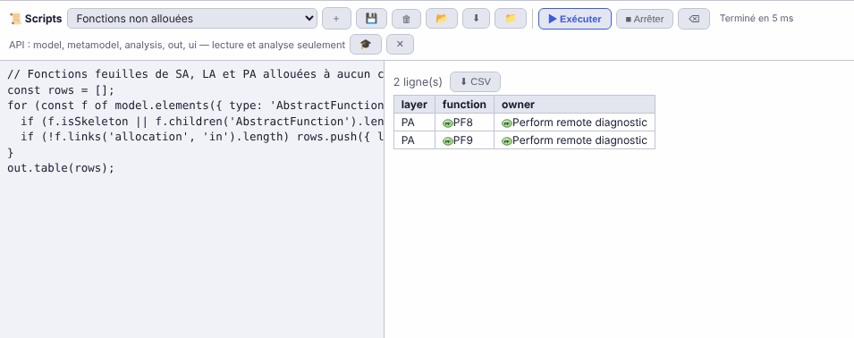

<sub>[📘 Sommaire du guide](../GUIDE-UTILISATION.md) · ◀ [22. Questions fréquentes et dépannage](22-faq.md) · [24. 🧩 SysML v2, 🧬 UML / SysML v1 et 📑 ReqIF](24-sysml-uml.md) ▶</sub>

# 23. 📜 Scripts (macros)

**💬 Revue & documents › 📜 Scripts** (mode Complet ; ou **Alt+4**, ou la recherche 🔍 « Scripts ») ouvre une console en bas des vues : des scripts **JavaScript** parcourent et analysent le modèle affiché par une **API**, comme les macros de Catia Magic / MagicDraw ou Python4Capella. L'API est celle d'**Arcature** (mêmes noms : un script de lecture tourne dans les deux outils), limitée à la **lecture** — Arcalyse ne modifie jamais le modèle — et complétée par `analysis`, qui rend les résultats de toutes les analyses d'Arcalyse.



## 23.1 Lancer un script

- À gauche, l'**éditeur** ; à droite, la **sortie**. Choisissez un **exemple** dans la liste (fonctions sans description, fonctions non allouées, matrice d'allocation, statistiques, santé et contrôles, traçabilité, chaînes, exigences, qualité des noms…) ou écrivez votre script, puis **Ctrl+Entrée** (ou ▶ Exécuter).
- Les éléments affichés sont des **liens** : un clic ouvre le panneau de détail. Les tableaux ont un bouton **⬇ CSV** ; les fichiers produits par `out.file` sont proposés au téléchargement. **■ Arrêter** interrompt un script trop long ; **⌫** efface la sortie.
- Le script porte sur le modèle **tel qu'il est affiché**, quel que soit son format (Capella, SysML v2, UML / SysML v1). `model.selection` contient l'élément ouvert dans le panneau de détail ; `model.diagrams` et `élément.diagrams` les diagrammes du `.aird` s'il est chargé, ou les diagrammes et vues d'un modèle SysML / UML.
- Une erreur indique la **ligne** du script (clic sur le message : l'éditeur s'y place). Un type, une relation ou un critère mal orthographiés lèvent une erreur explicite.

## 23.2 L'API en bref

| Objet | Rôle |
|---|---|
| `model` | `elements(filtre)`, `find`, `count`, `findByPath('A/B/C')`, `layer('LA')`, `getElementById`, `root`, `selection`, `types()`, `fileName`, `tool` (`'Arcalyse'`), `diagrams`, `hasDiagrams` |
| élément | `id`, `type`, `fullType`, `layer`, `name`, `summary`, `description`, `review`, `label`, `owner`, `path`, `isSkeleton`, `isTechnical` ; `children()`, `descendants()`, `findByPath()`, `attribute(nom)`, `attributes()`, `isA('Component')`, `references()`, `referencedBy()`, `links('allocation', 'in')`, `diagrams` |
| diagramme | `id`, `name`, `type`, `code` (LAB, SDFB…), `layer`, `kind` (`diagram`, `sequence`, `table`), `target` |
| `metamodel` | types de Capella et héritage : `isA`, `supertypes`, `has`, `types`, `version` |
| `analysis` (avec `await`) | `functions()`, `chains()`, `traceability()`, `capabilities()`, `states()`, `health()`, `requirements()`, `properties()`, `data()`, `constraints()`, `status()`, `categories()`, `rec()`, `libraries()`, `scenarios()`, `ports()`, `functionalExchanges()`, `componentExchanges()`, `physicalLinks()`, `deployment()`, `sysml()` (modèle SysML v2 ou UML / SysML v1 : lecture, diagnostics, liaisons, vues ; null pour Capella), `matrix()` (▦ Matrice : un onglet par son nom, ou une définition lignes / colonnes / relations), `checks(vue)`, `nameQuality(nom)`, `diagramsOf(élément)`, `names()` |
| `out` | `print`, `warn`, `error`, `table`, `csv`, `file`, `progress`, `clear` |
| `ui` (avec `await`) | `ask`, `confirm`, `choose`, `readFile`, `readCsv`, `parseCsv` |

Filtre : un nom de type (`'Component'` : sous-types compris), une fonction, ou `{ type, exactType, layer, name, technical, where }`. Référence complète : [`docs/api/arcalyse.d.ts`](../api/arcalyse.d.ts) (autocomplétion dans VS Code) et [`docs/api/LISEZMOI.md`](../api/LISEZMOI.md), qui contient aussi des **recettes** prêtes à l'emploi (compter, lister, exporter, contrôler). Visite guidée : **❓ Aide ▾ → 📜 Visite des scripts** ou 🎓 dans la console.

```js
// Composants logiques sans fonction allouée, en tableau puis en CSV
const rows = model.elements({ type: 'LogicalComponent', where: c => !c.isSkeleton })
  .filter(c => !c.links('allocation', 'out').length)
  .map(c => ({ component: c, owner: c.owner }));
out.table(rows);
out.file('composants-vides.csv', out.csv(rows));
```

```js
// Contrôles bloquants de toutes les vues (profil 🩺 appliqué)
for (const c of await analysis.checks())
  if (c.severity === 'err' && c.rows.length) out.warn(c.view, c.title, c.rows.length);
```

```js
// ▦ Matrice : relations disponibles, puis bilan du premier onglet de la page
const { tabs, relations } = await analysis.matrix();
out.table(relations);   // clé, libellé, groupe, nombre de liens
if (tabs.length) {
  const m = await analysis.matrix(tabs[0]);
  out.print(m.name, ':', m.links, 'lien(s),', m.rowsWithoutLinks, 'ligne(s) sans lien');
}
```

## 23.3 Bibliothèque et partage

**＋** commence un nouveau script ; **💾** l'enregistre dans le **projet** (gardé dans la 💾 page HTML, repris par 📄 Ouvrir un projet de travail) ; **📂** importe des fichiers `.js` ; **⬇** exporte le script affiché ; **🗑** le supprime. **📁 Dossier partagé** (Chrome / Edge) : un dossier de scripts — à côté du modèle, sur un partage réseau — dont les `.js` apparaissent dans la liste ; 💾 y réécrit le fichier, et un nouveau script y est enregistré ; le dossier est retrouvé à la prochaine ouverture (le navigateur peut redemander l'autorisation).

## 23.4 Isolement

Le script tourne dans un **worker** isolé, sur un instantané du modèle : il n'a accès ni à la page, ni au fichier, ni au réseau (`fetch` retiré) ; il demande ses analyses à Arcalyse, qui les calcule avec ses moteurs. Un script reçu d'un collègue ne peut donc ni envoyer le modèle ailleurs ni modifier quoi que ce soit.

## 23.5 🤖 Serveur MCP (essai)

Un serveur **MCP** (dossier `mcp/` du dépôt, Node.js 18+) permet à une application d'IA compatible (Claude Desktop, Claude Code, ou l'assistant de l'entreprise s'il gère MCP) d'**interroger un modèle** avec les analyses d'Arcalyse : résumé, recherche d'éléments, fiche d'un élément, diagrammes, traçabilité, contrôles, et scripts de l'API ci-dessus (`run_script`). C'est l'application d'IA qui appelle Arcalyse : le serveur ouvre la page dans un navigateur sans fenêtre et **hors ligne**, en **lecture seule**, sur le poste ; aucun compte ni clé n'est demandé côté Arcalyse. Formats : Capella (avec le `.aird` voisin), SysML v2, UML / SysML v1 ; pas encore ReqIF. Installation, déclaration dans l'application d'IA, réglages (dossiers autorisés `ARCALYSE_RACINES`…) et liste des outils : [`mcp/LISEZMOI.md`](../../mcp/LISEZMOI.md). Ce serveur est un **essai** : ses outils peuvent encore changer.

---

<sub>[📘 Sommaire du guide](../GUIDE-UTILISATION.md) · ◀ [22. Questions fréquentes et dépannage](22-faq.md) · [24. 🧩 SysML v2, 🧬 UML / SysML v1 et 📑 ReqIF](24-sysml-uml.md) ▶</sub>
