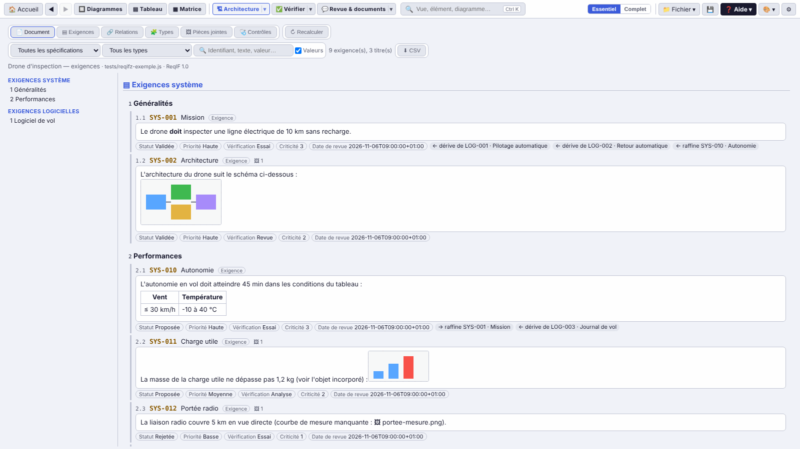
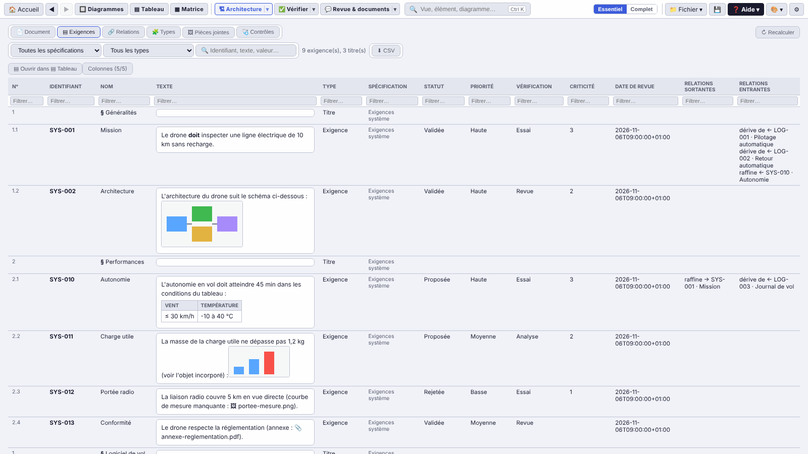
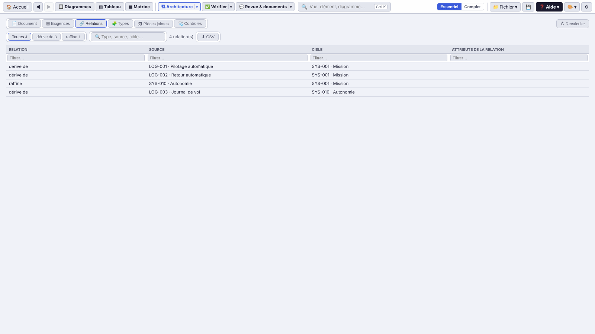
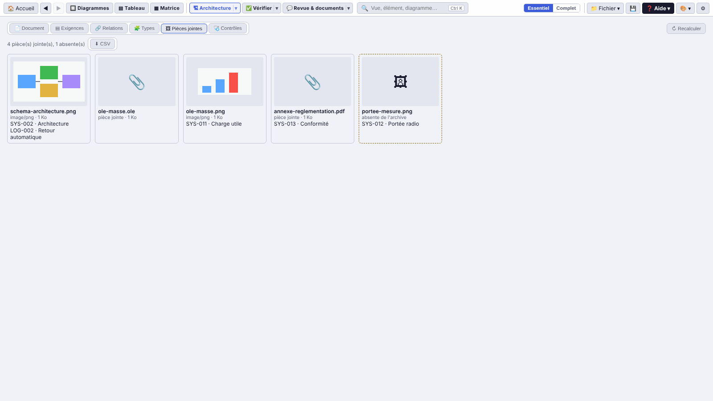
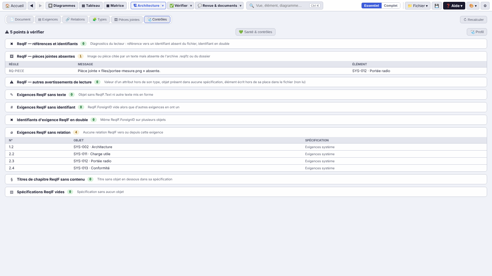

[📘 Sommaire du guide](../GUIDE-UTILISATION.md) · ◀ [23. 📜 Scripts (macros)](23-scripts.md) · [25. ▦ Matrice](25-matrice.md) ▶

# 24. 🧩 SysML v2, 🧬 UML / SysML v1 et 📑 ReqIF

Arcalyse lit aussi trois autres familles de fichiers, grâce aux **lecteurs autonomes d'Arcature**, le projet frère (Apache 2.0), embarqués dans le fichier : tout se passe sur le poste, **en lecture seule**. Le modèle est converti en éléments comme un `.capella` : les vues génériques fonctionnent de la même façon.

| Format | Fichiers | Lecteur | Livrable |
|---|---|---|---|
| **SysML v2** (notation textuelle) | `.sysml`, archive `.kpar`, dossier de `.sysml` (noms résolus d'un fichier à l'autre) | lecteur SysML v2 d'Arcature — mode d'emploi technique : [`docs/SYSML-V2.md`](../SYSML-V2.md) | `arcalyse-sysml2.html`, `arcalyse-complet.html` |
| **UML 2.5.1**, **SysML v1**, **UAF 1.2** | `.uml` d'Eclipse UML2 / Papyrus (avec son `.notation`), `.xmi` (OMG, Cameo, Papyrus, Enterprise Architect), `.mdzip` (Cameo / CATIA Magic), `.qea` (Enterprise Architect 16+), projet **IBM Rhapsody** au format texte (`.rpy` et son dossier `_rpy`) | lecteur UML / SysML v1 d'Arcature — [`docs/UML.md`](../UML.md) | `arcalyse-uml.html`, `arcalyse-complet.html` |
| **ReqIF 1.0 à 1.2** (exigences) | archive `.reqifz` (avec les images des textes), `.reqif`, dossier de `.reqif` et de leurs images | lecteur ReqIF d'Arcature — [`docs/REQIF.md`](../REQIF.md) | `arcalyse-reqif.html`, `arcalyse-complet.html` |

La version Capella (`arcalyse-capella.html`) ne contient aucun de ces lecteurs ; les cinq livrables sont bilingues (bascule 🌐).

## 24.1 Ouvrir

Comme un `.capella` ([§ 2](02-demarrer.md)) : glisser-déposer n'importe où dans la fenêtre, bouton de la **carte du format** sur l'écran d'ouverture (**📂 Fichier .sysml / .kpar…**, **📂 Fichier modèle…** pour UML / SysML v1, **📂 Fichier .reqif / .reqifz…** ; ou le dossier), **📁 Fichier › 📂 Ouvrir un modèle…** (type « Tous les modèles ») ou **📁 Ouvrir le dossier du projet…**. Pour Papyrus, déposez ou choisissez **le `.uml` et son `.notation` ensemble** (ou le dossier du projet) : un `.notation` seul est refusé, avec une explication. Une archive `.mdzip` est décompressée par le navigateur (Chrome / Edge 80+, Firefox 113+, Safari 16.4+). Les anciens projets d'Enterprise Architect (`.eap`, `.eapx`, `.feap`) ne sont pas lus : les enregistrer en `.qea` ou exporter en XMI. Pour **Rhapsody**, ouvrez le **dossier du projet** (le `.rpy` et son dossier `_rpy`, un paquetage par fichier `.sbs`) : le modèle est lu, ses diagrammes ne le sont pas encore. Pour **ReqIF**, voir [§ 24.5](#245--reqif).

**📎 Projet Papyrus sur plusieurs fichiers** (bibliothèque de types `lib/Types.uml#…`, profil, sous-modèle contrôlé) : ouvrez le dossier du projet ou déposez les fichiers ensemble ; le modèle principal est celui qu'aucun autre ne référence (s'il y en a plusieurs, une fenêtre au centre de l'écran demande lequel ouvrir). Le lecteur ne lit que ce modèle : les références vers les autres fichiers sont **signalées** (ligne 📎 de l'en-tête de 🧬 UML / SysML v1, case « Fichiers référencés » de 🏠 Accueil, contrôle 🩺 « Références vers d'autres fichiers non lus », indicateur du tableau de bord).

## 24.2 Ce qui fonctionne comme pour Capella

- **Explorer** : 🌳 Arborescence, 🃏 Cartes — groupées par **famille** au lieu des couches ARCADIA (SysML, UML : structure, comportement, exigences, organisation ; ReqIF : spécifications, relations, types), avec les filtres de famille ([§ 7.3](07-explorateur.md#73-modèles-sysml-uml-et-reqif--familles)) —, ▤ Tableau (colonnes des attributs et des références), ▦ Matrice (préréglages du format, [§ 25](25-matrice.md)), 🔍 Ctrl+K, panneau de détail (références sortantes et entrantes, section propre au format), 🗺 Relation Map (relations du format : typage, spécialisation, composition, connexions, satisfy, allocations… pour SysML v2 ; généralisations, compositions, associations, satisfy, allocations… pour UML / SysML v1 ; relations ReqIF).
- **Vérifier** : 💚 Santé & contrôles (diagnostics et contrôles du lecteur), 📐 tableau de bord (indicateurs du format), **⚖ Comparaison de versions** avec une autre version du même format : onglet 🔷 Modèle, et onglet 🔲 Diagrammes qui compare les diagrammes ou vues des deux versions **sans `.aird`** ; sous chaque version, l'outil, la version du modèle, le nombre d'éléments et de diagrammes ([§ 12.4](12-analyses.md#124--comparaison-de-versions)).
- **Suivre le fichier** : **🔄 Suivi du fichier** détecte une nouvelle version enregistrée par l'outil (Cameo, Papyrus, Enterprise Architect, éditeur SysML v2, outil d'exigences…), montre le delta et met à jour l'affichage après validation, en gardant la vue ([§ 16](16-suivi-fichier.md)). Les autres fichiers du projet (`.notation`, modèles référencés) sont repris de l'ouverture.
- **Diagrammes** : **⇄ Avant / après** montre les écarts d'un diagramme (UML / SysML v1) ou d'une vue calculée (SysML v2) avec une version d'avant — gardée d'elle-même par le suivi ou une réouverture du même fichier, choisie par **📂 Version d'avant…**, ou celle de ⚖ Comparaison ([§ 10.6](10-diagrammes.md#106--avant--après)).
- **Revue & documents** : 💬 Revue (y compris les notes sur les diagrammes et les vues), 📑 dossiers, 📘 Rapports — **🧩 Plans SysML à adapter** (SSS, SSDD) et modèles sur mesure par type, stéréotype, relation ou chemin ([§ 21.8](21-pas-a-pas.md#218-tutoriel--un-ssdd-sur-mesure-pour-un-modèle-sysml)) —, 💾 page enregistrée.
- **Accueil** : 🏠 Projet est adapté au format : cases **Fichiers du projet** (modèle, diagrammes ou vues, validation ; pour ReqIF : exigences, pièces jointes, lecture), tâches de « Que voulez-vous faire ? » propres au format, contenu par famille.
- **Aide** : la visite guidée **🎯 de la vue affichée** et celle de ⚖ Comparaison adaptent leurs textes au format ; **🌐** change de langue sans perte (le fichier est relu dans l'autre langue).

Les vues propres à Capella (fonctions, échanges, chaînes, scénarios, analyses ARCADIA, 🎚 Variantes) n'ont pas de données : elles sont retirées des menus en Essentiel et grisées en Complet.

## 24.3 🧩 SysML v2

- **🏗 Architecture › 🧩 SysML v2** : **🧩 Éléments** (puces par famille Structure / Comportement / Exigences & cas / Organisation, métaclasses, recherche), **🔗 Liaisons** (par relation : source, cible, via), **🩺 Diagnostics** (erreurs et avertissements du lecteur : fichier, ligne, règle, message, élément), **📄 Fichiers** (texte de chaque fichier, numéros de ligne) ; ⬇ CSV sur chaque onglet.
- **🔲 Diagrammes** : SysML v2 n'a pas de fichier de diagrammes ; le lecteur **calcule des vues** depuis le texte et les dispose automatiquement — **GV** vue générale, **IV** interconnexion, **STV** états, **AFV** flux d'actions. Elles s'ouvrent dans la vue 🔲 commune ([§ 10.5](10-diagrammes.md#105-modèles-sysml-v2-et-uml--sysml-v1)) : explorateur par genre ou 🌳 arborescence, recherche, thème, ⧩ filtres, zoom, ▣ carte, 📝 notes de revue, **≡ Texte** coloré, exports (SVG, PNG, PNG ×2, Imprimer / PDF, texte), planches, ⇄ Avant / après.
- **Icônes** : dessinées dans Arcature, une par métaclasse de la norme (part, port, action, état, exigence, paquet…) — définition pleine aux angles vifs, usage clair arrondi, usage de référence en tirets ; direction, rôle, port conjugué ou import récursif marqués dans un coin. Chaque genre de vue a son icône, dans sa couleur, l'étiquette du cadre marquée **« S »**.

## 24.4 🧬 UML / SysML v1

- **🏗 Architecture › 🧬 UML / SysML v1 › 🧬 Modèle** : outil et version reconnus, **🧩 Éléments** (famille, type, métaclasse, nom qualifié, déclaration, ligne), **🔗 Liaisons** (par relation), **🩺 Diagnostics** — la validation d'Arcature selon les contraintes de la spécification UML 2.5.1 et des profils SysML 1.7 et UAF 1.2, sous leur nom ; ⬇ CSV.
- **Comprendre les diagnostics.** Toutes les contraintes de la norme sont vérifiées, alors que Cameo n'en active qu'une partie par défaut : un grand modèle peut en compter des milliers, dus le plus souvent à quelques règles. En tête de l'onglet 🩺 Diagnostics, **Σ Répartition par règle** les regroupe :
  - **impact réel** de chaque règle, à la place de la gravité de la norme (qui classe presque tout en « erreur ») : 🔴 **incohérence** (le modèle se contredit : flux sans connecteur, cycle, référence vers rien — à regarder en priorité), 🟡 **à vérifier** (oubli ou doublon probable : noms en double, contexte d'une relation, classe active), 🟢 **forme** (écart sans conséquence, souvent dû à l'enregistrement du fichier — hors score de santé) ;
  - un clic sur une règle déplie sa **fiche** : ce que dit la règle, cause probable, est-ce grave, correction, éléments concernés (fiche aussi accessible depuis les diagnostics du panneau de détail d'un élément) ;
  - une **case ☑** par règle pour ne plus la compter : elle disparaît alors de 🏠 Accueil, de 💚 Santé et du tableau de bord (choix gardé dans le 🩺 profil). La règle d'Arcature **ARC_UML_02** (éléments sans nom, surtout des connecteurs et extrémités d'associations) est désactivée par défaut.
  Les contrôles 🩺, la case **Validation** de 🏠 Accueil (« 3 incohérence(s) · 2 à vérifier · 10 écart(s) de forme ») et sa tâche (« Regarder N incohérence(s) ») suivent ce classement.
- **Type** des éléments : le stéréotype SysML (Block, Requirement, PartProperty…), sinon la métaclasse UML ; les propriétés des stéréotypes (texte et identifiant d'une exigence…) sont des colonnes du ▤ Tableau. Le panneau de détail montre type, métaclasse, stéréotypes, déclaration, attributs écrits, liaisons, diagnostics et un extrait XMI.
- **🔲 Diagrammes** : les **diagrammes et tableaux enregistrés dans le fichier** — Cameo et Enterprise Architect (bdd, ibd, act, stm, sd, uc, req, par, pkg), Papyrus avec son `.notation` —, dessinés tels qu'ils ont été mis en page dans l'outil, et les **tableaux, matrices et Relation Map de Cameo** recalculés d'après leur définition ([§ 10.5](10-diagrammes.md#105-modèles-sysml-v2-et-uml--sysml-v1)). Pas de vues calculées pour ces formats. Chaque diagramme est dessiné à son ouverture (les plus chargés peuvent demander quelques secondes) ; **⇄ Avant / après** compare un diagramme à sa version d'avant. Les diagrammes de Rhapsody ne sont pas encore lus.
- **Famille 🏗 Architecture › 🧬 UML / SysML v1** (huit vues, barre de famille sous la barre principale) et vues de **✅ Vérifier**, chacune avec ses présentations et ses 🩺 contrôles (repris par 💚 Santé) :

| Vue | Menu | Présentations |
|---|---|---|
| 🧬 Modèle | 🏗 | 🧩 Éléments · 🔗 Liaisons · 🩺 Diagnostics |
| 🧱 Blocs & ports | 🏗 | ◧ Vue Blocs (blocs SysML dessinés comme les composants de Capella : ports en notation SysML, connecteurs, ItemFlow, allocations ; **▤ Détaillée** par défaut ou **▦ Compacte**, cartes sur plusieurs colonnes avec le nombre de liens de chaque port et liens dépliables) · ◎ Voisinage (un bloc et ses voisins) · ≡ Vue Ligne · ▦ Matrice · 🩺 Contrôles |
| 🗃 Interfaces (ICD) | 🏗 | 📋 Interfaces (FlowProperty, opérations, ports) · ▤ ICD (une ligne par connecteur entre ports, compatibilité) · 🩺 Contrôles |
| ƒ Activités & flux | 🏗 | ⇶ Couloirs (une activité en couloirs par porteur) · ◧ Vue Blocs (actions dessinées comme les fonctions de Capella : pins, flux à travers les nœuds de contrôle ; ▤ Détaillée ou ▦ Compacte) · ≡ Vue Ligne · ▦ Matrice · 🩺 Contrôles |
| 🚦 Machines à états | 🏗 | 📋 Machines (**clic sur la ligne** : aperçu du diagramme calculé, ajusté à la place disponible ; 🔎 : détail) · 🔎 États & transitions · 🖼 Diagramme calculé (dessiné à partir du modèle, indépendamment des diagrammes du fichier : zoom, exports) · ▦ Matrice · 🩺 Contrôles (états inatteignables ou sans issue, signaux jamais émis…) |
| 🎬 Interactions | 🏗 | 📋 Interactions (clic sur la ligne : aperçu du diagramme de séquence calculé) · 🔎 Messages · 🖼 Diagramme calculé · ▦ Matrice · 🩺 Contrôles |
| 🎯 Cas d'utilisation | 🏗 | 📋 Cas d'utilisation · ▦ Matrice acteurs · 🩺 Contrôles |
| 📦 Paquetages & classes | 🏗 | 📦 Paquetages (métriques de Martin, cycles) · 🧮 Classes · 🖧 Déploiement · 🩺 Contrôles |
| ⇶ Traçabilité par niveaux | ✅ | 📊 Couverture · 📋 Chemins · ⇶ Graphe (exigences, cas d'utilisation, fonctionnel, logique, physique) · 🩺 Contrôles |
| ⚖ Budgets | ✅ | 🌳 Cumul sur l'arbre des parts (multiplicités comprises, limite) · 📋 Grandeurs · 🩺 Contrôles |
| 🔒 Paramétrique & contraintes | ✅ | 📋 Blocs de contrainte · 🔗 Liaisons · 🔒 Contraintes (par nature : 📝 texte / OCL, 🧩 expression structurée de Cameo — critère de légende, groupe d'éléments — résumée par ses opérandes, XML repliable, ∅ sans texte) · 🩺 Contrôles |
| 🧾 Exigences SysML | ✅ | 📋 Liste · 🌳 Arbre · 📊 Couverture (satisfy, verify, directe ou indirecte) · ▦ Matrice · 🩺 Contrôles |

  Dans le panneau de détail d'un bloc, d'une machine, d'une interaction ou d'un cas, des boutons (◧, 🧾, 🚦, 🎬, 🎯, 🔲) ouvrent la vue correspondante sur l'élément. Dans 🧱 et ƒ, les filtres **Type / Connecteurs** et **Genre / Flux** sont des menus déroulants (« Type : tous ▾ » ou « 6 / 7 », recherche, Tout / Aucun, « seul » au survol) ; ⬇ CSV, ⬇ HTML (vues en blocs).
- **Icônes** : le jeu d'Arcature, dessiné d'après la notation graphique des normes UML et SysML, pour chaque élément. Pour les diagrammes, **une couleur par genre**, la même pour un genre d'UML et son semblable de SysML (classes et bdd, activité, états…) ; l'étiquette du cadre est **pleine, marquée « S »**, pour un diagramme SysML (d'après l'outil qui l'a produit), **creuse** pour un diagramme UML.

## 24.5 📑 ReqIF

Arcalyse lit des **exigences ReqIF** (Requirements Interchange Format de l'OMG, versions 1.0 à 1.2), en lecture seule et hors ligne, par le lecteur ReqIF d'Arcature (version ReqIF seule `arcalyse-reqif.html` et version complète). Mode d'emploi technique : [`docs/REQIF.md`](../REQIF.md).

**Ouvrir**

| Fichier | Produit par | Images des textes |
|---|---|---|
| archive **`.reqifz`** | DOORS, Polarion, Jama, codeBeamer… (un ou plusieurs `.reqif` et leurs pièces jointes) | oui |
| **`.reqif`** | Capella (Requirements Viewpoint), Enterprise Architect, ReqIF Studio… | non : choisir le `.reqif` **avec ses images**, ou ouvrir le dossier |
| **dossier** | un ou plusieurs `.reqif` et leurs images (📁 Dossier du projet, ou fichiers déposés ensemble) | oui |

Sur l'écran d'ouverture, la carte **ReqIF** propose **📂 Fichier .reqif / .reqifz…** et **Dossier (ReqIF et images)…** ; le glisser-déposer et 📁 Fichier fonctionnent aussi.

**Ce qui fonctionne** : les spécifications, leurs objets (exigences et titres de chapitre), relations et types deviennent des éléments. ▤ Tableau : une colonne par attribut ReqIF (Statut, Priorité…), l'identifiant ReqIF.ForeignID dans *Identifiant*, le type d'objet dans *Type ReqIF*, le numéro de chapitre dans *N°* ; colonne Description en **🖼 Texte riche** par défaut. ▦ Matrice : préréglage **Exigences × exigences (relations ReqIF)**. Panneau de détail : section **📑 ReqIF** (valeurs des attributs, relations, autres places, extrait du fichier). 💬 Revue, 📑 dossiers, 📘 Rapports (familles *Exigences*, *Titres de chapitre*, *Spécifications* ; sélection par type ReqIF), 💚 Santé, 🔄 Suivi du fichier, ⚖ Comparaison de versions (onglet 🔷 Modèle). 🏠 Accueil : pastille **ReqIF**, cases **Fichiers du projet** (exigences, pièces jointes, lecture), tâches : lire les exigences, sortir un tableau Excel, vérifier les exigences, faire relire, croiser les exigences en matrice.

**🏗 Architecture › 📑 ReqIF**

| Onglet | Contenu |
|---|---|
| **📄 Document** | Le document de chaque spécification (ou de toutes, chacune sous son nom) : plan des chapitres à gauche, objets numérotés (1, 1.1…) avec leur identifiant, leur texte mis en forme et ses images, les valeurs de leurs attributs et leurs relations (cliquables) ; filtres par spécification, type et texte ; pages de 200 objets. |
| **▤ Exigences** | Un tableau (colonnes au choix) ; **▤ Ouvrir dans ▤ Tableau** pour trier, filtrer et exporter en Excel, dans l'ordre du document. |
| **🔗 Relations** | Relations par type, avec leurs attributs. |
| **🧩 Types** | Types d'objets, de spécifications et de relations, et leurs attributs, avec leur **valeur par défaut** s'il y en a une (aussi dans le panneau de détail, « Valeurs par défaut »). |
| **🖼 Pièces jointes** | Vignettes, taille, objets qui les citent, pièces absentes. |
| **🩺 Contrôles** | Diagnostics du lecteur (référence vers un identifiant absent du fichier, identifiant en double, valeur hors de son type, objet dans aucune spécification, pièce jointe absente), exigences sans texte, sans identifiant, identifiants en double, exigences sans relation, titres de chapitre sans contenu, spécifications vides ; repris par 💚 Santé, réglables par le 🩺 profil. |

⬇ CSV dans chaque onglet.

| ▤ Exigences | 🔗 Relations |
|---|---|
|  |  |
| **🖼 Pièces jointes** | **🩺 Contrôles** |
|  |  |

**Images des textes** : les images citées par un texte XHTML sont montrées à leur place — document, panneau de détail, ▤ Tableau en 🖼 Texte riche, rapports exportés, 💾 page enregistrée. Un objet OLE de DOORS est remplacé par son image de repli ; une autre pièce jointe (PDF…) est citée par son nom (📎) ; une image absente de l'archive est citée par son nom (🖼) et signalée dans les contrôles.

**Plusieurs fichiers** : une archive ou un dossier qui contient plusieurs `.reqif` (un par module, par exemple) est lu en entier ; une relation peut relier des exigences de deux fichiers. L'encodage annoncé par chaque fichier (UTF-8, ISO-8859-1, windows-1252…) est respecté. Une exigence nommée par `ReqIF.ChapterName` (cas de Polarion) n'est prise pour un titre de chapitre que si elle n'a pas de texte ; une spécification sans nom est désignée par son identifiant.

ReqIF n'a pas de diagrammes : 🔲 Diagrammes et ⇄ Avant / après sont sans objet.

## 24.6 Limites

| | SysML v2 | UML / SysML v1 | ReqIF |
|---|---|---|---|
| Écriture | non (lecture seule) | non (lecture seule) | non (lecture seule) |
| Mise en page | vues disposées automatiquement à chaque calcul (⧩ filtres d'affichage) | diagrammes tels que dans l'outil, non modifiables | sans objet (pas de diagrammes) |
| 🔄 Suivi du fichier | `.sysml`, `.kpar` ; un dossier de `.sysml` n'est pas suivi | `.uml` (son `.notation` repris de l'ouverture), `.xmi`, `.mdzip`, `.qea` | `.reqif`, `.reqifz` ; un dossier n'est pas suivi |
| ⚖ Comparaison, ⇄ Avant / après | oui (vues calculées comparées) | oui (diagrammes du fichier comparés) | comparaison du modèle seulement |
| Non couvert | bibliothèque standard connue par ses noms seulement (`ISQ::mass`…) | éléments des autres fichiers d'un projet Papyrus (signalés) ; critères de Relation Map faits d'un script de Cameo ; anciens projets d'EA (`.eap`, `.eapx`, `.feap`) ; diagrammes de Rhapsody | rapprochement avec un modèle Capella, SysML ou UML ouvert en même temps |
| 💾 Page enregistrée | les éléments sont rouverts, mais pas la lecture : vue 🧩 et vues calculées vides, relire le `.sysml` | idem : vues 🧬 et diagrammes du fichier vides, relire le fichier | idem : éléments et images rouverts, vue 📑 ReqIF vide, relire le fichier |
| Taille | lecteur ≈ 0,4 Mo par langue | lecteur ≈ 1,3 Mo par langue | lecteur ≈ 0,2 Mo par langue |

Les livrables étant bilingues, chaque lecteur y figure deux fois (français et anglais).

---

[📘 Sommaire du guide](../GUIDE-UTILISATION.md) · ◀ [23. 📜 Scripts (macros)](23-scripts.md) · [25. ▦ Matrice](25-matrice.md) ▶
